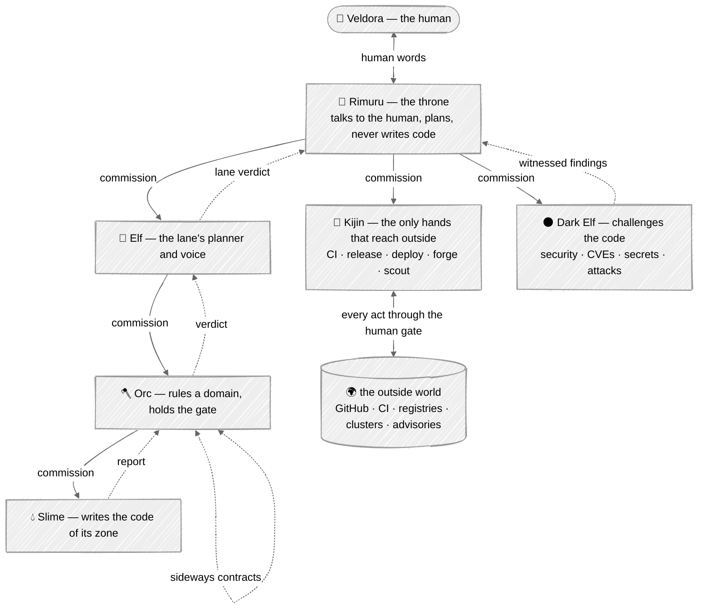
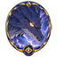
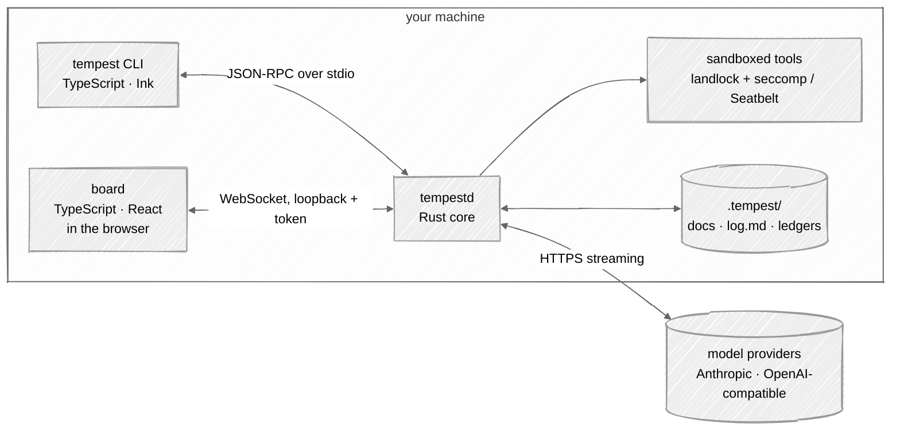

# Overview

## In one picture

|  |  |  |  |  |  |  |
|:---:|:---:|:---:|:---:|:---:|:---:|:---:|
| **Veldora** | **Rimuru** | **Elf** | **Orc** | **Slime** | **Kijin** | **Dark Elf** |

## In plain words

You talk to **Rimuru**. Rimuru never touches the code; it understands what you want, asks you
when something is unclear, and hands the work down.

The work flows down a fixed chain. An **Elf** plans a lane of work and decides which domains are
involved. An **Orc** owns a domain: before any code is written it writes the test that will judge
the code, then orders its **Slimes**. A Slime is the only one allowed to edit the code of its own
small zone, and it must update that zone's document in the same change.

Two races stand beside the chain, both answering to Rimuru:

- **Kijin** are the hands that reach outside: pushing branches, opening pull requests, watching
  CI, publishing releases, deploying. Nobody else can. Every outside act still asks you first,
  unless you have signed a standing permission for it.
- **Dark Elves** are the adversaries. They attack the code that the others wrote: security
  reviews, known vulnerabilities in dependencies, leaked secrets, unsafe patterns. They cannot
  fix anything themselves. A finding only counts if it comes with proof: a failing test or a
  scanner output.

Reports flow back up the same chain, each rank compressing what the rank below said, until
Rimuru answers you in plain language.

Everything that matters is written to the world directory `.tempest/` — creature documents, the
journal `log.md`, the ledgers. Sessions forget; the world remembers.

## Technical detail

### The processes

- **`tempestd`** (Rust) owns everything that must be correct: the loop, the races, the gate, the
  sandbox, the ledgers, the provider clients. It has no UI.
- **`tempest`** (TypeScript, Ink) is the terminal client. It starts `tempestd` as a child process
  and speaks JSON-RPC 2.0 over stdio. It renders; it decides nothing.
- **The board** (TypeScript, React) is the web cockpit, served by `tempestd` on loopback. It
  speaks the same protocol over a WebSocket.
- One protocol, defined once in Rust; the TypeScript types are generated from it. A client can
  never drift from the core.

### What is fixed and what is yours

| Compiled in (code) | Configured (data) |
|---|---|
| the six races and five ascended forms, their tree, shelves, powers | which creatures exist and their territories |
| the gate's checks, the wire envelope | which model rides each race |
| ascension conditions, privileges and falls | budgets: amounts per session, day, month |
| score formulas and meters | provider credentials (by reference, never inline) |
| the nine natures' enforcement points | Minds (skills): know-how a body can load |
| what is `read`, `write`, `outward`, `destructive` | Oni envelopes: standing outward permissions you sign |

Races are behaviour; creatures, Minds and models are data. That is the line isekai blurred with a
configurable rank table, and the line Tempest keeps.

### What stays from isekai

The nine natures, the crest, the wire register, the gate's four checks (Tempest adds two: tests
intact and no seal), territories, Minds,
memory tiers, the value ledger, evolution (split, mutate, rebirth) and ascension. What changes is
where they live: in typed Rust instead of prose plus configuration, with the docs in this book
saying exactly what the code does.
