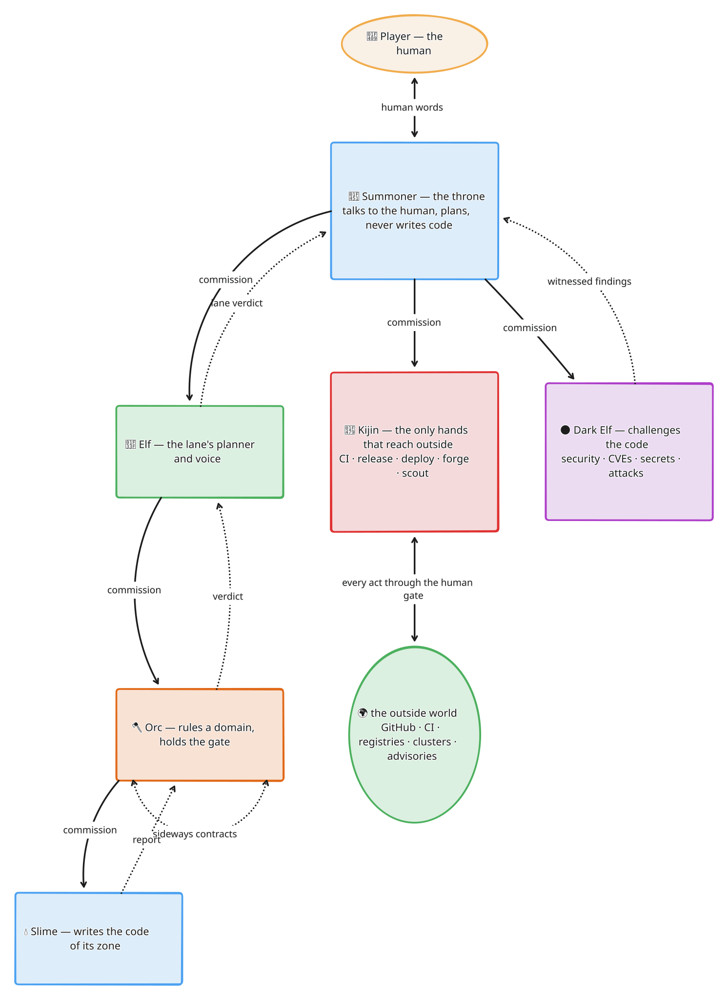
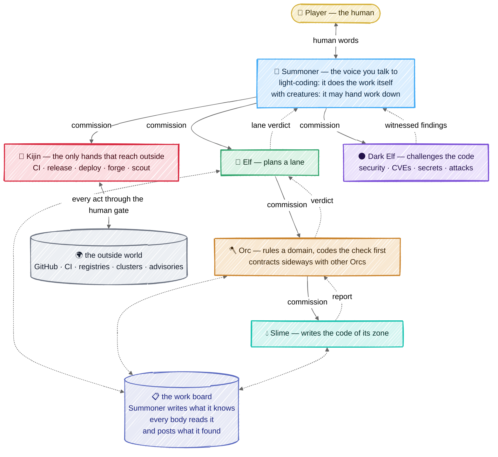
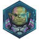
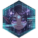
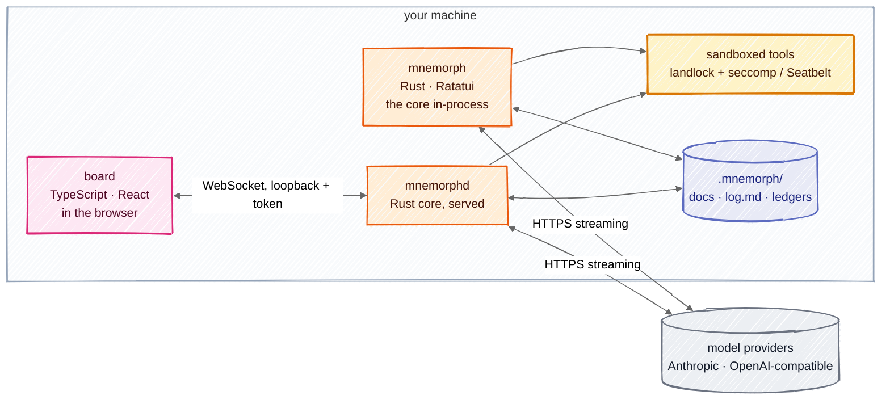

# Overview

## In one picture

<a href="./canvas/overview-light.svg">
<picture>
  <source media="(prefers-color-scheme: dark)" srcset="./canvas/overview-dark.svg">
  
</picture>
</a>

The sketch in Mermaid, the text this canvas is drawn from

|  |  |  |  |  |  |  |
|:---:|:---:|:---:|:---:|:---:|:---:|:---:|
| **Player** | **Summoner** | **Elf** | **Orc** | **Slime** | **Kijin** | **Dark Elf** |

## In plain words

You talk to **Summoner**. What happens next depends on the **mode** the session opened in. There
are three, and `mnemorph status` says which one you are in and why.

- **Light-coding**, the default. Summoner does the work itself: it reads the code, writes down what
  "done" is, plans, changes the files, runs what it wrote down and the tests, and answers. One
  body, one context, its own end gate. It needs nothing set up.
- **Structured-coding**, in a world that has creatures. Summoner may hand the work down a fixed
  chain. An
  **Elf** plans a lane of work and decides which domains are involved. An **Orc** owns a domain:
  before any code is written it codes the check that will judge the code, then orders its
  **Slimes**. A Slime is the only one allowed to edit the code of its own small zone. Summoner
  still does a fix itself when it already knows the files, the lines and the change.
- **Collective-coding**, an experiment. The creatures that report to Summoner are equals. Summoner
  writes the work board, splits the ask by zone and summons the members it needs, which work at
  once; it writes no code itself.

In structured-coding and collective-coding the bodies share **the work board**, one page in the
world
(`.mnemorph/tmp/board.md`): every body's brief carries it, and what each body found is posted back
to it, so a body ordered later builds on what an earlier one read.

Two races stand beside the chain, both answering to Summoner:

- **Kijin** are the hands that reach outside: pushing branches, opening pull requests, watching
  CI, publishing releases, deploying. Nobody else can. Every outside act still asks you first,
  unless you have signed a standing permission for it (honoured from M11).
- **Dark Elves** are the adversaries. They attack the code that the others wrote: security
  reviews, known vulnerabilities in dependencies, leaked secrets, unsafe patterns. They cannot
  fix anything themselves. A finding only counts if it comes with proof: a failing test or a
  scanner output.

Reports flow back up the same chain, each rank compressing what the rank below said, until
Summoner answers you in plain language.

Everything that matters is written to the world directory `.mnemorph/` — creature documents, the
journal `log.md`, the ledgers. Sessions forget; the world remembers.

### Which mode, and how to start it

| Mode | Use it when | Start it | It needs |
|---|---|---|---|
| **light-coding** | almost always: a bug, a feature, a refactor, a question about the code | `mnemorph`, in a world where no Elf reports to Summoner; `mnemorph --mode light-coding` anywhere | nothing |
| **structured-coding** | the work is too large for one context, or must stay inside zones that each have their own check | `mnemorph`, in a world where an Elf reports to Summoner; or `mnemorph --mode structured-coding` | adopted creature cards: an Elf under `summoner`, its Orcs, their Slimes with verify lines |
| **collective-coding** | an ask has separate parts in separate zones, and you want them worked at once | `mnemorph --mode collective-coding`; or `collective.on = true` in your global config | at least one adopted creature that reports to `summoner` |

- **`--mode` goes wherever a session opens:** `mnemorph`, `mnemorph resume <run>`,
  `mnemorph run "<ask>"`, and `mnemorphd` for a program. `auto` is the default:
  collective-coding when `collective.on` is set and Summoner has members, structured-coding when
  an Elf reports to it, else light-coding.
- **`mnemorph status` says the mode and why**, with no key needed:
  `mode     light-coding — no Elf reports to the Summoner in this world`. The app says it on its
  first
  lines, the web board in the session pane, `mnemorph run --json` on its result line, and the
  run's journal on its `law` beat.
- **A mode the world cannot give opens no session.** `mnemorph --mode structured-coding` in a world
  with
  no Elf is refused with what is missing, before any key is asked for; it never falls back to
  another mode in silence.
- **A resumed run's mode is decided again.** `mnemorph resume <run>` with no `--mode` opens in
  the mode the world gives now. When that is not the mode the run stopped in, the first lines say
  so: pass `--mode` to go on in the old one.
- **Creatures are cards you write and adopt.** A card is `.mnemorph/<race>/<name>/README.md`: its
  race, whom it reports to and its ground ([soil](02-races.md#soil--who-may-write-what)). A card
  is a stranger until you adopt it with `mnemorphd roster adopt`; `mnemorphd roster list` shows
  who is here, and this repository's own `.mnemorph/` is a worked example. A card that waits
  gives no mode, and the reason says how many wait:
  `… no Elf reports to the Summoner in this world; 9 cards here are not adopted yet …`.

**Start with light-coding.** It is the mode the measurements favour. On our bench (fixes in a
Python library, one small model, November 2026), each mode against light-coding on the same
multi-part tasks:

| Screen | Light-coding | The other mode |
|---|---|---|
| structured-coding | 3 of 5 passed, $0.63 a run | 1 of 3 passed, $1.92 a run |
| collective-coding | 3 of 8 passed, $0.62 a run | 1 of 4 passed, $2.02 a run |

The bench's own reports name these arms `solo`, `hierarchy` and `collective`, the names the
modes had when they ran.

- **Why they lost:** the chain and the collective's members spent their money on bodies that each
  read the
  same files again, cold.
- **What changed since:** the work board is shared in both, a plan item closes when its work
  lands, an order carries the list of what "done" is, and the chain's gates no longer refuse a
  part for a line that needs another part too.
- **Structured-coding, measured again after those changes** (13 November, one two-part task, one
  run a mode): light-coding passed in 6 minutes for $0.32. Structured-coding ran out of its 45
  minutes at $1.99, with one of the two problems solved. Its bodies now land their parts (8 of
  14 Slime runs, none refused; 1 of 16 before), so the chain works as a mechanism. It is still
  about seven times slower on work that fits one context. Collective-coding has not been
  measured again.
- **Light-coding, meanwhile, improved:** on ten single fixes it passed 5 before, and 8 or 9 once it
  wrote down what "done" is and checked it before answering.

So reach for the other two when a task does not fit one context, and expect to pay for it.

**Say what the result must be.** Light-coding checks its work against what the ask states. On
four tasks, an ask with its examples and their expected output passed 4 times in 4; the same ask
as one paragraph of prose passed 4 times in 8, at the same price. Without examples the body
writes its own checks from its own reading of the ask, and a wrong reading passes them: one task
failed 4 times in 4 on a case the ask said, in words, must stay as it was. One example of what
must change and one of what must not is worth more than a paragraph.

## Technical detail

### The processes

- **The core** (Rust crates) owns everything that must be correct: the loop, the races, the gate,
  the sandbox, the ledgers, the provider clients. It has no UI, and every surface links the same
  crates.
- **`mnemorph`** (Rust, Ratatui) is the command you run. With no subcommand it is the terminal
  app; `mnemorph run "<ask>"` asks once without it, for scripts. It hosts the session in its own
  process — no protocol between the screen and the core — and draws the same events the server
  sends ([the terminal UI](05-architecture.md#the-terminal-ui)). It renders; it decides nothing.
- **`mnemorphd`** (Rust) is the core as a server: JSON-RPC 2.0 over stdio for the TypeScript SDK,
  and the world's admin commands (`mnemorphd runs`, `mnemorphd memory status`, `mnemorphd q list`, …).
- **The board** (TypeScript, React) is the web cockpit, served by `mnemorphd` on loopback. It
  speaks the same protocol over a WebSocket. (The *work board* above is another thing: a page in
  the world that the bodies of a session share.)
- One protocol, defined once in Rust; the TypeScript types are generated from it. A client can
  never drift from the core.

### What is fixed and what is yours

| Compiled in (code) | Configured (data) |
|---|---|
| the six races and five ascended forms, their tree, shelves, powers | which creatures exist and their territories |
| the gate's checks, the wire envelope | which model rides each race |
| ascension conditions, privileges and falls | budgets: amounts per session, day, month |
| score formulas and meters | provider credentials (by reference, never inline) |
| the nine natures' enforcement points | Minds (skills): know-how a body can load |
| what is `read`, `write`, `outward`, `destructive` | Oni envelopes: standing outward permissions you sign |

Races are behaviour; creatures, Minds and models are data. That is the line isekai blurred with a
configurable rank table, and the line Mnemorph keeps.

### What stays from isekai

The nine natures, the crest, the wire register, the gate's four checks (Mnemorph adds two: tests
intact and no seal), territories, Minds,
memory tiers, the value ledger, evolution (split, mutate, rebirth) and ascension. What changes is
where they live: in typed Rust instead of prose plus configuration, with the docs in this book
saying exactly what the code does.
