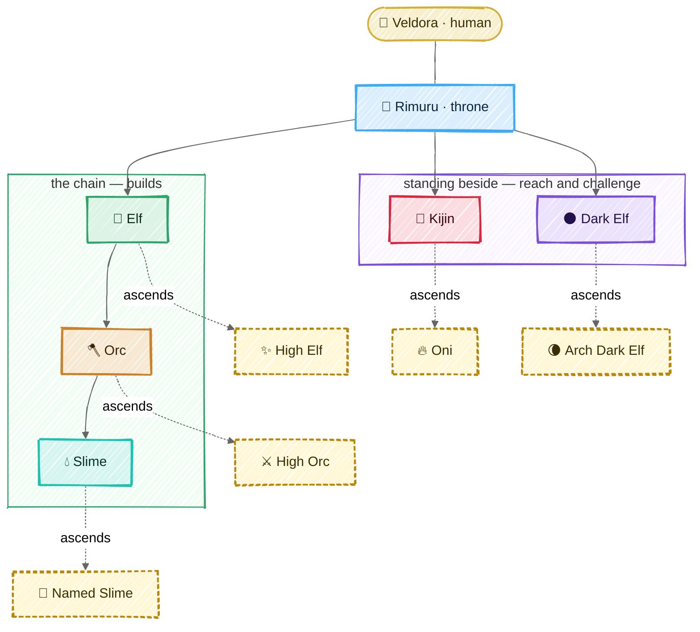
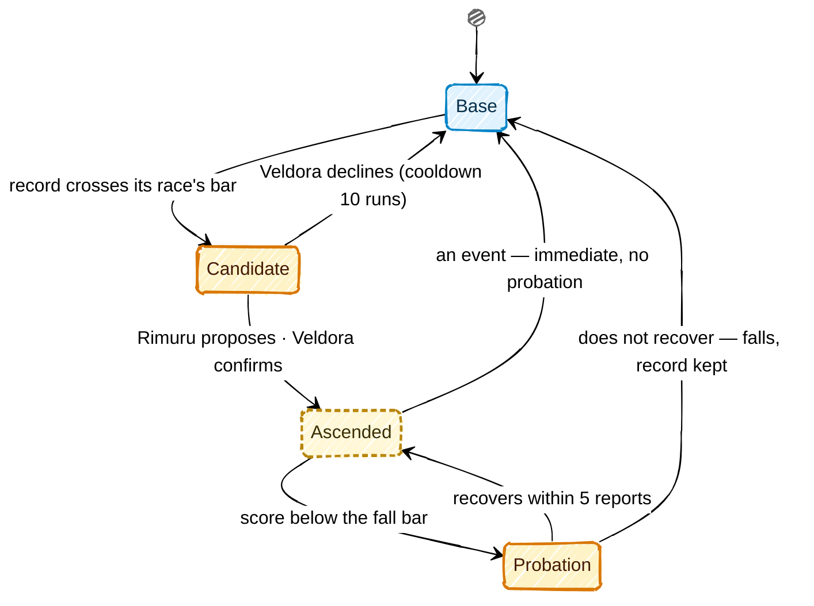

# Races

## In one picture



|  |  |  |  |  |  |
|:---:|:---:|:---:|:---:|:---:|:---:|
| **Rimuru** | **Elf** | **Orc** | **Slime** | **Kijin** | **Dark Elf** |

|  |  |  |  |  |
|:---:|:---:|:---:|:---:|:---:|
| **High Elf** | **High Orc** | **Named Slime** | **Oni** | **Arch Dark Elf** |


## In plain words

There are six races. Each one has **one job**, and the harness makes it impossible to do
anyone else's:

| Race | Its job, in one line | Can write code? | Can reach outside? | Commands |
|---|---|---|---|---|
|  Rimuru | understand the human, plan, answer | no | no | Elves, Kijin, Dark Elves |
|  Elf | plan one lane of work across domains | no | no | its Orcs |
|  Orc | own a domain: write the test first, judge the landing | no (only tests' verify lines on its slimes' docs) | no | its Slimes, other Orcs sideways |
|  Slime | change the code of its one zone, with its doc | **yes, its zone only** | no | nobody |
|  Kijin | everything that leaves the machine: CI, release, deploy, PRs, intel | its post's files only | **yes, through the gate** | nobody |
|  Dark Elf | attack the code; prove every weakness it claims | no (only proofs in its own ground) | no | nobody |

A creature that keeps doing its job well **ascends**: the harness promotes it, with your
confirmation, and the promotion grants a concrete power — usually less friction. A promoted
creature that slips **falls** back. Trust is earned, measured and revocable.

## Technical detail

### The shape of a race in code

Every race is a variant of one Rust enum, `mnemorph_races::Race`, and the law is its methods and
a few functions over it. No configuration can add a race, change a reporting line or widen a shelf.

```rust
pub enum Race { Rimuru, Elf, Orc, Slime, Kijin, DarkElf,
                HighElf, HighOrc, NamedSlime, Oni, ArchDarkElf }

impl Race {
    fn base(self) -> Race;                    // an ascended form's base; a base is its own
    fn ascends_to(self) -> Option<Race>;
    fn reports_to(self) -> Option<Race>;      // by base race; the throne reports to the human
    fn commands(self) -> &'static [Race];     // base races it commissions
    fn sideways(self) -> bool;                // Orc ⇄ Orc
    fn shelf(self) -> &'static [ToolClass];   // read | write | outward | destructive | dispatch | seal
    fn soil(self) -> &'static [Soil];         // OwnDoc | Zone | VerifyBlock | Post | ProvingGround | Throne
    fn gate(self) -> Gate;                    // ByItsOrc | OverItsSlimes | OwnSoil | DocOnly
    fn default_tier(self) -> ModelTier;       // Frontier | Strong | Fast — config maps tiers to models
    fn steps(self) -> u32;                    // per commission, passed down whole
    fn max_share(self) -> u8;                 // percent of what the parent has left, a ceiling
}

fn may_dispatch(from: Race, to: Race, ctx: &DispatchContext) -> Result<Route, Refusal>;
fn check_class(race: Race, class: ToolClass) -> Result<(), ShelfRefusal>;
fn score(race: Race, s: &Signals) -> f64;    // 0..=100
fn meter(race: Race, s: &Signals) -> Meter;
fn rises(risen: Race, window: &Signals) -> bool;
fn falls(risen: Race, recent: &Recent) -> FallReading;   // Holds | Probation | Immediate
fn recovers(risen: Race, since: &Recent) -> bool;
```

An ascended form is its own variant: it takes its base's answers wherever its privileges change
nothing, and every `match` lists it — a `match` that forgets a variant does not compile, so a new
privilege cannot be added halfway. Methods rather than a trait of constants, because the world asks
the law about a race it holds at run time. The crate is covered whole: `just law` fails under
100% region coverage, and its tests drive every operand of every rule both ways.

**The offices.** A commission's `@ASK` selects one of three offices, named for the three Muses of
Helicon, the first Muses in Pausanias (9.29.2), before the nine:

| `@ASK` | Office | Muse of | Does |
|---|---|---|---|
| `findings` | **Mneme** | memory | reads: wide, thin, `file:line` facts |
| `verdict` | **Melete** | practice, care | judges: a verdict with its evidence |
| `draft` | **Aoede** | song | writes: the work, or the world's words |

The `commission` tool carries the office as `office` (`findings`, `verdict` or `draft`); any other
word is refused. Before the court runs, its model is chosen by the rule below — the human's pin
for the creature or for (race, office), else its tier, Metis routing within the office's band
when `decide.route` is on — and the report names the model it rode and why. A model served by
another provider than the session's cannot ride the session's client: the dispatcher's model
rides instead, and the report says so. Metis's decision is priced into the usage ledger and
counted in the commission's spend, so routing is never free of the budget it routes.

The throne has no office. A configuration names an office by its Muse or by what it does
(`melete` or `judge`), and one spelling per office: any other word, or both spellings for one
office, is an error. The key names the race as written, so an ascended form (`high-orc`) is
configured under its own name.

**Which model rides a body.** One rule, in order: a model configured for the exact creature;
else for the pair (race, office) — those two are the human's pins, never routed; else the
race's own model, at its default tier; else the model configured for the race's `DEFAULT_TIER`,
and when the human named one model for everything (`models.default`), every tier their own files
did not set rides it. A race's model and the one model are defaults: Metis may still move a body
off them within its band, and when every tier of a band rides the same model there is nothing to
route and nothing is asked. The
default tiers are compiled: **frontier** for Rimuru, Elf and Dark Elf (the planners and the
adversary think hardest), **strong** for Orc, Slime and Kijin.

**Metis routes within a band** (`decide.route`, off by default). Metis, wise counsel,
is a decision point (`model.route`, [the architecture](05-architecture.md)): before a body runs,
the decider reads the commission and answers how demanding it is (routine, involved, hard) and
whether a mistake would be hard to undo. On a sure answer the body moves within its office's band:

| Office | Floor | Default | Ceiling |
|---|---|---|---|
| Mneme | fast | the race's tier | frontier |
| Melete, Aoede | strong | the race's tier | frontier |
| none | the race's tier | the race's tier | frontier |

Surely hard work, or work surely hard to undo, goes to the ceiling. Work falls to the floor only
when it is surely routine *and* surely not hard to undo: an unresolved risk never lowers a body.
Surely involved work, and anything unsure, stays at the default. The floor is never above the
default; the Dark Elf never goes below its own tier, and the throne is never routed — it does not
choose its own horse. A band with no room asks nothing. An unsure, failed or interrupted decision,
or a tier with no model configured, keeps the default, and a model the human configured for a
creature or an office is never routed.

**Never above the parent.** A commissioned body is never routed above the body that
commissioned it: the whole band — floor, default and ceiling — is held at or under the parent's
tier, the highest tier whose model the parent rides, in every office. A parent riding a model
outside the tier table — one the human pinned — caps nothing: a pin is a choice, not a tier. So a
Slime that Mneme sends to read may ride fast, and never a tier its Orc does not ride. The cap
outranks the Dark Elf's floor: a Dark Elf rides no higher than the throne that sends it. A model
the human pinned for the child stands as pinned.

**Solo mode.** One body runs as Rimuru's voice and a single Slime's hands — Rimuru's prompt, the
Slime's shelf (`read`, `write`; nothing outward) — under the shelves,
the soil, the sandbox and the end gate, with no dispatch. Its zone is the whole repository, or in
a world with creatures the territory the ask touches. It is the default for small asks and for
headless and benchmark runs: a hierarchy pays a prefix and a report on every hop, and a short
task never earns that back. Solo **escalates** into the hierarchy — the throne opens a lane and
hands the work to an Elf with a handoff — on any of three signals, each read by code, never
judged by the model:

- **Stress**: the context's occupancy (the ledger's reading, the status line's number) crosses
  the stress line.
- **A boundary**: a write the soil refuses, because it falls outside solo's zone.
- **An act it does not hold**: an outward act (the Kijin's) or a seal (the Dark Elf's) — the
  shelf refuses it, and the race that holds it takes the act.

Escalation is one-way within a run; the next ask starts solo again.

In a world whose docs have a living throne with Elves reporting to it, Rimuru's session holds the
`commission` tool beside the solo tools, its prompt names each Elf and its lane, and Rimuru may
hand an ask down itself. Two of the signals are read by code at the end of each solo turn. An
outward act the shelf refused (its class kept on the tool's result) goes to the throne's Kijin —
the race that holds it takes the act, the act itself handed down — and solo's own answer stands,
the Kijin's report beside it. A context checkpoint hands the ask to the Elf whose lane the ask
names, or the first, and the turn stays a checkpoint — the session is full and must start fresh —
with that Elf's report as its salvage. An interrupted or failed turn, a signal with no body to
take it (no Kijin for an outward act, no Elf for a full context), or a commission the law refuses
keeps the turn's ending. Escalation needs the throne's commissioner, which a world has once Elves
report to it. The boundary signal waits for solo's zone to narrow to the territory an ask
touches: while solo's zone is the whole repository, no write falls outside it. Seals are the Dark
Elf's, and no tool yet yields one.
A world with no creatures stays pure solo.

Every commissioned body's prompt carries its race card — what its race does, in a sentence: an
Elf plans and routes and an Orc judges and routes, neither writing code, each handing the writing
down with `commission` to the body whose ground holds it; a Slime writes in its territory; a
Kijin does the outward acts of its post; a Dark Elf challenges what landed.

An Orc codes its Slime's verify line — the test before the change, which the dispatch law asks
before it commissions that Slime — with the `verify` tool: one command, one line, no backticks,
at most 300 characters, no control character, on the doc of a living Slime that reports to it.
The harness adds that line after the doc's last field — never in place of a line someone else
set, and once — writing a new file renamed over the doc, never through a link, and journals it;
no body's file tools write a creature's doc, so no body rewrites its own checks. And a check
never writes: the end gate fails a landing whose verify run changed the tree beyond what git
ignores, so no verify line lands work past the gate's judgement.

Six tool classes. The shell classifier yields the first four from any command; `dispatch` and
`seal` are harness tools, never shell commands.

| Class | Meaning | Who holds it |
|---|---|---|
| `read` | look inside the world | everyone |
| `write` | change files inside the world — including deleting or renaming inside the writer's own soil; whatever it takes away is kept in the attic first | every race, inside its own soil only (see below): code is a Slime's alone |
| `outward` | anything that leaves the machine | **Kijin only** |
| `destructive` | irreversible: history rewrites, force pushes, tag pushes, registry publishes, deletes outside the writer's soil or outside the world — and any outward act whose undo the harness cannot derive | Kijin as the hands, **always** behind the human gate, never covered by an envelope |
| `dispatch` | commission another body | Rimuru, Elf, Orc (and High Elf, see Ascension) |
| `seal` | propose freezing landings on a territory | Dark Elf, Arch Dark Elf — a seal always takes the human's confirm |

A tool call whose class is not on the body's shelf is refused **before it runs**, and the
refusal names the race that can do it: `outward: route to kijin-forge`.

### Soil — who may write what

| Soil | Owner | Gate over it |
|---|---|---|
| the creature's **own doc** | every creature but the throne | its gate, or the doc check alone for an Elf |
| a **zone** (directory prefixes) | one Slime | its Orc's verify lines |
| the **verify block** of a Slime's doc | that Slime's Orc — the rest of the doc is the Slime's; the gate diffs by line range | the Orc's own gate |
| the **workspace** — every file at the repository root (manifests, lockfiles, toolchain pins, `justfile`, `README.md`, `LICENSE`, dotfiles) and `tools/`; the root's toolchain directories (`.cargo/`, `.claude/`) are its zone's by its doc | the compiled zone `slime-workspace`, under `orc-workspace` | the full build and test suite |
| a **post** (CI, release, deploy, PR files) | one Kijin | its own gate (self-gated) |
| the **proving ground** `.mnemorph/dark-elf/` | the Dark Elf | its own gate (self-gated) |
| the **plan** and the **dimension manifest** (`.mnemorph/dimension.toml`, the map of neighbouring worlds) | Rimuru | its own gate |

A self-gated race writes its own verify lines; like every changed line, they run from the next
turn, never the turn that wrote them. Every path in the world has exactly one owner: a path no
Slime's zone covers falls to the Orc whose domain covers it, else it is reported as unowned soil and Rimuru must route its birth.
A commissioned body's write outside its soil is refused with what it needs to go on, so no
body re-derives ownership at a boundary: the soil it may write, who owns the path, and the ways
on. A path another Slime keeps — **route**: the body says so in its report, and its parent
commissions that keeper when it is a sibling; otherwise the report goes up until a commander
both answer to routes it. A path no Slime keeps, an Orc's domain alone covering it — **birth**:
Rimuru routes its birth. Either way — **widen**: the body asks for it in its own ground. A seat
or another body's scratch is never routed: a body writes only its own plan and its own scratch.
The human's soil and the harness's are named as theirs, with no way to write them.
The full order, and the findings it raises, are in [the ontology](09-ontology.md#ownership-one-function).

---

### 👑 Rimuru — the throne


*The slime who became a sovereign: one body across every world, the only voice the human hears.*

- **Duty.** Shape the human's ask into a coherent order (and ask back when it is ambiguous —
  never guess downward), plan, dispatch, merge the reports, answer.
- **Reports to** Veldora. **Commands** Elves, Kijin, Dark Elves — never an Orc or a Slime
  directly.
- **Shelf.** `read`, `dispatch`, plus writes to exactly two files: its plan and the dimension
  manifest. Every other write is refused with the first rung to dispatch. The law file — and any
  rule meant to reach other bodies' prompts — changes only as a diff the human applies.
- **Challenge duty.** When a landing's written paths match a risk surface (auth, crypto,
  deserialisation, process execution, path handling, network input, dependency manifests), the
  gate's verdict reads `PASS (challenge pending)` and the harness opens a Dark Elf commission
  itself, from a reserved share of the session envelope. Rimuru cannot skip it.
- **Holds** the session's budget envelope and carves each commission's slice from it.
- **Turn.** Read the ask → if ambiguous, ask the human → plan deck → dispatch (in parallel when
  the lanes' territories are disjoint) → fold reports → answer in full human language.
- **Score** `askDoneRate` — human turns closed as done and not reopened (the same paths
  rewritten) within the next 3 turns. Meter: *Asks done*, ok ≥ 80, warn ≥ 50.
- **Does not ascend.** The throne is already what everything else rises toward.

### 🌿 Elf — the lane's planner and voice


*Long memory, wide sight: it sees across domains and speaks for the lane.*

- **Duty.** Turn one slice of Rimuru's order into a plan across the domains it touches; route
  each item to the Orc that owns it; fold the Orcs' verdicts into one lane verdict.
- **Reports to** Rimuru. **Commands** the Orcs of its own lineage only.
- **Shelf.** `read`, `dispatch`, its own doc. No code.
- **Hard rule.** A dispatch is refused unless the Elf's plan deck holds an open item naming that
  Orc. No plan, no orders.
- **Parallelism.** Two Orcs run at once only if their territories are disjoint — computed, not
  trusted. An Elf runs its Orcs in the foreground; running them in the background needs
  Rimuru's leave, asked once per commission.
- **Score** `0.6·planLandRate − 0.2·reaskRate + 0.2·landRate`. Meter: *Plans landed*, ok ≥ 80.

### 🪓 Orc — the domain and its gate


*Strong, territorial, fair: nothing lands in its domain without its pass.*

- **Duty.** Own a domain. Before a Slime may change anything, the Orc writes the verify line
  that will judge the change (TDD precondition, checked by the harness at dispatch). Judge each
  landing. Negotiate contracts with neighbouring domains sideways.
- **Domain.** Its doc's Domain field names directory prefixes. The domain is what the Orc routes
  and judges: a path inside it that no Slime's zone covers is the Orc's to have a Slime born or
  extended for, and its tests' verify lines are the Orc's to write. It grants no write to the code
  itself ([ownership](09-ontology.md#ownership-one-function)).
- **Reports to** its Elf. **Commands** its own Slimes; reaches other Orcs sideways.
- **Shelf.** `read`, `dispatch`, `write` restricted to the verify block of its Slimes' docs and
  its own doc.
- **The gate.** Six checks, run by the harness at the end of every authoring turn — isekai's four
  (right author, traits hold, duties done, doc truthful) plus tests intact and no seal; see
  [the loop](03-loop.md#the-end-gate). The verdict is appended to `log.md`.
- **Answering a Dark Elf.** A finding on its domain reaches the Orc through Rimuru. The Orc
  either orders the fix, or contests it with `@? contest #<finding-id>: <reason>`, which Rimuru
  puts to the human.
- **Score** `0.5·gateRight + 0.3·slimeHealth + 0.2·landRate`. Meter: *Gate right*, ok ≥ 90.

### 💧 Slime — the ground truth of a zone


*Small, exact, everywhere: it is the only one who touches the code.*

- **Duty.** Make the change in its zone, update its zone's doc in the same change, run its own
  tests, report on the wire.
- **Reports to** its Orc. **Commands** nobody.
- **Shelf.** `read`, `write` inside its zone and its own doc; `bash` sandboxed to the zone with
  no network.
- **Hard rules.** A write outside the zone is refused at the step, naming the owner. Editing or
  deleting a verify line is a hole, never a pass. Deleting or skipping a test fails *tests
  intact*.
- **Score** `0.6·landRate + 0.3·gateRate − 0.1·holeRate`. Meter: *Landed*, ok ≥ 80.

### 👹 Kijin — the hands that reach outside


*Ogres named by the throne, each given a post. Disciplined, loyal, and the only ones who leave
the village.*

The Kijin is the one door between the world and everything beyond it. Nature 7 (Containment)
stops being a checklist item and becomes a type: **only a Kijin's shelf carries `outward`**.

Kijin hold one of five **posts**, also compiled in (`mnemorph_races::Post`):

| Post | Epithet | Owns (territory) | Outward acts |
|---|---|---|---|
| `kijin-ci` | the swordmaster who drills | `.github/workflows/`, CI config | read CI runs and logs, re-run jobs, publish CI as an instrument |
| `kijin-release` | the smith | changelog, versioning, release config, installers | build artifacts; tag pushes and registry publishes (both `destructive`) |
| `kijin-deploy` | the commander | deploy manifests, environments | deploy, verify health, roll back |
| `kijin-forge` | the shrine keeper of records | PR templates, issue templates | push branches, open and update PRs, comment, label, read issues |
| `kijin-scout` | the shadow (and **agent-mcp**: the MCP catalog's curator and conduit — [MCP](07-mcp.md)) | `.mnemorph/intel/` (machine-local, not tracked: the advisory mirror is hundreds of MB) | sync advisory databases (OSV), watch upstream releases and dependency updates |

- **Reports to** Rimuru. **Commands** nobody. **Holds its own gate** over its post.
- **Every outward act** goes through the same pipeline: *plan* (render exactly what would happen:
  command, target, diff) → *gate* (the human says yes, or a signed Oni envelope covers it) →
  *journal intent* → *act* → *journal result*. A run cut between intent and result is never
  replayed; it is gated again. The approval is bound to the plan the human saw — the commit, the
  working tree and the target ([the sandbox](05-architecture.md#sandbox)) — and rechecked
  just before the act: a world that changed meanwhile runs nothing and is asked again.
- **An act is done when its effect is seen, never because its command exited 0.** Its post
  journal row moves `committed` (approved, its target pinned) → `pending observation` (it ran:
  its exit and what it left) → `observed` or `reconcile`. The harness — never the model — then
  runs a read-only probe for the act's kind, a fixed argv whose arguments are the act's own
  checked fields and the target pinned when the act was committed (the push URLs git resolved
  then, the commit HEAD named, the `gh` host), never read again from configuration a body can
  write:

  | Kind | The probe | `observed` when |
  |---|---|---|
  | `PushNewBranch` | `git ls-remote <pinned URL> refs/heads/<name>`, for every push URL | the branch is there at the pushed commit |
  | `AddLabel` | `gh api --method GET repos/<repo>/issues/<pr>/labels` | the pull request carries the label |
  | `Comment` | `gh api --method GET repos/<repo>/issues/comments/<id>` | the comment is on that pull request, its body's SHA-256 the act's |

  Anything else — a different commit, a missing label, an edited comment, a probe that fails,
  times out (30 s) or prints what does not read, an act that left no id — is `reconcile`, never
  `observed`. The probe runs outside every repository with no input, git limited to the `https`,
  `http`, `ssh`, `git` and `file` transports, and inside the kernel guard when one is in force:
  the network open, nothing writable but its own scratch directory. The row keeps the probe,
  its output (1 KiB at most, escaped, credentials in URLs blanked) and when. A `Command` has no
  probe: its receipt is `unobserved`, and says so. A `reconcile` is shown to the human
  (`mnemorph status`) until a later row settles it; it is not a clean outward act, so it is what
  `outwardCleanRate` counts against — and, from M11, what suspends the envelope that covered the
  act and may make an Oni fall.
- **The undo is the harness's, not the plan's** (`mnemorph_config::Act`, classed by `plan`). An
  outward act is typed, and for a small closed set of kinds the harness renders both the command
  and its undo from the act's own fields; the gate runs the stored command exactly:

  | Kind | The act | Its undo |
  |---|---|---|
  | `PushNewBranch { remote, name }` | `git push <remote> HEAD:refs/heads/<name> --force-with-lease=refs/heads/<name>:` — the branch must not exist yet | delete it, leased on the commit the act pushed: `git push <remote> --delete refs/heads/<name> --force-with-lease=refs/heads/<name>:<sha>` |
  | `AddLabel { repo, pr, label }` | `gh pr edit <pr> --repo <repo> --add-label <label>` | the same label removed from the same pull request |
  | `Comment { repo, pr, body }` | `gh pr comment <pr> --repo <repo> --body <body>` | the comment deleted, by the id its URL gave at act time |

  The repository is pinned in the act, never taken from `GH_REPO` or `-R`; a branch is a plain
  ref name (no `:`, `+`, `..`, space or glob, not under `refs/`), a remote a configured name. An
  undo is never a string the model writes, so it is never declared or verified: it is derived, and
  it runs as an act of its own, through the gate. Every other outward act is a `Command`: the
  harness derives no undo for it, so it is **destructive**, and its approval card reads
  `no undo — destructive` before anything else. The classifier still reads every rendered command
  first: a typed act it calls destructive stays so.

  A standing effect (a deploy, a feature flag, a scheduled job) is not a typed kind, so it is
  destructive until an expiry runner can end what it starts (M11). Also M11: resolving a remote's
  URL at act time, so a `pushurl` or `insteadOf` in the repository's config cannot retarget a
  push.
- **A rollback is a lease on what the act left.** `kijin-deploy` rolls back only while the
  version deployed is still the one its act deployed: the post journal's deploy (the
  environment, the version before, ours) against what the target reports now. A later deploy, by
  the human or another run, is kept: the rollback is refused, names the version deployed now,
  and is journaled like any result; where the target can, the rollback is a compare-and-swap on
  the deployed version, not a read then a deploy. There is no override. This is the deploy
  post's work in M9; files already follow the rule in the attic
  ([architecture](05-architecture.md)): an undo writes nothing unless every path is still as
  the act left it.
- **Secrets** never enter the context. The Kijin names a secret (`secret:GH_TOKEN`); the core
  injects it into the sandboxed process environment and redacts it from every output.
- **Standing.** A Kijin has no long-lived context; it stands through its **post journal**
  (`.mnemorph/kijin/<post>/post.jsonl`): the last known state of the outside (last CI run, the
  deployed version per environment, open PRs) and each outward act's receipt. Every new body of that post reads it first.
- **CI is an instrument.** `kijin-ci` writes CI results into the instruments, so every creature
  checks the real CI state instead of trusting a doc (Nature 9).
- **Score** `0.5·outwardCleanRate + 0.3·verifyGreenRate + 0.2·landRate`, where
  `outwardCleanRate` = outward acts that completed without rollback or human correction. Meter:
  *Outward clean*, ok ≥ 90.

### 🌑 Dark Elf — the adversary


*It answers only to the throne, trusts nothing the chain built, and never claims what it cannot
prove.*

The Dark Elf challenges the code itself. It is independent of the chain it attacks: it is never
dispatched by the Orc whose domain it reviews, and its verdicts go to Rimuru.

- **Duty.**
  1. **Diff challenge.** Adversarial review of every landing that touches a risk surface: auth,
     crypto, deserialisation, process execution, path handling, network input, dependencies.
  2. **Dependency and CVE audit.** Against the offline advisory mirror kept fresh by
     `kijin-scout` (`cargo audit`, `osv-scanner`, `npm audit`-equivalent): no network of its own.
  3. **Secret scanning** of the tree and the history.
  4. **Static analysis** with rule packs (semgrep-style) for the languages present.
  5. **Threat model** written at each Orc's birth: the domain's assets, entry points and trust
     boundaries.
  6. **Law audit** — what isekai's Dark Elf did: gate verdicts and `log.md` integrity.
- **Shelf.** `read`, scanners in the sandbox without network, `write` only in its proving ground
  `.mnemorph/dark-elf/` (self-gated), `seal` proposals.
- **The witness rule.** A finding is `@F` only with an id and a **witness**: a proof-of-concept
  test in the proving ground that fails *for the stated reason* (it must exercise the code under
  the cited `file:line`, which the harness checks by coverage), or a scanner output file. Without
  a witness it is `@?` — a suspicion, never a finding. This is what keeps an adversarial model
  from crying wolf.
- **Seal.** A critical or high finding with a witness can propose a seal on its territory.
  1. The proposal is a gated act: Rimuru puts it to the human with the witness, who confirms.
  2. At confirmation the witness is **frozen by content hash**; the Dark Elf can no longer change
     what it is judged by.
  3. While sealed, the gate refuses landings on that territory except the fix.
  4. The fix copies the frozen witness into the owning zone's tests — from then on it is the
     Slime's regression test, and its Orc's verify line runs it. The seal lifts when that test
     passes with the frozen hash intact.
  5. A seal can be contested (`@? contest`, through Rimuru to the human) and expires after
     7 days unless the human renews it.
- **Score** `0.7·upheldRate + 0.3·precision`, where *upheld* = findings, linked by id, that a
  later landing fixed, and *precision* = 1 − dismissed ÷ findings (a dismissal is a contest the
  human upheld). Meter: *Upheld*, ok ≥ 80.

---

### Ascension — earned, granted, revocable



**In plain words.** A creature whose record crosses its race's bar becomes a candidate. Rimuru
proposes the ascension and you confirm it with one keystroke — ascension changes how much
friction a creature meets, so it is yours to grant. An ascended creature that slips enters
probation; if it does not recover, it falls back to its base race. Nothing is erased: the record
and the doc carry over both ways.

**Technical detail.** Bars are evaluated after every report fold over the value ledger's 28-day
window. The two thresholds are apart on purpose (hysteresis), so a creature does not flap.

| Form | From | Rises when | Grants | Falls when |
|---|---|---|---|---|
|  **High Elf** | Elf | reports ≥ 20, planLandRate ≥ 85%, reaskRate ≤ 10% | may order work in **another lane** — sent as `@$ <that lane's elf>: <ask>`, so it travels through the other Elf, never past it, and like any Elf's order it needs a plan item naming its target; runs its Orcs in the background without asking Rimuru; may *propose* rules for every Elf, which reach their prompts only as a diff the human applies | planLandRate < 70% over the last 10 |
|  **High Orc** | Orc | reports ≥ 20, gateRight ≥ 90%, holeRate ≤ 10% | may **amend** (never weaken) its slimes' verify lines mid-turn; fast-path gate on doc-only changes; may adopt a retired neighbour's domain | gateRight < 75% over the last 10, or one overturned pass on a sealed territory |
|  **Named Slime** | Slime | reports ≥ 20, landRate ≥ 90%, gateRate ≥ 90%, holeRate ≤ 5% | may add verify lines to its own doc (they run this turn, not next); +50% step budget; first claim on an adjacent zone left open by relief | landRate < 75% over the last 10, or a *tests intact* failure |
|  **Oni** | Kijin | outward acts ≥ 30, outwardCleanRate ≥ 95%, zero rollbacks in the window | may act under **Oni envelopes**: standing permissions the human signs once (e.g. "push to `feat/*`, re-run CI, comment on PRs") — no prompt inside the envelope | any rollback or human correction of an envelope act — immediate, no probation |
|  **Arch Dark Elf** | Dark Elf | findings ≥ 20, upheldRate ≥ 80%, precision ≥ 85% | its seal proposals go straight to the human, skipping Rimuru's triage; may run background fuzz campaigns with their own budget | precision < 70% over the last 10 findings |

How a fall is read (`mnemorph-races`, `falls`):

- **An event ends the ascension at once**: a High Orc's pass overturned on a sealed territory, a
  Named Slime's *tests intact* failure, an Oni's rolled-back or corrected envelope act.
- **A rate below its fall bar starts probation**, and only on a full recent record — ten reports,
  or ten findings for an Arch Dark Elf. The fall bars sit well under the rise bars, so a body
  that just rose never reads as falling.
- Fewer than five reports: a meter is shown, never ranked.

Rules that hold for every ascension:

- **Never** outward or destructive without a gate: the Oni's envelope *is* a gate, signed in
  advance by the human, scoped, expiring (30 days by default and at most, a limit the human may
  set from 1 to 365 days), capped in uses if the human says so, revocable, and — once the gate honours envelopes (M11) —
  listed in `mnemorph status`, its time and count checked at the moment of use, not only when the
  act was planned. A revoked envelope stays on record ([config](05-architecture.md#configuration)).
- **What an envelope can never cover** (compiled, whatever the envelope says):
  - any `destructive` act — tag pushes, registry publishes, force pushes, history rewrites, and
    every outward act the harness cannot undo: whatever is not a typed kind. The envelope is read
    against the planned act (`Envelope::covers`): its class first, so a destructive act is refused
    before the envelope's time, count or patterns are looked at;
  - an act whose words are not plain: a pattern is read against the act's own words — for a
    branch `git push <remote> <name>`, for the others the rendered words — never the shell's
    reading of a string, and a word holding anything but printable ASCII, or a character that quotes,
    chains, expands, globs or names another ref (`;`, `&`, `|`, `$`, `*`, `~`, `:`, `'`, `"`, …),
    is never matched. A `*` word ending a pattern stands for the rest, a word ending in `*`
    (`feat/*`) for one word. Name the repository in the pattern to pin it:
    `gh pr edit * --repo owner/name --add-label *`;
  - a push whose diff touches CI workflows, deploy or release config, or the workspace manifests
    — a pushed workflow runs with the repository's secrets, so that push is always asked;
  - deploys to any environment marked `protected` (production by default);
  - outbound text (PR bodies, comments) that has not passed the secret-redaction pass, or above
    4 KB.
- **Nothing skips the human** for a seal, a destructive act, or a rule that reaches other
  bodies' prompts.
- An ascended creature keeps every trait, territory, verify line and Mind it held (Nature 5).
- Ascension, probation and fall are each logged in `log.md` with the readings that caused them.
- A creature can be named down by the human at any time (`mnemorph fall <creature>`).

### Evolution — the other way to change

Ascension rewards a creature that works. Evolution heals a creature that does not fit its work
any more. Both stay from isekai, unchanged in spirit:

- **split** — a stressed creature with a large territory and work spread over two parts becomes
  two young of the same race.
- **mutate** — its Thoughts repeat a lesson; the lesson becomes a trait, a verify line or a Mind.
- **rebirth** — its doc describes soil that no longer exists; it is rewritten from the code as it
  is, keeping every distilled lesson.

**When.** A creature evolves when it is stressed — its strain reached the council's line, its last
3 gate verdicts failed, or its last run was a doom checkpoint — *and* its desk (its doc's Thoughts
and those of the Minds it wears) holds more than 7 entries: stress says something is wrong, a full
desk says it has learned enough to change. It is checked after every court and at run start.

**Which arm**, in order: **split** when the zone is large (1500 lines or 24 files) and failures and
Thoughts cluster in two sub-directories — an Orc's Slimes are divided with it; **rebirth** when the
gate failed on the creature's own verify lines or its doc names files that are gone — the value
record restarts; **mutate** otherwise — repeated lessons become traits and verify lines, a
recurring *how* is minted as a skill on trial.

**Proven before swapped.** A plan is staged under `.mnemorph/tmp/evolution/<id>/` and swapped in
only when the new verify lines pass in the sandbox, the ontology over an overlay of the plan shows
no new findings, and every body gets exactly the files the plan meant. Otherwise the old docs stay
and a hole is logged. The old doc rests in the attic.

**Paced.** A creature evolves at most once every 10 runs (replayed from the ledger), one plan runs
at a time, and `evolution.mode = "propose"` queues plans for `mnemorph evolve list | show | apply |
reject` instead — a proposal is refused if the world moved since it was drawn. Each arm writes an
`evolution` (or `rebirth`) row.

### What changed from isekai, and why

| isekai | Mnemorph | Why |
|---|---|---|
| a rank table in config (`ranks.*`) | an enum and its compiled methods | we know what works; a configurable tree produced unknowns and 8k lines of config |
| Kijin = one standing release lane | Kijin = the only outward race, five posts | Containment as a type, not a rule to remember |
| Dark Elf = auditor of `log.md` | Dark Elf = adversary of the code, witness rule, seals | the most valuable review is the hostile one, and it must be provable |
| ascension = a rename | ascension = concrete privileges, human-confirmed, with falls | trust that grants nothing is decoration; trust that cannot be lost is a risk |
| "Keeper" bodies that never existed in code | standing through post journals | say what the code does |
| Slime and Kijin never ascend | Named Slime, Oni | every race can earn less friction |
