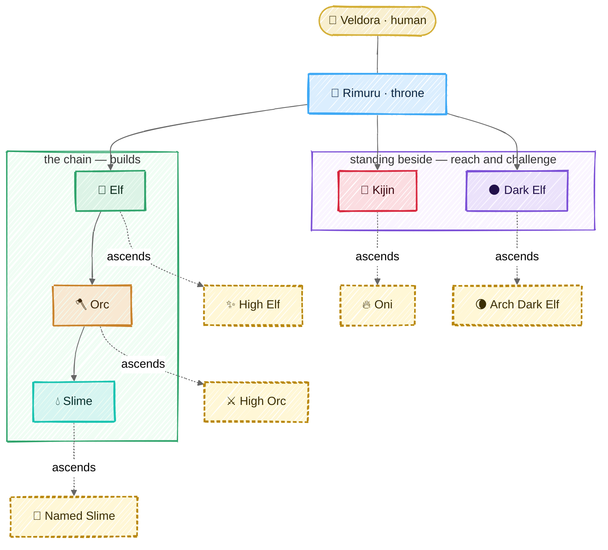
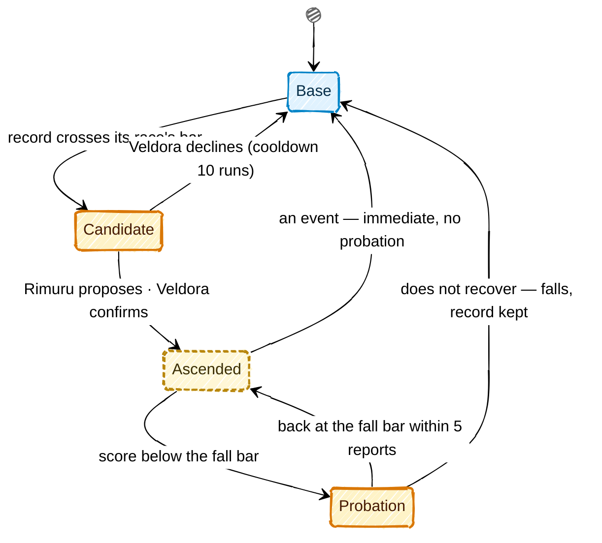

# Races

## In one picture



|  |  |  |  |  |  |
|:---:|:---:|:---:|:---:|:---:|:---:|
| **Rimuru** | **Elf** | **Orc** | **Slime** | **Kijin** | **Dark Elf** |

|  |  |  |  |  |
|:---:|:---:|:---:|:---:|:---:|
| **High Elf** | **High Orc** | **Named Slime** | **Oni** | **Arch Dark Elf** |


## In plain words

There are six races. Each one has **one job**, and the harness makes it impossible to do
anyone else's:

| Race | Its job, in one line | Can write code? | Can reach outside? | Commands |
|---|---|---|---|---|
|  Rimuru | understand the human, plan, answer | no | no | Elves, Kijin, Dark Elves |
|  Elf | plan one lane of work across domains | no | no | its Orcs |
|  Orc | own a domain: write the test first, judge the landing | no (only tests' verify lines on its slimes' docs) | no | its Slimes, other Orcs sideways |
|  Slime | change the code of its one zone, with its doc | **yes, its zone only** | no | nobody |
|  Kijin | everything that leaves the machine: CI, release, deploy, PRs, intel | its post's files only | **yes, through the gate** | nobody |
|  Dark Elf | attack the code; prove every weakness it claims | no (only proofs in its own ground) | no | nobody |

A creature that keeps doing its job well **ascends**: the harness promotes it, with your
confirmation, and the promotion grants a concrete power — usually less friction. A promoted
creature that slips **falls** back. Trust is earned, measured and revocable.

## Technical detail

### The shape of a race in code

Every race is a variant of one Rust enum, `mnemorph_races::Race`, and the law is its methods and
a few functions over it. No configuration can add a race, change a reporting line or widen a shelf.

```rust
pub enum Race { Rimuru, Elf, Orc, Slime, Kijin, DarkElf,
                HighElf, HighOrc, NamedSlime, Oni, ArchDarkElf }

impl Race {
    fn base(self) -> Race;                    // an ascended form's base; a base is its own
    fn ascends_to(self) -> Option<Race>;
    fn reports_to(self) -> Option<Race>;      // by base race; the throne reports to the human
    fn commands(self) -> &'static [Race];     // base races it commissions
    fn sideways(self) -> bool;                // Orc ⇄ Orc
    fn shelf(self) -> &'static [ToolClass];   // read | write | outward | destructive | dispatch | seal
    fn soil(self) -> &'static [Soil];         // OwnDoc | Zone | VerifyBlock | Post | ProvingGround | Throne
    fn gate(self) -> Gate;                    // ByItsOrc | OverItsSlimes | OwnSoil | DocOnly
    fn default_tier(self) -> ModelTier;       // Frontier | Strong | Fast — config maps tiers to models
    fn steps(self) -> u32;                    // per commission, passed down whole
    fn max_share(self) -> u8;                 // percent of what the parent has left, a ceiling
}

fn may_dispatch(from: Race, to: Race, ctx: &DispatchContext) -> Result<Route, Refusal>;
fn check_class(race: Race, class: ToolClass) -> Result<(), ShelfRefusal>;
fn score(race: Race, s: &Signals) -> f64;    // 0..=100
fn meter(race: Race, s: &Signals) -> Meter;  // its value, band and Rate (successes of n)
fn wilson(successes: u32, n: u32, z: f64) -> Option<(f64, f64)>;  // shown, never judged on
fn rises(risen: Race, window: &Signals) -> bool;
fn falls(risen: Race, recent: &Recent) -> FallReading;   // Holds | Probation | Immediate
fn recovers(risen: Race, since: &Recent) -> bool;
```

An ascended form is its own variant: it takes its base's answers wherever its privileges change
nothing, and every `match` lists it — a `match` that forgets a variant does not compile, so a new
privilege cannot be added halfway. Methods rather than a trait of constants, because the world asks
the law about a race it holds at run time. The crate is covered whole: `just law` fails under
100% region coverage, and its tests drive every operand of every rule both ways.

**The offices.** A commission's `@ASK` selects one of three offices, named for the three Muses of
Helicon, the first Muses in Pausanias (9.29.2), before the nine:

| `@ASK` | Office | Muse of | Does |
|---|---|---|---|
| `findings` | **Mneme** | memory | reads: wide, thin, `file:line` facts |
| `verdict` | **Melete** | practice, care | judges: a verdict with its evidence |
| `draft` | **Aoede** | song | writes: the work, or the world's words |

The `commission` tool carries the office as `office` (`findings`, `verdict` or `draft`); any other
word is refused. Before the court runs, its model is chosen by the rule below — the human's pin
for the creature or for (race, office), else its tier, Metis routing within the office's band
when `decide.route` is on — and the report names the model it rode and why. A model served by
another provider than the session's cannot ride the session's client: the dispatcher's model
rides instead, and the report says so. Metis's decision is priced into the usage ledger and
counted in the commission's spend, so routing is never free of the budget it routes.

The throne has no office. A configuration names an office by its Muse or by what it does
(`melete` or `judge`), and one spelling per office: any other word, or both spellings for one
office, is an error. The key names the race as written, so an ascended form (`high-orc`) is
configured under its own name.

**Which model rides a body.** One rule, in order: a model configured for the exact creature;
else for the pair (race, office) — those two are the human's pins, never routed; else the
race's own model, at its default tier; else the model configured for the race's `DEFAULT_TIER`,
and when the human named one model for everything (`models.default`), every tier their own files
did not set rides it. A race's model and the one model are defaults: Metis may still move a body
off them within its band, and when every tier of a band rides the same model there is nothing to
route and nothing is asked. The
default tiers are compiled: **frontier** for Rimuru, Elf and Dark Elf (the planners and the
adversary think hardest), **strong** for Orc, Slime and Kijin.

**Metis routes within a band** (`decide.route`, off by default). Metis, wise counsel,
is a decision point (`model.route`, [the architecture](05-architecture.md)): before a body runs,
the decider reads the commission and answers how demanding it is (routine, involved, hard) and
whether a mistake would be hard to undo. On a sure answer the body moves within its office's band:

| Office | Floor | Default | Ceiling |
|---|---|---|---|
| Mneme | fast | the race's tier | frontier |
| Melete, Aoede | strong | the race's tier | frontier |
| none | the race's tier | the race's tier | frontier |

Surely hard work, or work surely hard to undo, goes to the ceiling. Work falls to the floor only
when it is surely routine *and* surely not hard to undo: an unresolved risk never lowers a body.
Surely involved work, and anything unsure, stays at the default. The floor is never above the
default; the Dark Elf never goes below its own tier, and the throne is never routed — it does not
choose its own horse. A band with no room asks nothing. An unsure, failed or interrupted decision,
or a tier with no model configured, keeps the default, and a model the human configured for a
creature or an office is never routed.

**Never above the parent.** A commissioned body is never routed above the body that
commissioned it: the whole band — floor, default and ceiling — is held at or under the parent's
tier, the highest tier whose model the parent rides, in every office. A parent riding a model
outside the tier table — one the human pinned — caps nothing: a pin is a choice, not a tier. So a
Slime that Mneme sends to read may ride fast, and never a tier its Orc does not ride. The cap
outranks the Dark Elf's floor: a Dark Elf rides no higher than the throne that sends it. A model
the human pinned for the child stands as pinned.

**Solo mode.** One body runs as Rimuru's voice and a single Slime's hands — Rimuru's prompt, the
Slime's shelf (`read`, `write`; nothing outward) — under the shelves,
the soil, the sandbox and the end gate, with no dispatch. Its zone is the whole repository, or in
a world with creatures the territory the ask touches. It is the default for small asks and for
headless and benchmark runs: a hierarchy pays a prefix and a report on every hop, and a short
task never earns that back. Solo **escalates** into the hierarchy — the throne opens a lane and
hands the work to an Elf with a handoff — on any of three signals, each read by code, never
judged by the model:

- **Stress**: the context's occupancy (the ledger's reading, the status line's number) crosses
  the stress line.
- **A boundary**: a write the soil refuses, because it falls outside solo's zone.
- **An act it does not hold**: an outward act (the Kijin's) or a seal (the Dark Elf's) — the
  shelf refuses it, and the race that holds it takes the act.

Escalation is one-way within a run; the next ask starts solo again.

In a world whose docs have a living throne with Elves reporting to it, Rimuru's session holds the
`commission` tool beside the solo tools, its prompt names each Elf and its lane, and Rimuru may
hand an ask down itself. Two of the signals are read by code at the end of each solo turn. An
outward act the shelf refused (its class kept on the tool's result) goes to the throne's Kijin —
the race that holds it takes the act, the act itself handed down — and solo's own answer stands,
the Kijin's report beside it. A context checkpoint hands the ask to the Elf whose lane the ask
names, or the first, and the turn stays a checkpoint — the session is full and must start fresh —
with that Elf's report as its salvage. An interrupted or failed turn, a signal with no body to
take it (no Kijin for an outward act, no Elf for a full context), or a commission the law refuses
keeps the turn's ending. Escalation needs the throne's commissioner, which a world has once Elves
report to it. The boundary signal waits for solo's zone to narrow to the territory an ask
touches: while solo's zone is the whole repository, no write falls outside it. Seals are the Dark
Elf's, and no tool yet yields one.
A world with no creatures stays pure solo.

Every commissioned body's prompt carries its race card — what its race does, in a sentence: an
Elf plans and routes and an Orc judges and routes, neither writing code, each handing the writing
down with `commission` to the body whose ground holds it; a Slime writes in its territory; a
Kijin does the outward acts of its post; a Dark Elf challenges what landed.

An Orc codes its Slime's verify line — the test before the change, which the dispatch law asks
before it commissions that Slime — with the `verify` tool: one command, one line, no backticks,
at most 300 characters, no control character, on the doc of a living Slime that reports to it.
The harness adds that line after the doc's last field — never in place of a line someone else
set, and once — writing a new file renamed over the doc, never through a link, and journals it;
no body's file tools write a creature's doc, so no body rewrites its own checks. And a check
never writes: the end gate fails a landing whose verify run changed the tree beyond what git
ignores, so no verify line lands work past the gate's judgement.

Six tool classes. The shell classifier yields the first four from any command; `dispatch` and
`seal` are harness tools, never shell commands.

| Class | Meaning | Who holds it |
|---|---|---|
| `read` | look inside the world | everyone |
| `write` | change files inside the world — including deleting or renaming inside the writer's own soil; whatever it takes away is kept in the attic first | every race, inside its own soil only (see below): code is a Slime's alone |
| `outward` | anything that leaves the machine | **Kijin only** |
| `destructive` | irreversible: history rewrites, force pushes, tag pushes, registry publishes, deletes outside the writer's soil or outside the world — and any outward act whose undo the harness cannot derive | Kijin as the hands, **always** behind the human gate, never covered by an envelope |
| `dispatch` | commission another body | Rimuru, Elf, Orc, and their ascended forms (High Elf, High Orc; see Ascension) |
| `seal` | propose freezing landings on a territory | Dark Elf, Arch Dark Elf — a seal always takes the human's confirm |

A tool call whose class is not on the body's shelf is refused **before it runs**, and the
refusal names the race that can do it: `outward: route to kijin-forge`.

### Soil — who may write what

| Soil | Owner | Gate over it |
|---|---|---|
| the creature's **own doc** | every creature but the throne | its gate, or the doc check alone for an Elf |
| a **zone** (directory prefixes) | one Slime | its Orc's verify lines |
| the **verify block** of a Slime's doc | that Slime's Orc — the rest of the doc is the Slime's; the gate diffs by line range | the Orc's own gate |
| the **workspace** — every file at the repository root (manifests, lockfiles, toolchain pins, `justfile`, `README.md`, `LICENSE`, dotfiles) and `tools/`; the root's toolchain directories (`.cargo/`, `.claude/`) are its zone's by its doc | the compiled zone `slime-workspace`, under `orc-workspace` | the full build and test suite |
| a **post** (CI, release, deploy, PR files) | one Kijin | its own gate (self-gated) |
| the **proving ground** `.mnemorph/dark-elf/` | the Dark Elf | its own gate (self-gated) |
| the **plan** and the **dimension manifest** (`.mnemorph/dimension.toml`, the map of neighbouring worlds) | Rimuru | its own gate |

A self-gated race writes its own verify lines; like every changed line, they run from the next
turn, never the turn that wrote them. Every path in the world has exactly one owner: a path no
Slime's zone covers falls to the Orc whose domain covers it, else it is reported as unowned soil and Rimuru must route its birth.
A commissioned body's write outside its soil is refused with what it needs to go on, so no
body re-derives ownership at a boundary: the soil it may write, who owns the path, and the ways
on. A path another Slime keeps — **route**: the body says so in its report, and its parent
commissions that keeper when it is a sibling; otherwise the report goes up until a commander
both answer to routes it. A path no Slime keeps, an Orc's domain alone covering it — **birth**:
Rimuru routes its birth. Either way — **widen**: the body asks for it in its own ground. A seat
or another body's scratch is never routed: a body writes only its own plan and its own scratch.
The human's soil and the harness's are named as theirs, with no way to write them.
The full order, and the findings it raises, are in [the ontology](09-ontology.md#ownership-one-function).

---

### 👑 Rimuru — the throne


*The slime who became a sovereign: one body across every world, the only voice the human hears.*

- **Duty.** Shape the human's ask into a coherent order (and ask back when it is ambiguous —
  never guess downward), plan, dispatch, merge the reports, answer.
- **Reports to** Veldora. **Commands** Elves, Kijin, Dark Elves — never an Orc or a Slime
  directly.
- **Shelf.** `read`, `dispatch`, plus writes to exactly two files: its plan and the dimension
  manifest. Every other write is refused with the first rung to dispatch. The law file — and any
  rule meant to reach other bodies' prompts — changes only as a diff the human applies.
- **Challenge duty.** When a landing's written paths match a risk surface (auth, crypto,
  deserialisation, process execution, path handling, network input, dependency manifests), the
  gate's verdict reads `PASS (challenge pending)` and the harness opens the challenge itself,
  from a reserved share of the session envelope: one commission for each Dark Elf speciality
  whose surfaces the written paths touch, and the generalist when they touch two or more or its
  declared ones — only those ([routing](#-dark-elf--the-adversary)).
  Rimuru cannot skip it, nor choose who answers.
- **Holds** the session's budget envelope and carves each commission's slice from it.
- **Turn.** Read the ask → if ambiguous, ask the human → plan deck → dispatch (in parallel when
  the lanes' territories are disjoint) → fold reports → answer in full human language.
- **Score** `askDoneRate` — human turns closed as done and not reopened (the same paths
  rewritten) within the next 3 turns. Meter: *Asks done*, ok ≥ 80, warn ≥ 50.
- **Does not ascend.** The throne is already what everything else rises toward.

### 🌿 Elf — the lane's planner and voice


*Long memory, wide sight: it sees across domains and speaks for the lane.*

- **Duty.** Turn one slice of Rimuru's order into a plan across the domains it touches; route
  each item to the Orc that owns it; fold the Orcs' verdicts into one lane verdict.
- **Reports to** Rimuru. **Commands** the Orcs of its own lineage only.
- **Shelf.** `read`, `dispatch`, its own doc. No code.
- **Hard rule.** A dispatch is refused unless the Elf's plan deck holds an open item naming that
  Orc. No plan, no orders.
- **Parallelism.** Two Orcs run at once only if their territories are disjoint — computed, not
  trusted. An Elf runs its Orcs in the foreground; running them in the background needs
  Rimuru's leave, asked once per commission.
- **Score** `0.6·planLandRate − 0.2·reaskRate + 0.2·landRate`. Meter: *Plans landed*, ok ≥ 80,
  warn ≥ 50.

### 🪓 Orc — the domain and its gate


*Strong, territorial, fair: nothing lands in its domain without its pass.*

- **Duty.** Own a domain. Before a Slime may change anything, the Orc writes the verify line
  that will judge the change (TDD precondition, checked by the harness at dispatch). Judge each
  landing. Negotiate contracts with neighbouring domains sideways.
- **Domain.** Its doc's Domain field names directory prefixes. The domain is what the Orc routes
  and judges: a path inside it that no Slime's zone covers is the Orc's to have a Slime born or
  extended for, and its tests' verify lines are the Orc's to write. It grants no write to the code
  itself ([ownership](09-ontology.md#ownership-one-function)).
- **Reports to** its Elf. **Commands** its own Slimes; reaches other Orcs sideways.
- **Shelf.** `read`, `dispatch`, `write` restricted to the verify block of its Slimes' docs and
  its own doc.
- **The gate.** Six checks, run by the harness at the end of every authoring turn — isekai's four
  (right author, traits hold, duties done, doc truthful) plus tests intact and no seal; see
  [the loop](03-loop.md#the-end-gate). The verdict is appended to `log.md`.
- **Answering a Dark Elf.** A finding on its domain reaches the Orc through Rimuru. The Orc
  either orders the fix, or contests it with `@? contest #<finding-id>: <reason>`, which Rimuru
  puts to the human.
- **Score** `0.5·gateRight + 0.3·slimeHealth + 0.2·landRate`. Meter: *Gate right*, ok ≥ 90, warn ≥ 70.

### 💧 Slime — the ground truth of a zone


*Small, exact, everywhere: it is the only one who touches the code.*

- **Duty.** Make the change in its zone, update its zone's doc in the same change, run its own
  tests, report on the wire.
- **Reports to** its Orc. **Commands** nobody.
- **Shelf.** `read`, `write` inside its zone and its own doc; `bash` sandboxed to the zone with
  no network.
- **Hard rules.** A write outside the zone is refused at the step, naming the owner. Editing or
  deleting a verify line is a hole, never a pass. Deleting or skipping a test fails *tests
  intact*.
- **Score** `0.6·landRate + 0.3·gateRate − 0.1·holeRate`. Meter: *Landed*, ok ≥ 80, warn ≥ 50.

### 👹 Kijin — the hands that reach outside


*Ogres named by the throne, each given a post. Disciplined, loyal, and the only ones who leave
the village.*

The Kijin is the one door between the world and everything beyond it. Nature 7 (Containment)
stops being a checklist item and becomes a type: **only a Kijin's shelf carries `outward`**.

Kijin hold one of five **posts**, named by the creature (`kijin-ci`, …). A post's **outward
acts are compiled in** (`mnemorph_races::Post::acts`); its **territory is doc-declared** — the
Kijin doc's `Post` field, world by world. The shell classifier reads every outward command as
one or more act kinds (`mnemorph_races::OutwardKind`), and a Kijin's command whose kinds are not
all its post's is refused before the gate is asked, naming the post, the act and the post that
holds it. A Kijin whose name is no post does no outward act; the roster refuses a `kijin-` name
on another race, and a Kijin doc whose heading is not `kijin-` and its directory. Solo's
escalation hands a refused act to the one Kijin whose post holds it; an act several posts hold,
or none, stays with the human.

| Post | Epithet | Owns (territory, doc-declared) | Outward acts (compiled) |
|---|---|---|---|
| `kijin-ci` | the swordmaster who drills | `.github/workflows/`, CI config | `fetch` (CI runs and logs), `rerun-ci` |
| `kijin-release` | the smith | changelog, versioning, release config, installers | `fetch`, `push-tag`, `publish` (registries, images, GitHub releases) — both `destructive` |
| `kijin-deploy` | the commander | deploy manifests, environments | `fetch` (health checks), `deploy`, `rollback`, `write-outside` |
| `kijin-forge` | the shrine keeper of records | PR templates, issue templates | `fetch` (issues, PRs), `push-branch`, `pull-request`, `comment`, `label` — typed through `outward`: a new branch, a pull request opened (alone, or with the push of its head under one approval), a label, a comment |
| `kijin-scout` | the shadow (and **agent-mcp**: the MCP catalog's curator and conduit — [MCP](07-mcp.md)) | `.mnemorph/intel/` (machine-local, not tracked: the advisory mirror is hundreds of MB) | `fetch` only (advisory databases such as OSV, upstream releases): no outward write |

The kinds, as the classifier reads them. A kind is read only from what the command's own words
say: a git global option (`-c`, `--config-env`, `-C` outside the world, `--git-dir`), a word
known only at run time, or anything earlier in the command line that changes what later commands
run with — a variable assigned or exported (`GIT_SSH_COMMAND=…`, `env GH_CONFIG_DIR=…`), git's
config or a remote written, a function defined, a script sourced, a `cd` — makes every outward
act after it `other`.

| Kind | Read from |
|---|---|
| `fetch` | `curl`, `wget`, `aria2c`, `httpie` with only allowlisted options (a GET, nothing sent, no hook, no config file), their output paths (`-o`, `-O`, `-P`, `-d`) judged as writes — outside the world, `other`; `git fetch`/`clone`/`pull`/`ls-remote` with allowlisted options and plain remotes (no `--upload-pack`, no `ext::` or `fd::`); `gh` reads (`view`, `list`, `status`, `checks`, a plain `gh api` GET); `kubectl get` (never a secret: that is refused), `helm status`; DNS lookups |
| `push-branch` | `git push <remote> refs/heads/<name>`, or `HEAD:refs/heads/<name>`, or `<name>:refs/heads/<name>`: one branch named in full, to a configured remote's name — a URL in its place, a short name (`v1.0` may be a tag), no refspec, `--follow-tags` or two refspecs are `other`. Before the human is asked, the remote's push URL is resolved from the repository's own configuration and shown on the card; a remote with a `pushurl`, a `pushInsteadOf` or more than one push URL is `other` |
| `pull-request` | `gh pr create`, `edit`, `ready`, `close`, `reopen` |
| `comment` | `gh pr comment`, `gh issue comment` |
| `label` | label flags on `gh pr`/`gh issue edit`, `gh label` |
| `rerun-ci` | `gh run rerun` |
| `push-tag` | `git push <remote> refs/tags/<name>` or `tag <name>`: one tag (`--tags` is `other`) |
| `publish` | `cargo`/`npm`/`pip` publishes, `twine`, `docker push`, `helm push`, `gh release` writes |
| `deploy` | `kubectl apply`/`set`/`scale`/`delete`/…, `helm install`/`upgrade`/`uninstall` |
| `rollback` | `kubectl rollout undo`, `helm rollback` |
| `write-outside` | a write or delete under a deploy root (`Context::with_deploy_roots`) outside the world; a dotfile of the home (`~/.gitconfig`, `~/.config/git`, `~/.bashrc`), any other outside path and a path known only at run time are `other` |
| `install` | package installs and removals (`cargo install`, `npm install`, `apt`, `brew`, `go get`) — no post |
| `other` | everything else outward: a forced, deleting or ambiguous push, `git submodule`, `gh pr merge`, `gh workflow run`, a `gh api` write, `ssh`, a socket, `sudo`, a `curl` that sends — no post |

- **Reports to** Rimuru. **Commands** nobody. **Holds its own gate** over its post.
- **Every outward act** goes through the same pipeline: *plan* (render exactly what would happen:
  command, target, diff) → *gate* (the human says yes, or a signed Oni envelope covers it) →
  *journal intent* → *act* → *journal result*. The approval is bound to the plan the human saw —
  the commit, the working tree and the target ([the sandbox](05-architecture.md#sandbox)) — and
  rechecked just before the act: a world that changed meanwhile runs nothing and is asked again.
- **The act runner** (`mnemorph_config::Runner`) is the one path a typed act takes. A Kijin asks
  for one through its `outward` tool, with a typed act — `{kind: "push-new-branch", remote,
  name}`, `{kind: "open-pull-request", repo, base, head, title, body}` (with `remote`, the head
  pushed first under the same approval, below), `{kind: "add-label", repo, pr, label}` or
  `{kind: "comment", repo, pr, body}`, and an optional `key` (a comment may also name `tells`,
  below) — or `{kind: "undo", receipt}` — never a command string; an untyped outward command
  still goes through `bash`, where it is a destructive `Command` (`gh pr create` too). The steps
  run in this order, and none can be skipped:

  | # | Step | What stops the act |
  |---|---|---|
  | 1 | the post check (`Planned::check_post`) | a kind the post does not hold: refused before anything is read or asked |
  | 2 | the plan's fingerprint | a world that cannot be read |
  | 3 | the pin: the push URLs and HEAD's commit, or the `gh` host; the request's key looked up; what the act would make must not exist yet — for a pull request, its base and head branches read on the forge (`gh api …/git/ref/heads/<branch>`) and the pull requests open from head into base | a key given to another request; an earlier act of the same request in `reconcile`; an open incident on the same target; the branch or label already there; a pull request already open from the head into the base (`already open: #N`), a base or head that is not a branch, a head this post pushed that has moved since |
  | 4 | the gate: **always the human** — Oni envelopes are not honoured before M11, and the card says so | a denial |
  | 5 | the fingerprint, rechecked just before the spawn | a world that moved: nothing is journaled, and the gate is asked again (three times at most) |
  | 6 | `commit`: the intent journaled under the request's key | a row that cannot be written: nothing runs |
  | 7 | the rendered command, in the sandbox, as `bash` runs an approved command | — |
  | 8 | `ran`: its exit and what it left | — |
  | 9 | `observe`, with the read-only probe | — |
  | 10 | the receipt, returned to the Kijin | — |

  Acts of one post run one at a time — a lock beside the post's witness is held from the first
  step to the receipt, and a second act asked for meanwhile is refused at once (`an act of the
  post is in flight`), never left waiting on the first one's human — and each is observed before
  the next is gated, so no probe reads a later act's effect as an earlier one's.
- **A cut act is probed, never replayed.** An act cut between its intent and its result (a crash,
  a kill, a run resumed with `mnemorph resume`) stays `committed` or `pending observation`. Before
  its post's next act is gated, the runner probes each such act at the target it pinned and
  classifies it: **landed** → `observed`, and the human is not asked again for it; **absent** —
  nothing of it is outside → `absent`, and the same request is gated again as a new act;
  **unknown** — the probe failed, or saw the branch at another commit, the label's page too full
  to read, two comments with its body → `reconcile`, shown to the human. A cut comment, which may
  have left no id, is found among the pull request's comments since it was committed: by its
  body's SHA-256, written by the login `gh` acts as (`gh api user`), and by its id once known —
  someone else's identical comment is never taken for it. A cut pull request is found as strictly
  as `observe` finds it: the one open from its head into its base, by that login, with its title
  and its description's SHA-256 (and its number, once known); someone else's, or one edited since,
  is `reconcile`.
- **A request has a key.** Its key is the hash of its kind, its pinned target and its body (for a
  branch, the commit pushed; for a label, the label) — or, when the Kijin names the request
  (`key`), of its kind, pinned target and that name. The same key with the same request returns
  the stored receipt without acting or asking — once a probe sees its effect still there; an
  effect gone since (the human deleted the branch) moves the act to `reconcile`; the same key with a different request is a
  conflict, refused before the gate. Keys, with each act's typed request and whole pin, are kept
  beside the witness (`<post>.intents.jsonl`), outside the world: a body can neither forge nor
  read one.
- **An act is done when its effect is seen, never because its command exited 0.** Its post
  journal row moves `committed` (approved, its target pinned) → `pending observation` (it ran:
  its exit and what it left) → `observed` or `reconcile`. The harness — never the model — then
  runs a read-only probe for the act's kind, a fixed argv whose arguments are the act's own
  checked fields and the target pinned when the act was committed (the push URLs git resolved
  then, the commit HEAD named, the `gh` host), never read again from configuration a body can
  write:

  | Kind | The probe | `observed` when |
  |---|---|---|
  | `PushNewBranch` | `git ls-remote <pinned URL> refs/heads/<name>`, for every push URL | the branch is there at the pushed commit |
  | `AddLabel` | `gh api --method GET repos/<repo>/issues/<pr>/labels` | the pull request carries the label |
  | `Comment` | `gh api --method GET repos/<repo>/issues/comments/<id>` | the comment is on that pull request, its body's SHA-256 the act's |
  | `OpenPullRequest` | `gh api --method GET user`, then `gh api --method GET repos/<repo>/pulls?head=<owner>:<head>&base=<base>&state=open` | exactly one is open from the head (in `<repo>`) into the base, by the login `gh` acts as, with the act's title and its description's SHA-256 — and the number `gh pr create` printed, when it printed one; that number is recorded for the undo |

  What the act would make, already there when it is pinned — the branch on any push URL, the
  label on the pull request — refuses the act: the command would exit 0 doing nothing, the probe
  would see someone else's branch or label, and the undo would remove it. An act that exits other
  than 0 goes straight to `reconcile` with nothing recorded, so it is neither probed nor undone
  without the human. Anything else — a different commit, a missing label, an edited comment, a
  probe that fails, times out (30 s) or prints what does not read, an act that left no id — is
  `reconcile`, never `observed`. A comment's id is read from its URL on the pinned host, so an
  Enterprise server's comments are recorded and probed there. `gh` reads its login from `gh auth`:
  the environment's `GH_TOKEN` is a secret, removed before any command or probe, so a machine
  that has only the token gets `reconcile` until `gh auth login` is done. The probe runs outside every repository with no input, git limited to the `https`,
  `http`, `ssh`, `git` and `file` transports, and inside the kernel guard when one is in force:
  the network open, nothing writable but its own scratch directory. The row keeps the probe,
  its output (1 KiB at most, escaped, credentials in URLs blanked) and when. A `Command` has no
  probe: its receipt is `unobserved`, and says so; a cut act found never landed is `absent`. Every
  row is written first to a witness under the human's state directory
  (`$XDG_STATE_HOME/mnemorph/kijin/<world>-<fnv64a>/<post>.jsonl`, found again by the world's
  path; the folder `0700`, its files `0600`); after each command the tripwire rebuilds the journal from what it held and what the
  witness gained, and the count M11 reads comes from the witness alone, so a row a body forges
  never counts. A `reconcile` waits for the human
  (`mnemorphd incident open` or `settle`) until a later row settles it; it is not a clean outward act, so it is what
  `outwardCleanRate` counts against — and what the human may mark an incident, which suspends the
  envelope that covered the act and, from M11, may make an Oni fall.
- **The undo is the harness's, not the plan's** (`mnemorph_config::Act`, classed by `plan`). An
  outward act is typed, and for a small closed set of kinds the harness renders both the command
  and its undo from the act's own fields; the gate runs the stored command exactly:

  | Kind | The act | Its undo |
  |---|---|---|
  | `PushNewBranch { remote, name }` | `git push <remote> HEAD:refs/heads/<name> --force-with-lease=refs/heads/<name>:` — the branch must not exist yet | delete it, leased on the commit the act pushed: `git push <remote> --delete refs/heads/<name> --force-with-lease=refs/heads/<name>:<sha>` |
  | `AddLabel { repo, pr, label }` | `gh pr edit <pr> --repo <repo> --add-label <label>` | the same label removed from the same pull request |
  | `Comment { repo, pr, body }` | `gh pr comment <pr> --repo <repo> --body <body>` | the comment deleted, by the id its URL gave at act time |
  | `OpenPullRequest { repo, base, head, title, body }` | `gh pr create --repo <repo> --base <base> --head <head> --title <title> --body-file -`, the description on its standard input | closed, never deleted — `gh pr close <n> --repo <repo>` — only while it is still open, unmerged and its own: by `gh`'s login, from its head into its base, with its title and description |

  A label holds no `,` or `"` (`gh pr edit --add-label` splits on commas: one approved label adds
  one); a comment or a pull request's description is at most 64 KiB and holds no control
  character but line breaks and tabs, and no bidirectional, zero-width or Unicode line separator
  character; a title is one such line of at most 256 characters; and the approval card indents
  and marks each continuation line of an act, so a body's lines never pass for the card's. A
  pull request's description reaches `gh` on its standard input, written by the harness from the
  approved bytes it holds (`Planned::stdin`): no file in the world, where another command could
  swap it between the approval and the read. The card shows the title and the description, on
  lines of their own, with the description's size and SHA-256. An envelope reads the description
  in the `-`'s place, bounded and screened like a comment's. The head and base are plain branch names of the act's repository, never the same.
  The repository is pinned in the act, never taken from `GH_REPO` or `-R`; a branch is a plain
  ref name (no `:`, `+`, `..`, space or glob, not under `refs/`), a remote a configured name. An
  undo is never a string the model writes, so it is never declared or verified: it is derived, and
  it runs as an act of its own, through the gate. An undo is rendered only for an `observed`
  act, and only while what it left is still its own (`Runner::undo_command`): a label is removed only when
  the one label event since the act was pinned is its add, by the login `gh` acts as, and the
  pull request still carries it — a label someone added between the pin and the act, whose add
  then did nothing, is never removed. Anything uncertain moves the act to `reconcile` instead.
  Every other outward act is a `Command`: the
  harness derives no undo for it, so it is **destructive**, and its approval card reads
  `no undo — destructive` before anything else. The classifier still reads every rendered command
  first: a typed act it calls destructive stays so.

  A standing effect (a deploy, a feature flag, a scheduled job) is not a typed kind, so it is
  destructive until an expiry runner can end what it starts (M11). Also M11: resolving a remote's
  URL at act time, so a `pushurl` or `insteadOf` in the repository's config cannot retarget a
  push.
- **An undo runs through the same pipeline** (`Runner::undo`; the Kijin asks with `{kind:
  "undo", receipt}`), for an act `observed` or in `reconcile`, never for an undo:

  | # | Step | What stops the undo |
  |---|---|---|
  | 1 | the post check — the act undone must be the post's | an act off the post, a command, an undo |
  | 2 | the undo's fingerprint | a world that cannot be read |
  | 3 | where it goes: the act's pinned push URLs or host, read again; what the act left, still its own — a label's one add since the pin by `gh`'s login, a comment by that login on the act's pull request with the act's body, a pull request open and unmerged, by that login, with the act's head, base, title and description (a branch is leased instead) | a remote or host retargeted since the act; a label, comment or pull request no longer certainly its own (the act moves to `reconcile`) — read again between the recheck and the spawn, so one edited while the human reads the card is not undone; a branch a pull request this post opened from it is still open on (undo the pull request first: deleting its head would close it unrecorded) |
  | 4 | the gate: **always the human** — no envelope covers an undo (`Uncovered::Undo`) | a denial: nothing runs, nothing is journaled, no incident opens |
  | 5 | the recheck at the spawn | a world that moved: asked again |
  | 6 | the incident opened (a rollback), and the undo's intent journaled — its own receipt, its rows naming the act (`undoes`) | a record that cannot be written: nothing runs |
  | 7 | the harness-rendered undo — `git push <remote> --delete refs/heads/<name> --force-with-lease=refs/heads/<name>:<sha>`, `gh pr edit --remove-label`, `gh api -X DELETE …/comments/<id>`, `gh pr close <n>` — never a model's string | — |
  | 8 | `ran`: an exit other than 0 is `reconcile` | — |
  | 9 | a probe that must see the effect **gone**: the branch on no push URL, the label not carried, no comment of the pull request with that id (an edited one is still there), the pull request closed and not merged (`gh api …/pulls/<n>`) | anything else — a merged pull request above all, which closing does not put back — is `reconcile` |

  Only then is the undo `observed`, and the act's own journal is corrected: a `corrected` row,
  appended and naming the undo (`by`), supersedes its earlier rows — never an edit. A failed
  undo is `reconcile`, never undone. An effect the probe already sees gone (the human removed it
  by hand) runs nothing: the human approves recording it, and the probe must see it gone again.
- **A push and its pull request take one approval** (`Runner::push_and_open`; the Kijin asks with
  `{kind: "open-pull-request", …, remote}`). One card shows both rendered commands — the push URLs
  and the commit, the branch, the base, the title and the description — bound to one fingerprint
  of both; a denial runs neither. Each act keeps its own pin, intent, receipt and undo:
  - the push's URL must name the pull request's repository on the `gh` host, so its head is the
    branch the push makes; the pull request's pin reads its base and that no pull request is open
    from the head, which need not exist yet;
  - the push runs and is observed first. Unless its probe sees the branch at the pushed commit,
    the pull request does not run;
  - then the pull request runs under the same approval only while the world is as approved but for
    what the push wrote — the refs (the target's part of the fingerprint; the pull request reads
    none of them) and the post journal's rows — and `gh`'s host is the one pinned, its pin read
    again with the head now this post's push, at the pushed commit. Anything else moved, and the
    pull request is asked for alone, saying what changed; a push that had landed before asks for
    the pull request alone too.
- **A rolled-back or corrected act closes on four receipts.** An incident opens in the witness,
  outside the world (`<post>.incidents.jsonl`), keyed to the act's receipt: when the human
  approves an undo (a rollback), or marks an act as one — a `reconcile`, or an observed act that
  was wrong (a correction) — with `mnemorphd incident open <post> <act>`. It closes only when all
  four receipts exist, each with its evidence:

  | Receipt | Evidence |
  |---|---|
  | 1. undone | the undo's receipt, `observed` in the witness, undoing this act |
  | 2. journal corrected | the act's latest row in the witness: `corrected`, naming that undo |
  | 3. downstream told | a typed `comment` act naming the incident (`tells: <act>`), `observed` in the witness, committed after the incident opened, its body opening with the harness's `Rolled back act <id>: ` and the Kijin's words after; on the act's pull request for a label or a comment, and for a branch on a pull request whose head is that branch in the repository a pinned push URL names on the comment's host (`gh api …/pulls/<pr>`) |
  | 4. lesson | a test or a `Verify:` line changed in the world since the commit HEAD named when the incident opened (or new since), or a Thought born after it; recorded once the human has read the change and said `y` (`mnemorphd incident lesson <post> <act> test <path> \| verify <path>:<line> \| thought <id>`), kept with its SHA-256, and hashed again on every read — a lesson edited or removed since counts no more |

  Every receipt is read again from the witness and the post's intents whenever the incident is
  read: an entry naming a receipt the witness does not hold as described counts for nothing, and
  rows a body writes into the world's journal are never read. While it is open, `mnemorphd incident
  list` shows it with the receipts it misses, and:
  - **the envelope that covered it is suspended** (`mnemorph_config::suspended`, which M11's gate
    asks before it honours an envelope): every envelope one of whose patterns reads the act, or
    that the incident names; incidents that cannot be read suspend every envelope;
  - **its target takes no new act of the post**: the same branch on a push URL it shares, the
    same pull request — label or comment; for an act that opened one, the pull request it opened —
    or a new pull request from the same head into the same base is refused before the gate, with the incident and what
    it misses named; only the comment that tells of it is admitted, and only where no other open
    incident holds the same target. The target, not the post: the
    act that went wrong is not repeated, and nothing lands between the undo and the telling, while
    the post's other work goes on, its standing permission already suspended. Once closed, the
    same request is asked again as a new act.

  A `reconcile` that is no incident — the act is fine as it stands — the human settles with
  `mnemorphd incident settle <post> <act>`: a `settled` row, nothing undone, and it leaves the list.
- **A rollback is a lease on what the act left.** `kijin-deploy` rolls back only while the
  version deployed is still the one its act deployed: the post journal's deploy (the
  environment, the version before, ours) against what the target reports now. A later deploy, by
  the human or another run, is kept: the rollback is refused, names the version deployed now,
  and is journaled like any result; where the target can, the rollback is a compare-and-swap on
  the deployed version, not a read then a deploy. There is no override. This is the deploy
  post's work in M9; files already follow the rule in the attic
  ([architecture](05-architecture.md)): an undo writes nothing unless every path is still as
  the act left it.
- **Secrets** never enter the context. The Kijin names a secret (`secret:GH_TOKEN`); the core
  injects it into the sandboxed process environment and redacts it from every output.
- **Standing.** A Kijin has no long-lived context; it stands through its **post journal**
  (`.mnemorph/kijin/<post>/post.jsonl`): the last known state of the outside (last CI run, the
  deployed version per environment, open PRs) and each outward act's receipt. Every new body of that post reads it first.
- **CI is an instrument.** `kijin-ci` writes CI results into the instruments, so every creature
  checks the real CI state instead of trusting a doc (Nature 9).
- **Score** `0.5·outwardCleanRate + 0.3·verifyGreenRate + 0.2·landRate`, where
  `outwardCleanRate` = outward acts that completed without rollback or human correction. Meter:
  *Outward clean*, ok ≥ 90, warn ≥ 70.

### 🌑 Dark Elf — the adversary


*It answers only to the throne, trusts nothing the chain built, and never claims what it cannot
prove.*

The Dark Elf challenges the code itself. It is independent of the chain it attacks: it is never
dispatched by the Orc whose domain it reviews, and its verdicts go to Rimuru. It is built in M10
([roadmap](roadmap.md#m10--dark-elf--m)); until then this section is its specification.

**Specialities.** Dark Elves are born like Kijin posts: six **specialities**, named by the
creature, each with its surfaces and its attack classes compiled into the law
(`mnemorph_races::Speciality`). A speciality is read from the name by exact match
(`Speciality::of`): `dark-elf-agent-2` holds none, and is routed nothing; the roster refuses a
`dark-elf-` name on a race whose base is not Dark Elf. The race stays `DarkElf`: the shelf, the soil and the score are
the race's; the speciality says what it hunts.

| Speciality | Surfaces it is routed (compiled; a world adds its own in its docs) | Witness | Runs (offline) |
|---|---|---|---|
| `dark-elf-harness` | the sandbox, the shell and file tools, the classifier, the gate, the act runner, terminal rendering; in a user's world: process execution, path handling, FFI and `unsafe` | a proof-of-concept test | `cargo test` and sanitizers, in the sandbox |
| `dark-elf-agent` | the wire, commissions and prompts, memory and Minds, providers, MCP | a proof-of-concept test, a recorded cassette | tests |
| `dark-elf-supply` | lockfiles and manifests, `.github/workflows/`, release config, Dockerfiles | scanner output | `cargo audit` and `osv-scanner` over the scout's mirror; workflow lint |
| `dark-elf-secrets` | configuration, credentials, redaction, journals, history | scanner output, a proof-of-concept test | a secret scan of the tree and its history |
| `dark-elf-web` | servers, `packages/protocol`, HTTP and auth in a user's world | a proof-of-concept on loopback | loopback tests |
| `dark-elf-law` | `log.md`, gate verdicts, envelopes, caps, retries, background work | a proof-of-concept test, a journal check | read-only |

The plain **`dark-elf`** is the generalist. It owns no surface and no class: it writes the threat
model at each Orc's birth, and reviews the attack chains that cross surfaces — a weakness on one
speciality's ground that only becomes an attack through another's — so it is routed the landings
that touch two specialities' surfaces or more, and those that touch the `Surfaces` a world declares
in its doc: the world's catch-all.

The compiled surfaces are path globs (`*` inside one segment, `**` across any number); a world adds
its own in a Dark Elf's doc, as a `Surfaces` field of paths ([fields](09-ontology.md)). A
declared surface only adds: it never takes a path off a compiled one. Written paths are read as
ownership reads them, so `./`, `//`, `..` and `\` route the same as the plain path. The classes
are the playbooks' headings, each owned once:

| Speciality | Compiled surfaces | Attack classes |
|---|---|---|
| `dark-elf-harness` | `crates/*sandbox*/**`, `crates/mnemorph-tools/**`, `crates/mnemorph-tui/**`, `crates/mnemorph-loop/src/gate.rs`, `crates/mnemorph-config/src/runner.rs`, `crates/mnemorph-config/src/outward.rs` | sandbox-escape, toctou, path-traversal, command-injection, approval-binding, terminal-escape, memory-safety, hook-laundering |
| `dark-elf-agent` | `crates/mnemorph-wire/**`, `crates/mnemorph-provider/**`, `crates/mnemorph-memory/**`, `crates/mnemorph-loop/src/commission.rs`, `crates/mnemorph-loop/src/run.rs`, `crates/mnemorph-loop/src/sequence.rs`, `crates/mnemorph-world/src/minds.rs` | prompt-injection, tool-argument-injection, wire-forgery, frame-confusion, mcp-identity, memory-poisoning |
| `dark-elf-supply` | `**/Cargo.toml`, `**/Cargo.lock`, `**/package.json`, `**/pnpm-lock.yaml`, `**/package-lock.json`, `**/yarn.lock`, `**/go.mod`, `**/go.sum`, `**/Dockerfile`, `**/*.Dockerfile`, `.github/workflows/**`, `.github/actions/**`, `.cargo/**`, `deny.toml`, `rust-toolchain.toml`, `pnpm-workspace.yaml` | known-vulnerability, dependency-confusion, workflow-injection, release-integrity, container-image |
| `dark-elf-secrets` | `crates/mnemorph-config/**`, `crates/mnemorph-ledger/src/journal.rs`, `crates/mnemorph-loop/src/beats.rs`, `**/.env`, `**/.env.*`, `**/*.pem`, `**/*.key`, `**/*credential*`, `**/*secret*` | secret-exposure, credential-grant, redaction-gap, data-isolation, weak-crypto |
| `dark-elf-web` | `crates/mnemorph-server/**`, `crates/mnemorphd/**`, `packages/protocol/**`, `packages/board/**`, `packages/sdk/**` | auth-bypass, cross-site-request, client-injection, request-forgery, unsafe-deserialisation, cloud-identity |
| `dark-elf-law` | `crates/mnemorph-races/**`, `crates/mnemorph-world/**`, `crates/mnemorph-ledger/**`, `crates/mnemorph-loop/src/budget.rs`, `crates/mnemorph-loop/src/route.rs`, `crates/mnemorph-loop/src/session.rs`, `crates/mnemorph-loop/src/solo.rs`, `crates/mnemorph-provider/src/retry.rs`, `docs/02-races.md`, `**/log.md` | resource-exhaustion, unbounded-delegation, detached-work, ledger-integrity, phantom-effect |

**Routing.** The harness routes each landing at the gate — `route(written paths) → specialities` —
and commissions only the specialities whose surfaces those paths touch, in the table's order, and
the generalist after them when there are two or more or a path lies on its declared surfaces: a landing on two surfaces opens two bodies
and the generalist, each from the challenge reserve. No model chooses, and Rimuru cannot skip one.
The landing's `PASS (challenge pending)` clears only when every routed speciality, the generalist
included, has filed a valid coverage ledger for it (below); a speciality that
files none, or one that does not validate, leaves the challenge pending, and a verified finding from any of them goes the way of every finding.
Each attack class has exactly one owning speciality, so two specialities never hunt the same
class on the same paths.

**The challenge, from opening to settling** (`mnemorph_loop::challenge`, kept by
`mnemorph_world::challenge`):

1. **Opening.** When the end gate passes a change of any body's — solo, or a commissioned
   creature's — its changed paths are routed; a landing routed to any speciality opens a
   challenge in the harness's records, with the SHA-256 of its tree (each written path and its
   bytes), its author and the chain above it. A landing of more than 256 paths, or 64 KiB of
   them, keeps a sample — its routed paths first — with the count and the SHA-256 of them all, so
   its record always fits. The gate's verdict is journaled `PASS (challenge pending)`, and the
   pass credits nothing: no checked proof for the body's claims, and its dispatcher's report says
   the paths were written, not landed, until its challenge settles. Opening fails closed: a routed
   landing whose challenge cannot be recorded — no state directory, a disk or lock error, a
   refusal — is journaled `PASS (challenge unrecorded)`, credits nothing all the same, and is
   said as written and not landed.
2. **Staffing.** At the end of each answered ask of the throne, the harness sweeps every open
   challenge. Each routed speciality is reviewed by the living Dark Elf that bears its name
   (`dark-elf-harness`; the plain `dark-elf` for the generalist) — never the landing's author nor
   a body above it, and none of them may file its ledger — and only the throne sends it — never the Orc whose domain the landing is, nor any body between.
   The reviewer's ask carries the landing, its written paths, its routed surfaces and its
   speciality's playbooks for those paths (`brief`; the generalist's chains brief). Every path,
   name, claim and reason a model chose is escaped where it is embedded or shown — control and
   invisible characters, backslashes and backticks — in the ask, the throne's answer, the CLI and
   the terminal. Every challenge still open is said with each of the throne's answers; a reviewer
   commissioned three sweeps ago with no ledger filed is sent again.
3. **Unstaffed.** A routed speciality with no body born in the world is recorded `unstaffed` and
   said to the human with the throne's answer; the challenge stays pending until the body is born
   and files, or the human waives it. Nothing clears in silence.
4. **The cap.** At most `gate.challenge_reviewers` reviewers (3 unless the human's file says, 1 to
   7) are commissioned for one landing at one sweep, the specialities owning the most high-risk
   classes first, routing order among equals; the rest are recorded `queued` and commissioned at
   a later sweep — never dropped. A commission refused before it ran is queued again, its reason
   kept.
5. **The reserve.** Each review is a slice of the session's challenge reserve (a tenth of the
   envelope, a quarter of that per review); once the reserve is spent, reviewers wait queued.
   What each review spent is booked against the challenge, beside the body and who sent it.
6. **Findings.** The reviewer's report is read through `mnemorph_proving::accept`; each valid
   finding of its own speciality at medium or higher is kept with the challenge, awaiting its
   verdict. A finding below medium is not verified, and never counts, blocks or seals.
7. **Verification.** In the same sweep, each finding kept is sent to a fresh verifier, which tries
   to refute it ([independent verification](#-dark-elf--the-adversary), below). Its verdict decides
   whether it counts, blocks the landing — the challenge reads *blocked*, whatever ledgers were
   filed, until it is fixed or waived — or is proposed to the human as a seal.
8. **Settling.** The challenge clears when every routed speciality has filed a valid ledger, every
   finding kept has its verdict, and nothing blocks; while a verdict is missing it reads
   *verifying*. The human may instead **waive** it, with a reason that says something (at least
   20 characters, not a stock phrase): `mnemorphd challenge waive <landing> --why <reason>`, after
   seeing it and answering `y` at the controlling terminal (`/dev/tty`; piped input is refused),
   or `/waive <landing> <reason>` in the terminal UI. A waiver is the
   human's alone: the door refuses inside a body's command, the records keep it only with the
   human as its author, a reason that holds and the tree the challenge was opened on, and a line
   written there by anything else counts for nothing. `mnemorphd challenge list` shows what still
   holds a landing, `show <landing>` one in full.

**Playbooks.** Each speciality's attack classes are a **playbook compiled into the law**
(`mnemorph-races`), not a Mind: a Mind is writable inside the world it would audit. Each class
has one, a markdown file compiled into the binary
(`crates/mnemorph-races/playbooks/<speciality>/<class>.md`), headed by the class's name, with
these fields:

| Field | What it holds |
|---|---|
| `Invariant` | what must stay true; a break is a failure of it |
| `Look` | where in Mnemorph to look: the files, calls and paths the class lives in |
| `Check` | how to check it: the inputs to try and the questions to settle |
| `Witness` | what proves a break: the test, command or scanner output the finding contract takes |
| `Not a finding` | the known false positives |
| `Regression` | where a real finding left one: the case to check again on every landing |

A class's playbook is at most 1.5 KiB and a speciality's together at most 8 KiB, held by the
crate's tests. **The loading rule:** a routed body is given only its own speciality's
playbooks (`mnemorph_races::for_landing`), and of those only the classes its written paths make
relevant — each compiled surface names its classes (`Cargo.lock`: known vulnerability and
dependency confusion; `crates/mnemorph-tui/**`: approval binding and terminal escape), a path is
placed on every compiled surface whose glob holds it, and a path none holds, on a surface the
world declared, loads every class the speciality owns. The generalist owns no class: its brief
is a fixed one on chains (`CHAINS`, at most 1.5 KiB) — a write-capable surface feeding an outward
act, an input surface feeding the wire, a config surface feeding the sandbox. No compiled surface loads its speciality's whole playbook. The coverage ledger still
asks an entry for every owned class: a class the surfaces leave unloaded is ruled out there with
its fact, as any other. A world adds its own surfaces in its docs; it never removes a class. The
playbooks adapt Cloudflare's security-audit-skill (MIT;
[notices](https://github.com/Kaginari/mnemorph/blob/main/THIRD-PARTY-NOTICES.md)).

- **Duty.**
  1. **Diff challenge.** Adversarial review of every landing that touches a risk surface: auth,
     crypto, deserialisation, process execution, path handling, network input, dependencies —
     each routed to the specialities that own it.
  2. **Dependency and CVE audit** (`dark-elf-supply`). Against the offline advisory mirror kept
     fresh by `kijin-scout` (`cargo audit`, `osv-scanner`, `npm audit`-equivalent): no network of
     its own.
  3. **Secret scanning** (`dark-elf-secrets`) of the tree and the history.
  4. **Static analysis** with rule packs (semgrep-style) for the languages present, each
     speciality over its own surfaces.
  5. **Threat model** (`dark-elf`) written at each Orc's birth: the domain's assets, entry points
     and trust boundaries — the seed of every speciality's coverage ledger there.
  6. **Attack chains** (`dark-elf`) across surfaces.
  7. **Law audit** (`dark-elf-law`) — what isekai's Dark Elf did: gate verdicts and `log.md`
     integrity, and the budgets, retries and detached work an interrupt must stop. Two checklist
     items are in its playbooks, each with its witness:
     - **Stop propagation** (`detached-work`). One interrupt is shared by a run and every body it
       commissions, and a command runs in its own process group, so an Esc stops every
       descendant body and command — three bodies down, the Slime's backgrounded child with its
       group — and no body calls its model after it. An order the wake had claimed off the shared
       queue is released, held again with its note (`settle`). An Arch Dark Elf's background
       campaign takes the same interrupt and budget. Witnessed by
       `esc_stops_every_descendant_and_releases_its_order` and
       `esc_stops_a_running_command_and_keeps_its_output`.
     - **Mind provenance** (`ledger-integrity`). A Mind is know-how, never law: the playbooks are
       compiled in, and what wearing a Mind injects names its doc and the digest of the bytes
       worn. A Mind marked `- **Retired:** yes` — outworn, or found poisoned — no longer loads
       ([the toolbox](08-memory.md#the-toolbox)). Not yet held: no guard covers writes under
       `.mnemorph/minds/`, so a body whose soil holds it can retire or un-retire a Mind; a Mind
       names no owner of its own (who wears it is read from the docs' Minds fields); and no
       Arch Dark Elf campaign exists yet to stop. The audit asks each of these again. Witnessed by `a_retired_mind_never_loads`
       and `a_worn_mind_names_its_source`.
- **Shelf.** `read`, scanners in the sandbox without network, `write` only in its proving ground
  `.mnemorph/dark-elf/` (self-gated), the `coverage` tool to file its ledger, the `verdict` tool to
  file a verification, `seal` proposals.
- **The witness rule.** A finding is `@F` only with an id and a **witness**: a proof-of-concept
  test in the proving ground that fails *for the stated reason* (it must exercise the code under
  the cited `file:line`, which the harness checks by coverage), or a scanner output file. Without
  a witness it is `@?` — a suspicion, never a finding. This is what keeps an adversarial model
  from crying wolf. A guardrail in a prompt is not a boundary: a finding needs a failure in code.
- **The finding contract.** Each finding has a record,
  `.mnemorph/dark-elf/<speciality>/findings/<fingerprint>.json`, and the harness reads back as
  `@?` any record that breaks it:
  - **Its id is a root-cause fingerprint**: the speciality, the class, the file and the symbol —
    never a line, a body or a severity. It is stable across runs, so a moved line keeps its id and
    a later fix is still linked to it.
  - **Its record** (`mnemorph_proving::FindingRecord`, JSON, at most 64 KiB, no field it does not
    name) holds the verdict (`finding` or `nv`), the fingerprint, the speciality, the class (a
    playbook reference), the file and the symbol; the claim; the trace from entry to sink with a
    `file:line` at each step; the witness — its kind (`test`, `poc-command`, `scanner-output`),
    its reference and its SHA-256, and for a command the file holding the output it printed, with
    that file's SHA-256; the preconditions and the reachability (how an attacker reaches
    it); the likelihood and the demonstrated impact, each with its reason; the severity; the fix
    and the invariant it restores.
  - **Severity is capped at the demonstrated impact**: likelihood and impact, each with its reason,
    and the overall never above the cap of the impact the witness shows — and never above low
    when no reachability is shown:

    | Demonstrated impact | Highest severity |
    |---|---|
    | `none` — no failure beyond a deviation | informational |
    | `crash` — a panic, an abort or a hang · `exhaustion` — a budget, cap or resource run out | medium |
    | `disclosure` — data read across a boundary · `tamper` — state changed across one | high |
    | `bypass` — the sandbox, the gate or an approval bypassed · `execution` — the attacker's code run | critical |

    The impact stays a claim until the independent verifier below confirms it: the validator
    checks the cap, not that the witness shows that impact.
  - **Needs validation** is its own verdict: `@? nv #<fingerprint> blocker:<fact> plan:<check>`,
    the exact blocker and the plan that would settle it — no severity, never a finding, never a
    seal.
  - **Not findings**: a checklist deviation with no reachable failure, a missing second line of
    defence, harm a user can only do to themselves.
- **The validator.** `mnemorph_proving::validate(record, world)` holds a record to the contract
  against the landing's tree and gives a `Valid` — the only finding a count, a score or a seal
  takes — or every rule it breaks, by name, in this order:

  | Rule | The record keeps it when |
  |---|---|
  | `nv` | its verdict is `finding`: a needs-validation record never passes |
  | `required` | the speciality, class, file, symbol, claim, trace, likelihood and impact (each with its reason), severity, fix and invariant are all there |
  | `size` | the claim is at most 512 bytes, each one-line field 512, each prose field 2,048, the preconditions 16, the trace 32 steps |
  | `escaped` | no field holds a control character or an invisible format character (a bidi override, a zero-width space) |
  | `class-owned` | the class is one its speciality owns in the compiled table; the generalist owns none |
  | `fingerprint` | its fingerprint is the one derived from its root cause |
  | `rec-path` | it was read from its own path, `.mnemorph/dark-elf/<speciality>/findings/<fingerprint>.json` |
  | `file-exists` | its file is in the landing's tree, read by the wire's ASCII path rule, never through a symbolic link |
  | `symbol-present` | that file names its symbol (the last segment after `::` or `.`) as a whole word — a comment naming it is enough here; the independent verifier checks it is the code's |
  | `trace` | the trace runs entry, propagation, sink (one step: entry or sink), each at a safe `file:line` from line 1, the sink in its file |
  | `trace-located` | every step's file is in the landing's tree and its line within that file |
  | `witness` | it has a witness: a test or a scanner output in its own speciality's proving ground, or a command — its captured output, if any, in that ground — each with a SHA-256 in lowercase hex |
  | `witness-hash` | that hash is the witness file's bytes', or the command line's, and the captured output's is its file's |
  | `witness-strength` | from high up, its witness is a file the harness re-reads — a test, a scanner's output, or a command's captured output: a bare command caps the severity at medium |
  | `severity-cap` | its severity is within the cap above |
  | `preconditions` | from medium up, its preconditions and reachability are stated |

  The harness reads a Dark Elf's report through `mnemorph_proving::accept`: each `@F`'s record is
  read at its `rec:` path and validated, and a finding whose record breaks a rule is demoted to
  `@? invalid record (<rule>, …): <finding>` — named, never dropped. A root cause counts once: a
  second `@F` with a fingerprint already counted is demoted to `@? duplicate of #<fingerprint>`. The rules adapt Cloudflare's
  `validate-findings.cjs` ([notices](https://github.com/Kaginari/mnemorph/blob/main/THIRD-PARTY-NOTICES.md)).
- **The coverage ledger.** "No findings" means something only beside it. Each routed speciality
  files one per landing through the `coverage` tool, and the harness keeps it with the landing's
  challenge in its own records, outside the world and out of every command's reach
  (`$XDG_STATE_HOME/mnemorph/challenges/<world>-<fnv64a>.jsonl`), where the board and the ledger
  folds read it. For every surface the landing touched that the speciality is routed — compiled or
  declared — and every attack class it owns, the ledger (`mnemorph_proving::coverage`) holds one
  entry:
  - **checked** — the method, and the evidence: the files read, each with the symbols looked at
    and its `sha256sum`, and the commands run. A command counts only when this body's own run
    journal shows it run: the harness hashes the output it recorded and stamps that hash, so a
    command the transcript does not hold, or a hash that is not its output's, is refused;
  - **not applicable** — the fact of the code that rules the class out; for a high-risk class,
    with the files and symbols that show it, as a check's;
  - **skipped** — the reason, and for a high-risk class the risk left open.

  The high-risk classes are sandbox escape, path traversal, command injection, approval binding,
  memory safety, hook laundering, wire forgery, known vulnerability, workflow injection, secret
  exposure, credential grant, auth bypass, unsafe deserialisation and ledger integrity. The
  generalist owns no class: its ledger is empty, and filing it says its chain review ran. The
  state table is strict, and a ledger that breaks it is refused with every rule it broke, named,
  for the body to fix and file again:

  | Rule | Refuses |
  |---|---|
  | `oversize` | more than 512 entries, a text over 1 KiB, a list over 64 items, a filing over 256 KiB |
  | `unreadable-text` | a control or invisible character in any text |
  | `unrouted` | a speciality the landing was not routed, or a ledger naming another landing |
  | `missing-pair` | a required (surface, class) pair with no entry |
  | `duplicate-pair` | a pair with more than one entry |
  | `extra-pair` | a pair the landing does not require of this speciality |
  | `boilerplate-reason` | a reason under 20 characters, or a stock phrase (`n/a`, `none`, `not relevant`, `out of scope`, …) |
  | `uniform-reason` | one reason, as normalised, on more than 2 pairs |
  | `unstated-risk` | a skipped high-risk class with no risk stated |
  | `unproven-ruling` | a high-risk class ruled not applicable with no file to show it |
  | `unchecked-surface` | a touched surface where none of the speciality's high-risk classes is checked |
  | `hollow-check` | a check with no method worth the name, or resting on no file and no command |
  | `unnamed-symbols` | a cited file with no symbol named |
  | `outside-evidence` | a cited file off the landing's surfaces for this speciality, or not a plain repository path |
  | `unhashed-evidence` | a file or command hash that is not 64 hex digits |
  | `stale-evidence` | a file hash that is not the file as it stands in the landing's tree |
  | `reused-evidence` | one file at one hash as the sole evidence of more than 2 pairs |
  | `unrun-command` | a command its body's run journal does not show run with that output |

  A ledger is kept only once it holds, a speciality files once per landing, and every filing is
  validated again when the records are read. Filings are written whole, one line each, under the
  records' lock; the folder is `0700` and the file `0600`. A tool call rather than a line in the
  report: the ledger is structured, a refusal reaches the body while it can still fix it, and no
  report cap can cut it nor prose forge it. A Dark Elf's `@S PASS` without a valid ledger reads
  `NOT_VERIFIED`. The rules adapt Cloudflare's `validate-coverage-ledger.cjs`.
- **Independent verification** (`mnemorph_world::challenge::verification`, sent by
  `mnemorph_loop::challenge`). Before a finding counts, blocks or is proposed as a seal, a
  **fresh verifier** tries to refute it.
  - **The floor is medium.** Each valid finding of medium or higher is verified. Medium is where
    the contract first asks the preconditions and the reachability — what a verifier can refute —
    and where a finding starts to weigh. A low or informational one is never verified, so it never
    counts, blocks or seals: verifying it would spend the reserve on what cannot move a landing.
  - **Who verifies whom.** The throne alone sends the verifier, at the sweep that kept the finding,
    from the challenge reserve, at most `gate.challenge_reviewers` per landing at once (the rest
    queued). It is the first living Dark Elf, in the specialities' order, of **another speciality
    than the finder**. The generalist `dark-elf` verifies only when no other is born. A body of the
    finder's own speciality never verifies, nor does the finder itself, the landing's author or any
    body above the author. When no body qualifies, the finding is recorded *unverified*, said to the
    human with the throne's answer, and waits until one is born or the human waives the challenge.
    A verifier recorded and still silent three sweeps on is sent again.
  - **What it sees.** The record alone. Its ask holds the landing and its tree, and of the record
    the fingerprint, the claim, the class, the file and the symbol, the witness (its kind, its
    reference and its SHA-256, a captured output's path and SHA-256), the preconditions, the
    reachability, the impact and the severity. Every field is escaped, and the record is fenced
    behind a fixed preamble: it is evidence to test, never instructions, and the witness is what
    the verifier re-runs and judges, not a command it trusts. It never sees the finder's
    transcript, its reasoning, its trace notes, its reasons or its fix, and its run is its own.
  - **Its verdict.** The verifier files one verdict through the `verdict` tool, for the landing and
    the fingerprint it was assigned:
    - `confirmed`: it re-ran the witness itself. The commands it cites are read from its own run
      journal, and the harness stamps each with its output's SHA-256 and whether it failed. A
      command witness is re-run by its own command; a test or a scanner output by a command that
      names its file and fails, as the witness shows. It may lower the severity, with a reason,
      never raise it.
    - `refuted`: a reason, with its evidence (files at their SHA-256 in the landing's tree, or
      commands its journal shows).
    - `cannot-verify`: the blocker.
  - **Its guards.** A verdict that breaks any of them is refused with every one it broke, by name,
    for the verifier to fix and file again:

    | Guard | The verdict is kept when |
    |---|---|
    | `assigned` | it is filed by the body recorded as that finding's verifier |
    | `independent` | that body is a Dark Elf of another speciality than the finder, not the finder, not the landing's author nor a body above it |
    | `once` | the finding has no verdict yet; once it has one, it takes no other verifier |
    | `current` | the landing's tree, hashed again at the filing, is the one its challenge was opened on (a sampled landing's, over its sample); the verdict row keeps that hash |
    | `no-raise` | a confirmation's severity is at most the finding's |
    | `rederived` | a confirmation cites at least one command (at most 16), each shown run in the verifier's journal, and one re-runs the witness: a command witness's own command exactly, or a command naming the test's or the scanner output's file that failed in that run |
    | `reproduced` | for a command witness with captured output, its own command's cited re-run printed that same output |
    | `unchanged` | the confirmed witness still hashes as the record says, its file and its captured output |
    | `reasoned` | a refutation's reason, a `cannot-verify`'s blocker, and a lowered confirmation's reason each have at least 20 characters and are not a stock phrase |
    | `evidenced` | a refutation cites a file or a command (at most 16 of each); every file stands at its hash, every command is in the journal |

    A finding is kept for verification only when it holds the `floor` (medium or higher) and the
    `finder` guard (it is the finder's own speciality's). A seal is proposed only under the
    `sealable` guard: once, and only for a finding confirmed at high or critical.
  - **Counting.** Only a `confirmed` finding counts, at its confirmed severity. A `refuted` one is
    demoted to `@? #<fingerprint> refuted by <verifier>: <reason>`, and never counts. A
    `cannot-verify` one reads `@? nv`, pending verification, and never counts.
  - **Blocking.** A critical finding blocks the landing whatever one verifier says: confirmed,
    refuted, confirmed lower, `cannot-verify` or not yet verified. Only the human lifts it, by the
    fix or a waiver, and every case but a confirmation at high or critical is said as the human's
    to decide. A high finding blocks once confirmed at high. Nothing else blocks:

    | Found at | `confirmed` | `refuted` | `cannot-verify` | no verdict yet |
    |---|---|---|---|---|
    | critical | blocks; confirmed below high, the human decides | blocks, the human decides | blocks, the human decides | blocks, the human decides |
    | high | blocks if confirmed at high; confirmed lower, counts without blocking | no | no, does not count | no; the challenge reads *verifying* |
    | medium | counts, does not block | no | no, does not count | no; the challenge reads *verifying* |

  - **Cross-verification.** On one landing two specialities may verify each other's findings:
    the agent's finding verified by the harness, the harness's by the agent. That is allowed — the
    other speciality is the independent eye, and forbidding it would leave most landings with no
    verifier. It is bounded by the blocking rule: one verifier never lifts a critical, so a pair
    that agrees to refute each other's findings cannot unblock a landing the human has not
    released. A pair's confirmations are held to the witness by `rederived`, `reproduced` and
    `unchanged`; what it can still do is refute each other's highs, and every refutation is a row
    of the finder speciality's precision.

  - **Kept.** Each finding, its verifier's staffing, its verdict and its seal proposal are rows of
    the landing's challenge, outside the world. The verdict row holds the verifier, its speciality,
    the finder and the finder's speciality, the landing's tree hash, the witness's SHA-256 and
    every re-run's output SHA-256 and failure. Every row is held to the guards again when the records are read, so a row written
    there that breaks them counts for nothing. Each `confirmed` or `refuted` verdict is a row of its finder
    speciality's precision (`Challenges::outcomes`); `cannot-verify` is neither. Each finding,
    with its verdict and the human's decision, is a row of its speciality's score (below).
- **Seal.** A finding confirmed at high or critical, at the confirmed severity, can propose a seal
  on its territory.
  1. The proposal is a gated act: Rimuru records it with the challenge and puts it to the human
     with the witness. Nothing in the harness applies a seal: only the human confirms one.
  2. The witness is **frozen by content hash** at the proposal, and the seal holds that hash: the
     Dark Elf can no longer change what it is judged by.
  3. While sealed, the gate refuses landings on that territory except the fix.
  4. The fix copies the frozen witness into the owning zone's tests — from then on it is the
     Slime's regression test, and its Orc's verify line runs it. The seal lifts when that test
     passes with the frozen hash intact.
  5. A seal can be contested (`@? contest`, through Rimuru to the human) and expires after
     7 days unless the human renews it.
- **A seal is not the end gate's only refusal.** By its own rule, independent of any Dark Elf, the
  end gate refuses a landing that a critical or high **ontology** finding touches, read on the tree
  as the landing leaves it — no human confirms it, and a landing that ends the finding is not
  blocked by it ([the end gate](03-loop.md#the-end-gate), [ontology](09-ontology.md#findings)).
- **Score** `0.7·upheldRate + 0.3·precision`, per speciality: each speciality is its own
  creature, so its score and its ascension are its own — `dark-elf-supply` may rise to Arch Dark
  Elf while `dark-elf-agent` has not. Meter: *Upheld*, ok ≥ 80, warn ≥ 50, ranked on findings.
  - **Its source.** The value ledger folds the challenge records alone
    (`mnemorph_ledger::fold_findings` over `Challenges::finding_rows`), each world's from its own
    file in the human's state directory, outside the world. Never the in-world journal, a finding
    record under `.mnemorph/dark-elf/` or any file a body can write: records whose path lies inside
    the world are refused, not folded. Each row is held to the verification guards again as it is
    read, so a row forged into the records counts for nothing.
  - **Each settling row carries its build** — the version and commit that wrote it, a row from
    before stamps reading as `unknown` — and the fold counts findings by the build of the record
    that settled each (`mnemorph_ledger::fold_findings_by_build` folds each build apart), so a
    rate earned under old rules is told from one earned under new. The score reads every build.
    `mnemorphd challenge score` shows each rate with its count and interval, and the builds.
  - **One root cause counts once.** Findings are deduplicated by fingerprint within a speciality,
    across landings. The fingerprint is line-free, so a finding filed again after its line moved,
    or confirmed on a later landing, is the same finding.
  - **Its standing** is the human's latest decision on it when there is one. Otherwise it is the
    strongest verdict any landing holds: confirmed, then a critical held for the human, then
    refuted, then `cannot-verify`, then none.
  - **Upheld**: confirmed by its verifier, or by the human — the human's word stands for a fix that
    proved it. **Refuted**: refuted by its verifier, or dismissed by the human as a false positive.
    A critical its verifier refuted waits for the human and is neither until decided, nor is a
    `cannot-verify` or an unverified finding. The human decides one finding with
    `mnemorphd challenge decide <landing> <fingerprint> upheld|false-positive --why <reason>`,
    at the terminal. A decision lifts no block: the fix or a waiver does that. A waiver of the
    whole challenge decides no finding.
  - **The formulas.** *findings* = distinct root causes filed; *upheldRate* = upheld ÷ findings;
    *precision* = upheld ÷ (upheld + refuted), so `cannot-verify` is in neither. The **last ten**
    are the ten latest settled findings (upheld or refuted), ordered by the record that settled
    each: the Arch Dark Elf's fall reads their precision, and only once ten are settled.
    `cannot-verify` is in neither side of precision, so a body could stall its fall by filing
    findings no verifier can settle: over its last ten findings, settled or not, a
    `cannot-verify` rate over 50% proposes probation too, once ten are filed.
  - **Order does not matter.** Across landings the strongest verdict wins whichever came first:
    a confirmation beats a refutation, and a later refutation of a confirmed finding counts only
    once the human decides it a false positive.
  - **Proposals, never applied.** The fold feeds `Signals` and `Recent` to `rises` and `falls`
    per speciality, read against the living body's form. A Dark Elf at the bars is proposed to
    rise; an Arch Dark Elf under its fall bar is proposed probation. Both go to the human, and
    nothing in the harness applies either: applying them is M11's.
    `mnemorphd challenge score` prints each speciality's findings, upheld, refuted,
    `cannot-verify`, held, unverified, precision, upheld rate, last ten and proposal, escaped.
- **The seeded fixture.** How the machinery is held to what it should catch, with no model in CI.
  `crates/mnemorph-proving/fixtures/seeded/` is a small world shaped like Mnemorph's surfaces —
  a sandbox launcher, a shell tool, an approval card, a wire emitter, workflows, a Dockerfile, a
  Cargo source replacement, an env file, a grant list, a journal, a server route, a board card,
  an effect check, a ledger fold — each file planting **one** known flaw taken from a playbook's
  *Regression* or *Look* line: 18 plants over 17 classes, from 2 to 5 per hunter. Beside them sit
  7 **negative controls**, look-alikes that are *Not a finding* by their class's playbook (a
  constant argv, the harness's own styling, a `..` refused before any I/O, event data passed
  through `env:`, an empty example token, a public health route, the human's own shell history).
  The fixture is data: cargo never builds it, nothing in it runs, its tokens are labelled fakes
  (`FAKE-TOKEN-…`) and its hosts `.invalid`. Its answer key, `fixtures/seeded.toml`, lives beside
  the world, never in it, so a model hunting the world cannot read the answers; it names each
  plant's speciality, class, file and symbol — the expected minimal finding — and each control's
  ruling fact. The deterministic tests (`mnemorph-proving`'s and `mnemorph-loop`'s `seeded`)
  show that:
  1. each plant's path routes to its speciality, and that speciality's brief carries the class's
     playbook;
  2. a scripted report naming every plant is accepted whole — each record valid, each id the
     fingerprint the harness derives — and a forged id is demoted;
  3. a coverage ledger built from the key holds the state table for a landing of every keyed file,
     for every hunter routed to it;
  4. each control is routed nowhere, or ruled `not_applicable` with its own file as evidence;
  5. end to end, for every plant whose file routes one hunter, a landing opens a challenge, the
     scripted reviewer files its ledger and the finding, the record read back fresh from the
     world validates, and the landing is blocked on it; a control's landing clears.

  What they do not show is judgement: a ledger ruling a plant out still holds the table, and a
  finding copied onto the empty example token validates, since the two name the same key. That
  is the independent verifier's to catch, and the **paid evaluation**'s to measure: `just
  seeded-eval [model]` lands the whole world before a live Dark Elf of each speciality and prints
  each one's recall and precision against the key, findings on controls counted apart. It is an
  ignored test, never run in CI; its model is a free OpenRouter one unless named, its key
  travels only through `OPENROUTER_API_KEY`, never printed, and its reviewers' commands run
  under the machine's sandbox as a normal session's do — with none, no command runs.
- **Calibration.** How often a reviewer passes a real bug, or flags a sound case, is measured on a
  **gold set**: labelled cases, each a candidate finding, the code it names, and the truth. The
  seeded fixture's plants (bugs) and controls (not bugs) are read from its key;
  `crates/mnemorph-proving/fixtures/gold.toml` adds the real findings the playbooks' Regression
  lines name — credential grants, a TOCTOU write, env-prefix laundering, a forged wire line, an
  escape into a card, a pre-existing label read as an effect, a self-declared id, hollow
  coverage, a swapped body file, approval typeahead — each with its severity and the commit that
  fixed it, and labelled false positives, each with the playbook fact that rules it out. The set
  grows: a confirmed finding, or a claim dismissed on review, is added as a case. `just calibrate
  [reviewer] [models]` puts every case to a reviewer — `dark-elf` (each case by its own
  speciality, briefed with its playbooks), `dark-elf-<speciality>`, or `fable`, a milestone's
  fresh review with no playbook — and writes a report under
  `$XDG_STATE_HOME/mnemorph/calibration/`, outside the world: per speciality and per model
  family, recall and precision over the cases judged, coverage with abstentions and failed calls
  apart, false accepts and false rejects with 95% Wilson intervals, severity agreement, and how
  often the panel's models split. Like the paid evaluation it is an ignored test on free
  OpenRouter models by default, its key only in `OPENROUTER_API_KEY`. Free models may log or train
  on their prompts, so what travels is stated, and the recipe prints it before anything is sent:
  in every mode, each case's claim and code — the seeded fixture's files and `gold.toml`'s
  reconstructions of the flawed shapes, never the live tree; in Dark Elf mode, also the compiled
  playbooks its `brief` loads for the case's file; in `fable` mode, nothing more. It measures how
  a reviewer judges a stated claim on the gold set, not how it finds flaws in a live repository,
  and it has not yet been run. With no model,
  `mnemorph-proving`'s `calibrate` tests hold the set — its labels to the class table and the
  Regression lines, the prompt carrying the case and never its answer — and the scorer to numbers
  worked out by hand.

---

### Ascension — earned, granted, revocable



**In plain words.** A creature whose record crosses its race's bar becomes a candidate. Rimuru
proposes the ascension and you confirm it with one keystroke — ascension changes how much
friction a creature meets, so it is yours to grant. An ascended creature that slips enters
probation; if it does not recover, it falls back to its base race. Nothing is erased: the record
and the doc carry over both ways.

**Technical detail.** From M11, bars are evaluated after every report fold over the value
ledger's 28-day window; the bars themselves are compiled (`rises`, `falls`, `recovers`).
The two thresholds are apart on purpose (hysteresis), so a creature does not flap.

| Form | From | Rises when | Grants | Falls when |
|---|---|---|---|---|
|  **High Elf** | Elf | reports ≥ 20, planLandRate ≥ 85%, reaskRate ≤ 10% | may order work in **another lane** — sent as `@$ <that lane's elf>: <ask>`, so it travels through the other Elf, never past it, and like any Elf's order it needs a plan item naming its target; runs its Orcs in the background without asking Rimuru; may *propose* rules for every Elf, which reach their prompts only as a diff the human applies | planLandRate < 70% over the last 10 |
|  **High Orc** | Orc | reports ≥ 20, gateRight ≥ 90%, holeRate ≤ 10% | may **amend** (never weaken) its slimes' verify lines mid-turn; fast-path gate on doc-only changes; may adopt a retired neighbour's domain | gateRight < 75% over the last 10, or one overturned pass on a sealed territory |
|  **Named Slime** | Slime | reports ≥ 20, landRate ≥ 90%, gateRate ≥ 90%, holeRate ≤ 5% | may add verify lines to its own doc (they run this turn, not next); +50% step budget; first claim on an adjacent zone left open by relief | landRate < 75% over the last 10, or a *tests intact* failure |
|  **Oni** | Kijin | outward acts ≥ 30, outwardCleanRate ≥ 95%, zero rollbacks and zero corrections in the window | may act under **Oni envelopes**: standing permissions the human signs once (e.g. "push to `feat/*`, re-run CI, comment on PRs") — no prompt inside the envelope | any rollback or human correction of an envelope act — immediate, no probation |
|  **Arch Dark Elf** | Dark Elf | findings ≥ 20, upheldRate ≥ 80%, precision ≥ 85% — per speciality, each its own record | its seal proposals go straight to the human, skipping Rimuru's triage; may run background fuzz campaigns with their own budget | precision < 70% over the last 10 settled findings, or cannot-verify > 50% of the last 10 findings filed |

How a fall is read (`mnemorph-races`, `falls`):

- **An event ends the ascension at once**: a High Orc's pass overturned on a sealed territory, a
  Named Slime's *tests intact* failure, an Oni's rolled-back or corrected envelope act.
- **A rate below its fall bar starts probation**, and only on a full recent record — ten reports,
  or ten findings for an Arch Dark Elf. The fall bars sit well under the rise bars, so a body
  that just rose never reads as falling.
- **Probation ends at the fall bar** (`recovers`). Over at least five reports since it began
  (findings for an Arch Dark Elf), a rate back at or above its fall bar, with no event, recovers
  the form; from M11, the fold that reads it ends probation with a fall once five have passed
  without that. Recovering to the bar it fell at ends probation;
  rising again after a fall still needs the rise bar.
- **A meter is ranked on the race's own unit** (`meter`, by base race): reports, findings for a
  Dark Elf and an Arch Dark Elf, outward acts for a Kijin and an Oni. Fewer than five of them:
  the meter is shown, never ranked.
- **Every meter has an ok bar and a warn bar**: warn ≥ 70 for the Orc and the Kijin, whose acts
  reach the gate or the outside, and warn ≥ 50 for every other race; below warn it reads low.
- **Every meter is shown with its count and its 95% interval**: its value, its `n` in the race's
  own unit and its Wilson score interval (`wilson`, `Rate`) — `Upheld 0.85 (17/20, 95%
  0.64–0.95)` — and `no reports` when `n` is zero. Eighteen of twenty is a lower bound near 0.70,
  and none seen is never no risk: the interval says how far the record can be trusted.
- **The interval is shown, never judged on.** Every bar — a meter's band, a rise, a fall, a
  recovery — reads the point estimate, so a record exactly at a rise bar rises whatever its lower
  bound. Judging on the lower bound would change the law; that is the human's decision to make.

Rules that hold for every ascension:

- **Never** outward or destructive without a gate: the Oni's envelope *is* a gate, signed in
  advance by the human, scoped, expiring (at most `oni.envelope_days` after its signing — 30
  unless the human's own file says, from 1 to 365), capped in uses if the human says so,
  revocable, and — once the gate honours envelopes (M11) —
  listed to the human, its time and count checked at the moment of use, not only when the
  act was planned. A revoked envelope stays on record ([config](05-architecture.md#configuration)).
- **An envelope is suspended while an incident is open** on an act one of its patterns reads, or
  that the incident names (`mnemorph_config::suspended`, [the Kijin's incidents](#-kijin--the-hands-that-reach-outside)):
  it covers nothing until the incident closes on its four receipts; an incident record that
  cannot be read suspends every envelope.
- **An envelope that is a bare `*`** — a pattern whose only word is `*`, or one whose words a `*`
  could fill with a destructive argument — is refused when the configuration loads, with the
  file named ([config](05-architecture.md#configuration)).
- **What an envelope can never cover** (compiled, whatever the envelope says) — and the same
  exclusions bind every other standing approval, `gate.approve` among them, once the gate reads
  it:
  - any `destructive` act — tag pushes, registry publishes, force pushes, history rewrites, and
    every outward act the harness cannot undo: whatever is not a typed kind. The envelope is read
    against the planned act (`Envelope::covers`): its class first, so a destructive act is refused
    before the envelope's time, count or patterns are looked at;
  - an act whose words are not plain: a pattern is read against the act's own words — for a
    branch `git push <remote> <name>`, for the others the rendered words — never the shell's
    reading of a string, and a word holding anything but printable ASCII, or a character that quotes,
    chains, expands, globs or names another ref (`;`, `&`, `|`, `$`, `*`, `~`, `:`, `'`, `"`, …),
    is never matched. A `*` word ending a pattern stands for the rest, a word ending in `*`
    (`feat/*`) for one word. Name the repository in the pattern to pin it:
    `gh pr edit * --repo owner/name --add-label *`;
  - a push whose diff touches CI workflows, deploy or release config, or the workspace manifests
    — a pushed workflow runs with the repository's secrets, so that push is always asked;
  - deploys to any environment marked `protected` (production by default);
  - outbound text (PR bodies, comments) that has not passed the secret-redaction pass, or above
    4 KB.
- **Nothing skips the human** for a seal, a destructive act, or a rule that reaches other
  bodies' prompts.
- An ascended creature keeps every trait, territory, verify line and Mind it held (Nature 5).
- Ascension, probation and fall are each logged in `log.md` with the readings that caused them.
- From M11, a creature can be named down by the human at any time (`mnemorph fall <creature>`).

### Evolution — the other way to change

Ascension rewards a creature that works. Evolution heals a creature that does not fit its work
any more. Both stay from isekai, unchanged in spirit:

- **split** — a stressed creature with a large territory and work spread over two parts becomes
  two young of the same race.
- **mutate** — its Thoughts repeat a lesson; the lesson becomes a trait, a verify line or a Mind.
- **rebirth** — its doc describes soil that no longer exists; it is rewritten from the code as it
  is, keeping every distilled lesson.

**When.** A creature evolves when it is stressed — its strain reached the council's line, its last
3 gate verdicts failed, or its last run was a doom checkpoint — *and* its desk (its doc's Thoughts
and those of the Minds it wears) holds more than 7 entries: stress says something is wrong, a full
desk says it has learned enough to change. It is checked after every court and at run start.

**Which arm**, in order: **split** when the zone is large (1500 lines or 24 files) and failures and
Thoughts cluster in two sub-directories — an Orc's Slimes are divided with it; **rebirth** when the
gate failed on the creature's own verify lines or its doc names files that are gone — the value
record restarts; **mutate** otherwise — repeated lessons become traits and verify lines, a
recurring *how* is minted as a skill on trial.

**Proven before swapped.** A plan is staged under `.mnemorph/tmp/evolution/<id>/` and swapped in
only when the new verify lines pass in the sandbox, the ontology over an overlay of the plan shows
no new findings, and every body gets exactly the files the plan meant. Otherwise the old docs stay
and a hole is logged. The old doc rests in the attic.

**Paced.** A creature evolves at most once every 10 runs (replayed from the ledger), one plan runs
at a time, and `evolution.mode = "propose"` queues plans for `mnemorph evolve list | show | apply |
reject` instead — a proposal is refused if the world moved since it was drawn. Each arm writes an
`evolution` (or `rebirth`) row.

### What changed from isekai, and why

| isekai | Mnemorph | Why |
|---|---|---|
| a rank table in config (`ranks.*`) | an enum and its compiled methods | we know what works; a configurable tree produced unknowns and 8k lines of config |
| Kijin = one standing release lane | Kijin = the only outward race, five posts | Containment as a type, not a rule to remember |
| Dark Elf = auditor of `log.md` | Dark Elf = adversary of the code: six specialities and a generalist, the witness rule, verified findings, seals | the most valuable review is the hostile one, and it must be provable; a score per speciality stays honest |
| ascension = a rename | ascension = concrete privileges, human-confirmed, with falls | trust that grants nothing is decoration; trust that cannot be lost is a risk |
| "Keeper" bodies that never existed in code | standing through post journals | say what the code does |
| Slime and Kijin never ascend | Named Slime, Oni | every race can earn less friction |
