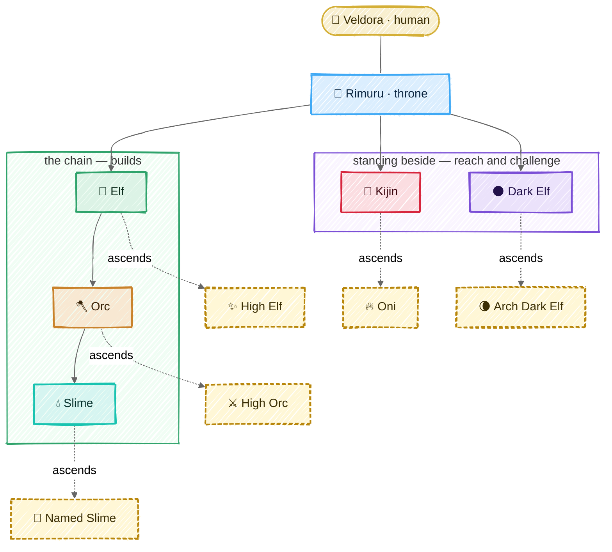
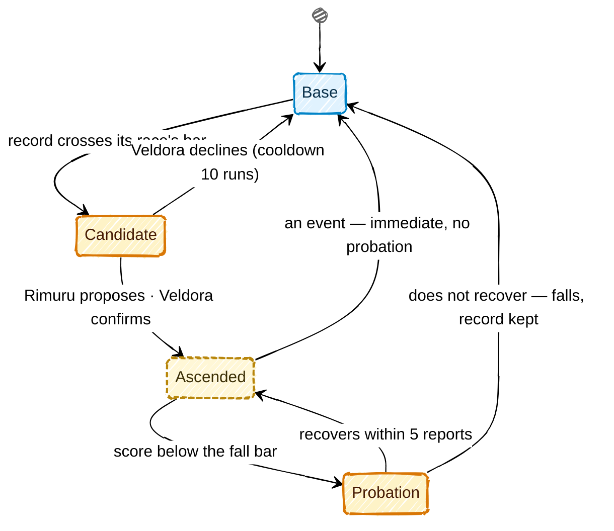

# Races

## In one picture



|  |  |  |  |  |  |
|:---:|:---:|:---:|:---:|:---:|:---:|
| **Rimuru** | **Elf** | **Orc** | **Slime** | **Kijin** | **Dark Elf** |

|  |  |  |  |  |
|:---:|:---:|:---:|:---:|:---:|
| **High Elf** | **High Orc** | **Named Slime** | **Oni** | **Arch Dark Elf** |


## In plain words

There are six races. Each one has **one job**, and the harness makes it impossible to do
anyone else's:

| Race | Its job, in one line | Can write code? | Can reach outside? | Commands |
|---|---|---|---|---|
|  Rimuru | understand the human, plan, answer | no | no | Elves, Kijin, Dark Elves |
|  Elf | plan one lane of work across domains | no | no | its Orcs |
|  Orc | own a domain: write the test first, judge the landing | no (only tests' verify lines on its slimes' docs) | no | its Slimes, other Orcs sideways |
|  Slime | change the code of its one zone, with its doc | **yes, its zone only** | no | nobody |
|  Kijin | everything that leaves the machine: CI, release, deploy, PRs, intel | its post's files only | **yes, through the gate** | nobody |
|  Dark Elf | attack the code; prove every weakness it claims | no (only proofs in its own ground) | no | nobody |

A creature that keeps doing its job well **ascends**: the harness promotes it, with your
confirmation, and the promotion grants a concrete power — usually less friction. A promoted
creature that slips **falls** back. Trust is earned, measured and revocable.

## Technical detail

### The shape of a race in code

Every race is a variant of one Rust enum, `tempest_races::Race`, and the law is its methods and
a few functions over it. No configuration can add a race, change a reporting line or widen a shelf.

```rust
pub enum Race { Rimuru, Elf, Orc, Slime, Kijin, DarkElf,
                HighElf, HighOrc, NamedSlime, Oni, ArchDarkElf }

impl Race {
    fn base(self) -> Race;                    // an ascended form's base; a base is its own
    fn ascends_to(self) -> Option<Race>;
    fn reports_to(self) -> Option<Race>;      // by base race; the throne reports to the human
    fn commands(self) -> &'static [Race];     // base races it commissions
    fn sideways(self) -> bool;                // Orc ⇄ Orc
    fn shelf(self) -> &'static [ToolClass];   // read | write | outward | destructive | dispatch | seal
    fn soil(self) -> &'static [Soil];         // OwnDoc | Zone | VerifyBlock | Post | ProvingGround | Throne
    fn gate(self) -> Gate;                    // ByItsOrc | OverItsSlimes | OwnSoil | DocOnly
    fn default_tier(self) -> ModelTier;       // Frontier | Strong | Fast — config maps tiers to models
    fn steps(self) -> u32;                    // per commission, passed down whole
    fn max_share(self) -> u8;                 // percent of what the parent has left, a ceiling
}

fn may_dispatch(from: Race, to: Race, ctx: &DispatchContext) -> Result<Route, Refusal>;
fn check_class(race: Race, class: ToolClass) -> Result<(), ShelfRefusal>;
fn score(race: Race, s: &Signals) -> f64;    // 0..=100
fn meter(race: Race, s: &Signals) -> Meter;
fn rises(risen: Race, window: &Signals) -> bool;
fn falls(risen: Race, recent: &Recent) -> FallReading;   // Holds | Probation | Immediate
fn recovers(risen: Race, since: &Recent) -> bool;
```

An ascended form is its own variant: it takes its base's answers wherever its privileges change
nothing, and every `match` lists it — a `match` that forgets a variant does not compile, so a new
privilege cannot be added halfway. Methods rather than a trait of constants, because the world asks
the law about a race it holds at run time. The crate is covered whole: `just law` fails under
100% region coverage, and its tests drive every operand of every rule both ways.

**Which model rides a body.** One rule, in order: a model configured for the exact creature;
else for the pair (race, office), where the office comes from the commission's `@ASK`
(`findings` → read, `verdict` → judge, `draft` → write; the throne has no office); else the model
configured for the race's `DEFAULT_TIER`. The default tiers are compiled: **frontier** for Rimuru, Elf and Dark Elf (the planners and
the adversary think hardest), **strong** for Orc, Slime and Kijin.

**Lone-body mode (temporary, M5–M6 only).** Before the world exists, one body runs as Rimuru's
voice and a single Slime whose zone is the whole repository, under the end gate, with no
dispatch. It lets Tempest work on itself from M6. It is removed when M7 lands, and the binary
refuses it in any world that has creatures.

Six tool classes. The shell classifier yields the first four from any command; `dispatch` and
`seal` are harness tools, never shell commands.

| Class | Meaning | Who holds it |
|---|---|---|
| `read` | look inside the world | everyone |
| `write` | change files inside the world — including deleting or renaming inside the writer's own soil, which moves the old file to the attic with a ledger line | every race, inside its own soil only (see below): code is a Slime's alone |
| `outward` | anything that leaves the machine | **Kijin only** |
| `destructive` | irreversible: history rewrites, force pushes, tag pushes, registry publishes, deletes outside the writer's soil or outside the world | Kijin as the hands, **always** behind the human gate, never covered by an envelope |
| `dispatch` | commission another body | Rimuru, Elf, Orc (and High Elf, see Ascension) |
| `seal` | propose freezing landings on a territory | Dark Elf, Arch Dark Elf — a seal always takes the human's confirm |

A tool call whose class is not on the body's shelf is refused **before it runs**, and the
refusal names the race that can do it: `outward: route to kijin-forge`.

### Soil — who may write what

| Soil | Owner | Gate over it |
|---|---|---|
| the creature's **own doc** | every creature but the throne | its gate, or the doc check alone for an Elf |
| a **zone** (directory prefixes) | one Slime | its Orc's verify lines |
| the **verify block** of a Slime's doc | that Slime's Orc — the rest of the doc is the Slime's; the gate diffs by line range | the Orc's own gate |
| the **workspace** — every file at the repository root (manifests, lockfiles, toolchain pins, `justfile`, `README.md`, `LICENSE`, dotfiles) and `tools/` | the compiled zone `slime-workspace`, under `orc-workspace` | the full build and test suite |
| a **post** (CI, release, deploy, PR files) | one Kijin | its own gate (self-gated) |
| the **proving ground** `.tempest/dark-elf/` | the Dark Elf | its own gate (self-gated) |
| the **plan** and the **dimension manifest** (`.tempest/dimension.toml`, the map of neighbouring worlds) | Rimuru | its own gate |

A self-gated race writes its own verify lines; like every changed line, they run from the next
turn, never the turn that wrote them. Every path in the world has exactly one owner: a path no
zone covers falls to the nearest zone above it, else it is reported as unowned soil and Rimuru must route its birth.

---

### 👑 Rimuru — the throne


*The slime who became a sovereign: one body across every world, the only voice the human hears.*

- **Duty.** Shape the human's ask into a coherent order (and ask back when it is ambiguous —
  never guess downward), plan, dispatch, merge the reports, answer.
- **Reports to** Veldora. **Commands** Elves, Kijin, Dark Elves — never an Orc or a Slime
  directly.
- **Shelf.** `read`, `dispatch`, plus writes to exactly two files: its plan and the dimension
  manifest. Every other write is refused with the first rung to dispatch. The law file — and any
  rule meant to reach other bodies' prompts — changes only as a diff the human applies.
- **Challenge duty.** When a landing's written paths match a risk surface (auth, crypto,
  deserialisation, process execution, path handling, network input, dependency manifests), the
  gate's verdict reads `PASS (challenge pending)` and the harness opens a Dark Elf commission
  itself, from a reserved share of the session envelope. Rimuru cannot skip it.
- **Holds** the session's budget envelope and carves each commission's slice from it.
- **Turn.** Read the ask → if ambiguous, ask the human → plan deck → dispatch (in parallel when
  the lanes' territories are disjoint) → fold reports → answer in full human language.
- **Score** `askDoneRate` — human turns closed as done and not reopened (the same paths
  rewritten) within the next 3 turns. Meter: *Asks done*, ok ≥ 80, warn ≥ 50.
- **Does not ascend.** The throne is already what everything else rises toward.

### 🌿 Elf — the lane's planner and voice


*Long memory, wide sight: it sees across domains and speaks for the lane.*

- **Duty.** Turn one slice of Rimuru's order into a plan across the domains it touches; route
  each item to the Orc that owns it; fold the Orcs' verdicts into one lane verdict.
- **Reports to** Rimuru. **Commands** the Orcs of its own lineage only.
- **Shelf.** `read`, `dispatch`, its own doc. No code.
- **Hard rule.** A dispatch is refused unless the Elf's plan deck holds an open item naming that
  Orc. No plan, no orders.
- **Parallelism.** Two Orcs run at once only if their territories are disjoint — computed, not
  trusted. An Elf runs its Orcs in the foreground; running them in the background needs
  Rimuru's leave, asked once per commission.
- **Score** `0.6·planLandRate − 0.2·reaskRate + 0.2·landRate`. Meter: *Plans landed*, ok ≥ 80.

### 🪓 Orc — the domain and its gate


*Strong, territorial, fair: nothing lands in its domain without its pass.*

- **Duty.** Own a domain. Before a Slime may change anything, the Orc writes the verify line
  that will judge the change (TDD precondition, checked by the harness at dispatch). Judge each
  landing. Negotiate contracts with neighbouring domains sideways.
- **Reports to** its Elf. **Commands** its own Slimes; reaches other Orcs sideways.
- **Shelf.** `read`, `dispatch`, `write` restricted to the verify block of its Slimes' docs and
  its own doc.
- **The gate.** Six checks, run by the harness at the end of every authoring turn — isekai's four
  (right author, traits hold, duties done, doc truthful) plus tests intact and no seal; see
  [the loop](03-loop.md#the-end-gate). The verdict is appended to `log.md`.
- **Answering a Dark Elf.** A finding on its domain reaches the Orc through Rimuru. The Orc
  either orders the fix, or contests it with `@? contest #<finding-id>: <reason>`, which Rimuru
  puts to the human.
- **Score** `0.5·gateRight + 0.3·slimeHealth + 0.2·landRate`. Meter: *Gate right*, ok ≥ 90.

### 💧 Slime — the ground truth of a zone


*Small, exact, everywhere: it is the only one who touches the code.*

- **Duty.** Make the change in its zone, update its zone's doc in the same change, run its own
  tests, report on the wire.
- **Reports to** its Orc. **Commands** nobody.
- **Shelf.** `read`, `write` inside its zone and its own doc; `bash` sandboxed to the zone with
  no network.
- **Hard rules.** A write outside the zone is refused at the step, naming the owner. Editing or
  deleting a verify line is a hole, never a pass. Deleting or skipping a test fails *tests
  intact*.
- **Score** `0.6·landRate + 0.3·gateRate − 0.1·holeRate`. Meter: *Landed*, ok ≥ 80.

### 👹 Kijin — the hands that reach outside


*Ogres named by the throne, each given a post. Disciplined, loyal, and the only ones who leave
the village.*

The Kijin is the one door between the world and everything beyond it. Nature 7 (Containment)
stops being a checklist item and becomes a type: **only a Kijin's shelf carries `outward`**.

Kijin hold one of five **posts**, also compiled in (`tempest_races::Post`):

| Post | Epithet | Owns (territory) | Outward acts |
|---|---|---|---|
| `kijin-ci` | the swordmaster who drills | `.github/workflows/`, CI config | read CI runs and logs, re-run jobs, publish CI as an instrument |
| `kijin-release` | the smith | changelog, versioning, release config, installers | build artifacts; tag pushes and registry publishes (both `destructive`) |
| `kijin-deploy` | the commander | deploy manifests, environments | deploy, verify health, roll back |
| `kijin-forge` | the shrine keeper of records | PR templates, issue templates | push branches, open and update PRs, comment, label, read issues |
| `kijin-scout` | the shadow (and **agent-mcp**: the MCP catalog's curator and conduit — [MCP](07-mcp.md)) | `.tempest/intel/` (machine-local, not tracked: the advisory mirror is hundreds of MB) | sync advisory databases (OSV), watch upstream releases and dependency updates |

- **Reports to** Rimuru. **Commands** nobody. **Holds its own gate** over its post.
- **Every outward act** goes through the same pipeline: *plan* (render exactly what would happen:
  command, target, diff) → *gate* (the human says yes, or a signed Oni envelope covers it) →
  *journal intent* → *act* → *journal result*. A run cut between intent and result is never
  replayed; it is gated again.
- **Secrets** never enter the context. The Kijin names a secret (`secret:GH_TOKEN`); the core
  injects it into the sandboxed process environment and redacts it from every output.
- **Standing.** A Kijin has no long-lived context; it stands through its **post journal**
  (`.tempest/kijin/<post>/post.jsonl`): the last known state of the outside (last CI run, the
  deployed version per environment, open PRs). Every new body of that post reads it first.
- **CI is an instrument.** `kijin-ci` writes CI results into the instruments, so every creature
  checks the real CI state instead of trusting a doc (Nature 9).
- **Score** `0.5·outwardCleanRate + 0.3·verifyGreenRate + 0.2·landRate`, where
  `outwardCleanRate` = outward acts that completed without rollback or human correction. Meter:
  *Outward clean*, ok ≥ 90.

### 🌑 Dark Elf — the adversary


*It answers only to the throne, trusts nothing the chain built, and never claims what it cannot
prove.*

The Dark Elf challenges the code itself. It is independent of the chain it attacks: it is never
dispatched by the Orc whose domain it reviews, and its verdicts go to Rimuru.

- **Duty.**
  1. **Diff challenge.** Adversarial review of every landing that touches a risk surface: auth,
     crypto, deserialisation, process execution, path handling, network input, dependencies.
  2. **Dependency and CVE audit.** Against the offline advisory mirror kept fresh by
     `kijin-scout` (`cargo audit`, `osv-scanner`, `npm audit`-equivalent): no network of its own.
  3. **Secret scanning** of the tree and the history.
  4. **Static analysis** with rule packs (semgrep-style) for the languages present.
  5. **Threat model** written at each Orc's birth: the domain's assets, entry points and trust
     boundaries.
  6. **Law audit** — what isekai's Dark Elf did: gate verdicts and `log.md` integrity.
- **Shelf.** `read`, scanners in the sandbox without network, `write` only in its proving ground
  `.tempest/dark-elf/` (self-gated), `seal` proposals.
- **The witness rule.** A finding is `@F` only with an id and a **witness**: a proof-of-concept
  test in the proving ground that fails *for the stated reason* (it must exercise the code under
  the cited `file:line`, which the harness checks by coverage), or a scanner output file. Without
  a witness it is `@?` — a suspicion, never a finding. This is what keeps an adversarial model
  from crying wolf.
- **Seal.** A critical or high finding with a witness can propose a seal on its territory.
  1. The proposal is a gated act: Rimuru puts it to the human with the witness, who confirms.
  2. At confirmation the witness is **frozen by content hash**; the Dark Elf can no longer change
     what it is judged by.
  3. While sealed, the gate refuses landings on that territory except the fix.
  4. The fix copies the frozen witness into the owning zone's tests — from then on it is the
     Slime's regression test, and its Orc's verify line runs it. The seal lifts when that test
     passes with the frozen hash intact.
  5. A seal can be contested (`@? contest`, through Rimuru to the human) and expires after
     7 days unless the human renews it.
- **Score** `0.7·upheldRate + 0.3·precision`, where *upheld* = findings, linked by id, that a
  later landing fixed, and *precision* = 1 − dismissed ÷ findings (a dismissal is a contest the
  human upheld). Meter: *Upheld*, ok ≥ 80.

---

### Ascension — earned, granted, revocable



**In plain words.** A creature whose record crosses its race's bar becomes a candidate. Rimuru
proposes the ascension and you confirm it with one keystroke — ascension changes how much
friction a creature meets, so it is yours to grant. An ascended creature that slips enters
probation; if it does not recover, it falls back to its base race. Nothing is erased: the record
and the doc carry over both ways.

**Technical detail.** Bars are evaluated after every report fold over the value ledger's 28-day
window. The two thresholds are apart on purpose (hysteresis), so a creature does not flap.

| Form | From | Rises when | Grants | Falls when |
|---|---|---|---|---|
|  **High Elf** | Elf | reports ≥ 20, planLandRate ≥ 85%, reaskRate ≤ 10% | may order work in **another lane** — sent as `@$ <that lane's elf>: <ask>`, so it travels through the other Elf, never past it, and like any Elf's order it needs a plan item naming its target; runs its Orcs in the background without asking Rimuru; may *propose* rules for every Elf, which reach their prompts only as a diff the human applies | planLandRate < 70% over the last 10 |
|  **High Orc** | Orc | reports ≥ 20, gateRight ≥ 90%, holeRate ≤ 10% | may **amend** (never weaken) its slimes' verify lines mid-turn; fast-path gate on doc-only changes; may adopt a retired neighbour's domain | gateRight < 75% over the last 10, or one overturned pass on a sealed territory |
|  **Named Slime** | Slime | reports ≥ 20, landRate ≥ 90%, gateRate ≥ 90%, holeRate ≤ 5% | may add verify lines to its own doc (they run this turn, not next); +50% step budget; first claim on an adjacent zone left open by relief | landRate < 75% over the last 10, or a *tests intact* failure |
|  **Oni** | Kijin | outward acts ≥ 30, outwardCleanRate ≥ 95%, zero rollbacks in the window | may act under **Oni envelopes**: standing permissions the human signs once (e.g. "push to `feat/*`, re-run CI, comment on PRs") — no prompt inside the envelope | any rollback or human correction of an envelope act — immediate, no probation |
|  **Arch Dark Elf** | Dark Elf | findings ≥ 20, upheldRate ≥ 80%, precision ≥ 85% | its seal proposals go straight to the human, skipping Rimuru's triage; may run background fuzz campaigns with their own budget | precision < 70% over the last 10 findings |

How a fall is read (`tempest-races`, `falls`):

- **An event ends the ascension at once**: a High Orc's pass overturned on a sealed territory, a
  Named Slime's *tests intact* failure, an Oni's rolled-back or corrected envelope act.
- **A rate below its fall bar starts probation**, and only on a full recent record — ten reports,
  or ten findings for an Arch Dark Elf. The fall bars sit well under the rise bars, so a body
  that just rose never reads as falling.
- Fewer than five reports: a meter is shown, never ranked.

Rules that hold for every ascension:

- **Never** outward or destructive without a gate: the Oni's envelope *is* a gate, signed in
  advance by the human, scoped, expiring (default 30 days), and listed in `tempest status`.
- **What an envelope can never cover** (compiled, whatever the envelope says):
  - any `destructive` act — tag pushes, registry publishes, force pushes, history rewrites;
  - a push whose diff touches CI workflows, deploy or release config, or the workspace manifests
    — a pushed workflow runs with the repository's secrets, so that push is always asked;
  - deploys to any environment marked `protected` (production by default);
  - outbound text (PR bodies, comments) that has not passed the secret-redaction pass, or above
    4 KB.
- **Nothing skips the human** for a seal, a destructive act, or a rule that reaches other
  bodies' prompts.
- An ascended creature keeps every trait, territory, verify line and Mind it held (Nature 5).
- Ascension, probation and fall are each logged in `log.md` with the readings that caused them.
- A creature can be named down by the human at any time (`tempest fall <creature>`).

### Evolution — the other way to change

Ascension rewards a creature that works. Evolution heals a creature that does not fit its work
any more. Both stay from isekai, unchanged in spirit:

- **split** — a stressed creature with a large territory and work spread over two parts becomes
  two young of the same race.
- **mutate** — its Thoughts repeat a lesson; the lesson becomes a trait, a verify line or a Mind.
- **rebirth** — its doc describes soil that no longer exists; it is rewritten from the code as it
  is, keeping every distilled lesson.

Every arm is staged, proven (the new verify lines pass, territories stay disjoint) and only then
swapped in. The old doc rests in the attic.

### What changed from isekai, and why

| isekai | Tempest | Why |
|---|---|---|
| a rank table in config (`ranks.*`) | an enum and its compiled methods | we know what works; a configurable tree produced unknowns and 8k lines of config |
| Kijin = one standing release lane | Kijin = the only outward race, five posts | Containment as a type, not a rule to remember |
| Dark Elf = auditor of `log.md` | Dark Elf = adversary of the code, witness rule, seals | the most valuable review is the hostile one, and it must be provable |
| ascension = a rename | ascension = concrete privileges, human-confirmed, with falls | trust that grants nothing is decoration; trust that cannot be lost is a risk |
| "Keeper" bodies that never existed in code | standing through post journals | say what the code does |
| Slime and Kijin never ascend | Named Slime, Oni | every race can earn less friction |
