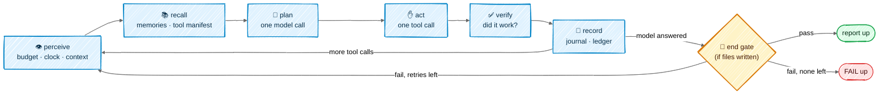
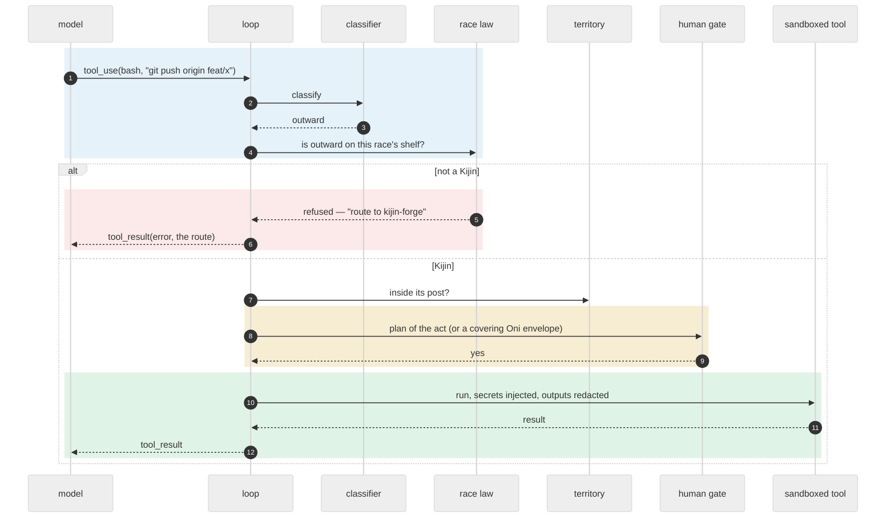

# The loop

## In one picture

## In plain words

Every body — Rimuru, an Elf, a Slime — runs the same six beats, over and over, until it has an
answer:

1. **Perceive** — check the fuel gauge: how much budget, time and context is left. If it is
   running out, save what matters and stop cleanly instead of crashing.
2. **Recall** — pull in the few memories and tools that fit the question, as pointers, not
   pasted text.
3. **Plan** — ask the model what to do next.
4. **Act** — run one tool the model asked for, after checking that this race may use it and,
   for anything that leaves the machine or destroys something, after asking you.
5. **Verify** — did the tool work? A failure counts against the body.
6. **Record** — write what happened to the journal and the ledger.

When the model stops calling tools and answers, the **gate** judges any files the body wrote.
If it fails, the body gets one chance to fix it. Then the report goes up.

## Technical detail

### One act, in order

The order is fixed and cheap-first: classify → shelf → territory → permission rules → human
gate → run. A refusal never reaches the sandbox, and every refusal names the lawful route.

### Budgets are readings

Before every model call the loop reads four meters from the core, never from the model:

| Meter | Default | Past it |
|---|---|---|
| steps | per race, passed down whole, never split (Rimuru 40, Elf 30, Orc 30, Slime 40, Named Slime 60, Kijin 20, Dark Elf 40) | checkpoint |
| wall clock | what the parent has left, passed down whole (session default 60 min) | checkpoint, one salvage resume of ≤ 4096 tokens to land `@U`/`@F` |
| context | an absolute line, `stress.context_tokens` (150k), never past 90% of the window — the same whatever the model | at 60%: old tool outputs fold; at 75%: the body is told to write down what is not durable; at the line: checkpoint, telling the human to break |
| cost | the commission's `@BUDGET`, in cache-weighted cost — the only budget that is carved | checkpoint with `@? budget` to the parent ([Consumption](06-consumption.md)) |

A checkpoint is an honest stop: the journal holds every beat, and `mnemorph resume <run>` picks
up from it. An outward act cut mid-flight is gated again, never replayed.

**The journal** is one append-only JSON line per beat — the ask, each model turn with its blocks
kept whole (thinking included, so a resume sends them back unchanged), each tool result, each
note the loop added, the ending. Resume rebuilds the conversation from it and counts the steps
already taken. A tool call the journal shows no result for may not have run: it is answered
with an error saying so, and the body asks again if it still needs it. Each answered model call
also writes a priced row to the usage ledger, and the cost meter reads that sum.

**Replay compaction** is a pure function over a copy of the conversation: old tool outputs fold
to a one-line caption — "folded: 100 lines of earlier output, call the tool again if you need
it" — while every assistant turn (its text, its tool calls, the thinking bound to them), every
small result and the last four exchanges stay whole. It folds in one batch when the context
crosses 60% of the stress line, not a little each turn, so the cached prefix holds between
folds. The journal is never touched: compaction shapes only what is sent. A 40-step run whose
history would be 150 KB sends at most about 53 KB a turn.

**A clock death salvages**: one more turn, without tools and capped at 4096 tokens, in a grace of
a tenth of the clock (2–60 s), to write down what the body did, learned and left. The
checkpoint carries it.

### The session: queue and interrupt

A session is one body's run and the lines the human types while it works. **Enter** during a turn
queues the line; when the turn ends, the next queued line becomes the next ask. **Esc** interrupts
the turn wherever it is: during a model call the call is dropped and nothing half-streamed enters
the conversation (an answer that has already arrived is kept, and Esc is honoured before any of
its acts runs); during a command, the command's whole process group stops within a poll, and
what it printed so far is kept in its result; between tool calls the calls not yet run are
answered "interrupted by the human before it ran", and none of them runs. The run's clock reaches
a running command the same way — including the end gate's verify commands — so no command
outlives the deadline. Either way the session pivots to the next queued line.

The step budget and the stress instruments are each ask's own — a session of questions is not
thrash; the clock, the context and the cost run for the session, and a resumed run reads what
it already spent and its last context from the ledger. An Esc that landed after an answer is
dropped when the next ask starts.

What the model returns is cleaned before it enters the conversation or the journal: empty text
blocks dropped, a repeated tool call id made unique, an empty reply stated as such. An empty
reply, a reply cut by the output ceiling or a paused turn is not an answer: the body is told and
goes on, bounded by the step meter. The provider's warnings are journaled for the human, never
fed to the model.

Before every request the conversation is **validated**: it starts and ends with the user, roles
alternate, no turn is empty, every tool call is answered by the very next user turn with its
results first, and no result answers a call nobody made. A broken conversation fails the run with
its reason instead of being refused by the provider. A property test throws random answers, tool
calls, interrupts and queued lines at a session and checks every request it sends.

### Stress, in four instruments

| Instrument | Trigger | Response |
|---|---|---|
| **guts** | rolling act score over the last 5 acts falls below −2 (a landed write +2, a failed act or an unchanged re-read −1) | one warning inside the conversation; a new window starts |
| **doom checkpoint** | guts warned 3 windows running | run stops; parent gets *retire / split / reshape* |
| **escalation** | more than 2 consecutive failed acts | turn ends `ESCALATE`, one hop up |
| **council** | strain (failed acts + re-asks + 1 per failed run) reaches 5 | the parent must answer as manager: `@INSTRUCT`, `@SPLIT` or `@ESCALATE`; at 7, relief splits or retires the creature |
| **stall** | 3 re-reads of unchanged windows with nothing landed (`repin`), or 40 turns with nothing landed (`actBudget`) | checkpoint: the run is busy, not working |

All are code. None of them asks the body how it feels.

The council's keys are `stress.escalateAt` (5), `stress.relieveAt` (7) and `stress.maxConsults`
(3): after three warrants the report is forced to `@S ESCALATE` and reaches the human. Strain is
read from the body's own first `@S`, never from how the loop ended — a court that reports
`@S FAIL` still finishes its loop cleanly. A clean landing clears it; the human's denials and
interrupted or dry runs never add to it. Every relief resets its own trigger, or the next run dies
on its first act.

### Self-heal

The world repairs itself in small, mechanical steps, each one written to the ledger:

- **Relief** splits a strained creature's zone in two young of the same race — by its prefixes,
  or by the directory tree under a one-prefix zone — or, when the zone cannot split, retires the
  seat: it keeps its memory, claims no files, and stays visible. A `relief` row records the act.
  Relief is skipped for a body that just evolved.
- **A clock death leaves a memo**: a court killed by its deadline gets its one salvage turn, then
  its lane goes into the ledger as a `death` row and the next-fit lane is suggested on the wire —
  advice to the parent, never a change on its own.
- **The roster heals from the docs**: the world fingerprints its creature docs, and when the
  fingerprint moves — another session's relief, a hand edit — the roster is rebuilt before the
  next dispatch, so no court is created for a retired seat. A heal never moves trust: a body's
  verify lines change only through its own gate.
- **`mnemorph housekeep --heal`** fixes what is mechanical — a creature without a doc, a broken
  *Reports to* link — and reports everything else.
- **One live court per seat**: a second commission to a busy seat waits in its lane.

### The end gate

Runs on the body's own writes (minus what its Courts already landed on their own account):

1. **Right author** — every path lies in the writer's own soil ([soil](02-races.md#soil--who-may-write-what));
   for a Slime's doc the gate diffs by line range: the verify block is the Orc's, the rest is the
   Slime's. Writes are found by snapshotting the tree, whatever tool made them — a shell
   redirect counts the same as the write tool.
2. **Traits hold** — the verify lines that stood *before* the turn run green, sandboxed, 120 s
   each. A line changed this turn is a hole and runs from the next turn (a Named Slime's own
   additions excepted).
3. **Duties done** — a commissioned body answered with a non-empty `@S`.
4. **Doc truthful** — the owner's doc moved in the same change.
5. **Tests intact** — no test deleted or skipped.
6. **No seal** — the territory is not sealed, or this landing is the fix: it carries the frozen
   witness into the zone's tests, unchanged by hash.

**In solo mode** the gate judges what the run changed against the tree as it was when the ask
arrived — so a shell redirect, a `rm`, a generated file all count — and runs traits hold (the
verify commands, through the same classified and guarded `bash`, 120 s each), duties done (a
non-empty answer) and tests intact: no test file deleted, and no test file — read whole, whatever
its size — with more skip markers than before (`#[ignore`, `.skip(`, `.only(`, `.todo(`,
`t.Skip(`, `t.Skipf(`, `@pytest.mark.skip`, …) or fewer tests (`#[test]`, `func Test`, `def
test_`, `it(`, `test(`, `@Test`). Right author holds by
construction: the whole repository is solo's soil, and the tripwire keeps `.git` and
`.mnemorph` out. An answer that changed nothing passes untouched. A first failure goes back to
the body as a note; a second ends the run as FAIL, every verdict journaled.

A landing on a risk surface passes as `PASS (challenge pending)` and opens a Dark Elf commission
automatically ([Rimuru's challenge duty](02-races.md#-rimuru--the-throne)).

The verdict goes to `log.md` through the append-only writer. Three fails running for the same
body on the same files harden into the lawful next acts: rewrite the commission, split, escalate.

### Between sessions: the handoff

A session's context dies; the world's files do not. A **handoff** is what a fresh session needs to
continue without re-asking, re-discovering or repeating a mistake — written by the session that
knows, read by the one that does not.

- **Writing.** `/handoff [focus]` (and `mnemorph handoff` headless). The core gathers what it knows
  as facts — the first ask, uncommitted changes, recent commits, the last journal entries, the
  shared queue's held and claimed work, the session's spend, the previous handoff — and the model
  fills a fixed template into `.mnemorph/handoffs/<time>.md`: goal; why it matters; current state
  (done · partial · not started); decisions and why; traps and dead ends; files and pointers; open
  work. Rules: state, never orders; point at artifacts, never copy them; secrets by location only;
  leave out what the law, config or code already say; carry forward what still holds from the
  previous handoff.
- **When.** On demand, and offered by the core when the context reaches the stress zone and at
  every checkpoint — the moment a session is about to lose what it knows.
- **Reading.** A new session is told a handoff is waiting (younger than 14 days). `/handoff read`
  gives the model the file with one rule: read every listed file, verify every claim against the
  code, then wait for the human. A handoff is context to check, never fact to trust.
