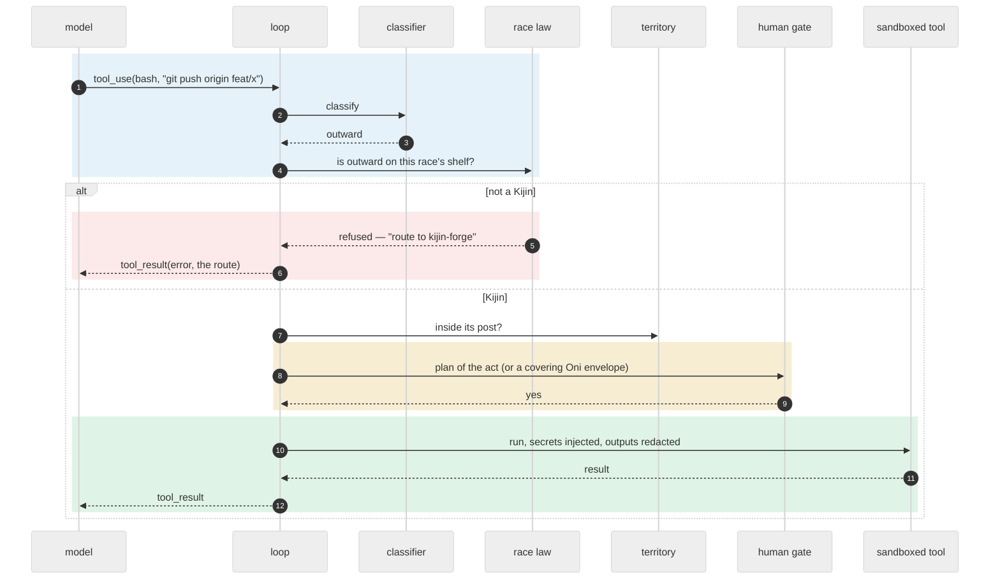

# The loop

## In one picture

## In plain words

Every body — Rimuru, an Elf, a Slime — runs the same six beats, over and over, until it has an
answer:

1. **Perceive** — check the fuel gauge: how much budget, time and context is left. If it is
   running out, save what matters and stop cleanly instead of crashing.
2. **Recall** — pull in the few memories and tools that fit the question, as pointers, not
   pasted text, always including one that disagrees if any does ([memory](08-memory.md)).
3. **Plan** — ask the model what to do next.
4. **Act** — run one tool the model asked for, after checking that this race may use it and,
   for anything that leaves the machine or destroys something, after asking you.
5. **Verify** — did the tool work? A failure counts against the body.
6. **Record** — write what happened to the journal and the ledger.

When the model stops calling tools and answers, the **gate** judges any files the body wrote.
If it fails, the body gets one chance to fix it. Then the report goes up.

## Technical detail

### One act, in order

The order is fixed and cheap-first: classify → shelf → territory → permission rules → human
gate → run. A refusal never reaches the sandbox, and every refusal names the lawful route.

### Budgets are readings

Before every model call the loop reads four meters from the core, never from the model:

| Meter | Default | Past it |
|---|---|---|
| steps | per race, passed down whole, never split (Rimuru 40, Elf 30, Orc 30, Slime 40, Named Slime 60, Kijin 20, Dark Elf 40) | checkpoint |
| wall clock | what the parent has left, passed down whole (session default 60 min) | checkpoint, one salvage resume of ≤ 4096 tokens to land `@U`/`@F` |
| context | an absolute line, `stress.context_tokens` (150k), never past 90% of the window — the same whatever the model | at 60%: old tool outputs fold; at 75%: the body is told to write down what is not durable; at the line: checkpoint, telling the human to break |
| cost | the commission's `@BUDGET`, in cache-weighted cost — the only budget that is carved | checkpoint with `@? budget` to the parent ([Consumption](06-consumption.md)) |

A checkpoint is an honest stop: the journal holds every beat, and `mnemorph resume <run>` picks
up from it. An outward act cut mid-flight is gated again, never replayed.

**The journal** is one append-only JSON line per beat — the ask, each model turn with its blocks
kept whole (thinking included, so a resume sends them back unchanged), each tool result, each
note the loop added, the ending. Resume rebuilds the conversation from it and counts the steps
already taken. A tool call the journal shows no result for may not have run: it is answered
with an error saying so, and the body asks again if it still needs it. Each answered model call
also writes a priced row to the usage ledger, and the cost meter reads that sum.

**Replay compaction** is a pure function over a copy of the conversation: old tool outputs fold
to a one-line caption — "folded: 100 lines of earlier output, call the tool again if you need
it" — while every assistant turn (its text, its tool calls, the thinking bound to them), every
small result and the last four exchanges stay whole. A fold rewrites the cached conversation
from its first folded message on, so it comes in rare, large batches: past 60% of the stress
line, and only when it takes out a fifth of the line or more. Between folds the conversation
sent only grows, and each turn reads it from the provider's cache
([Consumption](06-consumption.md)). The journal is never touched: compaction shapes only what is sent. A 40-step run whose
history would be 150 KB sends at most about 55 KB a turn, and with the cache it is billed a third of its input.

**A clock death salvages**: one more turn, without tools and capped at 4096 tokens, in a grace of
a tenth of the clock (2–60 s), to write down what the body did, learned and left. The
checkpoint carries it.

### The session: queue and interrupt

A session is one body's run and the lines the human types while it works. **Enter** during a turn
queues the line; when the turn ends, the next queued line becomes the next ask. **Esc** interrupts
the turn wherever it is: during a model call the call is dropped and nothing half-streamed enters
the conversation (an answer that has already arrived is kept, and Esc is honoured before any of
its acts runs); during a command, the command's whole process group stops within a poll, and
what it printed so far is kept in its result; between tool calls the calls not yet run are
answered "interrupted by the human before it ran", and none of them runs. The run's clock reaches
a running command the same way — including the end gate's verify commands — so no command
outlives the deadline. Either way the session pivots to the next queued line.

The step budget and the stress instruments are each ask's own — a session of questions is not
thrash; the clock, the context and the cost run for the session, and a resumed run reads what
it already spent and its last context from the ledger. An Esc that landed after an answer is
dropped when the next ask starts.

A client watches a run through its **observer**: every beat at the moment it is journaled, and
every call's spend — a model turn or a decision — with the run's running total and its context
against the stress line. It is how the CLI and the board show a run live
([the client protocol](04-communication.md#the-client-protocol)) without reading the journal
back. `open(world, gate, observer, env)` builds the session a client talks to — solo, and with the
`commission` tool and an envelope from the human's caps when the world has Elves under a living
throne: the configuration, the model through the human's backend, the tools under the kernel
guard, the journal, the ledger and the decisions.

What the model returns is cleaned before it enters the conversation or the journal: empty text
blocks dropped, a repeated tool call id made unique, an empty reply stated as such. An empty
reply, a reply cut by the output ceiling or a paused turn is not an answer: the body is told and
goes on, bounded by the step meter. The provider's warnings are journaled for the human, never
fed to the model.

Before every request the conversation is **validated**: it starts and ends with the user, roles
alternate, no turn is empty, every tool call is answered by the very next user turn with its
results first, and no result answers a call nobody made. A broken conversation fails the run with
its reason instead of being refused by the provider. A property test throws random answers, tool
calls, interrupts and queued lines at a session and checks every request it sends.

### Stress, in four instruments

| Instrument | Trigger | Response |
|---|---|---|
| **guts** | rolling act score over the last 5 acts falls below −2 (a landed write +2, a failed act or an unchanged re-read −1) | one warning inside the conversation; a new window starts |
| **doom checkpoint** | guts warned 3 windows running | run stops; parent gets *retire / split / reshape* |
| **escalation** | more than 2 consecutive failed acts | turn ends `ESCALATE`, one hop up |
| **council** | strain (failed acts + re-asks + 1 per failed run) reaches 5 | the parent must answer as manager: `@INSTRUCT`, `@SPLIT` or `@ESCALATE`; at 7, relief splits or retires the creature |
| **stall** | 3 re-reads of unchanged windows with nothing landed (`repin`); 40 turns with nothing landed (`actBudget`); the same call with the same input 5 times in a row (`loop`, warned at 3); one test bench run 12 times with no green and nothing landed between, or 8 times muted (`bench`) | checkpoint: the run is busy, not working |

All are code. None of them asks the body how it feels.

The **bench tally** keeps, per test command — the command before any pipe or `;`, its
`VAR=value`, `timeout` and runner words (`uv run`, `npx`, …) set aside — its visits, reds,
greens and muted runs. A **verification script** counts as a test run too: an inline check whose
script asserts (`python3 -c "…assert…"`, a heredoc `python3 - <<'EOF'`, `node -e`, `bash -c`,
`sh -c`), one bench per interpreter since its text changes from run to run, or a script file named
for testing, checking or verifying, with a `.py`, `.js`, `.mjs` or `.sh` name (`python3
check_run.py`, `bash verify.sh`). Bodies often check their work this way, and a tally that knew only
test runners would read them as never testing. An inline script's own `|` and `;` are its own, not
the shell's: only one outside the script mutes the run. A run that hides its exit status (`cargo test | tail`,
`cargo test; echo ok`) is muted, never green. Red runs with fixes landing between them are
test-driven work; twelve with nothing landed stop the run, and so do eight muted runs in a row,
however much landed between them: the body that ran one bench 63 times in twenty minutes, every
run piped, is the reason. A run built with decisions (`decisions()`, `Run::with_decisions`) and `decide.bench` on reads
a piped run's output instead of muting it — only when the shell saw it finish with a zero exit: a
non-zero exit or a kill at the deadline is never read, so no printed summary turns a seen failure
green. Decisions are a feature the human switches on (`decide.enabled`), and only a classifier
named by `decide.via` makes them: with none, they stay off, and no LLM reads a bench in its place. The decider answers green, red or unknown, and a sure green or red counts in the
tally as if the exit status had been seen. A read moves only the tally: a read red is not a failed
act, so the guts and escalation are untouched. An unsure answer, a failed decision, output the
shell cut short, stdout or stderr (its summary is in the part dropped), an Esc during the command or the decision,
or the run's clock running out leaves the run muted, as it was. Each decision is journaled in
`.mnemorph/instruments/decisions.jsonl`, priced into the usage ledger, and named in a warning in
the beat journal (for the human, never replayed to the model).

**The guts journal.** Every act writes a `guts` beat to the run's journal: the act's score, the
guts window's sum and whether it warned, whether the act failed, and its instruments, the readings
a learned value model ([M11](roadmap.md)) will train on:
- how many files it wrote, and the **lines** it added and removed, counted as a multiset against
  what the files held before, so a line moved within a file is neither (a file that was not text
  had none to remove);
- an **edit miss**: an edit whose `old_string` was not in the file, the body editing text it had
  not read (or, in a multiedit, text an earlier edit of the call had changed);
- the **bench** it ran, if any, and how that run counted: green, red, muted, read green or read red.

The beat is for the record only: the conversation rebuilt from the journal ignores it, and no
surface shows it.

The human's configuration reaches a run through `configure`: the attic's limits, the stress
line, the guard rules that ask instead of refusing, and whether commands may run unguarded.

The council's keys are `stress.escalate_at` (5), `stress.relieve_at` (7) and `stress.max_consults`
(3): after three warrants the report is forced to `@S ESCALATE` and reaches the human. Strain is
read from the body's own first `@S`, never from how the loop ended — a court that reports
`@S FAIL` still finishes its loop cleanly. A clean landing clears it; the human's denials and
interrupted or dry runs never add to it. Every relief resets its own trigger, or the next run dies
on its first act. The tally is `.mnemorph/instruments/council.jsonl`, sat after every commission that answered: a
run whose report did not say `DONE` adds its failed acts and one more — a gate denial is the
human's, never a failed act — and a `DONE` clears it. Relief acts only after a warrant, and a
relief that cannot act escalates instead, the tally kept; re-asks are not counted yet. The warrant reaches the parent as a hole in the child's report —
`@? council: <body> strain <n> — answer as its manager: @INSTRUCT …, @SPLIT …, or @ESCALATE` — the
last warrant forces the report's `@S` to `ESCALATE`, the body's own status kept beside it, and relief's act is a note in the report.

### Self-heal

The world repairs itself in small, mechanical steps, each one written to the ledger:

- **Relief** splits a strained creature's zone in two young of the same race — by its prefixes,
  or by the directory tree under a one-prefix zone — or, when the zone cannot split, retires the
  seat: it keeps its memory, claims no files, and stays visible. A `relief` row records the act.
  Relief is skipped for a body that just evolved. It relieves Slimes and Orcs: the two young are
  `<name>-a` and `<name>-b`, of the old one's base race, seated beside it, reporting to the same
  parent, with the same verify lines and Minds, each taking half the claims sorted — a claim
  another covers set aside — or half the entries under a one-directory ground, descending while
  that directory holds one entry (hidden entries go with the first, a link counts as a file). An
  Orc's living Slimes report to the young whose ground covers theirs. The old seat gains one
  `Retired: yes` line and nothing else changes; its open queue orders are named, to re-route.
  Every check runs before any write, and a failed write is undone. The
  human can act it with `mnemorph relief <name> [--apply]` — without `--apply` it says what it
  would do; never from a body's command.
- **A clock death leaves a memo**: a court killed by its deadline gets its one salvage turn, then
  its lane goes into the instruments as a `death` row (`.mnemorph/instruments/deaths.jsonl`, with
  the body named next) and the next-fit lane is suggested on the wire, as a hole — the living
  sibling of the same base race under the same parent, not stuck on its files, with the best
  worth (a tie to the one that spent least), or, with none, a smaller order or a longer clock —
  advice to the parent, never a change on its own. A salvage turn that wrote nothing is still a
  clock death.
- **The roster heals from the docs**: the world fingerprints its creature docs, and when the
  fingerprint moves — another session's relief, a hand edit — the roster is rebuilt before the
  next dispatch, so no court is created for a retired seat. A heal never moves trust: a body's
  verify lines change only through its own gate.
- **`mnemorph housekeep --heal`** fixes what is mechanical — a creature without a doc, a broken
  *Reports to* link — and reports everything else. A seat with no doc gets a retired stub, so its
  memory stays visible and it claims nothing; a *Reports to* that names no living creature is
  relinked to the nearest living ancestor of the race that may command it (an Orc for a Slime, an
  Elf for an Orc) — never past the race law; with none above, it is left. Each repair is one journal
  entry; only the field's own line changes, and nothing is written through a link. A doc that
  cannot be read, two seats with one name, a loop in the chain are said and left to judgment.
  Without `--heal` it says what it would fix. It exits 0 when the roster is whole, 1 while anything
  is left or a repair waits for `--heal`, 2 on an error or inside a body's command.
- **One live court per seat**: a second commission to a busy seat waits in its lane.

### The end gate

Runs on the body's own writes (minus what its Courts already landed on their own account):

1. **Right author** — every path lies in the writer's own soil ([soil](02-races.md#soil--who-may-write-what));
   for a Slime's doc the gate diffs by line range: the verify block is the Orc's, the rest is the
   Slime's. The records under `.mnemorph/` are outside the tree's snapshot: the tripwire refuses
   or reverts a tool's write there, beyond the shared queue, scratch and the advisory mirror.
   Writes are found by snapshotting the tree, whatever tool made them — a shell
   redirect counts the same as the write tool. A path's owner is read with `own` on the roster
   as the commission found it, and the failure names the owner and the route (`` `lib/x.rs` is
   slime-b's (zone lib/), not slime-a's — ask slime-b ``). A critical or high ontology finding
   that touches the landing fails this check, read on the tree as the landing leaves it, so a
   landing that ends a finding is not blocked by it ([ontology](09-ontology.md#findings)).
2. **Traits hold** — the verify lines that stood *before* the turn run green, sandboxed, 120 s
   each. A line changed this turn is a hole and runs from the next turn (a Named Slime's own
   additions excepted). A check never writes: a verify run that changes the tree beyond what
   git ignores — a test run's build output — fails the landing whole, naming what it changed, with
   no second try (a retry would write nothing and pass what the first wrote as the body's work).
   What a check leaves behind goes to `.mnemorph/report/`, prepared when a session opens: the
   folder, and the common test leftovers (`__pycache__/`, `.pytest_cache/`, `.mypy_cache/`,
   `.ruff_cache/`, and at the root `/.coverage`, `/htmlcov/`, `/coverage/`, `/.nyc_output/`), are
   ignored through git's local exclude file, never committed, so the project's `.gitignore` stays
   the human's. The gate's own view of the tree does not read that file: what the harness ignores
   for checks never hides a body's change.
3. **Duties done** — a commissioned body answered with a non-empty `@S`.
4. **Doc truthful** — the owner's doc moved in the same change.
5. **Tests intact** — no test deleted or skipped.
6. **No seal** — the territory is not sealed, or this landing is the fix: it carries the frozen
   witness into the zone's tests, unchanged by hash.

The gate says one of three words, never more. **PASS**: every check ran and held. **FAIL**: a
check ran and did not hold — a crash included. **NOT_VERIFIED**: nothing failed, but a check gave
no result — a verify line that did not run (no kernel guard and none allowed unguarded, or the
command refused or denied) or was killed at its deadline. A partial pass never reads as a full one: NOT_VERIFIED is no pass, and the
journal, the `gateVerdict` event and the transcript carry the word. A line killed at its deadline
gets the same one chance as a failure — the body's tests hung — and so does a line refused or
denied on a guarded machine. With no kernel guard in force and none allowed unguarded, no line can
run: that is the machine's doing, so the landing ends at once, journaled `NOT_VERIFIED, unrun`,
with no second try and no mark on the body's record, and the human is told to make the sandbox
work or allow commands unguarded.

**In solo mode** the gate judges what the run changed against the tree as it was when the ask
arrived — so a shell redirect, a `rm`, a generated file all count — and runs traits hold (the
verify commands, through the same classified and guarded `bash`, 120 s each), duties done (a
non-empty answer) and tests intact: no test file deleted, and no test file — read whole, whatever
its size — with more skip markers than before (`#[ignore`, `.skip(`, `.only(`, `.todo(`,
`t.Skip(`, `t.Skipf(`, `@pytest.mark.skip`, …) or fewer tests (`#[test]`, `func Test`, `def
test_`, `it(`, `test(`, `@Test`). Right author holds by
construction: the whole repository is solo's soil, and the tripwire keeps `.git` and
`.mnemorph` out. An answer that changed nothing passes untouched. A first failure goes back to
the body as a note; a second ends the run as FAIL, every verdict journaled.

A landing on a risk surface passes as `PASS (challenge pending)` and opens a Dark Elf commission
automatically ([Rimuru's challenge duty](02-races.md#-rimuru--the-throne)).

The verdict goes to `log.md` through the append-only writer: one entry per verdict, stamped,
naming the body and the verdict — `PASS`, `FAIL` or `NOT_VERIFIED`, with `, handed back` on a
first one that did not pass and `, unrun` when no kernel guard let any check run — with
the paths it changed and what failed; a pass that changed nothing is not journaled. The writer
only appends, whole entries in one write, each on lines of its own — a control character in a
command's output or a file name becomes a space — and never writes through a link; a world
without `.mnemorph/` has no journal. Three fails running for the same
body on the same files harden into the lawful next acts: rewrite the commission, split, escalate.
The journal is the record — the body's last three verdicts all `FAIL` (a failure handed back to
be fixed does not count), and the files every one of them changed — and an order that names one of
those files again — as a word of the order, `./` and a `:line` dropped — is refused with the three
routes, and a held order on the queue naming one waits instead of being claimed; an order rewritten without them goes through,
and one `PASS` clears the streak.
