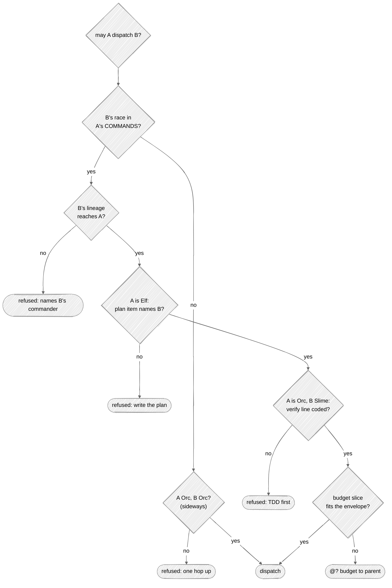
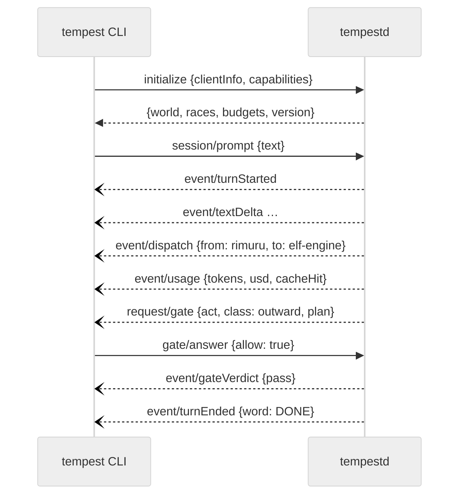

# Communication

Two different conversations happen in Tempest, and they speak different languages:

- **between bodies** — the wire: terse, tagged, built to save tokens;
- **between the core and its clients** — the protocol: typed JSON-RPC, built to be exact;
- and toward you, always, plain human language.

## In one picture — one order, down and back

```mermaid
---
config:
  look: handDrawn
  theme: neutral
---
sequenceDiagram
    autonumber
    actor V as Veldora
    participant R as 👑 Rimuru
    participant E as 🌿 elf-engine
    participant O as 🪓 orc-engine
    participant S as 💧 slime-wire
    participant G as 🚪 gate
    V->>R: "the wire should read @W lines into Report.Wrote"
    R->>R: shape the ask · plan
    R->>E: @ASK draft +unsaid · @BUDGET 200k · the ask
    E->>E: plan deck: [wire parses @W → orc-engine]
    E->>O: @ASK verdict +unsaid · @BUDGET 120k
    O->>O: write the verify line on slime-wire's doc
    O->>S: @ASK draft +unsaid · @BUDGET 60k
    S->>S: edit wire/, its test, its doc
    S->>G: end of turn
    G-->>S: pass → log.md
    S-->>O: @S DONE · @F wire/parse.rs:88 · @U territory … · @E
    O-->>E: @S DONE · @V landing holds · @E
    E-->>R: @S DONE · lane verdict · @E
    R-->>V: "Done — @W lines now fill Report.Wrote; the test is wire/parse.rs."
```

## In plain words

An order travels down one rank at a time, and each rank passes down only what the next one
needs. Rimuru never talks to a Slime; an Elf never talks to another Elf. The answer travels back
up the same way, each rank compressing what it heard.

Between bodies the messages are short tagged lines instead of prose — `@S` opens an answer,
`@F` is one finding with a `file:line`, `@E` closes. Long things are never pasted; they are
written to a file and the path is sent. This is how a deep chain stays affordable.

The `@U` line is the most important one: it is something the body learned that is written
nowhere on disk. When a body's context dies, its `@U` lines are what survives — they are filed as
shared notes and ontology facts automatically.

## Technical detail

### The wire envelope

**Asking (a commission):**

| Tag | Meaning |
|---|---|
| `@ROOT <path>` | territory pin |
| `@SCOPE …` | what is in scope |
| `@ASK findings\|verdict\|draft [+unsaid] [wire:raw]` | what is wanted; picks the office (read → judge → write) |
| `@CAP <bytes>` | answer ceiling, default 2048 |
| `@BUDGET tokens=… steps=… usd=…` | the slice of the parent's envelope ([Consumption](06-consumption.md)) |
| `@DUMP <path>` | where overflow goes |

**Answering (a report):**

| Tag | Meaning |
|---|---|
| `@S <word>` | opens: `DONE`, `PASS`, `FAIL`, `ESCALATE`, `CHECKPOINT`, … |
| `@F <file:line> <claim>` | one finding |
| `@V <claim> <evidence>` | a verdict |
| `@W <path>` | a path written |
| `@? <hole>` | something unresolved — never guessed |
| `@U law\|colony\|territory <fact>` | the unsaid |
| `@$ <body>: <ask>` | an order for the next turn |
| `@FORGE <draft>` | a repeating need worth becoming a tool or Mind |
| `@E <bytes>` | closes |

Over `@CAP`, the report is trimmed in a fixed order — `@FORGE`, `@F`, `@V` go first; `@S`, `@?`
and `@U` are never dropped. A report over 600 bytes travels as an envelope: a file under
`.tempest/instruments/loop/`, its hash, the written paths, an eight-line digest.

In code the wire is one crate (`tempest-wire`) with a parser and an encoder that round-trip;
every tag is an enum variant, and the property test is `parse(encode(r)) == r` for any report.

### Dispatch rules, all compiled in



The return path: the child's report is the parent's tool result, headed by the exit line
`@S <word>`; its written paths are recorded as court work so the parent's gate does not judge them
twice; its `@U` lines are landed; the value ledger folds the run; council warrants, ascensions
and evolutions ride the report as bracketed notes.

### The client protocol

`tempestd` exposes one JSON-RPC 2.0 API. The CLI reaches it over stdio, the board over a loopback
WebSocket. Types are defined in Rust and generated into TypeScript (`@tempest/protocol`), so the
clients cannot drift.



| Kind | Examples |
|---|---|
| requests (client → core) | `initialize`, `session/prompt`, `session/interrupt`, `session/resume`, `gate/answer`, `world/status`, `ledger/query`, `config/explain` |
| requests (core → client) | `gate/ask` — the human gate, the only call the core blocks on |
| events (core → client) | `turnStarted`, `textDelta`, `toolCall`, `toolResult`, `dispatch`, `report`, `usage`, `gateVerdict`, `ascension`, `evolution`, `checkpoint`, `turnEnded` |

Rules:

- Every event carries `{session, run, body, seq}`; `seq` is monotonic so a client that reconnects
  asks for `since: seq` and loses nothing.
- The gate request times out to *deny*, never to *allow*.
- The board's WebSocket accepts only `Host: 127.0.0.1|localhost`, checks `Origin`, and requires
  the per-launch token the CLI prints — reads included, not only acts.
- Protocol changes are versioned; the generated TypeScript is checked in and CI fails on a diff.
