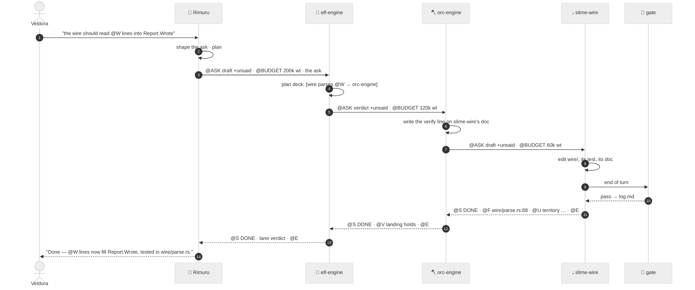
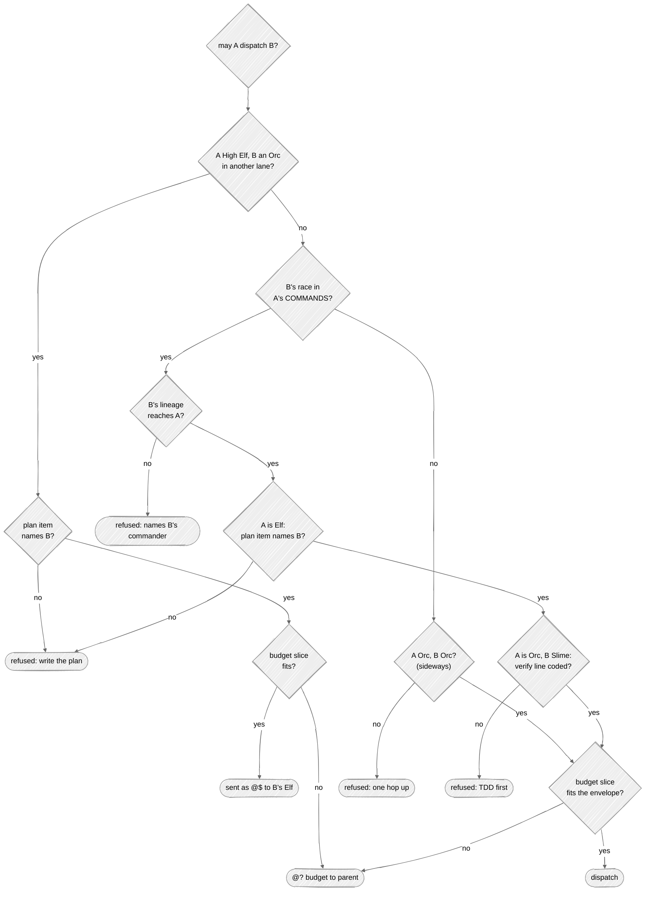
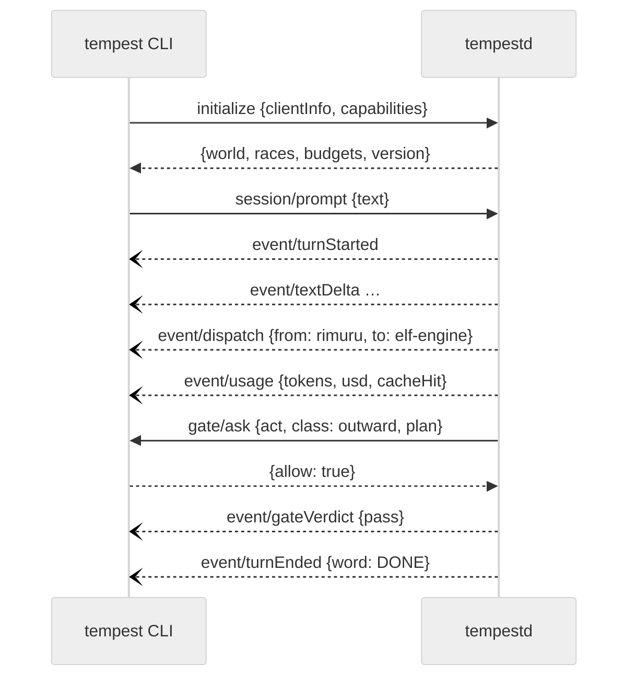

# Communication

Two different conversations happen in Tempest, and they speak different languages:

- **between bodies** — the wire: terse, tagged, built to save tokens;
- **between the core and its clients** — the protocol: typed JSON-RPC, built to be exact;
- and toward you, always, plain human language.

## In one picture — one order, down and back

## In plain words

An order travels down one rank at a time, and each rank passes down only what the next one
needs. Rimuru never talks to a Slime; an Elf never talks to another Elf. The answer travels back
up the same way, each rank compressing what it heard.

Between bodies the messages are short tagged lines instead of prose — `@S` opens an answer,
`@F` is one finding with a `file:line`, `@E` closes. Long things are never pasted; they are
written to a file and the path is sent. This is how a deep chain stays affordable.

The `@U` line is the most important one: it is something the body learned that is written
nowhere on disk. When a body's context dies, its `@U` lines are what survives — they are filed as
shared notes and ontology facts automatically.

## Technical detail

### The wire envelope

**Asking (a commission):**

| Tag | Meaning |
|---|---|
| `@ROOT <path>` | territory pin |
| `@SCOPE …` | what is in scope |
| `@ASK findings\|verdict\|draft [+unsaid] [wire:raw]` | what is wanted; picks the office (read → judge → write) |
| `@CAP <bytes>` | answer ceiling, default 2048 |
| `@BUDGET <cost>` | the carved slice of the parent's cost envelope ([Consumption](06-consumption.md)); steps and clock are not carved |
| `@DUMP <path>` | where overflow goes |
| `@SIZE <bytes>` | a draft's payload budget |

**Answering (a report):**

| Tag | Meaning |
|---|---|
| `@S <word>` | opens: `DONE`, `PASS`, `FAIL`, `ESCALATE`, `CHECKPOINT`, … |
| `@F #<id> <file:line> <claim> [witness:<path>]` | one finding; the id lets a later fix, contest or seal point at it |
| `@V <claim> <evidence>` | a verdict |
| `@W <path>` | a path written |
| `@? <hole>` | something unresolved — never guessed; three grammars are typed: `@CAP <n>: <k> lines cut — full report at <path>`, `contest #<id>: <reason>`, `budget: need ~<n> wt, have <m> wt` |
| `@U law\|colony\|territory <fact>` | the unsaid |
| `@$ <body>: <ask>` | an order for the next turn |
| `@FORGE <draft>` | a repeating need worth becoming a tool or Mind |
| `@T <tool> <cost>` | a tool offered in the level-1 manifest |
| `@R <path>` · `@H <hash>` | courier envelope: where the full report lies, and its hash |
| `@E <bytes>` | closes |

Two limits, two jobs. `@CAP` (2048 bytes) is what the **writer** may send: over it, lines are
cut from the end of each list in a fixed order — prose, `@T`, `@FORGE`, `@W`, `@F`, `@V` — and a
hole names the cut (`@? @CAP 2048: 12 lines cut — full report at <dump>`). `@S`, `@?`, `@U`,
`@R`, `@H` and `@$` are never cut: losing a hole, the unsaid, the courier or an order costs more
than any byte. The courier threshold (600 bytes) is what the **reader** receives inline: a report
between 600 and 2048 bytes is complete, but travels as an envelope — `@R` to the file under
`.tempest/instruments/loop/`, `@H`, one `@W` per written path, the orders, and a digest of the
first eight verdicts and findings — and the parent opens the file only when its verdict needs the
flesh.

Every emitted report closes with `@E <n>`, the exact byte length of the whole answer, its own
line included. Re-cutting a report that was already cut folds the earlier `@CAP` hole into one,
counting every line dropped along the way.

The grammar's readings, all of them:

- **No field opens a line.** A line break inside any field is folded to a space when emitted, so
  text cannot forge an `@S`, an order or an `@E`.
- **The raw pipe form** (`S|DONE`, `F|a.rs:3|claim`, `U|law|text`, `$|body|ask`) is read only
  when the commission said `wire:raw`; otherwise a line like `S|DONE` is prose.
- **An order's body is one word** (`@$ orc-auth: …`) and is read lower-cased; `@$ note this: …`
  is prose, not an order.
- **An untyped `@U`** whose first word is `law`, `colony` or `territory` reads as typed.
- **A finding's claim** whose first word would read as an id or a location, or whose last word
  would read as a witness, is fenced with `—` when emitted and read back as written; its
  whitespace is folded to single spaces, and an empty id is no id. `Finding::address` gives any
  finding a stable ten-hex id from its location, claim and witness.
- **`@CAP 0`** is refused like any bad value: it never means "no ceiling".
- Fields are trimmed; `@ASK +unsaid` alone is an empty ask with the flag set.

Council answers (`@INSTRUCT`, `@SPLIT`, `@ESCALATE`) are not wire tags yet: the loop that sends
them (M5) defines them, here, when it lands.

In code the wire is one crate (`tempest-wire`, no dependencies) with a parser and an encoder that
round-trip; property tests hold `parse(emit(r)) == r` for any report, an exact `@E`, and a cut
that never loses what must stay.

### Dispatch rules, all compiled in

The return path: the child's report is the parent's tool result, headed by the exit line
`@S <word>`; its written paths are recorded as court work so the parent's gate does not judge them
twice; its `@U` lines are landed; the value ledger folds the run; council warrants, ascensions
and evolutions ride the report as bracketed notes.

### The client protocol

`tempestd` exposes one JSON-RPC 2.0 API. The CLI reaches it over stdio, the board over a loopback
WebSocket. Types are defined in Rust and generated into TypeScript (`@tempest/protocol`), so the
clients cannot drift.

| Kind | Examples |
|---|---|
| requests (client → core) | `initialize`, `session/prompt`, `session/interrupt`, `session/resume`, `world/status`, `ledger/query`, `config/explain` |
| requests (core → client) | `gate/ask` — the human gate, the only call the core blocks on; the answer is its JSON-RPC response |
| events (core → client) | `turnStarted`, `textDelta`, `toolCall`, `toolResult`, `dispatch`, `report`, `usage`, `gateVerdict`, `ascension`, `evolution`, `checkpoint`, `turnEnded` |

Rules:

- Every event carries `{session, run, body, seq}`; `seq` is monotonic so a client that reconnects
  asks for `since: seq` and loses nothing.
- An unanswered gate never allows. After 10 minutes the run checkpoints as `SUSPENDED` (a neutral
  word: no strain, no failure) and resumes at that act when the human answers — an overnight run
  waits instead of dying.
- The board's WebSocket accepts only `Host: 127.0.0.1|localhost`, checks `Origin`, and requires
  the per-launch token the CLI prints — reads included, not only acts.
- Protocol changes are versioned; the generated TypeScript is checked in and CI fails on a diff.
