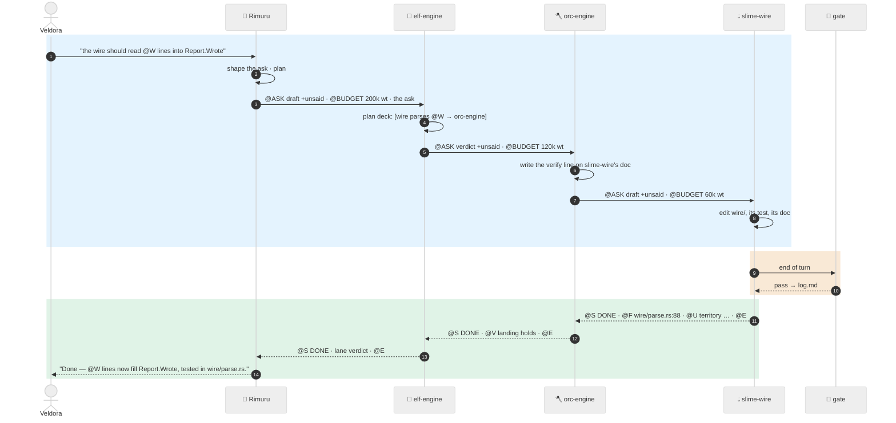
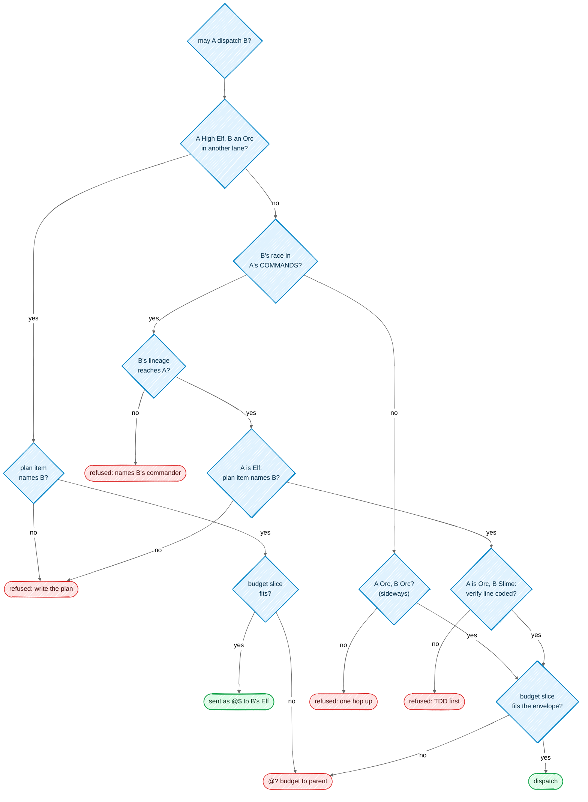
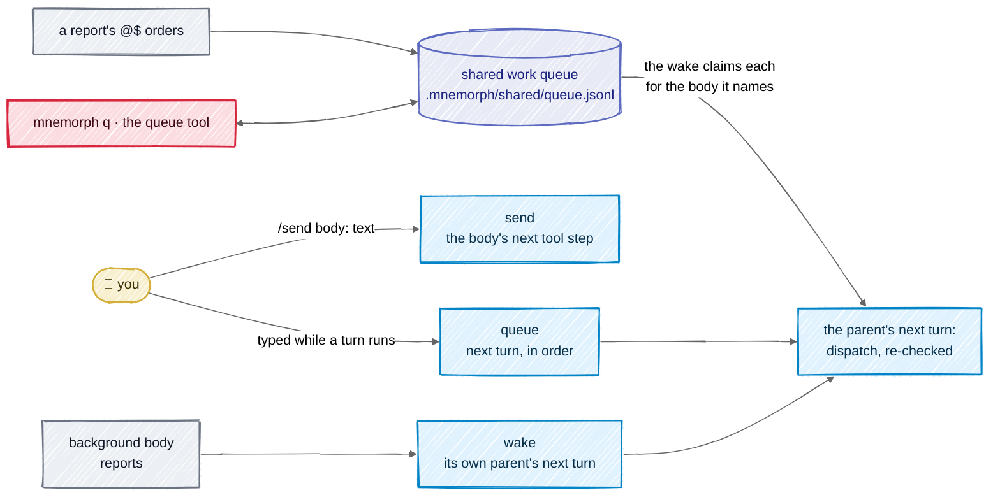
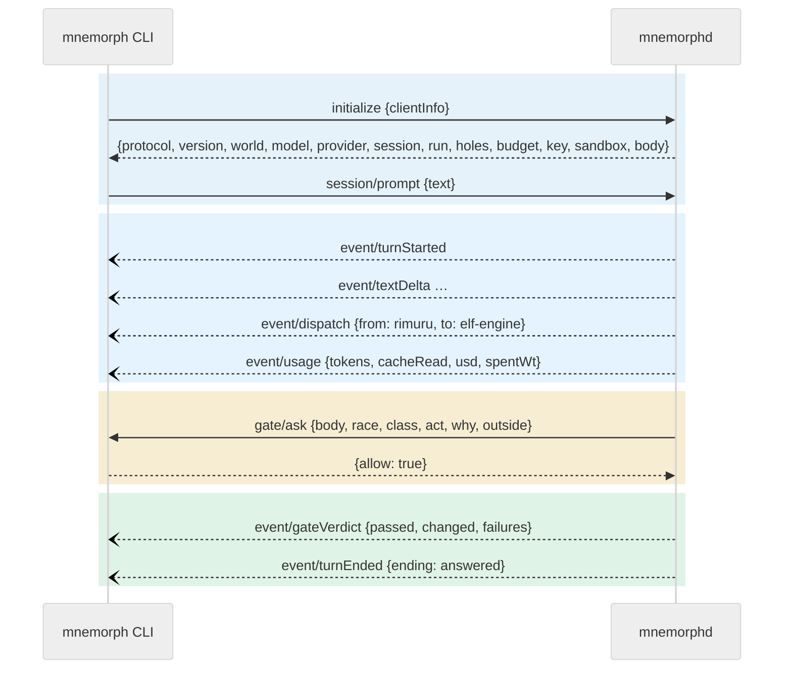

# Communication

Two different conversations happen in Mnemorph, and they speak different languages:

- **between bodies** — the wire: terse, tagged, built to save tokens;
- **between the core and its clients** — the protocol: typed JSON-RPC, built to be exact;
- and toward you, always, plain human language.

## In one picture — one order, down and back

## In plain words

An order travels down one rank at a time, and each rank passes down only what the next one
needs. Rimuru never talks to a Slime; an Elf never talks to another Elf. The answer travels back
up the same way, each rank compressing what it heard.

Between bodies the messages are short tagged lines instead of prose — `@S` opens an answer,
`@F` is one finding with a `file:line`, `@E` closes. Long things are never pasted; they are
written to a file and the path is sent. This is how a deep chain stays affordable.

The `@U` line is the most important one: it is something the body learned that is written
nowhere on disk. When a body's context dies, its `@U` lines are what survives — they are filed in
the creature's personal memory as proposed notes, and reach shared memory once a check or the
parent's verdict confirms them ([memory](08-memory.md)); territory facts go to the ontology, with
who said them and on what evidence ([ontology](09-ontology.md)).

## Technical detail

### The wire envelope

**Asking (a commission):**

| Tag | Meaning |
|---|---|
| `@ROOT <path>` | territory pin |
| `@SCOPE …` | what is in scope |
| `@ASK findings\|verdict\|draft [+unsaid] [wire:raw]` | what is wanted; picks the office (read → judge → write) |
| `@CAP <bytes>` | answer ceiling, default 2048 |
| `@BUDGET <cost>` | the carved slice of the parent's cost envelope ([Consumption](06-consumption.md)); steps and clock are not carved |
| `@DUMP <path>` | where overflow goes |
| `@SIZE <bytes>` | a draft's payload budget |

**Answering (a report):**

| Tag | Meaning |
|---|---|
| `@S <word>` | opens: `DONE`, `PASS`, `FAIL`, `ESCALATE`, `CHECKPOINT`, … |
| `@F #<id> <file:line> <claim> [witness:<path>]` | one finding; the id lets a later fix, contest or seal point at it |
| `@V <claim> <evidence>` | a verdict; a parent landing a free territory fact labels it `@V #<new-id> support\|counter\|refines #<id>` or `@V #<new-id> distinct` ([ontology](09-ontology.md#catching-what-nobody-flags)) |
| `@W <path>` | a path written |
| `@? <hole>` | something unresolved — never guessed; three grammars are typed: `@CAP <n>: <k> lines cut — full report at <path>`, `contest #<id>: <reason>`, `budget: need ~<n> wt, have <m> wt` |
| `@U law\|colony <fact>` · `@U territory <about> <key>=<value>` · `@U territory <about> <fact>` · `@U territory <about> !#<fact-id> <reason>` | the unsaid; a territory fact names the path it is about, keyed or free, and may counter another fact by id ([ontology](09-ontology.md#facts-who-said-what)) |
| `@$ <body>: <ask>` | an order for the next turn |
| `@FORGE <draft>` | a repeating need worth becoming a tool or Mind |
| `@T <tool> <cost>` | a tool offered in the level-1 manifest |
| `@M <anchor> <scope> <standing> <polarity>` · `@M -<n> <anchors>` | a recalled note, and the count cut above the floor ([memory](08-memory.md)) |
| `@ONTO <path>: <owner> · <facts>` | the ontology's projection for a body: who owns the paths it touches, and at most $k$ of their facts, each with its `#<fact-id>` so a counter can name it — contested first with both sides, then countered, then the rest by recency; `@ONTO -<n>` counts the facts cut ([ontology](09-ontology.md)) |
| `@R <path>` · `@H <hash>` | courier envelope: where the full report lies, and its hash |
| `@E <bytes>` | closes |

Two limits, two jobs. `@CAP` (2048 bytes) is what the **writer** may send: over it, lines are
cut from the end of each list in a fixed order — prose, `@T`, `@FORGE`, `@W`, `@F`, `@V` — and a
hole names the cut (`@? @CAP 2048: 12 lines cut — full report at <dump>`). `@S`, `@?`, `@U`,
`@R`, `@H` and `@$` are never cut: losing a hole, the unsaid, the courier or an order costs more
than any byte. The courier threshold (600 bytes) is what the **reader** receives inline: a report
between 600 and 2048 bytes is complete, but travels as an envelope — `@R` to the file under
`.mnemorph/instruments/loop/`, `@H`, one `@W` per written path, the orders, and a digest of the
first eight verdicts and findings — and the parent opens the file only when its verdict needs the
flesh.

Every emitted report closes with `@E <n>`, the exact byte length of the whole answer, its own
line included. Re-cutting a report that was already cut folds the earlier `@CAP` hole into one,
counting every line dropped along the way.

The grammar's readings, all of them:

- **No field opens a line.** A line break inside any field is folded to a space when emitted, so
  text cannot forge an `@S`, an order or an `@E`.
- **The raw pipe form** (`S|DONE`, `F|a.rs:3|claim`, `U|law|text`, `$|body|ask`) is read only
  when the commission said `wire:raw`; otherwise a line like `S|DONE` is prose.
- **An order's body is one word** (`@$ orc-auth: …`) and is read lower-cased; `@$ note this: …`
  is prose, not an order.
- **An untyped `@U`** whose first word is `law`, `colony` or `territory` reads as typed.
- **A finding's claim** whose first word would read as an id or a location, or whose last word
  would read as a witness, is fenced with `—` when emitted and read back as written; its
  whitespace is folded to single spaces, and an empty id is no id. `Finding::address` gives any
  finding a stable ten-hex id from its location, claim and witness.
- **`@CAP 0`** is refused like any bad value: it never means "no ceiling".
- Fields are trimmed; `@ASK +unsaid` alone is an empty ask with the flag set.

Council answers (`@INSTRUCT`, `@SPLIT`, `@ESCALATE`) are not wire tags yet: the loop that sends
them (M5) defines them, here, when it lands.

In code the wire is one crate (`mnemorph-wire`, no dependencies) with a parser and an encoder that
round-trip; property tests hold `parse(emit(r)) == r` for any report, an exact `@E`, and a cut
that never loses what must stay.

### Dispatch rules, all compiled in

The law decides on five facts and the world finds them, from the creature docs: the lineage
(the target's chain of command reaches the dispatcher), the plan item (an open
`- [ ] <creature>: <item>` line of the `plan.md` in the dispatcher's seat names the target), the verify line (the target Slime's doc carries one), the lane (the
first Elf above the target is not the dispatcher) and the budget (the slice fits what the
envelope has left). A refusal names the creature the order goes to instead:

| Refused | The lawful next act |
|---|---|
| not one hop | below the dispatcher: commission the next rank toward the target; else report it to the dispatcher's commander |
| not your line | ask the target's own commander |
| no plan item | open a plan item that names the target |
| verify first | code the verify line on the target's doc |
| budget | `@? budget: need ~<n> wt, have <m> wt` to the dispatcher's commander |

A name that is no living creature is refused before the law is asked: Rimuru routes its birth;
so is a route that would name one — a retired commander takes no order. The verify fact is
that the Slime's doc carries a non-blank verify line, not that the line tests this change; the
budget fact is the slice against what is left, the per-race share being a carving rule. Dispatch
trusts the chain as the docs write it: a loop or a skipped rank is the findings' to report
([ontology](09-ontology.md#findings)), and a target that reports to its dispatcher across a
skipped rank is refused with that said.

A dispatching body (Rimuru, an Elf, an Orc) holds a `commission` tool: `{to, ask, budget_wt}`.
The human's session holds it when the world's docs have a living throne with Elves reporting to
it: Rimuru keeps its solo tools for small asks, and its prompt names each Elf and its lane; a
world with no creatures stays solo.
The loop runs the call. It asks the law, and a refusal is the tool's result, naming the creature
the order goes to instead. A lawful order runs the child with a fresh context: its doc and the
order as its prompt, its soil as its tools' border, its verify lines and *right author* as its
end gate, its slice of the dispatcher's envelope (half of what is left unless the call names
one) as its budget, and the same commission tool when its race dispatches, so the order goes on
down. What the child changed off its ground — its gate refused it — is put back from the attic,
a new file removed; a child that did not answer — a FAIL, an ESCALATE, a checkpoint, an Esc — has its
whole landing put back, what it spent charged, and may be commissioned again; what an answering child and
its own commissions landed is the dispatcher's court work, which its gate does not judge again —
as landed: a later edit to it is the dispatcher's own, and so is anything the dispatcher had
changed on that path before the commission; a stray that could not be put back stays in front
of every gate above; and what the child spent counts against the dispatcher's envelope. One
court per seat: a body never commissions itself, nor a seat already at work. An answer that does
not open with `@S` reaches the dispatcher as a FAIL, never a DONE; the human's Esc reaches every
body the order went down to. An answering child's `@U territory` lines — any answer on the wire, whatever its `@S`
word — are filed as facts in its name — a support, or a counter naming an id — in the ontology's journal
([facts](09-ontology.md#facts-who-said-what)).

The return path: the child's report is the parent's tool result, headed by the exit line
`@S <word>`; its written paths are recorded as court work so the parent's gate does not judge them
twice; its `@U` lines are landed as proposed notes, and the parent's verdict accepts or rejects
each by name; the value ledger folds the run; council warrants, ascensions
and evolutions ride the report as bracketed notes.

### The lanes of a session, and the shared queue

**In plain words.** A session never loses what arrives while it works. What you type during a
turn waits its turn; what you `/send` reaches a running body at its next tool step; a background
body's report wakes the body that sent it. Work ordered down the ranks (`@$` lines) is written to a
shared queue on disk that every session, the terminal, the board and `mnemorph q` can see — so a
restart, a second session or a lost report never drops an order, and nobody has to wonder what is
waiting.

**The lanes**, all in the core (never a client-side buffer a dead turn could own):

| Lane | Filled by | Reaches | When |
|---|---|---|---|
| **queue** | the human typing while a turn runs; piped input | the session, as its next turn | in order, after the current turn ends; Esc interrupts and the next queued line starts at once |
| **send** | `/send <text>` in solo; `/send <body>: <text>` once the world has bodies (M7) | one running body | at its next tool step — steering, never a new task |
| **wake** | a background body's report | its own parent, at that parent's next turn | depth-agnostic: a slime's report wakes its orc, not the throne |

Queue and send are two lanes, never one inbox: a queued line must not ride the running turn.

**The shared work queue** is the durable form of the order book.

- One file, `.mnemorph/shared/queue.jsonl`, on the shared shelf: harness soil, ignored by git, so
  the queue belongs to one machine. It moves only through the harness and the human's `mnemorph q`;
  each line they write is written again to a witness under the human's state directory
  (`$XDG_STATE_HOME/mnemorph/queue/`), out of every command's reach. A body's command that touches
  the queue has it rebuilt from what it held and what the witness gained since, in the witness's
  order — whatever the command did to the file, a forged line, a deletion or a link in its place,
  never counts, and the human's moves made while the command ran are kept. A move made during a
  body's turn is never billed to that body. Every move appends the item's whole snapshot as one line
  with its revision; the queue is a fold over the lines. A line that does not follow its item's last
  revision is a typed refusal — two sessions claiming one item both append, the first wins, the
  second reads back refused. No lock file, no database.
- States: `held → claimed → done | dropped`. An item names the body it is ordered to — a living
  body of the roster, or the throne — its rank (lower runs first; ties run in order of arrival),
  who ordered it, the order, and its notes. Orders go down the ranks: a body orders only bodies
  below it, and only the human orders the throne's work.
- **Rank law.** A body moves the work it holds; anyone up the holder's reporting chain may move it
  too; work held by no one is the throne's. The human stands over every body.
- **Relay-hold.** A report's `@$` orders are held on the queue; nothing dispatches a held row
  mid-turn. At the turn boundary the wake claims each held row in the name of the body it is
  ordered to and opens the next turn with its dispatch — the queue id named, the body's earlier
  report as thread — and the dispatch rules check it again. The body's report settles its oldest
  claim: `DONE` closes it, any other word leaves it claimed with the exit noted. An order a
  commission expected and the report did not book is a hole for the parent.
- **Doors.** `mnemorph q list [--all] | show | add [--for] [--rank] | claim [--as] | touch |
  requeue | close [--drop]` for the human (`--json`; a refusal exits 2); a `queue` tool on every
  shelf for bodies — reading is free, moving takes only what the body holds or stands over, and a
  body never claims: only the human and the harness's wake do, so work reaches a body claimed in
  its name. The wake claims only an order its body can carry out: the dispatch rules hold, and
  what the order touches lies on that body's ground. The status line reads "N held".
- The queue does not travel with the repository. Orders that must reach another machine travel
  as what made them — a commission's report in the journal, a `@?` the human answers.

### The client protocol

`mnemorphd` exposes one JSON-RPC 2.0 API. The CLI reaches it over stdio, the board over a loopback
WebSocket. Types are defined in Rust and generated into TypeScript (`@mnemorph/protocol`), so the
clients cannot drift.

| Kind | Served by the solo session | Served once the world is |
|---|---|---|
| requests (client → core) | `initialize`, `session/prompt`, `session/send`, `session/interrupt`, `session/events {since}`, `shutdown` | `session/resume`, `queue/list`, `queue/move`, `world/status`, `ledger/query`, `config/explain` |
| requests (core → client) | `gate/ask` — the human gate, the only call the core blocks on | |
| events (core → client) | `turnStarted`, `queued`, `textDelta`, `toolStart`, `assistant`, `toolCall`, `toolResult`, `usage`, `note`, `warning`, `gateVerdict`, `turnEnded` | `dispatch`, `report`, `held`, `ascension`, `evolution` |

Each message is one line of JSON. `initialize` opens the session and answers `{protocol, version,
world, model, provider, session, run, holes, budget}`; a client that speaks another `protocol` stops
rather than misread. Each event is the notification `event/<type>`, its fields beside the
envelope. `session/prompt {text}` answers `{queued}` at once: a line sent while a turn runs
waits its turn, and the session takes lines strictly in the order they came. `gate/ask` sends
`{race, class, act, why, outside}`, and the client answers `{allow, reason?}`. A `usage` event
carries the turn's tokens, cache reads and writes, its price, and the run's spend and context
against its stress line, for the status line. A `toolResult` carries at most 16 000 bytes and
says how many it cut; the journal keeps the whole.

`mnemorphd` serves it: `mnemorphd [--world <dir>]` speaks on stdin and stdout, opens the solo
session from the world's configuration on `initialize`, and answers `--help` and `--version`
before it looks for any world. Inside, one thread owns the output, so no two lines interleave or
reorder; one thread reads the input and answers the gate's waits itself, so a gate holding a
turn never blocks the read that would release it; and one task owns the session.

The clients reach it through two packages. `@mnemorph/protocol` is the protocol's types,
generated from the Rust (`ts-rs`) into `src/generated` and checked in: the check regenerates them
and fails when they drift, and a test holds the TypeScript `PROTOCOL` to the core's. `@mnemorph/sdk`
is the client: `stdio()` starts `mnemorphd` and speaks on its pipes; a `Client` sends typed
requests, refuses a core that speaks another protocol, delivers every event to its listeners in
order and once each (`resync()` replays from the last `seq` it saw, dropping what it already
had), answers `gate/ask` with the handler the interface gives it — denying when there is none —
and fails whatever waits when the core's end closes, with the reason the core gave.

**The terminal client.** `mnemorph` starts the core and opens a session in this world; `mnemorph
run "<ask>"` asks once, prints the answer on stdout and the calls and the ending on stderr, and
exits 0 only when the body answered. `run` reads its ask from stdin only when none is on the
command line (`run` or `run -`), so an inherited open pipe never holds it, and it asks no one:
an act that needs the human is denied, and the denial says so. `--help` and `--version` answer
before any world is looked for; a core that will not start says why on the terminal before
anything is drawn, and one that goes away mid-session is said on the terminal, with exit code 1.
In a session the transcript goes to the terminal's own scrollback, printed once per item and
again whole when the width changes — the screen is cleared, the scrollback above kept. A
paragraph leaves the live region as soon as it is finished, and what still streams shows only
the lines the terminal has room for, so the live region never outgrows it. Below the transcript
live the text as it streams, the
calls that run, the lines waiting their turn, an approval when one is asked, the input, and the
status line — model, spend (`unpriced` when the price tables do not know the model), context
against the stress line, the cache's share, and what the human's caps leave
([consumption](06-consumption.md)); before the first call it says nothing of spend. A tool call
shows as soon as it starts, before its input has streamed. **`mnemorph status`** — and `/status`
in a session — prints the build's version and commit, the core's, where the provider's key comes
from (its variable and the file that names it, never the value), the sandbox actually in force
(or `none — <reason>`) and what the caps leave; the hello carries the core's part (`key`,
`sandbox`). **`mnemorph onto owner <path>...`** asks the core who owns each path, by which rule
and claim ([ontology](09-ontology.md#ownership-one-function)), with no session and no key.
**Enter** sends, and while a turn runs the line
waits its turn; **Alt+Enter** (Shift+Enter where the terminal reports it) starts a new line;
**`/send <text>`** steers the turn that runs — `session/send`, refused when nothing runs, the
text reaching the body after its next tool step as the human's, and said to the human when the
turn ends first; **Esc** stops the turn; **Ctrl+C** stops the turn and denies an open approval, or quits when
nothing runs — within a second, whether the core answers or not; **↑ ↓** walk the
history. An approval is chosen with **y** or **n** and confirmed with **Enter**, so a key typed as
the box appears approves nothing; **Esc** denies it; while it is open, keys typed and pastes are dropped; and one
whose turn ended unanswered is denied and cleared. The cursor moves by whole characters, an
emoji as one. Every
printable character is text while the input has focus, and keys that arrive together are taken
in order, a carriage return among them as Enter.

Rules:

- Every event carries `{session, run, body, seq}`; `seq` rises by one, in the order events reach
  the wire, so a client that reconnects asks `session/events {since: seq}` and loses nothing. The
  core keeps the last 10 000: the answer says the oldest it kept (`oldest`), and `complete: false`
  when the client asked from further back, so a gap is never silent.
- An event from a body the session commissioned carries that body and its run, at any depth: the
  client sees the whole order at work. The terminal shows such events as short lines under the
  body's name — what it started on, each tool call, a gate that refused it, how it ended — and
  never lets them touch the session's own turn; the hello names the session's own body, so even a
  replay that opens mid-commission tells them apart. An approval names the body asking, and a
  body's dollars below count in the session's spend.
- Leaving ends everything at once: on `shutdown`, or when the client's end closes, every act
  waiting at the gate is denied, the turn in flight stops, lines still queued never run, and the
  core exits once its output is written. Esc (`session/interrupt`) denies an act waiting at the
  gate as part of the turn it stops.
- One message per line; a batch is refused by name, and a notification is never answered.
- An unanswered gate never allows. After 10 minutes the act is denied and the body is told the
  human did not answer; with resume (M7) the run checkpoints as `SUSPENDED` instead (a neutral
  word: no strain, no failure) and resumes at that act when the human answers — an overnight run
  waits instead of dying.
- The board's WebSocket accepts only `Host: 127.0.0.1|localhost`, checks `Origin`, and requires
  the per-launch token the CLI prints — reads included, not only acts.
- Protocol changes are versioned; the generated TypeScript is checked in and CI fails on a diff.
