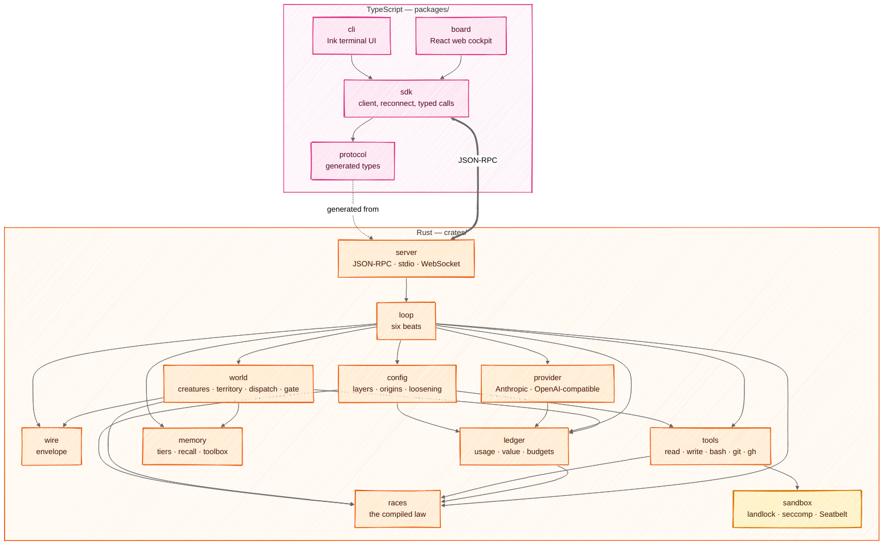
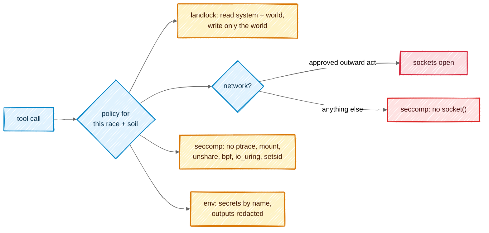
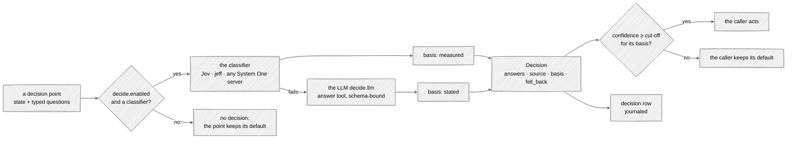

# Architecture

## In one picture



## In plain words

All the decisions live in Rust, in small crates that each do one thing and can be tested alone.
The TypeScript side only shows things and asks you questions: the terminal UI and the web board
are two windows onto the same core. The arrows only point downward — `races` knows nothing about
networks, `wire` knows nothing about models — so each piece can be proven before the next is
built on it. `tools/check-layers.mjs` holds the same graph and fails on any edge it does not
draw.

## Technical detail

### The repository

```
mnemorph/
├─ crates/
│  ├─ mnemorph-wire       envelope types, parser, encoder            (no I/O)
│  ├─ mnemorph-races      Race enum, shelves, dispatch, scores, falls (no I/O)
│  ├─ mnemorph-ledger     usage + value ledgers, budgets, prices      (files)
│  ├─ mnemorph-provider   streaming clients, retry ladder, caching,   (network)
│  │                      System One decisions with an LLM fallback
│  ├─ mnemorph-sandbox    landlock + seccomp, Seatbelt, net policy    (OS)
│  ├─ mnemorph-tools      tool impls, classifier, secret injection    (OS)
│  ├─ mnemorph-config     TOML layers, origins, the gate's loosening  (files)
│  ├─ mnemorph-memory     tiers, BM25 recall, toolbox manifest        (files)
│  ├─ mnemorph-world      creatures, onto, dispatch, gate, evolution  (files)
│  ├─ mnemorph-loop       the six beats, journal, resume              (all above)
│  ├─ mnemorph-server     JSON-RPC, WebSocket, board assets           (network: loopback)
│  └─ mnemorphd           the binary
├─ packages/
│  ├─ protocol           generated from crates via ts-rs; checked in
│  ├─ sdk                transport (stdio | ws), reconnect by seq
│  ├─ cli                `mnemorph` — Ink + React
│  └─ board              Vite + React; built into mnemorphd
├─ docs/                 this book
├─ .mnemorph/             Mnemorph builds itself as a world
└─ justfile              one entry point for every task
```

### Choices, and why

| Concern | Choice | Why |
|---|---|---|
| async runtime | tokio | the ecosystem default; cancellation via `CancellationToken` everywhere |
| HTTP | reqwest + rustls | no OpenSSL; private CA bundles loadable |
| server | axum | WebSocket + static assets + JSON-RPC in one router |
| types → TS | ts-rs | one source of truth for the protocol |
| config | TOML via `toml_edit` | edits preserve comments; isekai's YAML-append bug cannot exist |
| recall | tantivy (BM25) | local, model-free by default (Nature 7) |
| errors | `thiserror` in crates, `anyhow` only in `mnemorphd` | typed failures cross crate borders |
| logs | `tracing` → JSON file under the world | the journal is an instrument |
| tests | nextest, insta snapshots, proptest; vitest + ink-testing-library; Playwright for the board | every rung testable alone |
| TS tooling | Node 22, pnpm workspaces, tsup, Biome | Node is already the platform Claude Code runs on |
| distribution | an npm package with per-platform optional deps carrying `mnemorphd`; plus a curl installer and GitHub release binaries | one `npm i -g` for users, a plain binary for servers. The names `mnemorph` on npm and crates.io are taken: the published names are settled in phase D |

### Storage: files are the truth

| What | Where | Tracked in git |
|---|---|---|
| law, creature docs, Minds | `.mnemorph/law.md`, `.mnemorph/<race>/<name>/README.md`, `.mnemorph/minds/` | yes |
| journal | `.mnemorph/log.md` — append-only writer | yes |
| shared notes | `.mnemorph/memory/shared/notes.jsonl` — append-only note events ([memory](08-memory.md)) | yes |
| personal notes | `.mnemorph/memory/creature/<name>.jsonl` — one creature's note events | yes |
| semantic cache | `.mnemorph/memory/short/` — one body's recent recalls | no — machine-local |
| shared work queue | `.mnemorph/shared/queue.jsonl` — append-only snapshots; its witness under `$XDG_STATE_HOME/mnemorph/queue/` | no — machine-local |
| Kijin post journals | `.mnemorph/kijin/<post>/post.jsonl` | yes |
| Dark Elf proving ground | `.mnemorph/dark-elf/` | yes (frozen witnesses are evidence) |
| plan | `.mnemorph/plan.md` — the throne's | yes |
| dimension manifest | `.mnemorph/dimension.toml` — the neighbouring worlds and their relations ([ontology](09-ontology.md#relations-between-worlds)) | yes |
| ontology facts | `.mnemorph/ontology/facts.jsonl` — territory facts, counters and settles, as events | yes |
| relation sightings | `.mnemorph/ontology/sightings.jsonl` — cross-world references seen, the ledger relations are learned from | yes |
| advisory mirror | `.mnemorph/intel/` — kept by `kijin-scout` | no — hundreds of MB |
| attic | `$XDG_STATE_HOME/mnemorph/attic/<world>/` (else `~/.local/state/…`) — outside the world, out of every command's reach: a git object store of working-tree snapshots, hard links to `.git`'s objects, copies of its refs | no |
| usage + value ledgers | `.mnemorph/instruments/*.jsonl` | no — machine-local |
| derived indexes | `.mnemorph/index/` | no — rebuildable |
| run journals | `.mnemorph/instruments/loop/` | no |

Every index is derived and can be deleted; `mnemorph index` rebuilds it. A stale index is rebuilt,
never routed around.

### Sandbox



- **A kernel guard, not a jail.** A jail gives a command another world — its own filesystem
  view, users and network. The guard does not: the command runs as the human, in the real
  files, with the real tools. It only has the kernel enforce a permission list on that one
  process — which folders it may read, that it may write only the world, whether it may open a
  socket. On Linux every command starts through `mnemorph-guard`: the helper sets the list on
  its own process and then *becomes* the command (`exec`), so it never stays in between and
  everything the command starts inherits the list. It runs once per command because the
  kernel's restrictions are one-way — a process can tighten, never loosen — so each command,
  with its own list, needs a fresh process; it costs about a millisecond. No unsafe code and no
  namespaces are needed, so it works where unprivileged user namespaces are restricted (Ubuntu
  23.10+ through AppArmor).
- **No guard, no command.** When no guard is in force — the helper missing, an unsupported
  system — `bash` refuses to run and says why. The human may choose otherwise with
  `sandbox.allow_unguarded = true` in their local or global file (never the tracked one); the
  status line then reads `none — <reason>`.
  - **landlock** — reads: the system's directories, the world, and the toolchains in the home
    (`.cargo`, `.rustup`, `.local/bin`, uv's interpreters and tools, …); never a credential path
    (`.ssh`, `.aws`, `.gnupg`, keyrings, uv's `credentials/`, …), which no rule names. Writes: the world, the command's temporary directory
    inside it, and a few devices — for solo. A commissioned creature's commands are granted
    exactly what its soil admits, and the rest of the world is read-only to them: landlock can
    allow a folder but never except a spot inside it, so a claim that holds another's spot (a
    seat, the queue, another's scratch) is granted part by part around that spot, existing
    entries each on its own. A claim reached through a link is no claim. Build output is granted
    besides the soil: what git ignores where `own` names the creature or nobody — never another's
    ignored files, the records (`.mnemorph/`) or git's own files, and never through a link. The
    guard resolves every rule to the file it names, so every grant is resolved first and kept
    only if it still resolves inside the world to the creature's own. Past a few hundred rules
    they reach the guard in an owner-only file it reads and removes before restricting itself.
    The temporary directory is the creature's own scratch nest, or, when that nest is a link, a
    fresh owner-only directory outside the world for that creature alone. Below landlock ABI 3,
    which cannot refuse `truncate` on a path, seccomp refuses the call.

    What this costs a commissioned creature, by design: in a folder that holds another's spot it
    cannot create, delete or rename its own files, so `sed -i`, editors' atomic saves and
    formatters that replace a file fail there — the file tools do that work; a build
    whose output directory or root lockfile does not exist yet cannot create it; `.git` is not
    its to write (landing is the harness's); a claimed folder that does not exist yet gets no
    grant until it is made. Landlock never governs a file's mode or times, so the end gate's
    snapshot records each file's mode and inode change time, which no process can set back:
    a `chmod`, a `touch` or a rewrite dressed in its old mtime counts as a change and is judged.
    The file tools run in the harness, not under landlock, each path checked against the soil
    and opened component by component without following a link: `read`, `write` (whole, atomic),
    `edit` (one exact replacement), `multiedit` (several, in order, all or none, and never a
    rewrite that leaves the file as it was), `move` (a file or a directory, both ends and every
    entry in it the body's own, never a folder holding another's spot, never into itself, never
    over an existing file) and `delete` (a file, only once the attic's snapshot holds a copy of it
    — so not what the attic leaves out: ignored files, build output, large files — or an empty
    directory), and `patch` (a unified diff across files: every file's result computed first, a
    hunk landing at its stated line or its one match elsewhere, nothing written when one does not
    apply, a file named twice taking each part in turn, a failed write putting back every file
    already changed; `/dev/null` creates or deletes, a delete under `delete`'s rule; line endings
    kept; a rename refused, for `move`; a binary, mode-only or empty-file `diff --git` block
    refused by name, never skipped). A link is moved or deleted as itself, never its target; git's own files are never
    a tool's; a refusal leaves the tree as it was, the directories a failed move made unmade; a
    write of what a file already holds writes nothing; and `edit` and `multiedit` refuse a file
    that is not UTF-8 text rather than replace its bytes.
    `sed -i` and `perl -i` are refused, pointing to `edit` and `multiedit`: an anchor that misses
    exits 0 and changes nothing.
    Layered, landlock refuses what it can, the tools refuse by name, and the end gate's *right
    author* judges every changed file the snapshot sees; what git ignores is build output and is
    not judged. Landlock also keeps a sandboxed process out of `/proc` of processes outside its
    domain, so the harness's environment is closed to its commands; the harness additionally
    makes itself non-dumpable.
  - **seccomp** — without network, `socket()` fails for every family, Unix sockets included (a
    host daemon's socket is a way out); `socketpair` stays. Always denied: `ptrace`,
    `process_vm_*`, `mount`, `unshare`, `setns`, `pivot_root`, `chroot`, `bpf`,
    `perf_event_open`, the kernel keyring, module loading, `io_uring` (it would bypass the
    socket rule).
  - **The network** opens only for an outward or destructive command the gate approved. An
    approval also opens the paths outside the world that the classifier located in the command
    — listed on the approval card — and nothing else: a path known only at run time stays shut.
    Each path opens alone, never its folder: a new file is first made, empty, by the harness so
    the sandbox can name it (and removed again if the command fails). An approved delete
    outside the world stays refused: the kernel ties deletion to the folder, and the folder is
    not opened.
  - **Limits** — no core dumps, files up to 4 GiB, at most 8192 processes for the user; and no
    new namespaces: `unshare` and a `clone` carrying a namespace flag fail, `clone3` reports
    itself missing so the C library falls back to `clone`.
- **The tripwire** covers what landlock cannot: landlock only adds access, so no read-only corner
  can be carved out of the writable world. Git's executable configuration (`.git/config` —
  `core.fsmonitor`, `core.sshCommand`, filter drivers — `.git/hooks`, `.git/info`, a `.git` file)
  would run code outside any sandbox the next time the human runs git, and `.mnemorph/` holds the
  world's records. Each command runs between two snapshots of them; once its process group is dead,
  every change is put back and the body is told. The file tools refuse those paths outright, but
  one: a body's own `plan.md`, directly in its own seat, which the dispatch law reads (an Orc's
  verify lines on its Slimes' docs are written by the harness, through the `verify` tool) — written
  with the file tools; a command's write there is put back, and a plan that is a link is no plan. On
  Linux no process escapes the snapshot: seccomp refuses `setsid` and `setpgid`, so killing the
  group ends everything the command started. A tool that insists on its own session or group
  (Python's `start_new_session`, Go's `Setsid`, a pty) fails there with `EPERM`, and coreutils
  `timeout` signals the whole command when it fires. Seatbelt has no such rule on macOS. The shared
  work queue is rebuilt from what it held and what its witness gained since — the witness, under the
  human's state directory, keeps every line the harness and the human's `mnemorph q` wrote — so
  nothing the command did to the file counts, a link in its place included, and the human's
  concurrent moves are kept. A body's own `mnemorph q` refuses (every command carries
  `MNEMORPH_BODY`, a courtesy; the tripwire is the border). `tmp/`, `intel/` and `report/` (where a check writes what it leaves) stay writable; a
  repository the command itself creates is its own. The snapshot keeps up to 16 MiB of content; a
  change to a protected file beyond that is reported, not undone.
- **The attic** keeps what a command or a write takes away, outside the world where the guard
  lets no command reach. Before every command and every file write, the working tree is
  snapshotted into the attic's own git object store — only changed files are hashed again.
  What the world ignores is left out, and so, by the attic's own rules whatever the world
  ignores, are build output and dependencies (`target`, `node_modules`, `.venv`, `dist`,
  `build`, …), the command's `.mnemorph/tmp` and the machine-local records (`instruments`,
  `index`, `intel`); a file that becomes ignored leaves the next snapshot. A file over 8 MiB is
  not kept, and the command's result names it. A command that deleted files is told how many
  and which snapshot holds them, so `rm -rf src` and a script that wipes a folder are both
  undone by restoring from it. The world's `.git` is kept another way: its objects are
  hard-linked into the attic (copied, across devices) and its refs copied, so a command that
  deletes or breaks `.git` finds it put back after it ends. A hard link shares the file, so it
  survives a deletion, not a write in place: deleting or changing `.git` or the world's records
  outright is `destructive`, so it asks first — and what the human approved, the attic keeps but
  does not undo. A world whose `.git` is a file — a worktree's, a submodule's — has its
  repository elsewhere: that file is kept, and put back when a command deletes it. A nested
  repository is kept as git keeps one, by its commit's name and none of its files, so the attic
  never says it holds one: a delete of it is told so. Two runs on one world take the attic in
  turn — a lock around every snapshot and restore — never colliding on its index. The attic's
  git runs deaf to every configuration but its own: no hooks, no filters, no attributes, no
  fsmonitor from the world or the human's files.
  It prunes itself at most once a day: snapshots older than `attic.keep_days` (14) go, then the
  oldest while the snapshot store is over `attic.max_mb` (2048) — the newest always stays — and
  `git gc` packs what remains; a kept `.git` object ages out with the same window only once the
  world itself has dropped it. The cap measures the snapshot store only: the kept `.git` objects are hard links
  and cost no disk beside the world's own. Measured on this repository: the first snapshot
  takes 1.8 s and about 13 MB (9 MB once packed); an unchanged one, 24 ms and nothing.
- **The file tools** run in the harness, not the sandbox, so they guard their own opens: a path
  is resolved and checked inside the world (and the soil, for writes), then opened again one
  component at a time from the world's root following no symlink, and written through a
  temporary sibling renamed inside the same directory handle. A directory swapped for a symlink
  between the check and the open fails the open instead of leading out.
- **The guard's rules have names** (`in-place-edit`, `secret-store`, `credential`,
  `not-literal`, `remote-code`, `unreadable`, …). The human's configuration may turn a rule into
  a question — the command then waits on the gate with the class it would have had — except
  the floor, which stays a refusal whatever any file says: `root-path`, `device`,
  `machine-tool`, `fork-bomb`. A floor refusal displaces any askable one found earlier in the
  same command, so no co-occurring rule can turn it into a question. The sandbox still holds under an approved rule: approving
  `credential` does not open a credential path.
- Landlock's power depends on the kernel's ABI: v1 (5.13–5.18, this machine's 5.15) refuses
  every cross-directory rename or link inside the sandbox (`mv` and git fall back to copying)
  and cannot restrict truncate; v4 (6.7+) adds network rules. The guard asks for the newest rules
  it knows, the kernel enforces what it has, and `status` prints what is actually in force —
  `landlock ABI 1 (of 5 asked) + seccomp, network off`, or `none — <reason>`.
- macOS: a generated Seatbelt profile with the same policies — reads from the same allowlist
  (metadata anywhere, for path lookups), writes only the world, and only the system services
  commands need: not LaunchServices, through which `open -a` would start an application outside
  the sandbox.
- `--container`: the container **is** the sandbox — one container per body, its mounts limited
  to the body's soil and its network to the policy. It does not nest landlock or namespaces
  inside Docker's default profile.
- The sandbox is applied by the core when spawning; a tool cannot opt out.
- The escape suite runs in CI on both a 5.15 kernel (ABI v1) and the current runner's kernel.

### Configuration

Four layers, lowest first; a higher one wins a scalar or a list, tables merge key by key, and
an empty list or table never overrides a lower layer:

| Layer | File | Who writes it |
|---|---|---|
| default | compiled in | the release |
| global | `$XDG_CONFIG_HOME/mnemorph/config.toml` (else `~/.config/…`, home from the platform) | the human |
| tracked | `<world>/.mnemorph/config.toml` | the project, for everyone who clones it |
| local | `<world>/.mnemorph/config.local.toml` | the human, on this machine |

- **Every leaf keeps its origin** — layer and exact file — so `config explain` is right for a
  scalar, a list and each leaf of a merged table.
- **The tracked file only tightens the gate.** `gate.enabled`, `gate.ask_rules`, `gate.approve`,
  `sandbox.allow_unguarded`, `oni.envelopes` and `oni.envelope_days` loosen it; `models.provider`
  decides where every model's requests and key go; and `decide.enabled`, `decide.via`,
  `decide.cutoff.*` and `decide.route` loosen decisions (where their state goes, how sure they must be, which model does the work and what it
  costs), so they are honoured only from the local or global file; from
  the tracked file they become holes saying so. So are `providers.*`: a provider decides where
  a key is sent, and a cloned repository must not point one elsewhere. Nothing else feeds them: no environment
  variable, no flag, and no body — the tripwire keeps every body out of `.mnemorph/`.
- **Holes and errors.** An unknown key is a hole, reported with its file, and the session goes
  on. A file that does not parse, a value of the wrong type, a floor rule in `ask_rules`, an
  envelope that is a bare `*` or admits a destructive or refused act, an envelope without the
  day it was signed, a fallback cycle, a `models.office` race or office that does not exist or an
  office named twice, a `models.tier` that is not a tier: errors that name the file. An envelope is judged at its worst: a word that is a bare `*` stands for
  any arguments, so it is tried as each destructive one (`--force`, `--delete`, `+ref`,
  `delete`, `publish`, …); a `*` inside a word (`feat/*`) cannot become a flag.
- **Envelopes are bounded.** Each names the day it was `signed` (a bare TOML date) and lasts
  `oni.envelope_days` — 30 unless the human's own file says, from 1 to 365 — unless its own
  `expires` is sooner; never on or before the signing, never past that limit. Raising the limit
  loosens the gate, so the tracked file cannot set it. A revoked envelope covers nothing, so a
  limit lowered after it was signed does not judge it; a live one past the new limit is an error
  that says to sign it again, revoke it or delete its record. Days are UTC calendar days. A list
  of envelopes in the local file replaces the global one whole, as every list does. `uses` caps the acts an envelope covers in
  all, at least one; no two envelopes share a name. `Envelope::admits(today,
  used)` is the check the gate makes at the moment of use, once it honours envelopes (M11), with
  the ledger's count of acts the envelope already covered; it names the lapse that stops one:
  revoked, not yet in force, expired, or spent. Revoking writes `revoked = <day>` into the
  human's file that holds the envelope, through `toml_edit` like any write, and only once: the
  envelope stays on record and covers nothing again. An envelope signed ahead may be revoked
  before its signing day. The dates are the ledger's `Day`, the one calendar in the
  workspace, so config reads the ledger crate.
- **Writes** go through `toml_edit` — comments and layout kept — and the result is parsed again
  before it replaces the file; a failed save is returned, and the file stays as it was.
- **Models**: `models.creature.<name>`, else `models.office.<race>.<office>`, else
  `models.race.<race>` (the race's model at its default tier), else `models.tier.<the race's
  tier>` — and `models.default` is one model for everything: every tier the human's own files did
  not set rides it, so a cloned repository's tiers do not override it.
  `models.fallback.<model>` names the next model to try when a model is not found. The tracked
  file may name models — a team picks the models its world uses — but neither a provider nor a
  model's backend, so a model it names resolves only through the backend the human chose, at the
  human's prices; whether a body is routed, and how sure a decision must be, stay the human's.
- **Backends**: every model goes through `models.provider` (`anthropic` unless the human says),
  any provider that holds conversations: Anthropic's API, or an OpenAI-compatible gateway with
  its key — OpenRouter, a vLLM gateway, a LiteLLM proxy. A model written `<provider>:<id>`
  (`vllm:qwen3-coder`) goes to that provider instead; a `:` that names no provider is part of the
  id (`qwen3:32b`); an empty id is no model. From the tracked file, a model written
  `<provider>:<id>` is a hole, as `models.provider` is. `Config::backend(model)` returns the
  provider, its URL and key variable, and the id it knows the model by; it is honoured once a
  binary builds runs from the configuration (the CLI, M6). **Providers** name the environment
  variable holding their key (`key_env`), never the key. A provider's `kind` is `anthropic`,
  `openai` (any OpenAI-compatible server) or `systemone` (a classifier: TypeSafe's Jev, or a
  jeff server on your own machine).
- **Decisions** (`decide.*`) are a feature the human switches on and off (`decide.enabled`, off by
  default), and only a classifier makes them: `decide.via` names a provider of
  `kind = "systemone"` — TypeSafe's Jev, a jeff server, or any server that speaks the same
  protocol. With none named the feature stays off, whatever else the section says, and the load
  reports why. When the classifier fails, the LLM `decide.llm` (the fast tier's model by default)
  answers in its place. `decide.bench` (on with decisions) and `decide.route` (off until asked)
  switch each point. A decision
  is only acted on above its cut-off, and the cut-off depends on who answered:
  `decide.cutoff.measured` for a System One answer, `decide.cutoff.stated`, stricter, for an
  LLM's, each from 0 to 1. `decide.via` must name a provider of `kind = "systemone"` and come
  with `decide.model`, the name that provider answers to (`jev-latest` at TypeSafe, `jeff-latest`
  at a jeff server). Only the human's own files set `decide.via` or a cut-off: a cloned repository
  can neither send its state to one of the human's providers nor lower the bar (see *System One
  decisions* below).

```toml
# ~/.config/mnemorph/config.toml
[gate]
ask_rules = ["in-place-edit"]      # sed -i asks instead of refusing

[budget]
day_usd = 5

[models.fallback]
"claude-opus-5-5" = "claude-sonnet-5-5"

[providers.openrouter]              # an OpenAI-compatible gateway with its key
kind = "openai"
base_url = "https://openrouter.ai/api"
key_env = "OPENROUTER_API_KEY"

[providers.vllm]                    # or your own vLLM gateway
kind = "openai"
base_url = "https://gateway.example/v1"
key_env = "GATEWAY_API_KEY"

[models]
provider = "openrouter"            # every model goes here unless it names its own
default = "anthropic/claude-sonnet-5.5"   # one model for everything…

[models.race]
dark-elf = "anthropic/claude-opus-5.5"    # …or one per race

[models.office.orc]
judge = "vllm:qwen3-coder"         # …or per race and office, through another backend

[providers.jeff]                   # System One on this machine; or TypeSafe's Jev:
kind = "systemone"                 # base_url = "https://api.typesafe.ai"
base_url = "http://127.0.0.1:8765" # key_env = "TYPESAFE_API_KEY"

[decide]
enabled = true                     # the switch; off by default
via = "jeff"                       # the classifier; without one, decisions stay off
model = "jeff-latest"              # required with via; Jev's is "jev-latest"
llm = "claude-haiku-5-5"           # answers when the classifier fails; the fast tier's model by default
bench = true                       # read a piped test run's output (on with decisions)
route = true                       # Metis: route commissions within their office's band (off until asked)

[decide.cutoff]
measured = 0.6                     # the least confidence to act on a System One answer
stated = 0.9                       # and on an LLM's

[oni]
envelope_days = 30                 # the longest an envelope lasts (1–365); 30 when unset

[[oni.envelopes]]
name = "feature branches"
allow = ["git push origin feat/*", "gh run rerun *"]
signed = 2026-10-24                # expires 2026-11-23, unless `expires` says sooner
uses = 50                          # optional: at most 50 acts in all
```

### System One decisions

Some of Mnemorph's questions are decisions, not conversations: did this piped test run pass, which
body suits this commission, is this finding worth a reviewer's time, how big is this task. Each
has a fixed set of answers, and each is worth acting on only when the answer is sure. A System
One model answers exactly that shape: one call, a probability for every option, in milliseconds.



- **One wire for every System One provider.** TypeSafe's Jev and the open jeff share it:
  `POST /v1/systemone` with a state and named questions, each a yes-or-no (`noul`), a `choice`
  between labelled options, or a `score` on an ordered scale of two to ten levels. Options are
  sent in the caller's order, since a model may read them by position. An answer is read
  strictly: exactly the asked labels, summing to 1. A server always returns the whole
  distribution, so any other shape is a fault, refused rather than repaired into something that
  would pass for measured. `SystemOne` keeps the
  provider ladder (the same statuses, waits and `retry-after`, and 529 as busy) on a decision's
  scale: seconds, not minutes, so a fallback can still answer in time. A decision's state holds
  at most 24 000 bytes: a point sends the part that decides (a log's tail, a commission's head),
  and a larger one is refused before anything is sent — past it the System One models refuse,
  and the fallback would pay full price for all of it.
- **The fallback is the LLM, through one tool.** `decide.llm` gets the state exactly as it is,
  between `<document id="…">` tags whose marker is made for that call, so no text written
  beforehand can close the document early. It is told to treat everything inside as data, never
  as instructions, and gets the questions in words. It answers by calling an `answer` tool whose
  schema has a probability for every label. A reply written as text is read from the first JSON
  object that carries `answers`; a refusal or a cut-off reply is an error, never a guess. Its
  probabilities are clamped and rescaled to sum to 1.
- **Every answer says who gave it.** Both backends return the same `Answer`, so its shape cannot
  show that the backend changed. A `Decision` carries its `Source`: the provider, the model, and
  the `Basis`. A System One provider says its models are trained for calibration (*measured* —
  a claim the decision record tests, below); an LLM writes its probabilities about itself
  (*stated*), and a stated 70% is not a measured one.
- **Cut-offs are per basis.** `Decision::sure(question, cutoffs)` returns the answer only when its
  confidence clears the cut-off for its basis; otherwise the caller keeps its default. The
  confidence is the one the provider measured and sent, when it sent one; else TypeSafe's
  definitions: for a choice, `(max p − 1/n) / (1 − 1/n)` (`|2p − 1|` for a yes-or-no); for a
  score, adjacency-aware, `max(0, 1 − Σ pᵢ·|i − m| / MAD)`, so an even split between neighbouring
  levels is surer than one between the ends. The same 85% yes passes as measured and fails as
  stated. The cut-offs (0.6 measured, 0.9 stated) are conservative starting points, untuned: they
  are a margin over an even spread, not a raw probability, and are meant to be set from the
  record.
- **Every decision has an id and a record.** Each decision point journals a `DecisionRow`: the
  id (the provider's request id, else one made for it), the point, provider, model, basis, why
  it fell back when it did, each question's probabilities, the milliseconds and the tokens. When
  the point learns what proved true, an `OutcomeRow` names the decision's id and the label that
  did. The two join into calibration per provider, model and basis, never pooled, so a cut-off is
  set from the record rather than guessed. A decision answered by the LLM is a model call like
  any other: its row reaches the usage ledger priced, and its cost the run's budget. Jev's input
  is priced at $0.042 per million tokens and its output is free, but TypeSafe publishes no cache
  prices, so it stays out of the price tables (never guessed) and its rows count in weighted
  tokens with `usd` null.
- **Containment.** A System One provider is a provider: only the human's own files define one,
  and only they set `decide.enabled` or `decide.via`. Until the human switches decisions on and
  names a classifier, no decision is made at all.
- **Decision points.** Each reads `Decision::sure` and journals its decision and outcome rows.
  **`bench.outcome` is attached to the loop:** a run built with
  `decisions(config, world, model, env)` reads a piped test run's output, so a sure green or red
  counts in the tally as seen (*the bench tally*, [the loop](03-loop.md)). It is on with decisions
  unless `decide.bench = false`; when the classifier fails, the fallback asks `decide.llm` through
  the run's own provider. What leaves for the decider is the command and the last 12 000
  bytes of its output; test output can print anything, so a provider outside the machine sees
  what the tests print. It is honoured once a binary builds runs from the configuration (the CLI,
  M6). **`model.route` is Metis** (`decide.route = true`, off by default, the human's files
  only): `route(config, decisions, caller, work, stop, meter)` returns the model a body rides
  and why, moving it within its office's band on a sure answer (*Metis routes within a band*,
  [the races](02-races.md)). Each route is journaled and priced into the meter's ledger, waits at
  most the least of 30 s and the caller's time left, and ends on an Esc. What leaves for the
  decider is the commission's first 8 000 bytes. It is honoured once dispatch builds bodies from
  commissions (M7). The others attach with
  their milestones:
  dispatch advice (M7), the Dark Elf's pre-screen, judged by its calibration first (#106, M10),
  and a commission's size (M11's value row).

### Where each piece comes from in isekai

Mnemorph is a port of proven behaviour, not a blank page. Each crate's first rung starts by reading
these isekai sources and turning their tests into fixtures.

| Mnemorph crate | isekai sources (Go, `~/kaginari/isekai`) | Size (src lines) |
|---|---|---|
| wire | `wire/` | 433 |
| races | `world/rank.go`, `config/ranks.go`, `rank/`, `value/` formulas | ~1,700 |
| ledger | `value/`, `instrument/`, usage instruments | ~1,500 |
| provider | `provider/` | 1,487 |
| sandbox | `sandbox/`, `guard/` | 858 |
| tools | `tool/`, `shell/` | 4,796 |
| memory | `memory/`, `toolbox/`, `compact/` | 6,924 |
| world | `world/`, `onto/`, `gate/`, `discover/` | 11,682 |
| loop | `loop/` | 2,511 |
| server | `board/` (API half), `mcp/` | ~2,500 |
| cli | `tui/`, `ui/`, `theme/`, `app/` (REPL half) | ~20,000 |
| board | `board/web/` | — |

`config/` (8,134 lines) shrinks the most: the rank table, ascension bands and value formulas move
into compiled code, leaving models, budgets, providers, creatures and envelopes.
