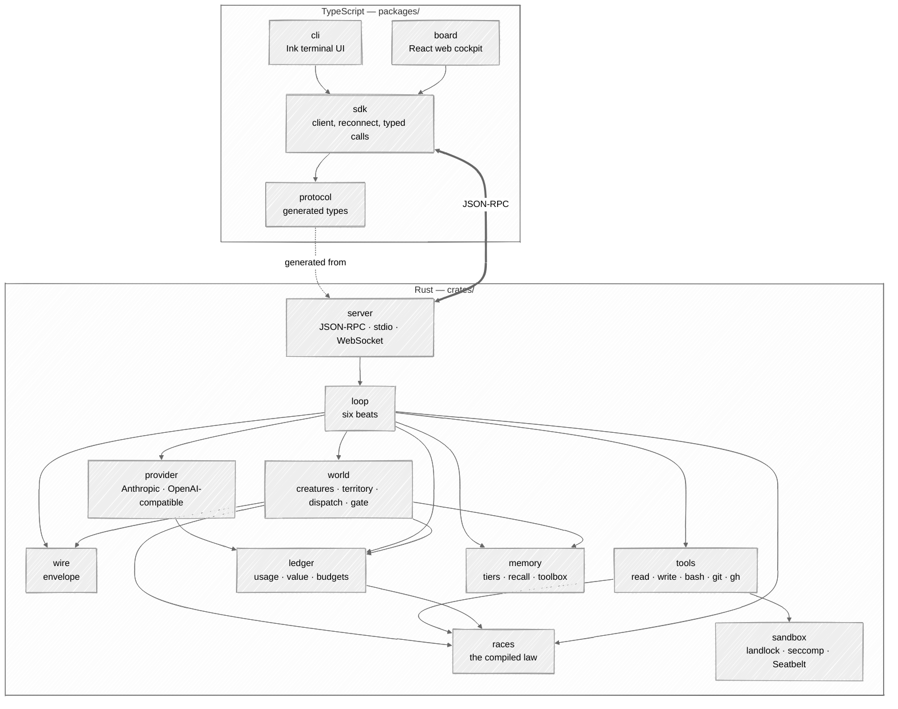
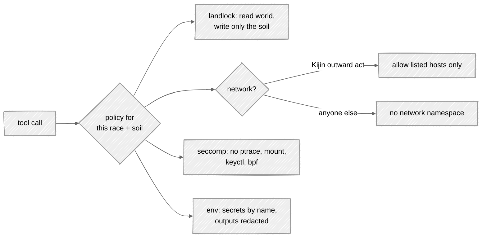

# Architecture

## In one picture



## In plain words

All the decisions live in Rust, in small crates that each do one thing and can be tested alone.
The TypeScript side only shows things and asks you questions: the terminal UI and the web board
are two windows onto the same core. The arrows only point downward — `races` knows nothing about
networks, `wire` knows nothing about models — so each piece can be proven before the next is
built on it. `tools/check-layers.mjs` holds the same graph and fails on any edge it does not
draw.

## Technical detail

### The repository

```
tempest/
├─ crates/
│  ├─ tempest-wire       envelope types, parser, encoder            (no I/O)
│  ├─ tempest-races      Race enum, shelves, dispatch, scores, falls (no I/O)
│  ├─ tempest-ledger     usage + value ledgers, budgets, prices      (files)
│  ├─ tempest-provider   streaming clients, retry ladder, caching    (network)
│  ├─ tempest-sandbox    landlock + seccomp, Seatbelt, net policy    (OS)
│  ├─ tempest-tools      tool impls, classifier, secret injection    (OS)
│  ├─ tempest-memory     tiers, BM25 recall, toolbox manifest        (files)
│  ├─ tempest-world      creatures, onto, dispatch, gate, evolution  (files)
│  ├─ tempest-loop       the six beats, journal, resume              (all above)
│  ├─ tempest-server     JSON-RPC, WebSocket, board assets           (network: loopback)
│  └─ tempestd           the binary
├─ packages/
│  ├─ protocol           generated from crates via ts-rs; checked in
│  ├─ sdk                transport (stdio | ws), reconnect by seq
│  ├─ cli                `tempest` — Ink + React
│  └─ board              Vite + React; built into tempestd
├─ docs/                 this book
├─ .tempest/             Tempest builds itself as a world
└─ justfile              one entry point for every task
```

### Choices, and why

| Concern | Choice | Why |
|---|---|---|
| async runtime | tokio | the ecosystem default; cancellation via `CancellationToken` everywhere |
| HTTP | reqwest + rustls | no OpenSSL; private CA bundles loadable |
| server | axum | WebSocket + static assets + JSON-RPC in one router |
| types → TS | ts-rs | one source of truth for the protocol |
| config | TOML via `toml_edit` | edits preserve comments; isekai's YAML-append bug cannot exist |
| recall | tantivy (BM25) | local, model-free by default (Nature 7) |
| errors | `thiserror` in crates, `anyhow` only in `tempestd` | typed failures cross crate borders |
| logs | `tracing` → JSON file under the world | the journal is an instrument |
| tests | nextest, insta snapshots, proptest; vitest + ink-testing-library; Playwright for the board | every rung testable alone |
| TS tooling | Node 22, pnpm workspaces, tsup, Biome | Node is already the platform Claude Code runs on |
| distribution | an npm package with per-platform optional deps carrying `tempestd`; plus a curl installer and GitHub release binaries | one `npm i -g` for users, a plain binary for servers. The names `tempest` on npm and crates.io are taken: the published names are settled in phase D |

### Storage: files are the truth

| What | Where | Tracked in git |
|---|---|---|
| law, creature docs, Minds | `.tempest/law.md`, `.tempest/<race>/<name>/README.md`, `.tempest/minds/` | yes |
| journal | `.tempest/log.md` — append-only writer | yes |
| shared notes | `.tempest/memory/shared/notes.jsonl` | yes |
| shared work queue | `.tempest/shared/queue.jsonl` — append-only snapshots, `merge=union` | yes |
| handoffs | `.tempest/handoffs/<time>.md` | yes |
| Kijin post journals | `.tempest/kijin/<post>/post.jsonl` | yes |
| Dark Elf proving ground | `.tempest/dark-elf/` | yes (frozen witnesses are evidence) |
| dimension manifest | `.tempest/dimension.toml` — the neighbouring worlds and their relations | yes |
| advisory mirror | `.tempest/intel/` — kept by `kijin-scout` | no — hundreds of MB |
| attic | `.tempest/attic/` — deleted and replaced files, with a ledger line each | yes |
| usage + value ledgers | `.tempest/instruments/*.jsonl` | no — machine-local |
| derived indexes | `.tempest/index/` | no — rebuildable |
| run journals | `.tempest/instruments/loop/` | no |

Every index is derived and can be deleted; `tempest index` rebuilds it. A stale index is rebuilt,
never routed around.

### Sandbox



- Linux: landlock (filesystem) and seccomp (syscalls) always. Network isolation for every
  non-Kijin process is a fresh network namespace **when unprivileged user namespaces are
  available** (Ubuntu 23.10+ restricts them through AppArmor by default); otherwise a seccomp
  filter that denies `socket()` for non-local families. pid/ipc/uts namespaces under the same
  condition.
- Landlock's power depends on the kernel's ABI: v1 (5.13–5.18, this machine's 5.15) cannot
  allow cross-directory renames (`mv a/x b/x` inside the soil fails) and cannot restrict
  truncate; v4 (6.7+) adds network rules. The core probes the ABI at start, uses what it has,
  and `tempest status` prints the sandbox actually in force — never more than that.
- macOS: a generated Seatbelt profile with the same policies.
- `--container`: the container **is** the sandbox — one container per body, its mounts limited
  to the body's soil and its network to the policy. It does not nest landlock or namespaces
  inside Docker's default profile.
- The sandbox is applied by the core when spawning; a tool cannot opt out.
- The escape suite runs in CI on both a 5.15 kernel (ABI v1) and the current runner's kernel.

### Where each piece comes from in isekai

Tempest is a port of proven behaviour, not a blank page. Each crate's first rung starts by reading
these isekai sources and turning their tests into fixtures.

| Tempest crate | isekai sources (Go, `~/kaginari/isekai`) | Size (src lines) |
|---|---|---|
| wire | `wire/` | 433 |
| races | `world/rank.go`, `config/ranks.go`, `rank/`, `value/` formulas | ~1,700 |
| ledger | `value/`, `instrument/`, usage instruments | ~1,500 |
| provider | `provider/` | 1,487 |
| sandbox | `sandbox/`, `guard/` | 858 |
| tools | `tool/`, `shell/` | 4,796 |
| memory | `memory/`, `toolbox/`, `compact/` | 6,924 |
| world | `world/`, `onto/`, `gate/`, `discover/` | 11,682 |
| loop | `loop/` | 2,511 |
| server | `board/` (API half), `mcp/` | ~2,500 |
| cli | `tui/`, `ui/`, `theme/`, `app/` (REPL half) | ~20,000 |
| board | `board/web/` | — |

`config/` (8,134 lines) shrinks the most: the rank table, ascension bands and value formulas move
into compiled code, leaving models, budgets, providers, creatures and envelopes.
