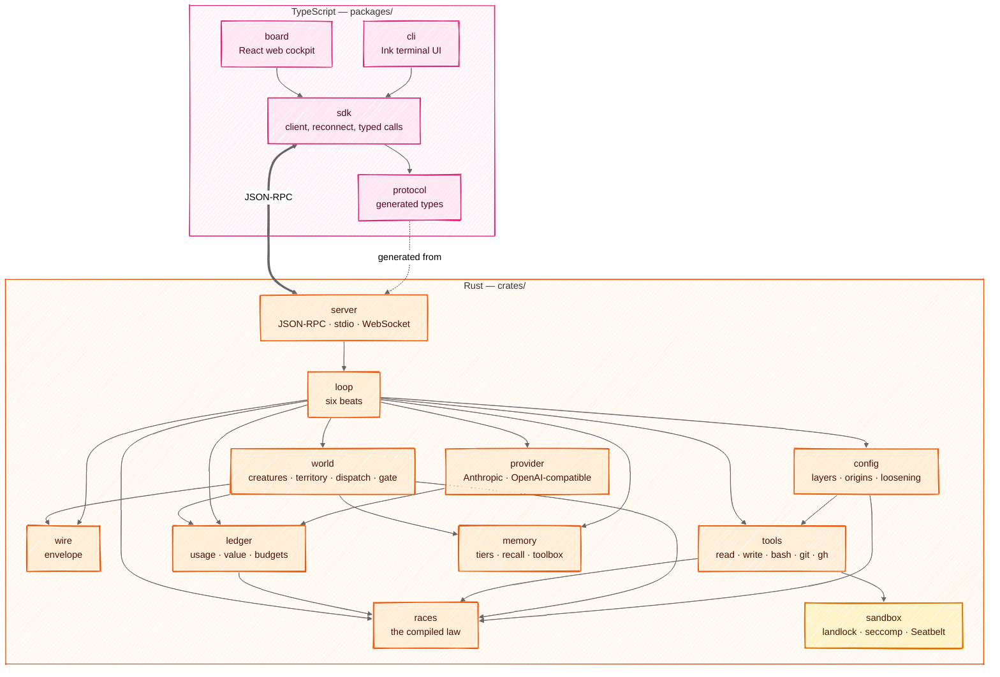
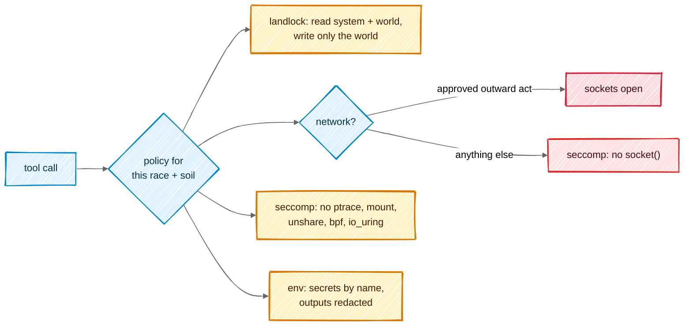

# Architecture

## In one picture



## In plain words

All the decisions live in Rust, in small crates that each do one thing and can be tested alone.
The TypeScript side only shows things and asks you questions: the terminal UI and the web board
are two windows onto the same core. The arrows only point downward — `races` knows nothing about
networks, `wire` knows nothing about models — so each piece can be proven before the next is
built on it. `tools/check-layers.mjs` holds the same graph and fails on any edge it does not
draw.

## Technical detail

### The repository

```
mnemorph/
├─ crates/
│  ├─ mnemorph-wire       envelope types, parser, encoder            (no I/O)
│  ├─ mnemorph-races      Race enum, shelves, dispatch, scores, falls (no I/O)
│  ├─ mnemorph-ledger     usage + value ledgers, budgets, prices      (files)
│  ├─ mnemorph-provider   streaming clients, retry ladder, caching    (network)
│  ├─ mnemorph-sandbox    landlock + seccomp, Seatbelt, net policy    (OS)
│  ├─ mnemorph-tools      tool impls, classifier, secret injection    (OS)
│  ├─ mnemorph-config     TOML layers, origins, the gate's loosening  (files)
│  ├─ mnemorph-memory     tiers, BM25 recall, toolbox manifest        (files)
│  ├─ mnemorph-world      creatures, onto, dispatch, gate, evolution  (files)
│  ├─ mnemorph-loop       the six beats, journal, resume              (all above)
│  ├─ mnemorph-server     JSON-RPC, WebSocket, board assets           (network: loopback)
│  └─ mnemorphd           the binary
├─ packages/
│  ├─ protocol           generated from crates via ts-rs; checked in
│  ├─ sdk                transport (stdio | ws), reconnect by seq
│  ├─ cli                `mnemorph` — Ink + React
│  └─ board              Vite + React; built into mnemorphd
├─ docs/                 this book
├─ .mnemorph/             Mnemorph builds itself as a world
└─ justfile              one entry point for every task
```

### Choices, and why

| Concern | Choice | Why |
|---|---|---|
| async runtime | tokio | the ecosystem default; cancellation via `CancellationToken` everywhere |
| HTTP | reqwest + rustls | no OpenSSL; private CA bundles loadable |
| server | axum | WebSocket + static assets + JSON-RPC in one router |
| types → TS | ts-rs | one source of truth for the protocol |
| config | TOML via `toml_edit` | edits preserve comments; isekai's YAML-append bug cannot exist |
| recall | tantivy (BM25) | local, model-free by default (Nature 7) |
| errors | `thiserror` in crates, `anyhow` only in `mnemorphd` | typed failures cross crate borders |
| logs | `tracing` → JSON file under the world | the journal is an instrument |
| tests | nextest, insta snapshots, proptest; vitest + ink-testing-library; Playwright for the board | every rung testable alone |
| TS tooling | Node 22, pnpm workspaces, tsup, Biome | Node is already the platform Claude Code runs on |
| distribution | an npm package with per-platform optional deps carrying `mnemorphd`; plus a curl installer and GitHub release binaries | one `npm i -g` for users, a plain binary for servers. The names `mnemorph` on npm and crates.io are taken: the published names are settled in phase D |

### Storage: files are the truth

| What | Where | Tracked in git |
|---|---|---|
| law, creature docs, Minds | `.mnemorph/law.md`, `.mnemorph/<race>/<name>/README.md`, `.mnemorph/minds/` | yes |
| journal | `.mnemorph/log.md` — append-only writer | yes |
| shared notes | `.mnemorph/memory/shared/notes.jsonl` | yes |
| shared work queue | `.mnemorph/shared/queue.jsonl` — append-only snapshots, `merge=union` | yes |
| handoffs | `.mnemorph/handoffs/<time>.md` | yes |
| Kijin post journals | `.mnemorph/kijin/<post>/post.jsonl` | yes |
| Dark Elf proving ground | `.mnemorph/dark-elf/` | yes (frozen witnesses are evidence) |
| dimension manifest | `.mnemorph/dimension.toml` — the neighbouring worlds and their relations | yes |
| advisory mirror | `.mnemorph/intel/` — kept by `kijin-scout` | no — hundreds of MB |
| attic | `.mnemorph/attic/` — deleted and replaced files, with a ledger line each | yes |
| usage + value ledgers | `.mnemorph/instruments/*.jsonl` | no — machine-local |
| derived indexes | `.mnemorph/index/` | no — rebuildable |
| run journals | `.mnemorph/instruments/loop/` | no |

Every index is derived and can be deleted; `mnemorph index` rebuilds it. A stale index is rebuilt,
never routed around.

### Sandbox



- **A kernel guard, not a jail.** A jail gives a command another world — its own filesystem
  view, users and network. The guard does not: the command runs as the human, in the real
  files, with the real tools. It only has the kernel enforce a permission list on that one
  process — which folders it may read, that it may write only the world, whether it may open a
  socket. On Linux every command starts through `mnemorph-guard`: the helper sets the list on
  its own process and then *becomes* the command (`exec`), so it never stays in between and
  everything the command starts inherits the list. It runs once per command because the
  kernel's restrictions are one-way — a process can tighten, never loosen — so each command,
  with its own list, needs a fresh process; it costs about a millisecond. No unsafe code and no
  namespaces are needed, so it works where unprivileged user namespaces are restricted (Ubuntu
  23.10+ through AppArmor).
- **No guard, no command.** When no guard is in force — the helper missing, an unsupported
  system — `bash` refuses to run and says why. The human may choose otherwise with
  `sandbox.allow_unguarded = true` in their local or global file (never the tracked one); the
  status line then reads `none — <reason>`.
  - **landlock** — reads: the system's directories, the world, and the toolchains in the home
    (`.cargo`, `.rustup`, `.local/bin`, …); never a credential path (`.ssh`, `.aws`, `.gnupg`,
    keyrings, …), which no rule names. Writes: the world, the command's temporary directory
    inside it, and a few devices. The soil is the tools' border; the sandbox's border is the
    world. Landlock also keeps a sandboxed process out of `/proc` of processes outside its
    domain, so the harness's environment is closed to its commands; the harness additionally
    makes itself non-dumpable.
  - **seccomp** — without network, `socket()` fails for every family, Unix sockets included (a
    host daemon's socket is a way out); `socketpair` stays. Always denied: `ptrace`,
    `process_vm_*`, `mount`, `unshare`, `setns`, `pivot_root`, `chroot`, `bpf`,
    `perf_event_open`, the kernel keyring, module loading, `io_uring` (it would bypass the
    socket rule).
  - **The network** opens only for an outward or destructive command the gate approved. An
    approval also opens the paths outside the world that the classifier located in the command
    — listed on the approval card — and nothing else: a path known only at run time stays shut.
    Each path opens alone, never its folder: a new file is first made, empty, by the harness so
    the sandbox can name it (and removed again if the command fails). An approved delete
    outside the world stays refused: the kernel ties deletion to the folder, and the folder is
    not opened.
  - **Limits** — no core dumps, files up to 4 GiB, at most 8192 processes for the user; and no
    new namespaces: `unshare` and a `clone` carrying a namespace flag fail, `clone3` reports
    itself missing so the C library falls back to `clone`.
- **The tripwire** covers what landlock cannot: landlock only adds access, so no read-only
  corner can be carved out of the writable world. Git's executable configuration
  (`.git/config` — `core.fsmonitor`, `core.sshCommand`, filter drivers — `.git/hooks`,
  `.git/info`, a `.git` file) would run code outside any sandbox the next time the human runs
  git, and `.mnemorph/` holds the world's records. Each command runs between two snapshots of
  them; once its process group is dead, every change is put back and the body is told. The
  file tools refuse those paths outright. `.mnemorph/shared/` (the work queue), `tmp/` and
  `intel/` stay writable; a repository the command itself creates is its own. The snapshot keeps
  up to 16 MiB of content; a change to a protected file beyond that is reported, not undone.
- **The file tools** run in the harness, not the sandbox, so they guard their own opens: a path
  is resolved and checked inside the world (and the soil, for writes), then opened again one
  component at a time from the world's root following no symlink, and written through a
  temporary sibling renamed inside the same directory handle. A directory swapped for a symlink
  between the check and the open fails the open instead of leading out.
- **The guard's rules have names** (`in-place-edit`, `secret-store`, `credential`,
  `not-literal`, `remote-code`, `unreadable`, …). The human's configuration may turn a rule into
  a question — the command then waits on the gate with the class it would have had — except
  the floor, which stays a refusal whatever any file says: `root-path`, `device`,
  `machine-tool`, `fork-bomb`. A floor refusal displaces any askable one found earlier in the
  same command, so no co-occurring rule can turn it into a question. The sandbox still holds under an approved rule: approving
  `credential` does not open a credential path.
- Landlock's power depends on the kernel's ABI: v1 (5.13–5.18, this machine's 5.15) refuses
  every cross-directory rename or link inside the sandbox (`mv` and git fall back to copying)
  and cannot restrict truncate; v4 (6.7+) adds network rules. The guard asks for the newest rules
  it knows, the kernel enforces what it has, and `status` prints what is actually in force —
  `landlock ABI 1 (of 5 asked) + seccomp, network off`, or `none — <reason>`.
- macOS: a generated Seatbelt profile with the same policies — reads from the same allowlist
  (metadata anywhere, for path lookups), writes only the world, and only the system services
  commands need: not LaunchServices, through which `open -a` would start an application outside
  the sandbox.
- `--container`: the container **is** the sandbox — one container per body, its mounts limited
  to the body's soil and its network to the policy. It does not nest landlock or namespaces
  inside Docker's default profile.
- The sandbox is applied by the core when spawning; a tool cannot opt out.
- The escape suite runs in CI on both a 5.15 kernel (ABI v1) and the current runner's kernel.

### Configuration

Four layers, lowest first; a higher one wins a scalar or a list, tables merge key by key, and
an empty list or table never overrides a lower layer:

| Layer | File | Who writes it |
|---|---|---|
| default | compiled in | the release |
| global | `$XDG_CONFIG_HOME/mnemorph/config.toml` (else `~/.config/…`, home from the platform) | the human |
| tracked | `<world>/.mnemorph/config.toml` | the project, for everyone who clones it |
| local | `<world>/.mnemorph/config.local.toml` | the human, on this machine |

- **Every leaf keeps its origin** — layer and exact file — so `config explain` is right for a
  scalar, a list and each leaf of a merged table.
- **The tracked file only tightens the gate.** `gate.enabled`, `gate.ask_rules`, `gate.approve`
  and `oni.envelopes` loosen it, so they are honoured only from the local or global file; from
  the tracked file they become holes saying so. So are `providers.*`: a provider decides where
  a key is sent, and a cloned repository must not point one elsewhere. Nothing else feeds them: no environment
  variable, no flag, and no body — the tripwire keeps every body out of `.mnemorph/`.
- **Holes and errors.** An unknown key is a hole, reported with its file, and the session goes
  on. A file that does not parse, a value of the wrong type, a floor rule in `ask_rules`, an
  envelope that is a bare `*` or admits a destructive or refused act, a fallback cycle: errors
  that name the file. An envelope is judged at its worst: a word that is a bare `*` stands for
  any arguments, so it is tried as each destructive one (`--force`, `--delete`, `+ref`,
  `delete`, `publish`, …); a `*` inside a word (`feat/*`) cannot become a flag.
- **Writes** go through `toml_edit` — comments and layout kept — and the result is parsed again
  before it replaces the file; a failed save is returned, and the file stays as it was.
- **Models**: `models.creature.<name>`, else `models.office.<race>.<office>`, else
  `models.tier.<the race's tier>`; `models.fallback.<model>` names the next model to try when a
  model is not found. **Providers** name the environment variable holding their key
  (`key_env`), never the key.

```toml
# ~/.config/mnemorph/config.toml
[gate]
ask_rules = ["in-place-edit"]      # sed -i asks instead of refusing

[budget]
day_usd = 5

[models.fallback]
"claude-opus-5-5" = "claude-sonnet-5-5"

[providers.openrouter]
kind = "openai"
base_url = "https://openrouter.ai/api"
key_env = "OPENROUTER_API_KEY"

[[oni.envelopes]]
name = "feature branches"
allow = ["git push origin feat/*", "gh run rerun *"]
```

### Where each piece comes from in isekai

Mnemorph is a port of proven behaviour, not a blank page. Each crate's first rung starts by reading
these isekai sources and turning their tests into fixtures.

| Mnemorph crate | isekai sources (Go, `~/kaginari/isekai`) | Size (src lines) |
|---|---|---|
| wire | `wire/` | 433 |
| races | `world/rank.go`, `config/ranks.go`, `rank/`, `value/` formulas | ~1,700 |
| ledger | `value/`, `instrument/`, usage instruments | ~1,500 |
| provider | `provider/` | 1,487 |
| sandbox | `sandbox/`, `guard/` | 858 |
| tools | `tool/`, `shell/` | 4,796 |
| memory | `memory/`, `toolbox/`, `compact/` | 6,924 |
| world | `world/`, `onto/`, `gate/`, `discover/` | 11,682 |
| loop | `loop/` | 2,511 |
| server | `board/` (API half), `mcp/` | ~2,500 |
| cli | `tui/`, `ui/`, `theme/`, `app/` (REPL half) | ~20,000 |
| board | `board/web/` | — |

`config/` (8,134 lines) shrinks the most: the rank table, ascension bands and value formulas move
into compiled code, leaving models, budgets, providers, creatures and envelopes.
