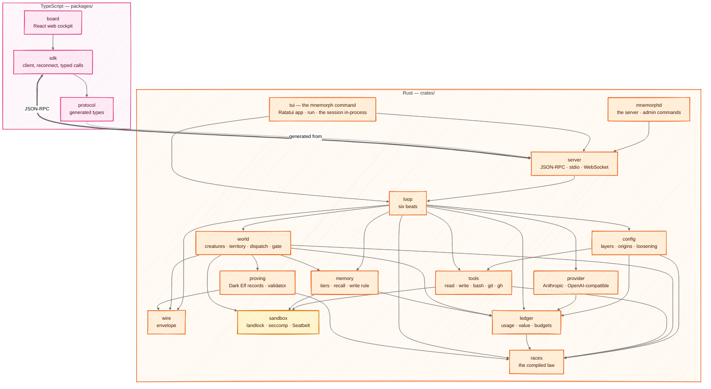
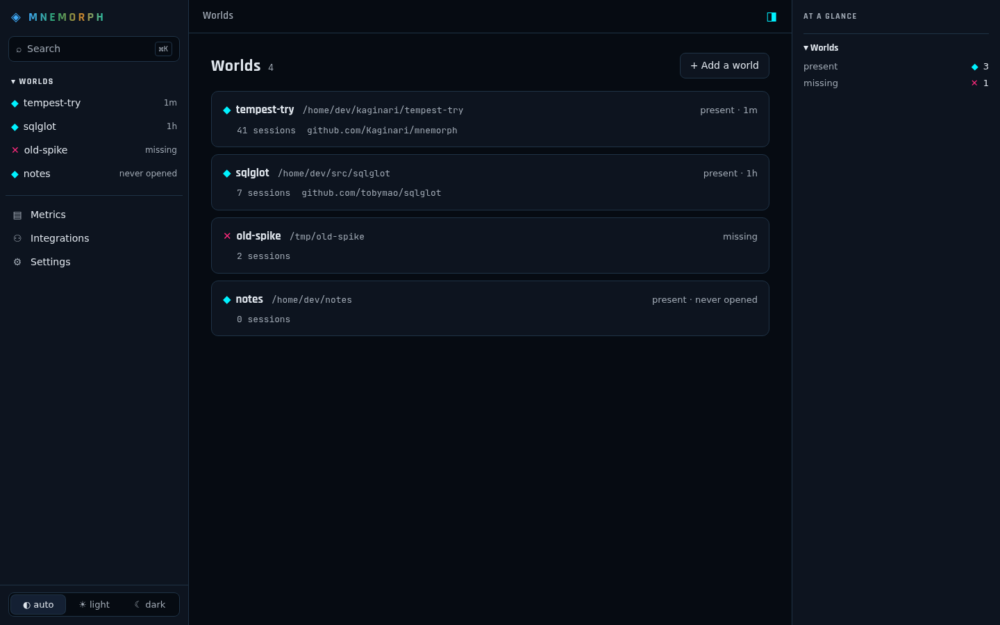
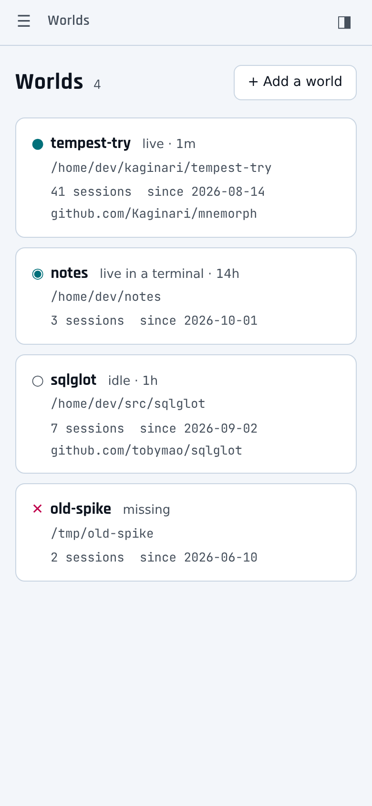
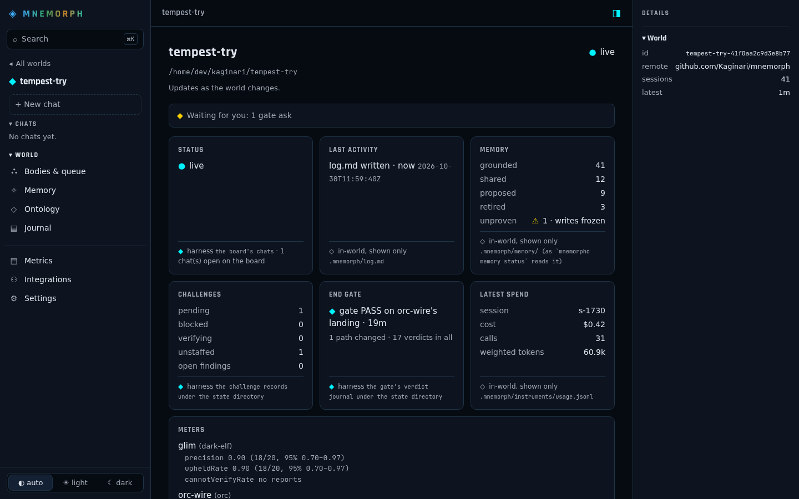
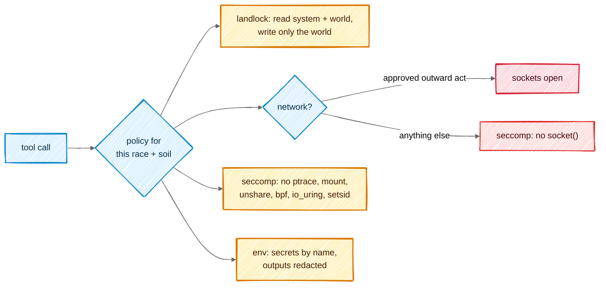
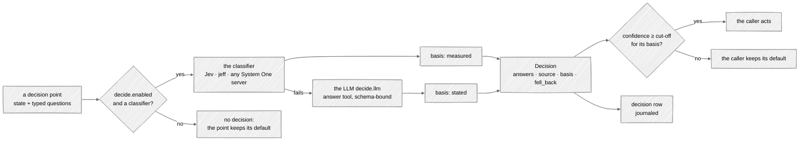

# Architecture

## In one picture



## In plain words

All the decisions live in Rust, in small crates that each do one thing and can be tested alone.
The clients only show things and ask you questions: `mnemorph`, the Rust terminal app, hosts the
core in its own process, and the web board speaks to `mnemorphd` over the protocol through the
TypeScript SDK — two windows onto the same core. The arrows only point downward — `races` knows nothing about
networks, `wire` knows nothing about models — so each piece can be proven before the next is
built on it. `tools/check-layers.mjs` holds the same graph and fails on any edge it does not
draw.

## Technical detail

### The repository

```
mnemorph/
├─ crates/
│  ├─ mnemorph-wire       envelope types, parser, encoder            (no I/O)
│  ├─ mnemorph-races      Race enum, shelves, dispatch, scores, falls (no I/O)
│  ├─ mnemorph-ledger     usage + value ledgers, budgets, prices      (files)
│  ├─ mnemorph-proving    Dark Elf finding records, coverage ledgers  (reads the tree)
│  ├─ mnemorph-provider   streaming clients, retry ladder, caching,   (network)
│  │                      System One decisions with an LLM fallback
│  ├─ mnemorph-sandbox    landlock + seccomp, Seatbelt, net policy    (OS)
│  ├─ mnemorph-tools      tool impls, classifier, secret injection    (OS)
│  ├─ mnemorph-config     TOML layers, origins, the gate's loosening  (files)
│  ├─ mnemorph-memory     tiers, BM25 recall, the write rule          (files)
│  ├─ mnemorph-world      creatures, onto, dispatch, gate, Minds      (files)
│  ├─ mnemorph-loop       the six beats, journal, resume              (all above)
│  ├─ mnemorph-server     JSON-RPC, WebSocket, board assets           (network: loopback)
│  ├─ mnemorph-tui        `mnemorph`: the terminal app and `run`,     (terminal)
│  │                      the session in-process
│  └─ mnemorphd           the server binary and the admin commands
├─ packages/
│  ├─ protocol           generated from crates via ts-rs; checked in
│  ├─ sdk                transport (stdio | ws), reconnect by seq
│  ├─ theme              the palette the board shares with the terminal app
│  └─ board              Vite + React; built into mnemorphd
├─ docs/                 this book
├─ .mnemorph/             Mnemorph builds itself as a world
└─ justfile              one entry point for every task
```

### Choices, and why

| Concern | Choice | Why |
|---|---|---|
| async runtime | tokio | the ecosystem default; cancellation through the run's own `Interrupt`, which reaches a running command |
| HTTP | reqwest + rustls | no OpenSSL; private CA bundles loadable |
| server | JSON-RPC over stdio, three threads (writer, reader, driver); axum for the board (`mnemorphd board`) | the board's WebSocket + static assets + JSON-RPC in one router |
| types → TS | ts-rs | one source of truth for the protocol |
| config | TOML via `toml_edit` | edits preserve comments; isekai's YAML-append bug cannot exist |
| recall | BM25 in `mnemorph-memory`, no index engine | local, model-free by default (Nature 7) |
| errors | typed error enums where a caller branches on the failure, a plain reason elsewhere | typed failures cross crate borders |
| logs | the run's journal, JSONL under `.mnemorph/instruments/loop/` | the journal is an instrument |
| tests | nextest, proptest; Ratatui's test backend; vitest; Playwright for the board (M12) | every rung testable alone |
| TS tooling | Node 22, pnpm workspaces, Biome | Node is already the platform Claude Code runs on |
| distribution | GitHub release binaries of `mnemorph` and `mnemorphd`, a curl installer; `cargo install --path` from a checkout | one plain binary for people and for servers. The name `mnemorph` on crates.io is taken: the published names are settled in phase D |

### The terminal UI

`mnemorph` is the command you run: a terminal app in Rust, drawn with
[Ratatui](https://ratatui.rs), in the crate `mnemorph-tui`. It hosts the session in its own
process: `mnemorph_loop::open` gives it the session, an observer turns what the run does into the
same events the server sends (`mnemorph_server::events`), and the model's stream arrives as text
deltas. No protocol sits between the screen and the core. It lives in the terminal crate rather
than a crate of its own: `run` needs nothing the app does not already depend on, so the layering
keeps the edges it had.

```sh
mnemorph                          # a session in this world (also: mnemorph chat)
mnemorph --world <dir>            # a session in that world
mnemorph resume last              # pick up the newest run that stopped (or --resume <run>)
mnemorph --theme light            # dark, light or auto
mnemorph --probe                  # what the terminal draws, then exit
mnemorph status                   # the model, the key's origin, the sandbox, the budget, holes, meters
mnemorph run "<ask>"              # one ask without the app
```

`mnemorphd` is the same core as a server — the client protocol for the TypeScript SDK and the
board — and holds the world's admin commands: `runs`, `onto`, `memory`, `q`, `incident`,
`envelope`, `challenge`, `meters`, `evolution`, `housekeep` (`--verify` walks the chained
journals) and `relief`, and the board's: `board`, `board add`, `board forget` (`mnemorphd --help`).

**Why two binaries.** They answer two kinds of caller over one core. `mnemorph` is for a person at
a terminal, and for scripts: it hosts the session in its own process, with no protocol between the
screen and the loop. `mnemorphd` is for programs that are not Rust: the SDK and an editor plugin start it as a
child and speak JSON-RPC to it, and the board is served by it (`mnemorphd board`); every such client sees the
same sessions, gate and events. The upkeep commands sit with it because they work on the world's
records directly, without a session. Both link the same crates (`mnemorph-loop`, `-world`,
`-races`, `-tools`, `-sandbox`), so a law, a gate or a sandbox rule holds the same in either.

| You want to | Run |
|---|---|
| talk to Rimuru | `mnemorph` |
| ask once from a script or CI | `mnemorph run "<ask>"` |
| pick up a run that stopped | `mnemorph resume last` |
| list resumable runs, read memory, check the ontology, the queue, incidents | `mnemorphd runs`, `mnemorphd memory status`, `mnemorphd onto check`, `mnemorphd q list`, `mnemorphd incident list` |
| read every creature's meters, swap an evolution in, judge it | `mnemorphd meters`, `mnemorphd evolution swap <id>`, `mnemorphd evolution judge <id>` |
| connect the SDK | the SDK starts `mnemorphd` itself |
| open the board | `mnemorphd board`, then the URL it prints |

`resume <run|last>` opens the session on a run that stopped instead of a new one, through the
same opening and the same end gate ([Resume](03-loop.md#budgets-are-readings)); a run with nothing
to resume is refused in plain text, before the terminal is taken. `mnemorphd runs` lists them.

#### The board server

`mnemorphd board [--port 7878] [--bind 127.0.0.1|::1] [--open]` is one daemon for every world on
the machine: an axum router in `mnemorph-server` (`src/board/`) on `127.0.0.1` and `[::1]`. Any
other address is refused — remote use is an SSH port-forward of the same port
(`ssh -L 7878:127.0.0.1:7878 <host>`), the explicit opt-in. One board runs per machine:
`$XDG_STATE_HOME/mnemorph/board.lock` is held for its life, and `board.url` beside it (`0600`)
holds the URL with the key waiting now, which a second launch prints before it exits. A body never
runs `board`, `board add` or `board forget` (`MNEMORPH_BODY` is refused).

**The worlds** are the registry's — every world a session opened in — and the human's hand,
`$XDG_STATE_HOME/mnemorph/board/worlds.jsonl`: `board add <dir>` lists a world no session opened in
yet; `board forget <dir>` stops listing one until it is added again or a session opens in it.
A world whose directory vanished stays listed as `missing`. Nothing inside a world is read to list
it, and nothing read from inside a world grants trust.

**The key, the cookie, the token.** The daemon prints `http://127.0.0.1:<port>/#k=<key>`, 32 random
bytes in hex in the fragment, which a browser never sends or logs. The page reads it, drops it from
the address bar, and posts it once: `POST /session` with `{"key": "<key>"}` as `application/json`.
The key dies on that use — reused, it is refused — and a fresh one waits in `board.url`. The answer
sets the cookie `mnemorph_board` (`HttpOnly; SameSite=Strict; Path=/`) and carries
`{"csrf": "<token>"}`, the token bound to that session; a reloaded page gets it again from
`GET /api/session`. Every mutation sends the token in `x-mnemorph-csrf`; a WebSocket handshake,
which cannot set a header, sends it as a `Sec-WebSocket-Protocol` entry `mnemorph.csrf.<token>`.
`POST /api/session/end` ends the session and clears its cookie.

Every secret is short-lived. A printed key not traded within 10 minutes is replaced, and the new
URL kept in `board.url` for a second launch to print. `--open` hands the browser a key of its own,
valid once and for 60 seconds, because the opener's command line is readable by every local user
— and by a body's sandbox, which reads `/proc` — while it runs; it is refused when no board is built
in, since no page would spend the key. A session ends after 12 idle hours, or 7 days after it
began.

**The guard** runs before every route, so a route added later is held to it without naming it:

| Check | Applies to | Refused with |
|---|---|---|
| `Host` is a bound address, literally (`127.0.0.1:<port>`, `[::1]:<port>`) — never a name, so a rebound DNS name fails | every request | 403 |
| `Sec-Fetch-Site`, when sent, is `same-origin` or `none` — another port of `127.0.0.1` is the same *site*, so `SameSite` alone does not hold it | every request | 403 |
| `Origin`, when sent, is `http://` + the `Host`; it must be sent | every request; required on a mutation and a WebSocket upgrade | 403 |
| the session cookie | `/api/…` but `/api/health`, `/ws`, `/ws/…`, every mutation and upgrade but `POST /session` | 401 |
| the CSRF token | every mutation and upgrade but `POST /session` | 403 |

**Every response**, a refusal included, carries `Content-Security-Policy: default-src 'none';
script-src 'self'; style-src 'self'; img-src 'self' data: blob:; font-src 'self'; connect-src
'self' ws://127.0.0.1:<port>; base-uri 'none'; form-action 'none'; frame-ancestors 'none';
require-trusted-types-for 'script'`, `X-Content-Type-Options: nosniff`, `Referrer-Policy:
no-referrer`, `Cross-Origin-Opener-Policy: same-origin`, `Cross-Origin-Resource-Policy:
same-origin` and `Cache-Control: no-store`.

**The assets** are `packages/board/dist`, embedded when `mnemorphd` is compiled by a fixed name
map: each file's path under `dist/` (`/index.html`, `/assets/index-<hash>.js`) is one entry, `/` is
`/index.html`, and any other path is 404 — a request path is never joined, decoded or normalised.
Source maps are left out.
Build the board first (`pnpm --filter @mnemorph/board build`); compiled without it, `mnemorphd`
embeds a placeholder page saying so, and serves the API all the same.

**The API** so far, all JSON, its types generated into `@mnemorph/protocol`:

| Route | Answers |
|---|---|
| `GET /api/health` | `{"ok": true}`, with no session |
| `GET /api/session` | `{"csrf": "<token>"}`: a reloaded page's way back to its token while the cookie lives; the page keeps it in memory only |
| `GET /api/worlds` | `BoardWorlds`: `{"worlds": [{"id", "name", "path", "remote", "last", "sessions", "state"}]}` — `id` is `<name>-<fnv64a>`, `remote` the normalised `origin` or `null`, `last` the latest session's RFC 3339 time or `null` for a world only added, `state` `present` or `missing`; the latest session first. Paths and names are the world's own text: the page renders them as text, never markup |
| `GET /api/w/<id>` | `BoardOverview` of a listed world, 404 for an id no listed world has — see *The world overview* below |
| `GET /api/w/<id>/memory` | `BoardMemory`: the standing, each creature's row and a page of notes — `?creature=`, `?scope=personal\|shared`, `?standing=proposed\|grounded\|retired\|dormant\|tombstoned`, `?review=yes\|no`, `?offset=`, `?limit=` (100, at most 500) — see *The memory and ontology pages* below |
| `POST /api/w/<id>/memory/<note>/confirm` | `{"seen"}`: the **confirmed** route, as `mnemorphd memory confirm`; `BoardDone {done}` |
| `POST /api/w/<id>/memory/<note>/wake` | `{"seen"}`: a note the gate retired, woken as `mnemorphd memory wake`; `BoardDone {done}` |
| `GET /api/w/<id>/facts` | `BoardFacts`: the counts of each status, a page of facts — `?status=settled\|agreed\|single\|contested\|countered`, `?offset=`, `?limit=` — `onto check`'s findings, the paths' owners and the verdicts a settle may cite |
| `POST /api/w/<id>/facts/<fact>/settle` | `{"seen", "verdict": <n>}` or `{"seen", "statement": "…"}`: the fact settled on that proof, `by: human (board)`; no proof, or both, is refused (400); `BoardDone {done}` |
| `WS /ws/board` | the push channel, subprotocol `mnemorph.board.v1` beside the CSRF entry; the server alone speaks — see *The watcher* below |
| `POST /api/w/<world>/sessions` | a chat in a listed, present world: `{}` opens a new session, `{"resume": "<run>"}` (a session's run id, `r<ms>-<pid>`) or `{"resume": "last"}` resumes a stopped run through `mnemorph resume`'s opening; `201` with `BoardStarted`: `{"session": BoardSession, "hello": Hello}`. `429` past the cap of live chats, `502` with the child's reason when it does not open. The browser that posts it owns the chat |
| `GET /api/sessions` | `BoardSessions`: `{"sessions": [{"id", "world", "session", "run", "controlled", "tabs", "asks"}]}`, the live chats |
| `WS /ws/session/<id>` | a tab on a live chat (below), subprotocol `mnemorph.v1` |
| `GET /api/w/<id>/runs` | `BoardRuns`: `{"runs": [{"id", "when", "state", "why", "ask", "turns"}], "more"}` — a listed, present world's session runs from its journals, newest first, at most 100 (`more` counts the rest); `state` is `live` (a session holds its lock now), `stopped` (a checkpoint, an interrupt, a turn cut short: it may be resumed), `ended` (answered or failed) or `unknown` with `why` (too large, a line that does not read, not a regular file). See *The board's chat* below |
| `GET /api/w/<id>/runs/<run>` | `BoardTranscript`: `{"run", "state", "events", "dropped", "skipped"}` — a run's journal as the protocol's events (`{jsonrpc, method, params}`, `seq` from 1), the newest 10,000; `400` for a name that is no session run's id, `404` for no such run, `422` for a journal past 32 MiB or not a regular file |

#### The chat bridge

**A child per chat.** Each live chat is a child `mnemorphd --world <dir>` (with `--resume <run>`
for a past run) speaking the unchanged protocol on its stdio; the board bridges it line for line
to the tabs on `WS /ws/session/<id>`. It runs in the world's directory, in its own process group,
its stderr's last 8 KiB kept: a child that leaves on its own says why, escaped, in
`board/ended`. Its environment is an allowlist of the board's: `PATH`, `HOME`, `USER`, `LOGNAME`,
`SHELL`, `LANG`, `LC_*`, `TERM`, `TMPDIR`, `TZ`, `XDG_*`, `SSL_CERT_FILE`, `SSL_CERT_DIR`, the
proxies (`HTTP_PROXY`, `HTTPS_PROXY`, `NO_PROXY`, either case) and `MNEMORPH_*` but
`MNEMORPH_BODY` — each dropped still if the sandbox's test reads it as a secret (a proxy URL with
credentials) — so `AWS_PROFILE`, `SSH_AUTH_SOCK`, `KUBECONFIG` or `DOCKER_HOST` never reach it;
the only secrets put in are the provider keys named by `key_env` in the built-in defaults and the
human's global file. `MNEMORPH_BOARD_PID` names the board: on Linux the child sets its
parent-death signal (SIGTERM), then checks its parent is still the board, so a board killed
outright takes its chats with it. A provider defined only inside a world gets no key from the board: as
anywhere, nothing read from inside a world grants trust. The child makes itself non-dumpable
before it reads a key, as every `mnemorphd` does. The bridge opens the session itself
(`initialize`) and keeps the hello; a tab's `initialize` is answered with it.

**Ending.** A chat ends when its controller sends `shutdown`, when the child leaves, when the grace
runs out, or when the board stops (Ctrl-C or SIGTERM ends every chat before the server does). Each
waiting ask is denied with the reason, the child is sent `shutdown` and its input closed — it
denies what waits, stops the turn, journals the run and exits — and once it has exited, or after
10 seconds, its process group is killed while the child is still unreaped, so the group's id
cannot have been reused; then it is reaped. Each tab is sent `board/ended {why}` and closed with
code 4001. A command the child started in a group of its own (the `bash` tool's) is stopped by the
child as it leaves; a board killed outright closes every child's input and, on Linux, sends it
SIGTERM.

**Events and replay.** Every event line goes to every tab as the child wrote it — hostile text
included: rendering it inert is the page's job — and is kept: the last 10,000, within 64 MiB. A
tab that reconnects asks `session/events {since}`; the bridge answers from what it keeps, in pages
of about 1 MiB, `more: true` while another page follows, `complete: false` when the tab asks from
further back than is kept. The SDK holds live events while it replays and drops any `seq` it has
seen, so every event arrives once, in order.

**Asks.** `gate/ask` is a request, not an event, so the bridge keeps each waiting ask and sends it
to every tab — again to each tab that connects — with `leftMs`, the time it has before the core's
10-minute wait denies it. An ask leaves the list, and the tabs are sent `board/askGone {id}`, when
it is answered, when the controller interrupts, when the asking body's turn ends (any, for the
session's own body), or when its time is up. Only the controller's answer is taken, once per ask;
any other is refused with `board/refused {id, why}`.

**Roles.** One tab controls a chat; every other observes. Control belongs to the browser that
started the chat — its board cookie: its first tab controls, and another of its tabs takes control
with `board/takeOver` ("waiting in another tab — take over"); a tab of another browser observes
only. An observer's `session/prompt`, `session/send`, `session/interrupt` and `shutdown` are
refused (`-32011`), and its gate answers too. Each tab is sent `board/role {role, controlled}` on
connect and whenever control moves. With no controller for 60 seconds after the chat opened — a tab closed and not
reopened — the waiting asks are denied ("no tab held the chat for 60 s") and the chat ends; the
denial reaches the body as any denial does and is journaled with the run. A tab whose board
session ends is closed with 4401.

**Limits.** At most 8 live chats and 8 tabs per chat (4429); a tab's message at most 1 MiB (a
larger one closes it), its request ids numbers or strings of at most 128 bytes, at most 64 of its
requests waiting on the child. A line from the child over 4 MiB is dropped and said
(`board/oversize {bytes}`): the tabs see a gap in `seq`. Each tab has a bounded queue (4,096
messages, 16 MiB); a tab that falls behind is dropped with code 4008, not buffered, and catches up
by reconnecting. A message that takes over 30 seconds to reach a tab drops it, and each tab is
pinged every 5 seconds: two pings unanswered drop it. An ended chat frees what it kept at once.
Closes 4001, 4401, 4404 (no such chat) and 4429 are final for the SDK; others are
retried, the pause doubling from 250 ms to 5 s, 20 times.

**The browser's transport.** `@mnemorph/sdk/browser` is the client without Node: `ws({url, csrf})`
offers `mnemorph.v1` and `mnemorph.csrf.<token>`, the token asked for at each connection and kept
in memory only. On each reconnection the `Client` takes control back if it had it, then replays;
a request in flight when the socket drops fails rather than hangs.

#### The world overview

`GET /api/w/<id>` reads one world in-process through the crates the CLI uses, so its numbers are
the CLI's. Every field is a `Sourced<T>`: `{value, source, trusted, why}` — `value` is `null`
when its source cannot be read and `why` then says so (unknown is said, never guessed, and no
spend reads `$0` that was not priced); `trusted` is `true` only for what the harness keeps under
the state directory, chained, or knows itself. What is read inside the world — a body can write
it — is shown and grants nothing.

| Field | Value | Source | Trusted |
|---|---|---|---|
| `status` | `live` (a chat the board runs is open in it), `tui-live` (a session's run lock under `.mnemorph/instruments/loop/` is held by a live process now — a terminal's), `idle`, or `missing` (its directory is gone: shown, never dropped) | the board's chats; the run locks, probed as `mnemorphd runs` probes them (only a regular file is opened); the directory | the chats and the directory yes, the locks no |
| `activity` | `{at, what}`: the latest of a session opening, the gate's last verdict, `log.md` written, a run journal written, a call booked | the registry, the gate's journal, the files' write times | per source |
| `memory` | `shared`, `grounded`, `proposed`, `retired`, `unproven`, counted as `mnemorphd memory status` counts them | `.mnemorph/memory/` | no |
| `challenges` | the open challenges `pending`, `blocked`, `verifying`; those with an `unstaffed` speciality; their `findings`; `unreadable` record lines — as `mnemorphd challenge list` reads them | the challenge records under the state directory | yes |
| `gate` | how many verdicts, and the last: `{at, body, verdict, changed}` or `null` before the first | the gate's verdict journal under the state directory | yes |
| `meters` | each living creature's meters with `successes`, `n`, the point estimate and the 95% Wilson interval `lo`–`hi`, or `null`s for no report — as `mnemorphd meters --json` | the roster in the world over the challenge records' folds | no |
| `spend` | the latest session in the usage ledger: `calls`, `usd` (`null` when none was priced), `unpriced`, weighted tokens | `.mnemorph/instruments/usage.jsonl` | no |
| `waiting` | the gate asks the board's chats keep for the human; a terminal session's asks wait in its terminal | the board's chats | yes |
| `updates` | `pushed`, or `slowed` when the world is past the watcher's budget (below) | the board's watcher | yes |

**Reading inside a world.** A path there may be a link to `/dev/zero`, a pipe that never answers,
a device or a file of any size. Only a regular file is read: opened without following a link
(`O_NOFOLLOW`) and without blocking (`O_NONBLOCK`), checked again on the handle, and read to a cap
(`mnemorph_world::regular`). The memory tiers and the creature docs are first copied into a private
scratch directory — 8 MiB a file, 32 MiB and 2,000 entries in all — and the CLI's functions read
the copy, so a file swapped after the check reaches nothing; past a cap, or anything but a regular
file, the field is unknown and says which file and why. The usage ledger's last 8 MiB are read;
when older bytes are left, `spend` says so. A run lock is probed only as a regular file.

#### The memory and ontology pages

Both read a world's knowledge in-process with the CLI's own functions, over a copy taken as the
overview takes one (regular files only, capped): memory and facts live inside the world, so they
are shown and grant nothing. Their counts are the CLI's: `GET /api/w/<id>/memory` equals
`mnemorphd memory status --json` row for row, and `GET /api/w/<id>/facts` lists what `mnemorphd
onto check` reports, finding for finding (`mnemorph_world::onto_check` is the one list both read).

**Memory.** Each note is listed once per tier that holds it (`personal` or `shared`) with its
creature, its standing (`proposed`, `grounded`, `retired` — dormant by the gate's hand —,
`dormant`, `tombstoned`), the route its proof names (`checked`, `accepted`, `corroborated`,
`confirmed`) and the proof as written, and its place in the claim graph: its version and earlier
versions, what it rests on (claims, facts, creatures, files), and why it needs review while
something it rests on moved — the files a claim rests on are copied too, so its review is read
against what the world holds. Each creature's row carries its unproven events (its writes frozen),
the pathologies its recall traces show, and how many of its claims are proposed, retired and under
review. A note's text is cut at 2,000 characters and says so. The page filters by creature, scope,
standing and review.

**Ontology.** Every live fact stands in exactly one status of the facts table — `settled`, `agreed`,
`single`, `contested`, `countered` — and the page tabs them. A fact carries its supporters, each with
the anchor it gave and whether what it points at moved since, and its counters, each with its
reason; a settled fact says who settled it and on what proof. Beside them, `onto check`'s findings
(at most 500 listed, all counted) with its PASS or FAIL, the roster's problems, and the owner of each
path a fact is about, as `mnemorphd onto owner` says it. Running `onto check` reads the world's
tracked files with git, its own config's filesystem monitor off; the check's other reads inside the
world — creature docs, the law, the Minds, the anchors a fact cites, the files the verify line is
guessed from — open only regular files under 8 MiB (`regular::text`), for the CLI as for the board.

**The human's acts.** Confirm (the confirmed route: a proposed claim, or one grounded and waiting
under review, grounded and shared), wake (a note the gate retired, grounded again) and settle (a
fact settled on a proof) are the CLI's own functions — `memory::vouch`, `memory::wake_by`,
`Facts::settle` — behind the guard and the CSRF token, each confirmed in the page by a dialog that
names the exact note or fact, its id and its text, focus on Cancel. The server then checks again:
a board started inside a body's command (`MNEMORPH_BODY`) refuses every act; the id is plain
(letters, digits, `.`, `_`, `:`, `-`); the world is listed and present; a fresh copy still holds the
note or fact, the act still applies (409 if not), and its text is the one the human read — the
request names the SHA-256 of its id and text (`seen`), and a note or fact rewritten since is
refused (409); no step from the world down to the file the act appends to is a link (422). The
journal says it was the human, from the board: a confirm cites `confirmed: the human's word
(board)`, a wake `woken by the human (board)`, a settle is filed `by: human (board)`. A settle
needs one proof: a passing end-gate verdict, by its number in the harness's chained journal, that
changed a path at or under the fact's — the page offers those — or the human's own statement (1 to
1,000 characters), filed as `the human's word (board): <statement>`. A verdict that failed, landed
elsewhere, or does not exist is refused (422).

#### The watcher

The watcher looks only while a board socket is open: every 250 ms while a session is live in some
world (a board chat, or a run lock held), else every 2 s. Each look takes every world's signature
— the size and write time of `log.md`, the usage ledger, each run journal and lock, the memory
tiers (one level deep), and the challenge records and gate verdicts under the state directory —
within a budget of 2,000 entries a world (files stat'ed, directory entries read, locks probed).
A world past its budget is *slowed*: looked at every 10 s, and its overview's `updates` says
"too many entries: updates slowed". Looking fast, a world whose signature moved is told once it
holds still for a look, or 600 ms after it began moving at the latest, so a burst of writes is
one push; looking slow, it is told at once. A world first seen is remembered, not told. The list
of worlds is read again only when the registry or the human's list is written. Each change goes
to every board socket as JSON-RPC 2.0 without an id: `world/changed {"id"}`, or `worlds/changed`
when the list moved. Polling needs no platform's notification API and a world cannot exhaust a
watch table by making directories.

`WS /ws/board` passes the guard like any upgrade — the loopback Host, the Origin, the cookie, and
the CSRF token as the subprotocol entry `mnemorph.csrf.<token>` — and must offer
`mnemorph.board.v1`, which it answers. At most 16 are open; a tab sends nothing (anything but a
ping, a pong or a close ends it, and a message is capped at 1 KiB). A tab that stops reading is
dropped, never waited on: a send that takes over the chats' send limit (30 s) ends it, and it is
pinged at the chats' pace (5 s), two pings unanswered ending it. A socket that falls behind is
told `worlds/changed`; when its session ends it is closed with 4001. The page rereads what it
shows when its world is named, and everything when `worlds/changed` comes or its socket reopens.

#### The board's chat

Inside a world, the rail lists its chats: the live ones the bridge runs (`GET /api/sessions`), then
the past ones from its run journals (`GET /api/w/<id>/runs`), each titled by its last ask. *New
chat* posts `/api/w/<id>/sessions`; a stopped past run offers *Resume*, which posts `{"resume":
"<run>"}`. A live chat is `#/w/<world>/s/<chat>`, a past one `#/w/<world>/r/<run>`. The list is read
on opening, when the push channel says the world changed (at most every 2 s), every 10 s, and when
a chat ends.

**Past runs** are read through the world's shared reader (`mnemorph_world::regular`: a link never
followed, a pipe never waited on, the handle checked), by a session run's id only, from a journals
directory none of whose parts under the world is a link. A listing reads at most the newest 100
journals, 4 MiB each and 64 MiB in all; a transcript at most 32 MiB. The journal's beats become the
events a live chat sends — an ask `turnStarted`, the model's text `assistant` and its calls
`toolCall`, a result `toolResult` (cut at the protocol's 16,000 bytes), notes, warnings, the gate's
verdict and the ending — so a past chat draws as a live one; what the journal keeps for the record
alone (recall, the guts, the prefix, the model ridden, a compaction, the reasoning) is left out.
A line that does not read is counted, never guessed. Nothing read there grants anything: the text
is shown inert, like the model's.

**The transcript** follows the terminal's grammar (`crates/mnemorph-tui`): the human's line on a
gold spine; the answer on a holo spine under `✦ <body>`, a paragraph at a time as it streams; each
tool call a card coloured by its class — a look in Rimuru's blue, a write in the Dark Elf's violet,
a destructive act in the alarm, a command uncoloured, as the protocol carries no classifier's word —
with the class named beside the colour, its dot (running, ok, failed, stopped), its one-line
summary, `⎿ ok · 1.2s · +1 −1`, its output folded to 3 lines and its diff to 12, numbered from the
hunk (an `edit` numbers the string's own lines); consecutive reads, greps and globs one *explore*
card (`read 4 files · grep 2 patterns`); a wait of a second or more before the model's first
output one quiet line, `✓ thought for 3s` (protocol 1 carries no reasoning text, so the line holds
the wait only); a commissioned body's acts as `↳ orc-sql …` lines; the end gate one line with its
counts, and a toast when it arrives live; a turn that ended other than by answering, one line. Above
the composer, the activity strip says what runs now: `⣾ Running bash… · 12s · 61k tok · esc to
stop` — thinking, writing, calling, running, compacting or waiting for approval, the turn's time and
tokens.

**Safe rendering.** Every word a model, a tool or a journal wrote is a React text node through
`<Safe>`, control, bidi and zero-width characters shown as their escapes. The answer's Markdown is a
small subset parsed by the board itself (`src/safe/Markdown.tsx`: paragraphs, headings, lists,
quotes, rules, fences, code spans, strong, emphasis, strikethrough, links, images) into elements:
raw HTML is never parsed and reads as text; a link is followed only to http, https or mailto, with
`noopener noreferrer`; an image is never loaded, its words shown. Code is highlighted by a small
tokenizer (strings, comments, numbers, keywords) into spans of text. No dependency, nothing from a
string becomes markup, and nothing runs, so the page holds under `require-trusted-types-for
'script'`. A hostile depth or length costs linear work: each line is read by a scan or a regex with
no overlapping quantifiers (a backtracking pattern on one long line would freeze every tab showing
it), brackets are paired in one pass, a closer's search resumes where the last one stopped, nesting
stops at 8, a text parses into at most 2,000 blocks (the rest one paragraph), and past 100,000 characters an answer is shown as plain text. A test times every parser
the board runs on such text — the Markdown subset, the highlighter, the safe-text runs, the router —
on adversarial 100 KB inputs, each under 50 ms.

**The composer.** Enter sends; while a turn runs it queues (the line waits its turn, listed above
the composer), *Steer* (or `/send …`) reaches the running turn after its next tool step, and Esc
interrupts — the turn stops and what waits at the gate is denied. A tab that observes cannot send:
its composer is disabled and offers *Take over*, which a tab of the browser that opened the chat may
use. *End chat* ends it for every tab.

**A waiting ask** is shown, never approved here: a banner names the body, the class and the act,
and how long until the core denies it. Approving is the approval card's, a component of its own
with its protections (#278); the chat itself answers no ask, and Esc denies it with the turn.

**Reconnecting.** A tab opening on a chat replays what it said (`Client.catchUp`): live events that
overtake the replay wait for it, and the SDK drops an event whose `seq` it has seen, so a reconnect
— which replays from the last `seq` — or a reload never shows a message twice.

**The side pane** beside a chat: the vitals (the context against its stress line, the tokens, the
spend — `unpriced` never reads `$0` — and the weighted tokens), the world's memory counted (from its
overview), the files the session's acts changed as a tree marked added, modified or deleted, and
the bodies it commissioned with their state.

**Long chats.** The transcript is drawn in a window: only the rows near the viewport are in the DOM,
between two spacers whose heights are set through the CSSOM (never a style written as markup);
each row is measured once drawn. Scrolled to its end it follows what arrives; scrolled up it stays,
with a *Latest* button back. A 2,000-message transcript keeps under 120 rows in the DOM and scrolls
without a stalled frame (the board's Playwright suite measures it).

**Tested end to end** on the real server and bridge: `mnemorph-server`'s `board_e2e` example serves
the built board over a fresh world whose chats' children are real cores — the loop, the tools, the
end gate — answering from a scripted model; the suite opens a chat, sends two turns, reloads, ends
it and reads it back as a past run.

#### `mnemorph run`

`mnemorph run "<ask>"` asks once, without the app, through the same session: the same opening,
loop and end gate. With no ask, or `-`, it reads the ask from stdin. Progress — the streamed text,
each call, a failed result, warnings, the end gate's verdict — goes to stderr, escaped as the app
escapes it; the answer alone goes to stdout, escaped the same way when stdout is a terminal and as
the model wrote it when piped. Any ending but an answer is said on stderr's last line
as `mnemorph: <ending>` (`checkpoint: …`, `escalate: …`, `failed: …`, `interrupted`).

| Exit | When |
|---|---|
| 0 | answered, the end gate passed |
| 1 | failed — a failed end gate included — escalated, or interrupted (Ctrl+C) |
| 2 | the command line did not read, or the session could not open |
| 3 | stopped at a checkpoint: `mnemorph resume <run>` goes on |

No one is there to approve a gated act, so `run` denies every one and says so on stderr
(`mnemorph: denied <class> act …`); with `--gate-tty` it puts each to you on the terminal
(`/dev/tty`) instead. That card shows the whole act, with every part a model chose escaped by the
core's rule, so no carriage return or escape code can redraw what is approved; keys typed before
the card reached the screen are thrown away; only `y` or `yes` typed after it approves, and
anything else, the end of input or ten minutes of silence denies. It never approves on its own.

Ctrl+C stops the run as Esc stops the app's turn: the interrupt fires, a running command and
everything it started are killed, a question on the terminal is denied, the turn ends
`interrupted` in the journal, and `run` exits 1.

`--json` writes every event to stdout as a JSON line — the protocol's event, named by `type`
(`turnStarted`, `textDelta`, `toolCall`, `toolResult`, `note`, `warning`, `usage`,
`gateVerdict`, `turnEnded`, …), with `session`, `run`, `body` (a commissioned body's own name and
run for its events) and `seq` — and then one `result` line:

```json
{"type": "result", "session": "s…", "run": "r…", "ending": "answered", "answered": true,
 "answer": "…", "exit": 0,
 "gate": {"passed": true, "verdict": "PASS", "changed": ["…"], "failures": [], "unverified": []},
 "usage": {"calls": 3, "input": 0, "output": 0, "cacheRead": 0, "cacheWrite": 0, "usd": 0.01}}
```

`answer` is `null` unless it answered; `gate` is the session's last verdict, `null` when no gate
ran; `usage.usd` is `null` when a turn could not be priced. `--core <path>` is read and ignored:
the session runs in this process.

`--theme auto` (the default) reads `MNEMORPH_THEME` (`dark` or `light`), else the terminal's
background as `COLORFGBG` reports it, else dark.

```
╭─ ◈ MNEMORPH · rimuru · deepseek-v4-flash ───────────────────────────────────────────────── ● thinking 0s ╮
│ ᴄᴏɴᴠᴇʀꜱᴀᴛɪᴏɴ ─────────────────────────────────────────────────────────── │ ꜱᴇꜱꜱɪᴏɴ ───────────────────── │
│ ▝▀▀▀▀▀▀▀▀▀▀▀▀▀▀▀▀▀▀▀▀▀▀▀▀▀▀▀▀▀▀▀▀▀▀▀▀▀▀▀▀▀▀▀▀▀▀▀▀▀▀▀▀▀▀▀▀▀▀▀▀▀▀▀▀▀▀▀▀▀ ▘ │ ▾ vitals ──────────────────── │
│                                                                          │ ᴄᴛx  ━━━━────── 41% / 150.0k  │
│ ▄▄▄▄▄▄▄▄▄▄▄▄▄▄▄▄▄▄▄▄▄▄▄▄▄▄▄▄▄▄▄▄▄▄▄▄▄▄▄▄▄▄▄▄▄▄▄▄▄▄▄▄▄▄▄▄▄▄▄▄▄▄▄▄▄▄▄▄▄▄   │ ᴛᴏᴋ  60.9k                    │
│ ▌ ● edit  sqlglot/parser.py  write                                   ▕▄▖ │ ᴄᴏꜱᴛ $0.04                    │
│ ▌   ⎿ ok · 0ms · +1 −1                                               ▕ ▌ │                               │
│ ▌      - return this                                                 ▕ ▌ │ ▾ memory ──────────────────── │
│ ▌    1 + return self._parse_collate(this)                            ▕ ▌ │ recalled 3 this ask           │
│ ▝▀▀▀▀▀▀▀▀▀▀▀▀▀▀▀▀▀▀▀▀▀▀▀▀▀▀▀▀▀▀▀▀▀▀▀▀▀▀▀▀▀▀▀▀▀▀▀▀▀▀▀▀▀▀▀▀▀▀▀▀▀▀▀▀▀▀▀▀▀ ▘ │ grounded 5 · shared 2         │
│                                                                          │ ✓ “collations drop in         │
│   ↳ orc-sql  is working on: judge                                        │   \u{202e}_parse_types\u{1b}… │
│                                                                          │                               │
│   ↳ slime-parser  bash pytest tests/test_parser.py                       │ ▾ files · 1 ───────────────── │
│  ▄▀▀▀▀▄  ⣾ Thinking… (0s · 61k tokens · esc to interrupt)                │ sqlglot/                      │
│ ▀▀▀▀▀▀▀▀   slime-parser · running bash                                   │ └ M parser.py                 │
│ ▀▀▀▀▀▀▀▀                                                                 │                               │
│  ▀▀▀▀▀▀                                                                  │ ▾ bodies · 2 · 2 live ─────── │
│ ╭─ ᴀꜱᴋ ────────────────────────────────────── enter queues for rimuru ─╮ │ ◆ rimuru            ⣾ working │
│ │ ›  a line now waits its turn                                         │ │ … +2 more                     │
│ ╰──────────────────────────────────────────────────────────────────────╯ │                               │
╰─ $0.04 · 60.9k tok · ctx 41% · esc stop · enter queue · pgup scroll · world ~/sqlglot ───────────────────╯
```

| Part | What it shows |
|---|---|
| header | Mnemorph's mark (the name drawn across the water races' blues), the session's body and its model on the left; the session's id and its state on the right — `○ idle`, `● running bash 3s`, `◆ waiting for you` |
| panes | labelled in small capitals on their edges: ᴄᴏɴᴠᴇʀꜱᴀᴛɪᴏɴ, ꜱᴇꜱꜱɪᴏɴ (the sidebar), ᴀꜱᴋ (the input) |
| welcome | the card the conversation opens on: on first run it sits at the top of the conversation, like a header, and scrolls away with the transcript as messages come — a short transcript fills from the top, the room it leaves below it, above the input. The MNEMORPH wordmark in five rows of block letters, then the tagline; what Mnemorph does in four lines (the races and their soils, the end gate, memory with provenance, the ontology's voices); the races as chips; the world, the model, the session, **memory** (the grounded and shared counts, read by the sidebar's survey) and **verify** (the session card's verify line, or "none — memory can't be grounded" and the line to add, the test command the project's manifest names) in small capitals; the first keys |
| transcript | each message and call a raised panel — a spine in its colour, a lit top edge, a shadow one cell right and half a row down: the human's lines in gold; the body's Markdown (headings, emphasis, code highlighted, lists, quotes, links, tables) in cyan with `✦`, one panel however many pieces it streamed in; tool calls as cards in their class's colour (a look blue, a write violet, an outward act orange, a destructive one red) — `● bash  pytest -q  read`, then `⎿ running…`, then `⎿ ok · 2.0s · 3 lines` or `⎿ failed · 800ms`; output folded to three lines, a numbered diff for `edit`, `multiedit` and `patch`, a new file's head for `write`, each expanded whole by a click or a key; consecutive reads, indexes, greps and globs as one card (`read 4 files · grep 3 patterns`, its calls ok, failed or stopped counted); the reasoning as one quiet line; the end gate's verdict as one line with its counts |
| activity strip | above the input from the frame an ask is sent until its turn ends: a spinner, the phase as a verb in a moving shimmer, the time the turn has run, its tokens; under it the body and the phase in words, and the context when it nears its stress line |
| sidebar | at its head, on a column 36 rows tall or more, the portrait of Veldora — the human — while no body works, and of the body working now during a turn (Rimuru for the session, a commissioned body's race while it acts), over its state; **vitals**: the context as a gauge against the stress line, the tokens, the spend; **memory**: the notes recall gave this ask, the grounded and shared counts and the claim grounded last, as `mnemorphd memory status` reads them; **files**: the paths the session's acts changed, marked `A`, `M` or `D`, as a tree of their directories; **bodies**: the session's body and the bodies it commissioned, nested as they commissioned each other, each in its race's colour with what it is doing. A click on a section's title folds it (`▸`) or opens it (`▾`) |
| input | multi-line; a line sent while a turn runs waits its turn, shown above the input |
| approval | a modal over the dimmed view: a strip naming the gate with its countdown, the act's class in its colour, the act, the plan its approval binds to, its reasons and the paths it opens outside the world, the answers numbered; the input's edge reads "answer the card first" |
| toast | the end gate's verdict, `◆ end gate pass`, floating in at the top right and fading out on the spring; never drawn over an open approval |
| status bar | the spend in dollars and tokens, the context against its stress line (gold from 75%, alarm from 90%), the keys that matter now, the world |

| Key | Does |
|---|---|
| Enter | send (queued while a turn runs) |
| Alt+Enter, Shift+Enter, Ctrl+J | break the line |
| ↑ ↓ | move between lines, then through the lines sent before |
| PgUp PgDn, Shift+↑ ↓, Ctrl+Home End, the wheel | scroll the transcript |
| Alt+↑ ↓ | move the focus between cards (calls, groups, thoughts), scrolling each into view |
| Ctrl+T, a click on a card | expand the focused (or clicked) card — a call's folded output, a group's calls, a thought's text — or fold it again; with none focused, the newest |
| Ctrl+O | show or hide the sidebar |
| Esc | stop the turn; back to the end of the transcript |
| Ctrl+C | stop the turn, or leave when none runs |
| 1 or y, 2 or n, 3, then Enter | answer an approval — yes, no, or no with a reason typed for the model; ↑ ↓ move the pick while the whole act shows — from no pick to No, stopping at the ends, never onto Yes unasked — and read a long act otherwise; Esc denies it |

Slash commands: `/send <text>` steers the running turn at its next tool step, `/theme dark|light`,
`/clear`, `/help`, `/quit`.

**It shows its work as it happens.** The status appears in the frame after Enter, before any
token: the phase is read from the model — an approval on the card, a call whose arguments still
stream (`calling grep`), a call running (`running bash: pytest -q`), the answer streaming
(`writing`), the context past its stress line with the next answer not begun (`compacting`), else
`thinking` — and a commissioned body that acts (its events come through `Seen::From`) puts its
own name and tool there, and its portrait at the sidebar's head, until its turn ends: the body
shown is the newest that still works, so siblings working at once never take the portrait from
each other, and the session's own shows only when none does; the loop restarts only when the
body shown changes. The providers hand the stream reasoning as it comes
and a call's arguments piece by piece (`StreamEvent::Thinking`, `StreamEvent::ToolInput`; the
server's protocol does not carry them): the reasoning shows as one line that updates in place —
`◌ thinking · 12s · …its latest words` — and folds to `✓ thought for 12s` when the answer or a
call begins, its text a key away. A provider that keeps its reasoning in opaque blocks shows it
when the turn's blocks are journaled: the thought is placed where the step began, timed to the
step's first output; it replaces whatever streamed, so a retry that streamed the reasoning again
never leaves it doubled. A call's card appears at its first byte, its summary filling in as its
arguments arrive, its class read by the classifier off the UI thread; its duration is the time
to its result. Time is the model's clock, advanced by its ticks.

The portraits are the races' animations from Kaginari/mnemorph-animations, drawn natively at
256 pixels in its `.mnanim.json` format v2 (a JSON header and palette, the frames in an 8-bit
indexed PNG sprite sheet): each race's idle loop (48 frames at 16 fps, seamless) and the five
ascensions (80 frames, played once), embedded from `assets/anims/256px/` (its README names the
commit). `kit::mnanim` and `kit::glyphs` are vendored from that repository's player crate — the
repository is private, so CI could not fetch it as a dependency. Without real pixels a clip is
decoded once into glyph cells, 32 columns by 16 rows, each cell the best two-colour split of its
sub-pixels: octants (2 × 4 a cell) where the terminal draws them itself whatever the font (Kitty,
Ghostty), sextants (2 × 3) in WezTerm and foot, quadrants (2 × 2, block elements every font has)
elsewhere, half blocks on the Linux console; `MNEMORPH_TUI_GLYPHS=half|quadrants|sextants|octants`
overrides it. The idle loops decode on a blocking thread at start, an ascension on a thread of its
own the first time it plays — a frame only reads the cache and never decodes, so a clip not yet
ready is simply not drawn; a malformed file is an error, never a panic. A clip plays at its own
pace, advanced by elapsed time under the 30-frame cap, only while a body works and the portrait
is on screen; idle, or while the terminal's window has lost the focus (focus reports are on while the UI
runs, off when it gives the terminal back), the UI schedules no tick for it, and in pixels sends
nothing.

**Ascensions.** No event names an ascension yet: the sidebar's survey re-reads each creature's
race, and the body shown seen again as the risen form of the race it had is one. Its ascension
plays once from its start (`Model::ascend`, the hook an ascension event will call), then the risen
form's idle loop.

**The portraits in real pixels.** Where the terminal draws images, a working body's clip plays as
real pixels — its 256 px frames as the animations' player shows them with `--native`, one frame
pixel a screen pixel — and Veldora, at rest, is her still 256 px PNG from `assets/portraits/`;
the glyphs above are the fallback. At start, before the alternate screen,
`probe` asks the terminal on `/dev/tty` in raw mode: the window's pixels (`TIOCGWINSZ`), a cell's
size (`CSI 16 t`), its name (XTVERSION), Kitty's graphics query, and the device attributes (DA1)
last — every terminal answers DA1, so its reply ends the wait. It waits at most 200 ms with
`poll` on the calling thread, leaves no thread reading the input, and flushes a half-reply when
the time runs out. A reply that comes later still reaches the UI's input as keys — `ESC P` and
`ESC _` read as Alt+P and Alt+_, the rest as characters, Kitty's `1` among them — so for two
seconds after a probe that timed out, keys shaped like a reply — plain characters, and Alt+P,
Alt+_, Alt+[ and Alt+\ — are dropped, and no other key reaches an open approval card. A key with
Control is never a reply: Ctrl+C and Esc always reach the UI, so they stop, quit and deny. `kit::pixels` reads the replies and chooses:

1. **Kitty** when its query answered OK;
2. **iTerm2's inline images** when the terminal is xterm.js (VS Code), iTerm2 or WezTerm, by its
   name or the environment, and images are on — DA1 lists 4, or iTerm2 or WezTerm, which always
   draw them. A PNG in full colour, smaller than Sixel, so it is preferred where both exist;
3. **Sixel** when DA1 lists 4;
4. **glyphs** otherwise — and whenever a cell's size in pixels is unknown, or inside tmux.

`MNEMORPH_TUI_IMAGES` overrides it: `auto` (the default), `kitty`, `iterm`, `sixel`, `blocks`, or
`off` — glyphs, nothing asked of the terminal. `mnemorph --probe` prints what was found,
the replies as they came, and the choice.

The portrait's box is 32 columns, and as many rows as make it square — or, when its columns hold
256 pixels, enough rows for 256: 32 columns of 8 × 17 px cells (VS Code) are 256 × 272 px in 16
rows. Every picture is exactly the box's pixels, so the terminal never rescales it. A clip's frame
is laid on the background one pixel a screen pixel, centred, and shrunk (Lanczos) only when the
box is smaller than 256; Veldora's PNG is laid on the background and Lanczos-resized to the
largest square in the box. A clip's frames are encoded on a thread of their own, once per clip,
protocol, box and background (a reel, a few kept), the frame due first; a frame not encoded yet
is waited for with the old one still up, so the UI's thread never encodes and typing never
stalls. A still is built once and cached. iTerm2's inline images are given their box
in cells, so a font zoom never leaves the picture spilling past its box; on a resize the cell's
size is read again from the window (`TIOCGWINSZ`), and when it changed every picture is built
again at the new size. Sixel draws exactly the pixels it was built for: where the window gives no
pixels, a resize leaves no size to trust, so the portraits fall back to glyphs — the old
picture's box written again — until a size returns. Every byte of an image sequence comes from
those embedded files and from numbers, never from the model or the world.

A terminal image lies over the cells, and text drawn after it does not cover it, so the view
draws plain cells of the picture's background where it goes and names the picture it wants
(`pictures::Want`: the slot, the art — Veldora, or a clip's frame — the box, the background). After each frame `Placer`
compares that with what the terminal shows. An unchanged picture is never sent again. A clip's next frame over the same box replaces the old
one with nothing erased in between, so nothing flickers. Under **Kitty** each frame is
transmitted once under its own image id (`a=t`) and placed by id after (`a=p`): the next frame is
placed, then the old one's placement taken down (`a=d,d=i`, its data kept for the loop's next
turn), a few bytes a frame, so the clip plays at its own 16 frames a second. The terminal holds only the last few reels' frames: a reel let go (a few are kept; a font zoom lets all go) has its frames freed by id once none is on screen. Kitty may evict a stored frame under its quota, and `q=2` hides the error, so a stored frame is sent again every 32 placements. Under **iTerm2** and
**Sixel** a frame is its pixels sent again — about 67 KB as an iTerm2 image, 86 KB as Sixel — so the clip plays at 8 frames a second
(every other frame, the loop still three seconds), a frame sent only when it changes. VS Code's
terminal, with images on, draws iTerm2's inline images. A picture gone
or moved is erased first — Kitty deletes it by id, and under Sixel and iTerm2 the cells under its
old box are written again from the frame just drawn — then the new one is sent at its box with
the cursor saved and restored. While an approval is open no picture is wanted, so the card never
sits under one; under Kitty they are placed below the text (`z=-1`), so text drawn over one
always shows, and they are deleted before the frame that opens the card besides. On leaving, every Kitty frame stored is freed by its id; a panic deletes
Kitty's pictures and frees the frames' id range too, before the terminal is given back. A toast or the scroll note never sits under one either. A resize redraws
the screen, so each picture is sent again; the sidebar's toggle and its fold below 100 columns
move or remove theirs. A box that moved is erased and its picture held
back until the box has stayed put for 150 ms, so a moving box never sends a picture once a frame. At rest Veldora is still and asks no ticks; a new working body starts its clip from its first
frame. Pictures are the sidebar's alone.

**The wordmark.** The welcome card opens on MNEMORPH in block letters, five rows tall, from a
small font in `welcome.rs`: full and half blocks (`█ ▀ ▄`) and spaces only, each cell one
foreground colour on the card's face, so it is as crisp as the terminal's font everywhere and
scrolls with the transcript with nothing to withdraw. Its columns run the races' gradient —
Rimuru's blue, the elves' green, the orcs' amber, the slimes' teal — made readable on the light
page as every race hue is. The wordmark is 62 cells and the card's frame takes 6, so it shows on a
card 68 cells wide or more — a terminal of 72 columns or more with the sidebar folded, 108 or more
with it open; on a narrower card one line, `◈ MNEMORPH`, in the same gradient, stands in.

A terminal that gives no cell size gives its text area in pixels (`CSI 14 t`) more often than
not; the cell is that area over the window's cells, in either order (VTE answers width first):
the one the window divides exactly, a text area being whole cells, then the one nearest twice as
tall as wide. VTE lists Sixel in its device attributes when its Sixel is on; a VTE that does not
draws glyphs, and `--probe` names its version (`VTE_VERSION`) and what would give images.

To see the pictures in VS Code's terminal, turn on `terminal.integrated.enableImages` in the
settings and reload the window: xterm.js then lists Sixel in DA1, and Mnemorph draws iTerm2's
inline images. `mnemorph --probe` says `drawing iterm` when it took.

The sidebar takes 36 columns on the right from a 100-column terminal up, and folds away below it.
It shows only what the run or the world gives. The observer sends the chain of bodies each
commissioned body's event came through (`Seen::From`), what recall gave the session's ask, and
each `write`'s path; it never touches the disk on the session's task. The UI looks whether that
path exists on a runtime thread, so a hung mount holds that thread, never the session. The look
may race the write: "not there" proves the write created the file and marks it `A`, whenever the
answer arrives; anything else leaves it `M`. An act's paths count once its result lands without
error. The memory's standing (`mnemorph_memory::standing`, the same reading `memory status`
prints) and the roster's races are read on a runtime thread at start and after each line
finishes, each reading numbered so a late one never overwrites a newer one. The bodies' tree is
indexed as events fold in, so a frame walks only the rows it shows. The UI takes the mouse for the wheel and clicks; hold Shift to select text as usual.

**Nothing a model or a tool writes reaches the terminal raw.** The transcript drops the colour
sequences a program prints and escapes every other control, format, separator and
default-ignorable character as `\u{…}` (`mnemorph_loop::hidden`, the rule the board's section
below spells out), but keeps U+FE0F in prose so an emoji draws as one; code spans and blocks, and
the sidebar's every claim, path and body name, keep nothing hidden. The approval card shows each field through `mnemorph_loop::shown`, the core's own rule
for what a human approves, and takes an answer only from a key: a pick (`1` or `y`, `2` or `n`,
`3`, or ↑ ↓ while the whole act shows), then a pause, then Enter. Every pick passes the same
rules. Keys are ignored for 300 ms after the card is first drawn — a key that came before
the first draw never arms it — and so are keys the terminal read before it; any key that is not a
pick, Enter or a scroll — a paste too — clears the choice and arms the card again, so `okay` or
`deploy` typed into it, or a `y` and a carriage return in one read, approve nothing. An act longer
than the card scrolls inside it (↓ ↑, PgDn, End): its head shows, the cut marked, with the end of
its last line, and yes is refused until every row has been on screen, read in order — a jump past
rows never shown does not count them. The third answer denies, and once confirmed takes a reason
typed for the model; Enter sends the denial with it. Acts that ask while a card is open wait their turn, their number on the card. The
card counts down to its deadline and leaves at it. Esc, Ctrl+C, the turn ending, SIGTERM, SIGHUP,
SIGINT or SIGQUIT, and ten minutes of silence deny.

A panic in the session's task ends its turn as a failure and frees the UI; SIGTERM, SIGHUP,
SIGINT and SIGQUIT leave as a quit does, the terminal given back. However the loop ends, every
approval open or waiting is denied, and a terminal mode that cannot be set at start gives the
terminal back before the error prints. A panic on the UI thread turns the mouse, bracketed paste
and the keyboard flags off before its message prints.

**It stays fast in a long session.** Each entry is laid out once per width and kept — what moves
(a spinner, an elapsed count) once per frame and second — and a frame lays out only the entries
it shows, counted up from the end. Only the tail paragraph of a streaming answer reflows: a
finished paragraph leaves for an entry of its own, joined to the same panel. Stream deltas and tool events that arrive
together become one frame, and frames come at most 30 a second. An idle UI wakes for nothing.
The wheel moves the scroll on the same spring as the keys, and the loop ticks only while it moves.
A test draws a 2,000-message session with the sidebar open — every file it changed, forty
bodies, the activity strip drawn and the portrait playing — and holds every warm frame under the
33 ms budget in a debug build; the cold first frame and the first after a resize, which fill the
layout caches once, keep a cold-start margin (under 250 ms).

The UI is built in the Elm architecture, on a kit that rebuilds the good parts of Charm's
ecosystem:

| Charm | `mnemorph` | What it gives |
|---|---|---|
| Bubble Tea | `app` | one model, a message enum, a pure `update` returning commands the runtime runs off the UI thread, a `view` |
| Lip Gloss | `kit::style`, `kit::text` | a chainable box style — padding, borders with titles set in, width, alignment, margins — blocks joined across and down, all measured in terminal cells |
| Bubbles | `kit::textarea`, `kit::viewport`, `kit::spinner`, `kit::keyhelp` | components, each with its own `update` and `view` |
| Harmonica | `kit::spring`, `kit::toast` | a critically damped spring: the transcript scrolls smoothly, a toast fades |
| Glamour | `kit::markdown`, `kit::highlight` | Markdown drawn from a stylesheet the theme derives; code highlighted by syntect's grammars, in colours taken from the palette |
| Isekai's depth | `kit::slab`, `kit::shimmer` | raised panels — a spine, a lit top edge, a shaded bevel, a cast shadow, every tone stepped from the palette — and a crest of light sweeping a busy word |
| mnemorph-animations | `kit::mnanim`, `kit::glyphs`, `kit::pixels` | the races' animations, drawn natively at 256 px: sent as real pixels — Kitty, iTerm2 or Sixel — one frame pixel a screen pixel, or decoded once into glyph cells, octants down to half blocks |

The colours are `packages/theme`'s, ported to `theme.rs`; a test reads the TypeScript file and
fails when the two differ.

### The board

The board is the web cockpit `mnemorphd` serves on loopback: `packages/board`, React 19 built by
Vite into static files, with no router, state or chart library. It looks like the terminal app
and reads like claude.ai: a **rail** on the left, the **centre**, and a foldable **pane** on the
right.

 



**The rail.** At its head the `◈ MNEMORPH` wordmark, its letters running the races' colours as
the terminal's welcome does, then search, the **worlds** (each with its state in words: *present*
with the age of its latest session or *never opened*, or *missing*, never dropped) and the board's
own pages:
Metrics, Integrations, Settings. Inside a world the rail becomes that world's: back to every
world, *New chat*, its chats, and its sections (Bodies & queue, Memory, Ontology, Journal). At the
foot, the theme. Below 760 px the rail is a drawer behind the menu button, and the pane a drawer
too; a link followed, the scrim or Esc closes them. An opening drawer takes the focus and a
closing one gives it back to its button, and the folded rail is `inert`. The pane's open or folded
state is kept per browser.

**Addresses.** A small hash router of the board's own (`src/router.ts`) gives every view an
address, so a link, a reload or the back button lands where it was:

| Address | View |
|---|---|
| `#/` | every world, live first, then by latest activity |
| `#/w/<world>` | a world |
| `#/w/<world>/<bodies\|memory\|ontology\|journal>` | a section of it |
| `#/w/<world>/s/<session>` | a session |
| `#/metrics`, `#/integrations`, `#/settings` | the board's pages |

Segments are URI-encoded, and `parse(format(r))` gives every route back. Any other address, a
world the board does not know, and a view whose data is not served yet each say so in an empty
state, never a blank pane.

**Data.** The page first trades the key in its address (`#k=<key>`, see the board server above):
before anything renders, the key leaves the address bar and the history, and is posted once to
`POST /session`; a malformed one is dropped unsent. The worlds then come from `GET /api/worlds`,
the server's `BoardWorlds` of `BoardWorld` rows (`packages/protocol`, generated from
`mnemorph-server`): id, name, path, remote or `null`, the latest session or `null`, the session
count, and `present` or `missing`. The page checks every row field by field; a row that does not
hold together is left out and counted on the page, never guessed at. Worlds sort by their latest
session, a world never opened last.

**The worlds home** gives each world a row: its status (*live*, *live in a terminal*, *idle*,
*missing*) with its name and path, the latest session's age, then from its overview the memory
standing (grounded, shared, unproven), the open challenges, the gate's last verdict, the latest
session's spend (`unpriced` rather than `$0`) and the last activity — and *waiting for you* when
the board's chats keep a gate ask. **A world's page** (`#/w/<world>`) lays its overview out in
panels — status, last activity, memory, challenges, end gate, latest spend, meters — each footed
with its source and whether it is the harness's (*harness*) or read in the world (*in-world,
shown only*); an unknown field reads *unknown* with its reason. A missing world keeps its page and
what the harness kept for it. Each overview is read from `GET /api/w/<id>` and checked field by
field: a field that does not hold together reads as unknown, saying so. The page keeps one socket
on `WS /ws/board`, reopened with a growing pause after a drop, and says whether updates flow;
a reread that fails keeps what was shown, said to be stale. `vite dev` answers the API with the fixtures
(`src/data/fixtures.ts`), and the end-to-end tests route it to them; a unit test parses an answer
byte for byte as the server's handler writes it.

**Text a model or a tool wrote is inert.** It is rendered by `<Safe text=…/>` as React text nodes,
never as HTML; no file in the board writes HTML from a string. `src/safe/shown.ts` is the
TypeScript port of the core's `hidden` and `shown` (`mnemorph_wire`, re-exported by
`mnemorph_loop`), the one rule for what a human could not see for what it is: the card, the
terminal app, `mnemorphd`'s printouts, the wire's prose trimming and the proving records' refusals
all read it. It escapes as `\u{…}` every control character (Unicode Cc),
every format character (Cf: the bidi marks, embeddings, overrides and isolates, U+061C ARABIC
LETTER MARK, U+180E MONGOLIAN VOWEL SEPARATOR, the zero-width characters, the soft hyphen, the
interlinear annotations), the line and paragraph separators (Zl, Zp) and every default-ignorable
code point (the Hangul fillers, the combining grapheme joiner, the variation selectors and the
whole plane-14 block of tag characters, U+E0000–E0FFF, which spell ASCII invisibly). The zero-width
joiner is escaped too, so an emoji family shows its joiners, and so is U+FE0F: after a letter it
draws nothing, and what a human approves is exact. On the card and in every one-line field (a
name, a path, an act — never prose) `shown` also escapes each space separator but U+0020 and
U+1680 (U+00A0, U+2000–200A, U+202F, U+205F, U+3000), which would pass for a plain space, and
every combining mark (Mn, Me) past the second on one base, so a stack of marks cannot draw over
its neighbours. Look-alike letters (confusables, such as a Cyrillic `а` for a Latin `a`) are out
of the rule's reach: it escapes what cannot be seen, not what looks like something else. A backslash shows as `\u{5c}`, so a written escape cannot pass for one; in a
JavaScript string a lone surrogate is escaped too. The page sets each escape apart in the alarm
colour; prose may keep its newlines, its spaces, its marks and U+FE0F (`kept_in_prose`), never
a name, a path or an act.
The rule has one source: `crates/mnemorph-wire/tests/shown-vectors.json` lists its ranges, each
with its reason, the spaces and the marks, with the vectors; the Rust and the TypeScript tests check every code point
against those ranges and read the same vectors, so the two rules cannot drift. The TypeScript
tests also check that every Cf, Zl, Zp and default-ignorable character of the engine's own
Unicode is hidden, and every Mn and Me a mark, so a newer Unicode names what to add. A link is
followed only to an absolute `http`, `https` or `mailto` URL without credentials, in a new tab
with `rel="noopener noreferrer"`; any other is shown as text. An image from model text never
loads (a load is a request the model chose); its description is shown instead.

**Theme.** Colours are `@mnemorph/theme`'s tokens (`tokens.css`, the `--mn-*` variables, the
races' among them) and nothing else: dark by default, light under `data-theme="light"` on
`<html>`. The choice is auto, light or dark; auto follows the system preference and moves when it
does, and the resolved theme is set before the first paint. Every coloured mark carries its
words: a world's status is a glyph, a tone and a label, and a race's swatch has its name beside
it.

**Checks.** Besides Biome (whose recommended rules already refuse `dangerouslySetInnerHTML`),
`tools/check-board.mjs` fails on a raw colour in the board (a hex literal or a colour function
such as `rgb()`), on HTML written from a string (`dangerouslySetInnerHTML`, `innerHTML`,
`outerHTML`, `insertAdjacentHTML`, `setHTMLUnsafe`, `srcdoc`, `document.write`) and on code from a
string (`eval`, `new Function`), in every `.ts`, `.tsx`, `.js`, `.mjs`, `.css` and `.html` file;
it runs with `pnpm lint`. Vitest covers the
router, the worlds' parsing, the theme, the safe text against the shared vectors and hostile
links, the lint itself, and a colour-vision audit (`src/palette.ts`: the Machado 2009 simulation
of protanopia, deuteranopia and tritanopia, OKLab distance): each status keeps its own glyph and
words, the accent and the alarm stay apart under every deficiency, and every race chip names its race,
since three races' ambers collide for everyone. Playwright, pinned to one version with its
Chromium, runs the built page at phone (390×844) and desktop (1440×900) in both themes
(`just board-e2e`; on Linux in CI, the browser cached by version), served by `vite preview` with
the board server's own CSP and headers, and any `securitypolicyviolation` fails the test:
screenshots of the worlds, a
session, the settings and the open drawer; every visible text node at WCAG AA (4.5:1, 3:1 for
large text) against its composited background; a label on every coloured node; deep links and
the back button; the drawers, their focus and the inert folded rail; the theme across a reload; hostile names that stay text. The
screenshots are kept as CI's `board-e2e` artifact.

### Storage: files are the truth

| What | Where | Tracked in git |
|---|---|---|
| law, creature docs, Minds | `.mnemorph/law.md`, `.mnemorph/<race>/<name>/README.md`, `.mnemorph/minds/` | yes |
| journal | `.mnemorph/log.md` — append-only writer | yes |
| shared notes | `.mnemorph/memory/shared/notes.jsonl` — append-only note events ([memory](08-memory.md)) | yes |
| personal notes | `.mnemorph/memory/creature/<name>.jsonl` — one creature's note events | yes |
| semantic cache | `.mnemorph/memory/short/` — one body's recent recalls | no — machine-local |
| shared work queue | `.mnemorph/shared/queue.jsonl` — append-only snapshots; its witness under `$XDG_STATE_HOME/mnemorph/queue/` | no — machine-local |
| Kijin post journals | `.mnemorph/kijin/<post>/post.jsonl` — each outward act's receipt, one row per state; an untyped command only by its program and digest; every row witnessed under `$XDG_STATE_HOME/mnemorph/kijin/<world>-<fnv64a>/<post>.jsonl`, which the tripwire rebuilds it from and the count reads — the witness hash-chained, its head anchored with the other chained journals as `kijin-<post>`, and the journal holding its bytes; beside the witness, `<post>.intents.jsonl` (each act's key, typed request and whole pin), `<post>.incidents.jsonl` (each rolled-back or corrected act's incident and its receipts) and `<post>.lock` (one act of a post at a time) — the folder `0700`, its files `0600` | yes (the witness, intents, incidents and lock: no — machine-local) |
| Dark Elf proving ground | `.mnemorph/dark-elf/` | yes (frozen witnesses are evidence) |
| Dark Elf challenges | `$XDG_STATE_HOME/mnemorph/challenges/<world>-<fnv64a>.jsonl` (else `~/.local/state/…`) — each landing as it was routed with its tree hash and author, how each routed speciality is staffed (commissioned with its spend, queued, unstaffed), each speciality's coverage ledger, its findings of medium or higher with each verifier's staffing, verdict (the verifier, its speciality, the evidence hashes) and seal proposal (its witness frozen by hash), and the human's waiver, append-only and hash-chained ([the chain](06-consumption.md#the-usage-row)) — each row that settles a finding (found, ruled, decided) stamped `build: { version, commit }`, the build `status` prints, a row from before reading `unknown`; a line that does not parse holds its challenge pending, never skipped — outside the world and out of every command's reach | no — machine-local |
| evolution ledger | `$XDG_STATE_HOME/mnemorph/evolution/<world>-<fnv64a>.jsonl` (else `~/.local/state/…`) — each swap with its exact file set hashed before and after and the soil diff the harness saw, each run of a swapped body or of its do-nothing control stamped with the swap's id, the build and the named files' state before and after the run; written by the harness alone, append-only and hash-chained, its head anchored with the other chained journals; outside the world and out of every command's reach | no — machine-local |
| gate verdicts | `$XDG_STATE_HOME/mnemorph/gate/<world>-<fnv64a>.jsonl` (else `~/.local/state/…`) — each verdict the end gate journals in `log.md`, again: the body, the verdict, the paths changed, the failures and unverified checks, the `log.md` heading, and `build: { version, commit }` (a row from before reading `unknown`; `mnemorph_world::verdicts::by_build` keeps one build's); written by the harness alone, append-only and hash-chained, anchored as `gate`; outside the world | no — machine-local |
| Minds' witness | `$XDG_STATE_HOME/mnemorph/minds/<world>-<fnv64a>.jsonl` (else `~/.local/state/…`) — each Mind the human adopted, retired or unretired: its doc, the SHA-256 of its bytes then, its owner (on adoption) and `build`; written only by `mnemorphd mind` at the terminal, append-only and hash-chained, anchored as `minds`; a Mind loads only while its doc holds the adopted bytes | no — machine-local |
| envelope uses and revocations | `$XDG_STATE_HOME/mnemorph/oni/uses.jsonl` and `revoked.jsonl` (else `~/.local/state/…`), one pair for every world — each act an Oni envelope admitted, counted under `uses.lock`, and each revocation; append-only and hash-chained, anchored as `uses` and `revocations` with each world's chained journals | no — machine-local |
| chain anchors | `$XDG_STATE_HOME/mnemorph/anchors/<world>-<fnv64a>.jsonl` (else `~/.local/state/…`) — each chained journal's newest head that held, written with its `log.md` entry by `mnemorphd housekeep --verify`; every walk is held to it | no — machine-local |
| plan | `.mnemorph/plan.md` — the throne's | yes |
| dimension manifest | `.mnemorph/dimension.toml` — the neighbouring worlds and their relations ([ontology](09-ontology.md#relations-between-worlds)) | yes |
| ontology facts | `.mnemorph/ontology/facts.jsonl` — territory facts, counters and settles, as events | yes |
| relation sightings | `$XDG_STATE_HOME/mnemorph/dimension/<world>-<fnv64a>/sightings.jsonl` (else `~/.local/state/…`) — cross-world references the harness saw a body read in a committed manifest, the other world named by id; the ledger relations are learned from, the harness's alone | no — machine-local |
| board's list and lock | `$XDG_STATE_HOME/mnemorph/board/worlds.jsonl` (else `~/.local/state/…`) — each world the human added to the board or forgot, written only by `mnemorphd board add` and `board forget`; `board.lock`, held while a board runs, and `board.url` (`0600`), its URL with the key waiting now | no — machine-local |
| world registry | `$XDG_STATE_HOME/mnemorph/worlds.jsonl` (else `~/.local/state/…`), one for every world — a row each time a session opens: the world's canonical path, its id `<world>-<fnv64a>`, its `origin` remote normalised (`host/owner/repo`, never a credential) and when; the board finds worlds there, and a world's row count is the session clock a learned relation's expiry reads | no — machine-local |
| advisory mirror | `.mnemorph/intel/` — kept by `kijin-scout` | no — hundreds of MB |
| attic | `$XDG_STATE_HOME/mnemorph/attic/<world>/` (else `~/.local/state/…`) — outside the world, out of every command's reach: a git object store of working-tree snapshots, hard links to `.git`'s objects, copies of its refs | no |
| usage + value ledgers | `.mnemorph/instruments/*.jsonl` — the usage ledger hash-chained, its every byte witnessed under `$XDG_STATE_HOME/mnemorph/usage/` for the tripwire, its head anchored in `log.md` and kept under `$XDG_STATE_HOME/mnemorph/anchors/` ([the chain](06-consumption.md#the-usage-row)) | no — machine-local |
| derived indexes | none on disk: recall builds its BM25 index in memory | — |
| run journals | `.mnemorph/instruments/loop/` | no |

Every index is derived and can be deleted, and is rebuilt from what it derives from; a stale index
is rebuilt, never routed around.

The chained journals ([the chain](06-consumption.md#the-usage-row)), each a name in
`mnemorphd housekeep --verify` and in its `log.md` anchors:

| Name | The journal | Writers |
|---|---|---|
| `usage` | the usage ledger, in the world; its witness under `mnemorph/usage/` | every model call of every process |
| `value` | the Dark Elf's challenge records: findings, verdicts, seal proposals, waivers | the harness, under the records' lock |
| `evolution` | the evolution ledger | the harness |
| `gate` | the end gate's verdicts | every session and commission that lands |
| `minds` | the Minds' witness: adoptions, owners, retirements | the human's `mnemorphd mind` (adopt, retire, unretire) |
| `uses`, `revocations` | the Oni envelopes' uses and revocations, shared by every world | the act runner, under `uses.lock`; `mnemorphd envelope revoke` |
| `kijin-<post>` | the post's witness; walked once kept, and for good once anchored | the act runner, under the witness's lock |

A journal written by several processes takes its file's lock from the head's read to the row's
sync, so their rows stay one line of links; a journal from before its chain gains its genesis on
its next row.

### Sandbox



- **A kernel guard, not a jail.** A jail gives a command another world — its own filesystem
  view, users and network. The guard does not: the command runs as the human, in the real
  files, with the real tools. It only has the kernel enforce a permission list on that one
  process — which folders it may read, that it may write only the world, whether it may open a
  socket. On Linux every command starts through `mnemorph-guard`: the helper sets the list on
  its own process and then *becomes* the command (`exec`), so it never stays in between and
  everything the command starts inherits the list. It runs once per command because the
  kernel's restrictions are one-way — a process can tighten, never loosen — so each command,
  with its own list, needs a fresh process; it costs about a millisecond. No unsafe code and no
  namespaces are needed, so it works where unprivileged user namespaces are restricted (Ubuntu
  23.10+ through AppArmor).
- **No guard, no command.** When no guard is in force — the helper missing, an unsupported
  system — `bash` refuses to run and says why. The human may choose otherwise with
  `sandbox.allow_unguarded = true` in their global file (never the tracked or the local one); the
  status line then reads `none — <reason>`.
  - **landlock** — reads: the system's directories, the world, and the toolchains in the home
    (`.rustup`, `.local/bin`, uv's interpreters and tools, …); never a credential path
    (`.ssh`, `.aws`, `.gnupg`, keyrings, uv's `credentials/`, …), which no rule names, nor a
    folder above one: landlock cannot hide a path inside a tree it reads. So a toolchain tree
    that holds a credential is granted part by part: of `.cargo`, `bin`, `registry`, `git` and
    its config (not `credentials.toml`); of `.cache`, the named caches of uv, pip, pre-commit,
    Go, Node, pnpm, TypeScript, Playwright, Hugging Face's models, the bench's interpreters and a
    few more (not the Hugging Face token or git's credential cache); of `.config/git`, its
    `config`, `ignore` and `attributes` (not `credentials`); `.m2/repository`, `.gradle/caches`
    and `.gradle/wrapper` (not `settings.xml` or `gradle.properties`); and each Node nvm
    installed, its `bin`, `lib` and `include` (not `etc/npmrc`). A cache not named is
    unreadable. A toolchain path that is a link resolving onto, inside or above a credential
    path grants nothing; Landlock resolves links again when a file is opened, so a link inside a
    granted cache leads nowhere either. Of `~/go`, only `bin` and `pkg` (not `src`, the human's
    projects). Some configs stay readable because their tools cannot run without them, and each
    can hold a secret: `.cargo/config.toml` (a `[registry] token`), the remote URL in each cargo
    git dependency's `.cargo/git/db/*/config`, and `.gitconfig` (an `http.extraHeader` bearer
    token) — keep such tokens in the credential files instead. Seatbelt reads the same list and denies the credential paths besides. Writes: the world, the command's temporary directory
    inside it, and a few devices — for solo. A commissioned creature's commands are granted
    exactly what its soil admits, and the rest of the world is read-only to them: landlock can
    allow a folder but never except a spot inside it, so a claim that holds another's spot (a
    seat, the queue, another's scratch) is granted part by part around that spot, existing
    entries each on its own. A claim reached through a link is no claim. Build output is granted
    besides the soil: what git ignores where `own` names the creature or nobody — never another's
    ignored files, the records (`.mnemorph/`) or git's own files, and never through a link. The
    guard resolves every rule to the file it names, so every grant is resolved first and kept
    only if it still resolves inside the world to the creature's own. Past a few hundred rules
    they reach the guard in an owner-only file it reads and removes before restricting itself.
    The temporary directory is the creature's own scratch nest, or, when that nest is a link, a
    fresh owner-only directory outside the world for that creature alone. Below landlock ABI 3,
    which cannot refuse `truncate` on a path, seccomp refuses the call.

    What this costs a commissioned creature, by design: in a folder that holds another's spot it
    cannot create, delete or rename its own files, so `sed -i`, editors' atomic saves and
    formatters that replace a file fail there — the file tools do that work; a build
    whose output directory or root lockfile does not exist yet cannot create it; `.git` is not
    its to write (landing is the harness's); a claimed folder that does not exist yet gets no
    grant until it is made. Landlock never governs a file's mode or times, so the end gate's
    snapshot records each file's mode and inode change time, which no process can set back:
    a `chmod`, a `touch` or a rewrite dressed in its old mtime counts as a change and is judged.
    The file tools run in the harness, not under landlock, each path checked against the soil
    and opened component by component without following a link: `read`, `write` (whole, atomic),
    `edit` (one exact replacement), `multiedit` (several, in order, all or none, and never a
    rewrite that leaves the file as it was), `move` (a file or a directory, both ends and every
    entry in it the body's own, never a folder holding another's spot, never into itself, never
    over an existing file) and `delete` (a file, only once the attic's snapshot holds a copy of it
    — so not what the attic leaves out: ignored files, build output, large files — or an empty
    directory), and `patch` (a unified diff across files: every file's result computed first, a
    hunk landing at its stated line or its one match elsewhere, nothing written when one does not
    apply, a file named twice taking each part in turn, a failed write putting back every file
    already changed; `/dev/null` creates or deletes, a delete under `delete`'s rule; line endings
    kept; a rename refused, for `move`; a binary, mode-only or empty-file `diff --git` block
    refused by name, never skipped). A link is moved or deleted as itself, never its target; git's own files are never
    a tool's; a refusal leaves the tree as it was, the directories a failed move made unmade; a
    write of what a file already holds writes nothing; and `edit` and `multiedit` refuse a file
    that is not UTF-8 text rather than replace its bytes.
    Reads go skeleton first. `index` outlines a file (or up to ten): its symbols — `fn`,
    `struct`, `enum`, `impl`, `trait`, `mod`, `class`, `method`, `interface`, `const`, … — each
    with its line range, indented by nesting, then its imports and its line count:

    ```
    crates/mnemorph-tools/src/files.rs — rust, 1293 lines
    imports 4–17 (12): use std::collections::hash_map::DefaultHasher · use std::fmt::Write as _ · …
    26–30 fn hash
    51–52 struct Read
    54–64 struct ReadArgs
    66–180 impl Tool for Read
      67–69 fn name
    ```

    Rust, TypeScript, Python and Go are parsed with tree-sitter (JavaScript with the TSX grammar);
    Markdown headings, TOML tables and JSON keys by small scanners; any other file shows its line
    count and no skeleton, and so does a file over 4 MB or one whose parse runs past half a
    second. The walk keeps its own stack and stops 256 levels down, so no nesting exhausts the
    thread's; control characters are dropped from every name. A symbol's range takes the doc comments, attributes and decorators
    right above it. At most 200 symbols are shown, the rest counted from the line they start at;
    a symbol nested three deep is counted on its parent (`(+2 nested)`). Paths resolve as
    `read`'s do, so no link leads out, and a skeleton is made once per content in a session.
    `read` takes `offset` and `end` (or `limit`), or `path#symbol` (`src/lib.rs#parse`,
    `src/lib.rs#Parser::new`; a name shared by several symbols is refused with each one's range);
    a range past the end is read to the end and says so. A file over `tools.read.range_over`
    lines (400; or over 60 bytes a line of it, 24 KB) read with no range answers with its
    skeleton's first entries instead of its text; `0` reads every file whole. A file whose name
    holds `#` is read as that file.
    `sed -i` and `perl -i` are refused, pointing to `edit` and `multiedit`: an anchor that misses
    exits 0 and changes nothing.
    Layered, landlock refuses what it can, the tools refuse by name, and the end gate's *right
    author* judges every changed file the snapshot sees; what git ignores is build output and is
    not judged. **What a body reads of other processes:** `/proc` is readable, but landlock
    keeps a sandboxed process out of the `environ`, `mem` and `maps` of every process outside
    its domain, so the harness's environment — where the provider keys live — is closed to its
    commands. On Linux `mnemorph` and `mnemorphd` also make themselves non-dumpable as they
    start, so their `/proc` files are root's and closed to every other process of the user, an
    unguarded command's included (no core dump is written, and a debugger attaches only as
    root); `mnemorphd` refuses to serve if the kernel refuses this, and `mnemorph` warns in the
    session. Every process the harness starts — commands, its own `git` calls, the guard's probe
    — gets the harness's environment without its secrets, since a running child's `environ` is
    open to the user's other processes. The exception is an MCP server given a key by name in
    its configuration: while it runs, that key is readable by the user's other processes. What
    stays open is what any process of the user may see: the list of processes and each one's
    `cmdline` and `status` — so a secret never travels on a command line. On macOS there is no
    `/proc` and nothing is made non-dumpable: the Seatbelt profile allows `process-info*` only
    within the command's own sandbox and denies the sysctls that hand out another process's
    arguments and environment (`kern.procargs`, `kern.procargs2`, `kern.proc.*`) — so `ps`
    inside a command sees little; this rule is checked by CI's macOS run and not yet on a Mac
    by hand.
  - **seccomp** — without network, `socket()` fails for every family, Unix sockets included (a
    host daemon's socket is a way out); `socketpair` stays. Always denied: `ptrace`,
    `process_vm_*`, `mount`, `unshare`, `setns`, `pivot_root`, `chroot`, `bpf`,
    `perf_event_open`, the kernel keyring, module loading, `io_uring` (it would bypass the
    socket rule).
  - **The network** opens only for an outward or destructive command the gate approved. An
    approval also opens the paths outside the world that the classifier located in the command
    — listed on the approval card — and nothing else: a path known only at run time stays shut.
    Each path opens alone, never its folder: a new file is first made, empty, by the harness so
    the sandbox can name it (and removed again if the command fails). An approved delete
    outside the world stays refused: the kernel ties deletion to the folder, and the folder is
    not opened.
  - **An approval is bound to a plan.** The human may answer minutes after the ask while other
    courts keep working, so what they approve is the world they were shown: a fingerprint
    (`mnemorph_tools::Fingerprint`) of the command and five parts. **head** — the commit HEAD
    names. **diff** — the index as listed, every tracked file's bytes and mode bit, each
    submodule's own HEAD and working tree, every untracked file git does not ignore, and, by
    name whatever the ignore rules say, the files that steer a publish or carry its secrets
    (`.npmrc`, `.yarnrc`, `.yarnrc.yml`, `.env`, `.env.*`, `.cargo/config`,
    `.cargo/config.toml`, in the root and in every folder that holds the world's files).
    **git** — git's whole configuration as git reads it (every scope, includes expanded) and the
    bytes of the git directory's `config`, `config.worktree`, `hooks/` and `info/` (the common
    directory's too, in a worktree) and of a `.git` file: a hook, a `core.sshCommand` or an
    alias planted after the approval would run with the act. **target** — the branch HEAD
    names, every ref and its commit, the `remote.*`, `branch.*`, `push.*` and `url.*`
    configuration, each remote's push URLs as git resolves them (`insteadOf` and
    `pushInsteadOf` applied), and `GH_REPO` and `GH_HOST`, where `gh` acts when the command
    names no `-R`. Every repository inside the world's is bound the same way, its tree in the
    diff, its configuration and executables in git, its target in target: a submodule, an
    untracked repository, and the repository any folder the command names lies in (`git -C
    vendor`, `cd vendor`, `--git-dir=vendor/.git`), ignored or not — eight deep at most. A write inside the world needs no approval, so `git remote set-url`, a
    `pushurl` or an `insteadOf` can reroute an approved push without touching HEAD, the diff or
    the command: the target is what catches it. The short form, `plan 3f9a1c2e4b5d · head
    1a2b3c4d · diff 5d6e7f8a · git 0c1d2e3f · target 9a8b7c6d`, is on the approval card and in
    `gate/ask`.
    Every command the gate approves is bound: outward and destructive acts, and a guard rule the
    human turned into a question. A write inside the world asks no one, so there is no approval
    to bind; an ask that spawns nothing (a landing with its tests changed) is judged on the
    verify run just made. The bash tool prepares everything — the approved paths, the
    tripwire's and the attic's snapshots, the sandboxed command — then recomputes the
    fingerprint and spawns at once. Any difference and nothing runs: the gate asks again, its
    first reason "the world changed since approval" with each part that moved (`head moved
    1a2b3c4d → 9e8f7a6b`), and a second approval binds to the world as it is then. After three
    such re-asks the command is refused. A plan that cannot be read — any git command failing,
    a corrupt index, a broken submodule — is no plan: the gate is not asked, or the approved
    command does not run. The tool's result — the run's journal — keeps the plan the act ran
    against and every plan that went stale.
    The fingerprint reads through git with its fsmonitor, hooks and untracked cache off, lists
    the index without refreshing it and hashes the files itself, opening each from its root
    following no symlink, without blocking, and reading no further than the size the file had
    when opened: nothing in the world runs, and no link, pipe or growing file swapped in leads
    the harness out or holds it. A world with no repository binds to every file its ignore files
    leave in, and the publish files by name.
    What stays unbound: what git ignores beyond the publish files — ignored *code* an act runs
    (a `prepublishOnly` script reaching into `node_modules/.bin`, scripts in ignored folders)
    and other ignored output an act ships (a deploy's build); and the window between the
    recheck reading a file and the kernel starting the command. Concurrency is the tripwire's
    hole: it restores the protected files after a command ends, never while it runs, so another
    court's long command, the human or another harness may write in that window — `.git`'s
    hooks and configuration included. A court that changes the world without pause keeps the
    command from ever running, never makes it run unseen.
    Still to come: binding the list an act actually ships (`npm pack --dry-run
    --ignore-scripts`, `cargo package --list`, a docker build context); binding files over a
    size cap by their `stat` instead of their bytes, rather than reading them whole; and a
    process lock across courts, held exclusively from the recheck to the spawn (taken world
    first, then attic), which closes the window.
  - **An outward act's receipt is observed, not assumed.** A typed act pins its target with the
    plan the human approves (`Planned::pin`: the push URLs git resolves, `insteadOf` applied,
    the commit HEAD names, the `gh` host) — the fingerprint's target part binds them until the
    spawn, so what is pinned is where the act went, and a URL that begins with `-` or holds a
    space or control character is not pinned, and without a pin no receipt is committed. After
    the act, the harness runs a read-only probe on that pin
    (`mnemorph_config::PostJournal::observe`): a fixed argv, no shell, no input, its working
    directory an empty scratch directory outside every repository, git and `gh` variables
    cleared and prompts off, git limited to the `https`, `http`, `ssh`, `git` and `file`
    transports, a 30 s deadline that kills its process group. Inside the guard it may reach the
    network and read the credentials a read needs (`.ssh`, `.netrc`, `.git-credentials`, git's
    credential store, `.config/gh`), and write nothing but its scratch directory. Only a probe
    that shows the planned effect makes the act `observed`; anything else is `reconcile`
    ([races](02-races.md)). The Kijin's act runner (`mnemorph_config::Runner`, its `outward`
    tool) spawns through the bash tool's own path (`mnemorph_tools::shell::spawn_approved`):
    the sandbox, the tripwire's and the attic's snapshots, the plan rechecked at the spawn, and
    any text the act sends (a pull request's description) on the command's standard input from
    the approved bytes, never a file in the world —
    with the act's intent journaled between that recheck and the spawn, so an act whose world
    moved journals nothing and is asked again. An undo (`Runner::undo`) takes the same path, the
    human always asked, and is done only when a probe sees the effect gone; its incident
    (`mnemorph_config::closure`) stays open, suspending the envelopes that read the act and
    refusing new acts on its target, until its four receipts — undone, journal corrected,
    downstream told, lesson — are each found in the witness ([races](02-races.md)).
  - **Limits** — no core dumps, files up to 4 GiB, at most 8192 processes for the user; and no
    new namespaces: `unshare` and a `clone` carrying a namespace flag fail, `clone3` reports
    itself missing so the C library falls back to `clone`.
- **The tripwire** covers what landlock cannot: landlock only adds access, so no read-only corner
  can be carved out of the writable world. Git's executable configuration (`.git/config` —
  `core.fsmonitor`, `core.sshCommand`, filter drivers — `.git/hooks`, `.git/info`, a `.git` file)
  would run code outside any sandbox the next time the human runs git, and `.mnemorph/` holds the
  world's records. Each command runs between two snapshots of them; once its process group is dead,
  every change is put back and the body is told. The Kijin post journals and the usage ledger
  are put back as the work queue is: what each held, plus the rows its witness gained while the command ran. The file tools refuse those paths outright, but
  one: a body's own `plan.md`, directly in its own seat, which the dispatch law reads (an Orc's
  verify lines on its Slimes' docs are written by the harness, through the `verify` tool) — written
  with the file tools; a command's write there is put back, and a plan that is a link is no plan. On
  Linux no process escapes the snapshot: seccomp refuses `setsid` and `setpgid`, so killing the
  group ends everything the command started. A tool that insists on its own session or group
  (Python's `start_new_session`, Go's `Setsid`, a pty) fails there with `EPERM`, and coreutils
  `timeout` signals the whole command when it fires. Seatbelt has no such rule on macOS. The shared
  work queue is rebuilt from what it held and what its witness gained since — the witness, under the
  human's state directory, keeps every line the harness and the human's `mnemorphd q` wrote — so
  nothing the command did to the file counts, a link in its place included, and the human's
  concurrent moves are kept. A body's own `mnemorphd q` refuses (every command carries
  `MNEMORPH_BODY`, a courtesy; the tripwire is the border). `tmp/`, `intel/` and `report/` (where a check writes what it leaves) stay writable; a
  repository the command itself creates is its own. The snapshot keeps up to 16 MiB of content; a
  change to a protected file beyond that is reported, not undone.
- **The attic** keeps what a command or a write takes away, outside the world where the guard
  lets no command reach. Before every command and every file write, the working tree is
  snapshotted into the attic's own git object store — only changed files are hashed again.
  What the world ignores is left out, and so, by the attic's own rules whatever the world
  ignores, are build output and dependencies (`target`, `node_modules`, `.venv`, `dist`,
  `build`, …), the command's `.mnemorph/tmp` and the machine-local records (`instruments`,
  `index`, `intel`); a file that becomes ignored leaves the next snapshot. A file over 8 MiB is
  not kept, and the command's result names it. A command that deleted files is told how many
  and which snapshot holds them, so `rm -rf src` and a script that wipes a folder are both
  undone by restoring from it. The world's `.git` is kept another way: its objects are
  hard-linked into the attic (copied, across devices) and its refs copied, so a command that
  deletes or breaks `.git` finds it put back after it ends. A hard link shares the file, so it
  survives a deletion, not a write in place: deleting or changing `.git` or the world's records
  outright is `destructive`, so it asks first — and what the human approved, the attic keeps but
  does not undo. A world whose `.git` is a file — a worktree's, a submodule's — has its
  repository elsewhere: that file is kept, and put back when a command deletes it. A nested
  repository is kept as git keeps one, by its commit's name and none of its files, so the attic
  never says it holds one: a delete of it is told it was not kept. Two runs on one world take the attic in
  turn — a lock around every snapshot and restore — never colliding on its index. An undo
  is guarded, in the spirit of `git push --force-with-lease`: an act is sealed — a second
  snapshot taken when it ends — and an undo touches only what the act changed between the two,
  and only if every such path is still as the act left it: the same blob, the same mode, a link
  to the same target, or still nothing. One path changed since, by another court or the human,
  and nothing at all is undone: the later writer is kept, and the outcome
  (`Restore::Conflict`) names each path with what the act left and what is there now. There is
  no override. A path the act created is removed, and one it changed or deleted is written
  back — never by git's checkout, which caches its look at the leading directories across a
  batch and then unlinks and creates through them, so a directory swapped for a symlink in
  between would lead it out of the world. Every look and every write goes through a directory
  handle opened beneath the world, following no symlink (`openat2` with `RESOLVE_BENEATH` and
  `RESOLVE_NO_SYMLINKS` where the kernel has it, else one `O_NOFOLLOW` component at a time): the
  content streams from one `git cat-file --batch` into a temporary sibling, created exclusively,
  its mode set on the handle, then renamed into place — refusing to replace anything where the
  act left nothing — and a link is made with `symlinkat`, a removal is an `unlinkat` that never
  removes a directory. A component swapped after the check makes the write fail; it never lands
  outside. A path reached through a symlink, or under a file the act did not leave, is a
  conflict, and so is a directory holding anything the undo would not remove (only empty
  directories are ever removed). A file is read only when it is still a regular file of the
  size the act left, opened without blocking and hashed from that handle, so a fifo or a grown
  file never stalls the undo. A path too large for either snapshot cannot be undone, and a
  nested repository's gitlink never is. Every outcome is written to the attic's log — a write
  that fails part-way (a parent made unwritable, which trees do not record) with what was
  restored and what was not. The check and the writes run under the attic's lock, which the
  caller can hold across its own removals too; a writer outside the attic is not excluded, only
  kept from leading the undo out of the world. Directories the act made stay, empty.
  A commission seals its child's act the moment the child ends — so what another court
  writes after is never taken for its act — and puts its strays back under one hold of the lock,
  each stray restored or, if the child created it, removed through the same handles. Each
  restore reads the act's whole diff, so n strays cost n diffs: batching them is open work. The
  attic's git runs deaf to every configuration but its own: no hooks, no filters, no attributes, no
  fsmonitor from the world or the human's files.
  It prunes itself at most once a day: snapshots older than `attic.keep_days` (14) go, then the
  oldest while the snapshot store is over `attic.max_mb` (2048) — the newest always stays — and
  `git gc` packs what remains; a kept `.git` object ages out with the same window only once the
  world itself has dropped it. The cap measures the snapshot store only: the kept `.git` objects are hard links
  and cost no disk beside the world's own. Measured on this repository: the first snapshot
  takes 1.8 s and about 13 MB (9 MB once packed); an unchanged one, 24 ms and nothing.
- **The file tools** run in the harness, not the sandbox, so they guard their own opens: a path
  is resolved and checked inside the world (and the soil, for writes), then opened again one
  component at a time from the world's root following no symlink, and written through a
  temporary sibling renamed inside the same directory handle. A directory swapped for a symlink
  between the check and the open fails the open instead of leading out.
- **The guard's rules have names** (`in-place-edit`, `secret-store`, `credential`,
  `not-literal`, `remote-code`, `unreadable`, …). The human's configuration may turn a rule into
  a question — the command then waits on the gate with the class it would have had — except
  the floor, which stays a refusal whatever any file says: `root-path`, `device`,
  `machine-tool`, `fork-bomb`, `mind` (writing or removing a Mind under `.mnemorph/minds/`). A floor refusal displaces any askable one found earlier in the
  same command, so no co-occurring rule can turn it into a question. The sandbox still holds under an approved rule: approving
  `credential` does not open a credential path.
- Landlock's power depends on the kernel's ABI: v1 (5.13–5.18, this machine's 5.15) refuses
  every cross-directory rename or link inside the sandbox (`mv` and git fall back to copying)
  and cannot restrict truncate; v4 (6.7+) adds network rules. The guard asks for the newest rules
  it knows, the kernel enforces what it has, and `status` prints what is actually in force —
  `landlock ABI 1 (of 5 asked) + seccomp, network off`, or `none — <reason>`.
- macOS: a generated Seatbelt profile with the same policies — reads from the same allowlist
  (metadata anywhere, for path lookups), writes only the world, and only the system services
  commands need: not LaunchServices, through which `open -a` would start an application outside
  the sandbox.
- `--container`: the container **is** the sandbox — one container per body, its mounts limited
  to the body's soil and its network to the policy. It does not nest landlock or namespaces
  inside Docker's default profile.
- The sandbox is applied by the core when spawning; a tool cannot opt out.
- The escape suite runs in CI on both a 5.15 kernel (ABI v1) and the current runner's kernel.

### Configuration

Four layers, lowest first; a higher one wins a scalar or a list, tables merge key by key, and
an empty list or table never overrides a lower layer:

| Layer | File | Who writes it |
|---|---|---|
| default | compiled in | the release |
| global | `$XDG_CONFIG_HOME/mnemorph/config.toml` (else `~/.config/…`, home from the platform) | the human |
| tracked | `<world>/.mnemorph/config.toml` | the project, for everyone who clones it |
| local | `<world>/.mnemorph/config.local.toml` | the human, on this machine |

- **Every leaf keeps its origin** — layer and exact file — so `config explain` is right for a
  scalar, a list and each leaf of a merged table.
- **The tracked file only tightens the gate.** `gate.enabled`, `gate.ask_rules`, `gate.approve`,
  `sandbox.allow_unguarded`, `oni.envelopes` and `oni.envelope_days` loosen it; `models.provider`
  decides where every model's requests and key go; and `decide.enabled`, `decide.via`,
  `decide.cutoff.*` and `decide.route` loosen decisions (where their state goes, how sure they must be, which model does the work and what it
  costs), so they are honoured only from the global file; from
  the tracked file they become holes saying so. So are `providers.*`: a provider decides where
  a key is sent, and a cloned repository must not point one elsewhere.
- **The local file widens nothing.** `.mnemorph/config.local.toml` lives inside the world, where
  a body's command or a repository's script (a `make test` the gate runs) may write it. Every key
  above, every `budget.*` cap, every `providers.*` and every `mcp.*` from it is a hole: the
  global file alone loosens the gate, opens the sandbox, starts an MCP server or says where a
  key goes. Nothing else feeds them: no environment variable and no flag.
  `gate.verify_secs`, how long each of the end gate's verify commands may run, is the project's
  to set: a longer limit loosens no guard, and a command killed at it grounds nothing.
  `gate.challenge_reviewers`, how many Dark Elf reviewers one landing's challenge commissions at
  once (3; 1 to 7), is the human's alone: fewer reviewers delay a review.
  `evolution.min_net_wins`, how many more paired tasks an evolution must win than lose against
  doing nothing to be kept ([judged after the freeze](02-races.md#evolution--the-other-way-to-change);
  2, at least 1), is the human's alone too: a lower bar keeps more.
- **Holes and errors.** An unknown key is a hole, reported with its file, and the session goes
  on. A file that does not parse, a value of the wrong type, a floor rule in `ask_rules`, an
  envelope that is a bare `*` or admits a destructive or refused act, an envelope without the
  day it was signed, a fallback cycle, a `models.office` race or office that does not exist or an
  office named twice, a `models.tier` that is not a tier, a `gate.verify_secs` outside 10 to
  600: errors that name the file. An envelope is judged at its worst: a word that is a bare `*` stands for
  any arguments, so it is tried as each destructive one (`--force`, `--delete`, `+ref`,
  `delete`, `publish`, …); a `*` inside a word (`feat/*`) cannot become a flag.
- **Envelopes are bounded.** Each names the day it was `signed` (a bare TOML date) and lasts
  `oni.envelope_days` — 30 unless the human's own file says, from 1 to 365 — unless its own
  `expires` is sooner; never on or before the signing, never past that limit. Raising the limit
  loosens the gate, so the tracked file cannot set it. A revoked envelope covers nothing, so a
  limit lowered after it was signed does not judge it; a live one past the new limit is an error
  that says to sign it again, revoke it or delete its record. Days are UTC calendar days. The gate
  reads envelopes from the global file alone: a local file's are ignored, and
  `mnemorphd envelope list` says so. Each names the `world` (absolute) or the `repo`
  (`owner/name`) it is signed for, or both — one naming neither admits nothing — and may name a
  `post` and a `body`. `uses` caps the acts an envelope covers in
  all, at least one; no two envelopes share a name. `Envelope::admits(today,
  used)` is the check the gate makes at the moment of use ([races](02-races.md#ascension--earned-granted-revocable)),
  with the count of acts the envelope already admitted, kept in the uses ledger
  (`mnemorph_ledger::Uses`, `$XDG_STATE_HOME/mnemorph/oni/uses.jsonl`, outside every world and
  counted under its lock); it names the lapse that stops one: revoked, not yet in force, expired,
  or spent. The gate reads the envelopes afresh at each use, and only from a global file that is
  the human's own: one git tracks in the world, a link, another user's, or one that it or its
  folder lets others write is not honoured.
  Revoking (`mnemorphd envelope revoke <name>`) writes `revoked = <day>` into the
  human's file that holds the envelope, through `toml_edit` like any write, and only once: the
  envelope stays on record and covers nothing again; the revocation is journaled beside the
  uses (`revoked.jsonl`). Both journals are hash-chained and anchored with each world's chained
  journals. An envelope signed ahead may be revoked
  before its signing day. The dates are the ledger's `Day`, the one calendar in the
  workspace, so config reads the ledger crate.
- **Writes** go through `toml_edit` — comments and layout kept — and the result is parsed again
  before it replaces the file; a failed save is returned, and the file stays as it was.
- **Models**: `models.creature.<name>`, else `models.office.<race>.<office>`, else
  `models.race.<race>` (the race's model at its default tier), else `models.tier.<the race's
  tier>` — and `models.default` is one model for everything: every tier the human's own files did
  not set rides it, so a cloned repository's tiers do not override it.
  `models.fallback.<model>` names the next model to try when a model is not found. The tracked
  file may name models — a team picks the models its world uses — but neither a provider nor a
  model's backend, so a model it names resolves only through the backend the human chose, at the
  human's prices; whether a body is routed, and how sure a decision must be, stay the human's.
- **Backends**: every model goes through `models.provider` (`anthropic` unless the human says),
  any provider that holds conversations: Anthropic's API, or an OpenAI-compatible gateway with
  its key — OpenRouter, a vLLM gateway, a LiteLLM proxy. A model written `<provider>:<id>`
  (`vllm:qwen3-coder`) goes to that provider instead; a `:` that names no provider is part of the
  id (`qwen3:32b`); an empty id is no model. From the tracked file, a model written
  `<provider>:<id>` is a hole, as `models.provider` is. `Config::backend(model)` returns the
  provider, its URL and key variable, and the id it knows the model by; every session's
  provider, a commissioned body's included, is built from it. **Providers** name the environment
  variable holding their key (`key_env`), never the key. A provider's `kind` is `anthropic`,
  `openai` (any OpenAI-compatible server) or `systemone` (a classifier: TypeSafe's Jev, or a
  jeff server on your own machine).
- **Decisions** (`decide.*`) are a feature the human switches on and off (`decide.enabled`, off by
  default), and only a classifier makes them: `decide.via` names a provider of
  `kind = "systemone"` — TypeSafe's Jev, a jeff server, or any server that speaks the same
  protocol. With none named the feature stays off, whatever else the section says, and the load
  reports why. When the classifier fails, the LLM `decide.llm` (the fast tier's model by default)
  answers in its place. `decide.bench` (on with decisions) and `decide.route` (off until asked)
  switch each point. A decision
  is only acted on above its cut-off, and the cut-off depends on who answered:
  `decide.cutoff.measured` for a System One answer, `decide.cutoff.stated`, stricter, for an
  LLM's, each from 0 to 1. `decide.via` must name a provider of `kind = "systemone"` and come
  with `decide.model`, the name that provider answers to (`jev-latest` at TypeSafe, `jeff-latest`
  at a jeff server). Only the human's own files set `decide.via` or a cut-off: a cloned repository
  can neither send its state to one of the human's providers nor lower the bar (see *System One
  decisions* below).

```toml
# ~/.config/mnemorph/config.toml
[gate]
ask_rules = ["in-place-edit"]      # sed -i asks instead of refusing

[budget]
day_usd = 5

[models.fallback]
"claude-opus-5-5" = "claude-sonnet-5-5"

[providers.openrouter]              # an OpenAI-compatible gateway with its key
kind = "openai"
base_url = "https://openrouter.ai/api"
key_env = "OPENROUTER_API_KEY"

[providers.vllm]                    # or your own vLLM gateway
kind = "openai"
base_url = "https://gateway.example/v1"
key_env = "GATEWAY_API_KEY"

[models]
provider = "openrouter"            # every model goes here unless it names its own
default = "anthropic/claude-sonnet-5.5"   # one model for everything…

[models.race]
dark-elf = "anthropic/claude-opus-5.5"    # …or one per race

[models.office.orc]
judge = "vllm:qwen3-coder"         # …or per race and office, through another backend

[providers.jeff]                   # System One on this machine; or TypeSafe's Jev:
kind = "systemone"                 # base_url = "https://api.typesafe.ai"
base_url = "http://127.0.0.1:8765" # key_env = "TYPESAFE_API_KEY"

[decide]
enabled = true                     # the switch; off by default
via = "jeff"                       # the classifier; without one, decisions stay off
model = "jeff-latest"              # required with via; Jev's is "jev-latest"
llm = "claude-haiku-5-5"           # answers when the classifier fails; the fast tier's model by default
bench = true                       # read a piped test run's output (on with decisions)
route = true                       # Metis: route commissions within their office's band (off until asked)

[decide.cutoff]
measured = 0.6                     # the least confidence to act on a System One answer
stated = 0.9                       # and on an LLM's

[oni]
envelope_days = 30                 # the longest an envelope lasts (1–365); 30 when unset

[[oni.envelopes]]
name = "feature branches"
world = "/home/me/src/name"
repo = "owner/name"
allow = ["git push origin feat/*", "gh pr comment * --repo owner/name --body *"]
signed = 2026-10-24                # expires 2026-11-23, unless `expires` says sooner
uses = 50                          # optional: at most 50 acts in all
```

### Provider cassettes

The providers are tested against real responses, recorded once and replayed on every run with no
key and no network: `crates/mnemorph-provider/tests/cassettes/`, read by `tests/cassettes.rs`
through `Scripted`. CI never records and holds no key. Each cassette is a response body as the
server sent it (the raw SSE, or an error's JSON), never a header: the key travels in a request
header and the response headers carry request ids. Before a body is written the recorder scrubs
what differs between runs or names the account (generation ids to `gen-recorded`, tool call ids to
`call-recorded-<n>`, `user_id` to `user-recorded`, `created` to `0`) and refuses to write one
holding `sk-or-` or `Bearer`; a test checks every cassette stays that way.

OpenRouter is recorded from free models (`:free`, cost 0): a text answer and a tool round trip
(`nvidia/nemotron-3.5-lightning:free`), a reasoning turn with its `reasoning_details`
(`dots-studio/dots-3-note-preview:free`), and a refusal whose `code` is a number (an unknown model
id). To record again, by hand:

```sh
MNEMORPH_LIVE=1 MNEMORPH_RECORD=$PWD/crates/mnemorph-provider/tests/cassettes \
  OPENROUTER_API_KEY=… [MNEMORPH_LIVE_OR_MODEL=<id>:free] \
  cargo nextest run -p mnemorph-provider --run-ignored only --no-capture live_openrouter
git add -A && git grep -nE 'sk-or-v1-[0-9a-f]+'   # must print nothing before a commit
```

The hand-written streams in `tests/openai.rs` and `tests/review.rs` cover what no recording
holds: a mid-stream error (`finish_reason: "error"` or an `error` chunk after a 200), which no
legitimate request provokes, and Gemini's `extra_content.google.thought_signature`, which needs a
Gemini model (none is free). Anthropic, vLLM and Ollama have no cassette: they need a key or a
local server.

### Lifecycles, explored whole

Each lifecycle the harness keeps is walked breadth-first over its real code, never a model of it:
every state reachable from a fresh start over a small alphabet of events, the shortest event path
to each kept as its witness. The test fails when a state the lifecycle intends is unreachable,
when one it does not intend is reached, or when an invariant breaks in any state. A walk over
files forks its parent state on disk for every move. The walks live in each crate's
`tests/lifecycles.rs`.

| Lifecycle | Driven through | Bound | Invariants in every state |
|---|---|---|---|
| Ascension, probation, fall (`mnemorph-races`) | `rises`, `falls`, `recovers`, per ascended form | fixpoint | the form changes only on the human's word; a reading at the rise bars never reads as falling; recovery needs five reports; no rise proposed in a declined candidate's cooldown; an Oni never reaches probation |
| A receipt (`mnemorph-config`) | `PostJournal::commit`, `ran`, `observe` | fixpoint | `observed` only with a probe run and seen; a command rests `unobserved`; a refused move writes nothing |
| An Oni's act, its envelope, its incident (`mnemorph-config`) | `Runner::act`, `undo`, `settle`, `open_incident`, `lesson`, `EnvelopeGate::revoke`, stub forge | depth 5 | each act moves only along the receipt's edges; a correction names an undo seen landed; a closed incident holds its four receipts, read again from the witness; no use past the cap, after a revocation or while suspended; no act on an open incident's target; nothing runs that neither the human nor an envelope let run |
| An envelope's time and count | `Envelope::admits` | fixpoint | never past its cap; revoked, expired or spent never comes back into force |
| A Dark Elf challenge and its finding (`mnemorph-world`) | `Challenges` and its verification | fixpoint | cleared only with every routed ledger, no torn line, every finding ruled and none blocking; a critical is blocked until the human waives it; a waiver is final; a verdict only from the assigned verifier, once; a seal only on a confirmation at high or more; the value ledger's fold agrees |
| A session's run (`mnemorph-loop`) | `open_with`, `resume_with`, `ask` | depth 4 | every answer passed the end gate; a resume is refused exactly when the run answered, failed or is held; a run is listed to resume exactly when it stopped and no live session holds it |

### System One decisions

Some of Mnemorph's questions are decisions, not conversations: did this piped test run pass, which
body suits this commission, is this finding worth a reviewer's time, how big is this task. Each
has a fixed set of answers, and each is worth acting on only when the answer is sure. A System
One model answers exactly that shape: one call, a probability for every option, in milliseconds.



- **One wire for every System One provider.** TypeSafe's Jev and the open jeff share it:
  `POST /v1/systemone` with a state and named questions, each a yes-or-no (`noul`), a `choice`
  between labelled options, or a `score` on an ordered scale of two to ten levels. Options are
  sent in the caller's order, since a model may read them by position. An answer is read
  strictly: exactly the asked labels, summing to 1. A server always returns the whole
  distribution, so any other shape is a fault, refused rather than repaired into something that
  would pass for measured. `SystemOne` keeps the
  provider ladder (the same statuses, waits and `retry-after`, and 529 as busy) on a decision's
  scale: seconds, not minutes, so a fallback can still answer in time. A decision's state holds
  at most 24 000 bytes: a point sends the part that decides (a log's tail, a commission's head),
  and a larger one is refused before anything is sent — past it the System One models refuse,
  and the fallback would pay full price for all of it.
- **The fallback is the LLM, through one tool.** `decide.llm` gets the state exactly as it is,
  between `<document id="…">` tags whose marker is made for that call, so no text written
  beforehand can close the document early. It is told to treat everything inside as data, never
  as instructions, and gets the questions in words. It answers by calling an `answer` tool whose
  schema has a probability for every label. A reply written as text is read from the first JSON
  object that carries `answers`; a refusal or a cut-off reply is an error, never a guess. Its
  probabilities are clamped and rescaled to sum to 1.
- **Every answer says who gave it.** Both backends return the same `Answer`, so its shape cannot
  show that the backend changed. A `Decision` carries its `Source`: the provider, the model, and
  the `Basis`. A System One provider says its models are trained for calibration (*measured* —
  a claim the decision record tests, below); an LLM writes its probabilities about itself
  (*stated*), and a stated 70% is not a measured one.
- **Cut-offs are per basis.** `Decision::sure(question, cutoffs)` returns the answer only when its
  confidence clears the cut-off for its basis; otherwise the caller keeps its default. The
  confidence is the one the provider measured and sent, when it sent one; else TypeSafe's
  definitions: for a choice, `(max p − 1/n) / (1 − 1/n)` (`|2p − 1|` for a yes-or-no); for a
  score, adjacency-aware, `max(0, 1 − Σ pᵢ·|i − m| / MAD)`, so an even split between neighbouring
  levels is surer than one between the ends. The same 85% yes passes as measured and fails as
  stated. The cut-offs (0.6 measured, 0.9 stated) are conservative starting points, untuned: they
  are a margin over an even spread, not a raw probability, and are meant to be set from the
  record.
- **Every decision has an id and a record.** Each decision point journals a `DecisionRow`: the
  id (the provider's request id, else one made for it), the point, provider, model, basis, why
  it fell back when it did, each question's probabilities, the milliseconds and the tokens. When
  the point learns what proved true, an `OutcomeRow` names the decision's id and the label that
  did. The two join into calibration per provider, model and basis, never pooled, so a cut-off is
  set from the record rather than guessed. A decision answered by the LLM is a model call like
  any other: its row reaches the usage ledger priced, and its cost the run's budget. Jev's input
  is priced at $0.042 per million tokens and its output is free, but TypeSafe publishes no cache
  prices, so it stays out of the price tables (never guessed) and its rows count in weighted
  tokens with `usd` null.
- **Containment.** A System One provider is a provider: only the human's own files define one,
  and only they set `decide.enabled` or `decide.via`. Until the human switches decisions on and
  names a classifier, no decision is made at all.
- **Decision points.** Each reads `Decision::sure` and journals its decision and outcome rows.
  **`bench.outcome` is attached to the loop:** a run built with
  `decisions(config, world, model, env)` reads a piped test run's output, so a sure green or red
  counts in the tally as seen (*the bench tally*, [the loop](03-loop.md)). It is on with decisions
  unless `decide.bench = false`; when the classifier fails, the fallback asks `decide.llm` through
  the run's own provider. What leaves for the decider is the command and the last 12 000
  bytes of its output; test output can print anything, so a provider outside the machine sees
  what the tests print. It is honoured once a binary builds runs from the configuration (`mnemorph`,
  M6). **`model.route` is Metis** (`decide.route = true`, off by default, the human's files
  only): `route(config, decisions, caller, work, stop, meter)` returns the model a body rides
  and why, moving it within its office's band on a sure answer (*Metis routes within a band*,
  [the races](02-races.md)). Each route is journaled and priced into the meter's ledger, waits at
  most the least of 30 s and the caller's time left, and ends on an Esc. What leaves for the
  decider is the commission's first 8 000 bytes. It is honoured once dispatch builds bodies from
  commissions (M7). The others attach with
  their milestones:
  dispatch advice (M7), the Dark Elf's pre-screen, judged by its calibration first (#106, M10),
  and a commission's size (M11's value row).

### Where each piece comes from in isekai

Mnemorph is a port of proven behaviour, not a blank page. Each crate's first rung starts by reading
these isekai sources and turning their tests into fixtures.

| Mnemorph crate | isekai sources (Go, `~/kaginari/isekai`) | Size (src lines) |
|---|---|---|
| wire | `wire/` | 433 |
| races | `world/rank.go`, `config/ranks.go`, `rank/`, `value/` formulas | ~1,700 |
| ledger | `value/`, `instrument/`, usage instruments | ~1,500 |
| provider | `provider/` | 1,487 |
| sandbox | `sandbox/`, `guard/` | 858 |
| tools | `tool/`, `shell/` | 4,796 |
| memory | `memory/`, `toolbox/`, `compact/` | 6,924 |
| world | `world/`, `onto/`, `gate/`, `discover/` | 11,682 |
| loop | `loop/` | 2,511 |
| server | `board/` (API half), `mcp/` | ~2,500 |
| cli | `tui/`, `ui/`, `theme/`, `app/` (REPL half) | ~20,000 |
| board | `board/web/` | — |

`config/` (8,134 lines) shrinks the most: the rank table, ascension bands and value formulas move
into compiled code, leaving models, budgets, providers, creatures and envelopes.
