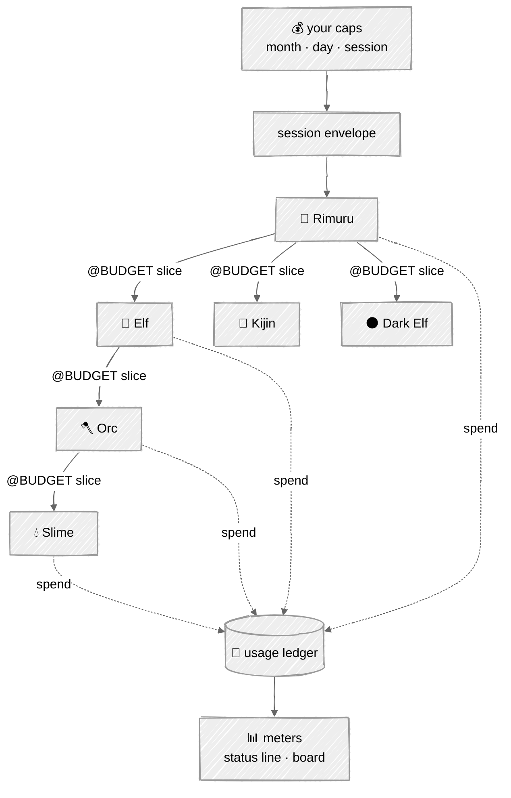

# Consumption

## In one picture



## In plain words

Budget flows down like context; spend flows up like memory.

You set caps — per month, per day, per session. A session gets an envelope. Rimuru carves a slice
of it for each order it gives, each Elf carves slices for its Orcs, and so on. No body can spend
more than its slice: before every model call the core checks whether the call could fit, and if
not, the body stops cleanly and asks its parent for more instead of overspending.

Every model call writes one line to the usage ledger: who spent it, on which model, how much was
cached. The terminal status line and the board show it live: tokens, cost, cache hits, burn rate,
what is left.

The biggest saving is designed in, not bolted on: every prompt is laid out so its start never
changes between calls, which lets the provider's prompt cache serve most of it at a fraction of
the price.

## Technical detail

### The usage row

One JSON line per model call in `.tempest/instruments/usage.jsonl`:

```json
{"ts":"…","session":"…","run":"…","body":"slime-wire","race":"slime","commission":"c-17",
 "model":"…","provider":"anthropic","input":5580,"output":112,"cacheRead":4096,
 "cacheWrite":0,"usd":0.0041,"envelope":{"left":54888,"of":60000}}
```

Prices come from a versioned table shipped with the binary (`prices.toml`), overridable per
provider in config; a model with no known price records `usd: null` and the meter says
*unpriced*, never zero.

### Envelopes

- Caps: `budget.month`, `budget.day`, `budget.session` (tokens and/or currency). A fold over the
  ledger enforces month and day across sessions.
- A commission's `@BUDGET` is carved by the parent. Each race has a compiled default share of
  what its parent has left (Elf 60%, Orc 50%, Slime 50%, Kijin 30%, Dark Elf 40%); the parent's
  plan may name a smaller one, never a larger one than it holds.
- **Pre-flight.** Before each model call: `context_tokens + max_output ≤ envelope.left`. If not,
  the loop checkpoints with `@? budget: need ~N, have M`. The parent can grant from its own
  envelope (`@INSTRUCT` with a new budget), split the work, or escalate to the human.
- Unspent slices return to the parent when the child reports.
- At 80% of any cap the human sees a warning; at 100% the session stops new commissions and
  finishes the current turn's report.

### Cache-first prompt layout

```
[ crest + nature law        ]  ← identical for every body in every world: cache breakpoint 1
[ race card (compiled text) ]  ← identical for every body of a race:         breakpoint 2
[ creature card + Minds manifest ]  ← identical across this creature's turns: breakpoint 3
[ recall anchors · commission · conversation ]  ← changes
```

- A test renders two consecutive turns for each race and asserts the first three blocks are
  byte-identical. Any timestamp, map ordering or counter that leaks into the stable prefix fails
  CI.
- `cacheHitRate` is a signal in the value ledger; the board shows it per race.

### Meters

| Meter | Reads | Where |
|---|---|---|
| spend | session tokens and cost, per body | status line, board |
| left | envelope left for the active body and the session | status line |
| cache | cache read ÷ input, rolling | status line, board |
| burn | tokens per minute over the last 5 minutes | board |
| per race | spend and pass rate by race over 28 days | board, `tempest ledger` |

`tempest ledger [--by race|body|model|day]` prints the same folds in the terminal.

### Building Tempest within your plan

The roadmap is cut into rungs small enough to finish in one or two focused sessions each. After
every rung, the session's spend is read with `npx ccusage` (Claude Code's local usage logs) and
written to the rung's entry in `log.md`. From milestone M6 on, Tempest can run its own work, and
its own ledger becomes the instrument.
