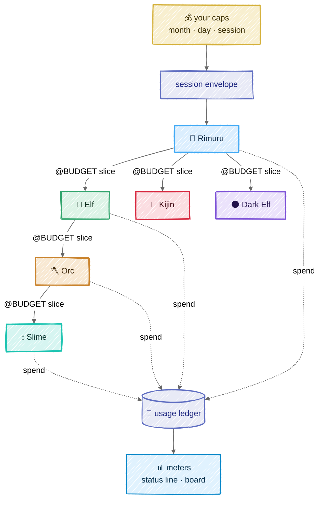

# Consumption

## In one picture



## In plain words

Budget flows down like context; spend flows up like memory.

You set caps — per month, per day, per session. A session gets an envelope. Rimuru carves a slice
of it for each order it gives, each Elf carves slices for its Orcs, and so on. No body can spend
more than its slice: before every model call the core checks whether the call could fit, and if
not, the body stops cleanly and asks its parent for more instead of overspending.

Every model call writes one line to the usage ledger: who spent it, on which model, how much was
cached. The terminal status line and the board show it live: tokens, cost, cache hits, burn rate,
what is left.

The biggest saving is designed in, not bolted on: every prompt is laid out so its start never
changes between calls, which lets the provider's prompt cache serve most of it at a fraction of
the price.

## Technical detail

### The usage row

One JSON line per model call in `.mnemorph/instruments/usage.jsonl` — decisions included: a
System One read writes its own row under its provider, with `usd` null for a model the price
tables do not know, so its `wt` still reaches the meters and the budget:

```json
{"ts":"2026-10-23T19:07:00Z","session":"…","run":"…","body":"slime-wire","race":"slime",
 "commission":"c-17","model":"…","provider":"anthropic","input":5580,"output":112,
 "cacheRead":4096,"cacheWrite":0,"prefix":3900,"wt":6700,"usd":0.0041,
 "envelope":{"left":54888,"of":60000}}
```

`prefix` is the part of the input that was the fixed per-session prompt (law, race card,
creature card, manifests): the cost every turn carries before it does any work, folded on its own
line (`prefixShare`) so a growing law shows up as a number, not a feeling. The journal is
append-only: one row per line, appended and synced before the call returns (a new journal's
directory is synced too). A torn last line is closed before the next row is written, and is
skipped and reported when the journal is read back, never fatal; a byte-order mark is ignored.

Two meters, one implementation each, never confused:

- **occupancy** — how full the window was at the last call: that call's `input + cacheRead +
  cacheWrite`. A reading, not a sum; the stress zone reads it.
- **spend** — every class of every call, summed. Budgets and caps read it, in weighted tokens.

Prices are `[models."<id>"]` tables in TOML — `input`, `output`, `cache-read` and `cache-write`,
all four required, in dollars per million tokens — layered model by model from the binary's table
and config (a config row replaces the whole row). The cache prices are never derived from the
input price: the read multiple differs by model, a tenth on some and a twentieth or less on the
newest. Mnemorph marks only 5-minute cache breakpoints; a reply that reports 1-hour cache writes
(priced at 2× input) carries a warning on its response, since the ledger prices every write at the
5-minute rate. A missing or misspelt key or a negative price refuses the table. A model with no
price records `usd: null` and the meter says *unpriced*, never zero; its weighted tokens still
count, with an output ratio of 5.

The binary ships one table per provider, from the provider's published prices — never guessed.
Anthropic's (`crates/mnemorph-provider/prices/anthropic.toml`) prices Claude Opus 5.5, Claude
Sonnet 5.5 and Claude Fable 5.1; a model whose four prices are not all published, such as Claude
Haiku 5.5's cache prices, stays unpriced until they are.

### The unit: weighted tokens

A budget counts what a call really costs, not how long its context is. Re-sent context served
from the cache costs about a tenth of fresh input (less on the newest models), so counting raw
context would kill a body after a few calls while
it was spending almost nothing. The unit is the **weighted token** (wt):

```
wt = uncached_input + 1.25 × cache_write + 0.1 × cache_read + r × output
```

where `r` is the model's output-to-input price ratio from the price table (5 when the model is
unpriced, or priced with free output — output is never free in weighted tokens). The weights are
fixed on purpose: wt is a budget unit, the same for every model, and dollars are the exact view.
It is computed in integers and rounded up.
Currency caps convert through the same table; a model with no known price is still bounded in wt.

### Envelopes

- **Caps:** `budget.session`, `budget.day`, `budget.month`, in weighted tokens, from the human's
  own files only — a cloned repository neither raises nor sets one. They are per world: the
  day and the month are read from the world's usage ledger, so they hold across the sessions
  that share it (a ledger across worlds comes with the board, M12). Before every model call the
  run rereads the ledger and stops at a checkpoint (`budget: the day cap is spent — …`) once the
  session, the day or the month is spent; at 80% of one the human is warned, once. A call is
  never cut in half, so a run can pass a cap by the one call that crosses it; every call — the
  salvage turn after a clock death included — is metered and ledgered. A ledger that cannot be
  read opens no capped session and stops a capped run: spend it cannot see is spend it cannot
  stop. A line it cannot read — a torn last write after a crash, a hand edit — stops nothing: it
  is counted high, as the largest call the ledger knows (20 000 wt at least), against every cap,
  since it cannot say its day or its session; the session opens telling the human which lines to
  repair or remove to count them true. Weighted tokens count every call — priced, unpriced or free — so no model slips under a
  cap; a dollar cap could not promise that, and the dollar keys (`budget.*_usd`) are a view for
  the board (M12), never a limit.
- **Only cost is carved.** Steps and the wall clock pass down whole, per race
  ([the loop](03-loop.md#budgets-are-readings)); splitting them would leave the Slime — the only
  body that writes code — a handful of steps.
- **Carving follows the plan.** A parent splits its envelope across its plan's open items by
  their declared weight (default equal), keeping a 10% reserve for itself. Each race has a
  compiled **maximum** share of what the parent has left when it carves (Elf 60%, Orc 60%,
  Slime 70%, Kijin 30%, Dark Elf 40%) — a ceiling, never a default — and the slices together
  never exceed what the parent holds.
- **The challenge reserve.** 10% of the session envelope is reserved for the automatic Dark Elf
  challenges; it cannot be carved for anything else. Each challenge draws a quarter of the
  reserve's full size (or what remains), and what it does not spend goes back to the reserve.
- **Pre-flight**, for a carved slice (dispatch, M7). Before each model call the core estimates
  the call in wt (`estimate`: cached
  prefix at the cache-read weight, the rest uncached, `max_output` at `r`). If it does not fit
  what is left, the loop checkpoints with `@? budget: need ~N wt, have M wt`. The parent can top
  up the child's slice from its own envelope (`@INSTRUCT` with a new budget), split the work, or
  escalate to the human.
- **Spend is recorded, never refused after the fact.** Pre-flight is the guard; when a call
  costs more than its estimate, the real cost is booked and the envelope reads *overspent*.
- Unspent slices return to the parent when the child reports; what the child spent counts as the
  parent's spend. A slice settles once, and only with the envelope that carved it — a replayed or
  stray report is refused and leaves the books alone. Envelopes and open slices serialise whole, so
  a checkpointed run resumes with the same books.
- Once dispatch carves (M7), a spent cap also stops new commissions while the turn in flight
  finishes its report.

### Cache-first prompt layout

The provider renders tools, then the system prompt, then the messages. Changing any tool
definition invalidates everything after it, so the tools tier comes first and never varies.
Anthropic allows at most four cache breakpoints. Most of a long run's input is its
conversation, not its prompt, so one breakpoint always rides the conversation's tail:

```
[ tools: the race's full, stable tool list ]  ← identical for every body of a race:  breakpoint 1
[ crest + nature law + race card           ]  ← identical for every body of a race:  breakpoint 2
[ creature card + its rules + Minds        ]  ← identical across its turns:          breakpoint 3
[ recall anchors · toolbox manifest text · commission · conversation ]
                                              ← the last block sent:                breakpoint 4
```

- The conversation's breakpoint moves forward every turn, so each request reads everything the
  last one sent at the cache-read price and writes only what the turn added. The conversation
  takes the slots the stable tiers leave, the tail first; a spare slot marks the previous
  request's tail too, so a turn that appends many blocks still lands within the provider's
  lookback of the entry the last one wrote.
- Compaction rewrites the conversation from its first folded message on, so it folds only in
  rare, large batches ([The loop](03-loop.md)): between folds, the history is read, not resent.
- Behind an OpenAI-compatible gateway, Claude caches only what is marked: the request carries
  the gateway's one automatic breakpoint, which moves with the conversation. The other models
  there (OpenAI, DeepSeek, Gemini, Grok, …) cache a stable prefix on their own.

- The toolbox's level-1 manifest is **text** in the changing tail, never tool definitions — so
  offering different tools per turn never breaks the cache.
- A test renders two consecutive turns for each race and asserts every tier up to breakpoint 3
  is byte-identical, tool JSON included. Any timestamp, map ordering or counter that leaks into
  the stable prefix fails CI.
- Each provider and model has a minimum cacheable prefix; a test asserts each breakpoint's
  prefix meets the minimum of every configured model, or the breakpoint is merged into the next.
- Caches are per model: "identical for every body" pays off among bodies on the same model.
- `cacheHitRate` is a signal in the value ledger, per tier; the board shows it per race.

### Meters

| Meter | Reads | Where |
|---|---|---|
| spend | session tokens and cost, per body | status line, board |
| left | envelope left for the active body and the session | status line |
| cache | cache read ÷ input, rolling | status line, board |
| burn | tokens per minute over the last 5 minutes | board |
| per race | spend and pass rate by race over 28 days | board, `mnemorph ledger` |

`mnemorph ledger [--by race|body|model|day]` prints the same folds in the terminal.

### Building Mnemorph within your plan

The roadmap is cut into rungs small enough to finish in one or two focused sessions each. On a
subscription plan what binds is not money but the usage windows (the 5-hour and weekly limits),
so after every rung the session's **tokens per model** and the **share of the usage window** it
took are read with `npx ccusage` (`daily` and `blocks`, from Claude Code's local logs) and
written to the rung's entry in `log.md`. The dollar figure ccusage prints is the API-equivalent
price, not what the plan costs: it is recorded only as a comparison. From M6 Mnemorph runs part of
its own work in solo mode, and its own ledger becomes the second instrument.
