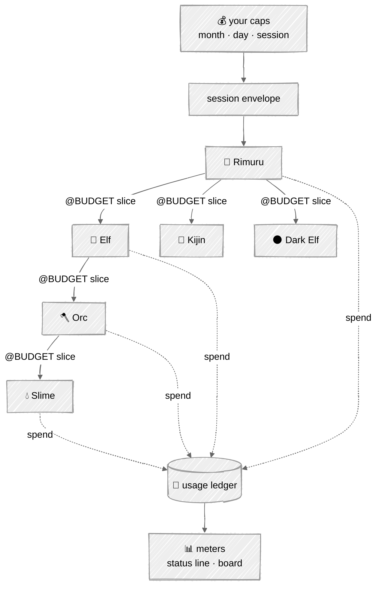

# Consumption

## In one picture



## In plain words

Budget flows down like context; spend flows up like memory.

You set caps — per month, per day, per session. A session gets an envelope. Rimuru carves a slice
of it for each order it gives, each Elf carves slices for its Orcs, and so on. No body can spend
more than its slice: before every model call the core checks whether the call could fit, and if
not, the body stops cleanly and asks its parent for more instead of overspending.

Every model call writes one line to the usage ledger: who spent it, on which model, how much was
cached. The terminal status line and the board show it live: tokens, cost, cache hits, burn rate,
what is left.

The biggest saving is designed in, not bolted on: every prompt is laid out so its start never
changes between calls, which lets the provider's prompt cache serve most of it at a fraction of
the price.

## Technical detail

### The usage row

One JSON line per model call in `.tempest/instruments/usage.jsonl`:

```json
{"ts":"…","session":"…","run":"…","body":"slime-wire","race":"slime","commission":"c-17",
 "model":"…","provider":"anthropic","input":5580,"output":112,"cacheRead":4096,
 "cacheWrite":0,"usd":0.0041,"envelope":{"left":54888,"of":60000}}
```

Prices come from a versioned table shipped with the binary (`prices.toml`), overridable per
provider in config; a model with no known price records `usd: null` and the meter says
*unpriced*, never zero.

### The unit: weighted tokens

A budget counts what a call really costs, not how long its context is. Re-sent context served
from the cache costs a tenth, so counting raw context would kill a body after a few calls while
it was spending almost nothing. The unit is the **weighted token** (wt):

```
wt = uncached_input + 1.25 × cache_write + 0.1 × cache_read + r × output
```

where `r` is the model's output-to-input price ratio from `prices.toml` (5 when unknown).
Currency caps convert through the same table; a model with no known price is still bounded in wt.

### Envelopes

- **Caps:** `budget.month`, `budget.day`, `budget.session`, in wt and/or currency. A fold over
  the ledger enforces month and day across sessions.
- **Only cost is carved.** Steps and the wall clock pass down whole, per race
  ([the loop](03-loop.md#budgets-are-readings)); splitting them would leave the Slime — the only
  body that writes code — a handful of steps.
- **Carving follows the plan.** A parent splits its envelope across its plan's open items by
  their declared weight (default equal), keeping a 10% reserve for itself. Each race has a
  compiled **maximum** share (Elf 60%, Orc 60%, Slime 70%, Kijin 30%, Dark Elf 40%) — a ceiling,
  never a default — so parallel children cannot together exceed what the parent holds.
- **The challenge reserve.** 10% of the session envelope is reserved for the automatic Dark Elf
  challenges; it cannot be carved for anything else.
- **Pre-flight.** Before each model call the core estimates the call in wt (cached prefix at the
  cache-read weight, the rest uncached, `max_output` at `r`). If it does not fit `envelope.left`,
  the loop checkpoints with `@? budget: need ~N wt, have M wt`. The parent can grant from its own
  envelope (`@INSTRUCT` with a new budget), split the work, or escalate to the human.
- Unspent slices return to the parent when the child reports.
- At 80% of any cap the human sees a warning; at 100% the session stops new commissions and
  finishes the current turn's report.

### Cache-first prompt layout

The provider renders tools, then the system prompt, then the messages. Changing any tool
definition invalidates everything after it, so the tools tier comes first and never varies.
Anthropic allows at most four cache breakpoints; Tempest uses all four:

```
[ tools: the race's full, stable tool list ]  ← identical for every body of a race:  breakpoint 1
[ crest + nature law                       ]  ← identical for every body:            breakpoint 2
[ race card (compiled text)                ]  ← identical for every body of a race:  breakpoint 3
[ creature card + its rules + Minds        ]  ← identical across its turns:          breakpoint 4
[ recall anchors · toolbox manifest text · commission · conversation ]  ← changes
```

- The toolbox's level-1 manifest is **text** in the changing tail, never tool definitions — so
  offering different tools per turn never breaks the cache.
- A test renders two consecutive turns for each race and asserts every tier up to breakpoint 4
  is byte-identical, tool JSON included. Any timestamp, map ordering or counter that leaks into
  the stable prefix fails CI.
- Each provider and model has a minimum cacheable prefix; a test asserts each breakpoint's
  prefix meets the minimum of every configured model, or the breakpoint is merged into the next.
- Caches are per model: "identical for every body" pays off among bodies on the same model.
- `cacheHitRate` is a signal in the value ledger, per tier; the board shows it per race.

### Meters

| Meter | Reads | Where |
|---|---|---|
| spend | session tokens and cost, per body | status line, board |
| left | envelope left for the active body and the session | status line |
| cache | cache read ÷ input, rolling | status line, board |
| burn | tokens per minute over the last 5 minutes | board |
| per race | spend and pass rate by race over 28 days | board, `tempest ledger` |

`tempest ledger [--by race|body|model|day]` prints the same folds in the terminal.

### Building Tempest within your plan

The roadmap is cut into rungs small enough to finish in one or two focused sessions each. On a
subscription plan what binds is not money but the usage windows (the 5-hour and weekly limits),
so after every rung the session's **tokens per model** and the **share of the usage window** it
took are read with `npx ccusage` (`daily` and `blocks`, from Claude Code's local logs) and
written to the rung's entry in `log.md`. The dollar figure ccusage prints is the API-equivalent
price, not what the plan costs: it is recorded only as a comparison. From M6 Tempest runs part of
its own work in lone-body mode, and its own ledger becomes the second instrument.
