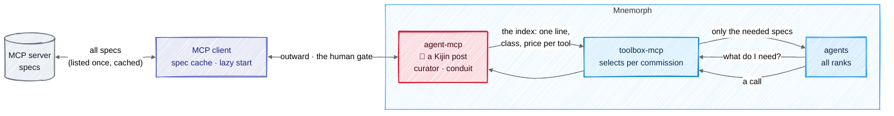

# MCP

## In one picture

## In plain words

An MCP server always sends every one of its tool definitions. Mnemorph takes them all in once, at
its border, and never shows them all to anyone.

Three parts share the work:

- **The MCP client** talks to the servers. It lists each server once, keeps the specs on disk, and
  starts a server only when one of its tools is first needed.
- **agent-mcp** is a Kijin post — the only body that touches the outside. It knows the whole
  catalog. When a server is added or changes, it reads every spec once and writes an index: one
  line, a class and a price per tool. When an agent calls a tool, it carries the call out through
  the sandbox and the human gate.
- **toolbox-mcp** answers every agent, whatever its rank: "for this task, these are the tools you
  need" — and hands over only those specs.

So an agent's context holds the few tools its task needs, not a hundred definitions it will never
use.

## Technical detail

### Code where code is enough

| Part | How it works | A model? |
|---|---|---|
| MCP client | lists each server (following the pagination cursor), caches specs by server identity and version, starts servers lazily, refreshes on a version change or `list_changed` | never |
| agent-mcp, **curator** | on a new server or a new version: classes each tool (read · write · outward · destructive), writes its one-line description, slims and prices its schema | once per server version, on the fast tier |
| agent-mcp, **conduit** | carries a call out: class check, sandbox, secrets by name, the human gate for outward acts, journal before and after | never |
| toolbox-mcp | ranks the index against the commission (BM25 and relation), filters by the race's shelf, returns the top tools' slimmed specs plus the search door | only when the catalog is large and the top candidates score close: one fast-tier rerank over names and one-liners, cached per commission |
| the ledger | records loads and calls; demotes tools loaded and never called; at a session's start, pins the tools a creature always uses into its prefix | never |

Every model call above is a ledger row in weighted tokens. The call path — an agent calling a tool
— runs no model at all.

### The rules

- **The full catalog never enters a rank's context.** It lives in the client's cache and the
  curator's index, on Kijin soil.
- **Selection never widens a shelf.** A tool whose class is not on the asking race's shelf is
  never offered; an `outward` tool is called through agent-mcp, under the gate.
- **The search door stays open.** A wrong selection costs one search, never a dead end.
- **The request only grows** ([#38](https://github.com/Kaginari/mnemorph/issues/38)): tools offered
  mid-session ride the uncached tail; pinning into the prefix happens only at a session's start.
- **Read-only lookups** (documentation search and the like) are still network acts. The human may
  mark a class `outward-read` in config: sandboxed and journaled, with no prompt. Never a default.
- **Served outward too.** `mnemorph mcp serve --toolbox` puts the same selection in front of any MCP
  client — Claude Code, OpenCode — for their own servers.

### Measured

The M13 benchmark runs the same servers and scripted tasks through Mnemorph and maki: spec tokens
shown, tokens loaded on demand, session start time, time to the first call, wrong-tool and
bad-argument calls, weighted tokens per task, and the selection's precision (offered tools that
were called) and recall (called tools that had to be searched). The design and its history:
[#48](https://github.com/Kaginari/mnemorph/issues/48).
