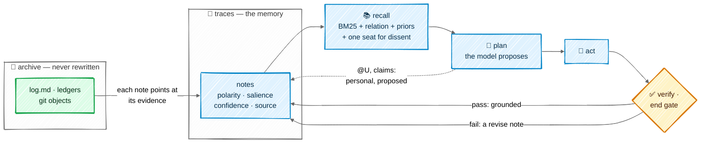

# Memory

Mnemorph's memory is built on one rule: **a model's words never become shared memory on their
own; something accountable must stand behind them** — a check that ran, the human, or, weaker, a
commissioner's verdict or a second creature's independent evidence. The design takes its rules
from Yucong Duan's [DIKWP MNEMORPH-85](https://github.com/YucongDuan/DIKWP-MNEMORPH-85), a
reconstructive memory runtime for LLM agents (a small reference implementation, its weights
untuned), and fits them onto what Mnemorph already has — an append-only journal, a verify beat
and an end gate — and the BM25 recall it has chosen. The rules are ported; no code is.

## In one picture



## In plain words

Most agent memories store whatever the model said and fetch the closest text back later. That
has a hidden flaw: when the model is wrong and its words are saved, the next recall brings the
mistake back as if it were a fact. Over many sessions the memory drifts towards believing its
own errors.

Mnemorph splits memory in two. The **archive** is the evidence: the journal, the ledgers, the
commits. It is never rewritten. The **traces** are the memory: short notes, each pointing at the
evidence it came from, each marked as agreeing, disagreeing or correcting. Traces may change;
the archive never does, so any belief can be walked back to the bytes behind it.

Memory also has two scopes. **Personal** memory belongs to one creature: it writes there
freely, and only it recalls from there, so its mistakes cannot spread. **Shared** memory is what
every creature reads, and only confirmed notes enter it.

Five rules follow:

1. **Proposals stay personal.** What a model says, including the unsaid it surfaces, lands in
   its creature's personal memory as *proposed*. It reaches shared memory only once it is
   *grounded*: a check passed, the commissioner accepted a finding, a second creature found the
   same thing on its own evidence, or the human confirmed it.
2. **Recall always shows the other side.** If any note disagrees with or corrects what is being
   recalled, one seat is reserved for it, however low it ranks.
3. **Corrections outrank habits.** A note born from a failed check starts well ahead of an
   ordinary one. Age barely matters: things stop being believed because the world corrected
   them, not because time passed.
4. **Summaries never swallow exceptions.** When a desk is distilled, agreeing notes merge;
   disagreeing and correcting notes stay as they are.
5. **Loops are seen, not felt.** The same recall coming back again and again with nothing new
   learned is detected by its fingerprint, and broken.

## Technical detail

### The two layers

| Layer | What it is | Where | Changes? |
|---|---|---|---|
| Archive | journal entries, ledger rows, commits, gate verdicts | `.mnemorph/log.md`, `.mnemorph/instruments/*.jsonl`, git | never rewritten |
| Traces, personal | one creature's notes | `.mnemorph/memory/creature/<name>.jsonl` (tracked) | by appended events only |
| Traces, shared | the world's notes | `.mnemorph/memory/shared/notes.jsonl` (tracked) | by appended events only |
| Short | one body's semantic cache | `.mnemorph/memory/short/` (machine-local) | freely; dies with the task |

A trace is

```math
\tau = (\text{text},\ \text{tags},\ \text{owner},\ \pi,\ s,\ \kappa,\ \text{status},\ \text{source})
```

- **polarity** $\pi \in \lbrace \text{support},\ \text{counter},\ \text{revise}\rbrace $;
- **salience** $s$ and **confidence** $\kappa$, both in $[0,1]$;
- **status** $\in \lbrace \text{proposed},\ \text{grounded},\ \text{dormant},\ \text{tombstoned}\rbrace $;
- **source**: the evidence it points at, such as a journal entry, a gate verdict, a commit or a
  `file:line`.

Every note file stays append-only (`merge=union`, set through git's local `.git/info/attributes`
when a session opens, so the world's own files stay the human's): a note is born by a `create`
event, and a status change, a demotion or a tombstone is a `status` event, a confidence moved a
`confidence` event, each naming the note it changes; the current state is a fold over the events.
On a split, each heir's file receives the events of the notes whose source lies in its ground —
a note with no path to read goes to every heir — and the old creature's file is kept whole. Two
machines that both append never conflict, because the fold does not trust line order:

- every event is one full line, written and synced before the writer returns, like a usage row;
- events are folded in $(\text{time}, \text{event id})$ order, and the latest event sets the
  status, so a demotion lowers what came before it; an event about a note never created is set
  aside, and a second creation of one is ignored;
- only events the order cannot separate (the same time and id, a merge's duplicate) take the
  stronger status: $\text{tombstoned} > \text{dormant} > \text{grounded} > \text{proposed}$.

Every event also names who wrote it — `by: record | gate | route | human | import` — and an event
that claims a standing must cite its proof (section *Two scopes, two standings*). An event in a
tracked tier cites tracked evidence — a `log.md` entry, a commit, a verdict recorded in the
journal — never a machine-local ledger row, so its proof travels with it. The fold checks that the
proof resolves: the entry, verdict or commit it cites exists and says what the event claims. A
proof that is merely out of reach on this machine (a commit not yet fetched) leaves the event
*unresolved here*: kept, not recalled as grounded, and never counted as an unproven write.

Let $C$ be the notes with $\pi \in \lbrace \text{counter}, \text{revise}\rbrace $ (the *dissent*) and $S^{+}$
the rest.

### Recall

Recall keeps the lessons already written for it: never rebuild the index inline, stay silent when
the query has no content words, and boost the body's own and its race's notes over the episodic
log. On top of BM25 it adds priors and dissent, over a budget of $k = 6$ anchors ($k \ge 2$):

```math
\mathrm{score}(\tau) =
\underbrace{w_q\,\widehat{\mathrm{bm25}}(q,\tau)}_{\text{meaning}}
+ \underbrace{w_r\,\mathrm{rel}(\tau)}_{\text{owner, race, log}}
+ w_s\,s + w_\kappa\,\kappa
+ w_t\,2^{-\Delta/H}
+ \beta\,\mathbf{1}[\tau \in C]
```

$\widehat{\mathrm{bm25}} = \mathrm{bm25} / (\mathrm{bm25} + c)$ saturates into $[0,1)$ without
looking at the other hits, so a poor best match stays a poor score. $c$ is a config constant
with a default, set against the recall fixtures; raw BM25 grows with the query's length, so $c$
is kept per query length in content words (1, 2–3, 4 and more).

$\mathrm{rel}(\tau)$ is Mnemorph's own term, the relation lesson made a number: 1.0 for the
body's own creature, 0.6 for its race, 0.3 for any other shared note, 0.1 for the episodic log.

The starting weights take MNEMORPH-85's where it has them — $w_q = 0.42$, $w_s = 0.10$,
$w_\kappa = 0.07$, $w_t = 0.07$, $\beta = 0.10$, $H = 120$ days — and give its context and purpose
weights ($0.25 + 0.09$) to the relation term: $w_r = 0.34$. The commission's `@ASK` office, not a
free-text purpose, picks which notes a findings, verdict or draft body is shown first. The
relevance floor $\theta = 0.12$ applies to the meaning term alone,
$w_q\,\widehat{\mathrm{bm25}}(q,\tau) \ge \theta$: the priors rank notes that match, they never
make a note match (with them in the sum, a body's own note would clear the floor with no match
at all). All of them live in config, never in a prompt, and are tuned against the recall
fixtures.

### Two scopes, two standings

Scope says who may recall a note; standing says how far it is trusted. They are separate axes:

| | proposed | grounded |
|---|---|---|
| **personal** | the creature's own claims, `@U` lines, guesses | its claims that passed a route below |
| **shared** | — never: nothing unconfirmed is shared | the world's memory |

A creature's recall reads its personal notes and the shared notes, ranked together, with the
relation term already favouring its own. A proposed note is marked as such on the wire.
Personal memory survives the creature's bodies; on a split, each heir inherits the notes whose
sources fall in its territory, and on retirement they are archived, never deleted.

**Routes from personal to shared.** A note is promoted, as a new event that points at its proof,
by exactly one of:

| Route | Proof | For |
|---|---|---|
| **checked** | the end gate passed *and* ran at least one verify line over a non-empty diff | work that wrote files |
| **accepted** | the commissioner's verdict names the claim and accepts it (the verdict-current) | research, reads, reviews — work with nothing to test |
| **corroborated** | a second creature lands a matching claim from different evidence anchors | anything, including failed runs |
| **confirmed** | the human says so | anything |

An answer that changed nothing passes the end gate untouched; that pass proves nothing about
its claims, so it never counts as **checked**. Its `@U` lines wait for **accepted**: the parent
reads the report and accepts or rejects each claim by name in its verdict. Grounded therefore
means *the work it rode on landed under a check, or someone accountable vouched for it* — never
that the claim was proven.

The **corroborated** route is Genesis's *named twice* applied to memory. If two bodies err
independently at rate $\varepsilon$, a wrong claim survives both with probability $\varepsilon^2$.
Bodies on the same model share blind spots, so their errors are not independent: the match
counts only when the two claims cite different anchors (different files, entries or commits),
never the same note recalled twice.

**Failed runs still teach.** The failure itself is an observed fact: it grounds a revise event
at once (see *Reconsolidation*). The body's explanation of *why* it failed stays personal and
proposed until a route promotes it.

**`@U territory` is not memory.** A territory fact goes to [the ontology](09-ontology.md#facts-who-said-what),
where it is remembered with who said it and can be countered; ownership is checked by the gate's
*right author* rule, not by recall.

**The dissent seat.** With a budget of $k \ge 2$ anchors:

```math
\mathcal{S} = \operatorname{top}_{k-2}(S^{+}) \ \cup\ \{\arg\max_{\tau \in C} \mathrm{score}(\tau)\} \ \cup\ \text{fill to } k
```

If $C \neq \emptyset$, at least one dissenting note is always recalled. Plain top-$k$ cannot
promise that: when agreeing notes outnumber disagreeing ones, the one correction that matters
ranks $k+1$ and is never seen.

**Declared omissions.** Notes whose meaning cleared the relevance floor but were cut are reported as a
count and at most three anchors, never their text, so the body knows recall was partial without
paying for it in the uncached tail every turn:

```math
\mathcal{O} = \{\tau \notin \mathcal{S} : w_q\,\widehat{\mathrm{bm25}}(q,\tau) \ge \theta\}
```

When no dissenting note was selected, recall says *none selected*, never *none exist*.

**On the wire.** Recall reaches the body as `@M` lines in the recall-anchors tier
([communication](04-communication.md#the-wire-envelope)):

    @M <anchor> personal|shared proposed|grounded support|counter|revise: <text>
    @M -<n> <anchor> <anchor> <anchor>        # n cut above θ; at most three named
    @M -0 dissent: none selected               # never "none exist"

Recall runs once per ask, over the body's personal notes and the shared ones — a note grounded
from its personal tier counted once — with the ask's own text as the query. Its lines open the
ask, and the anchors shown go to the run's journal as the turn's `recall` row, the record a
run-ending failure reconsolidates by. An ask that matches nothing is sent as it was.

### The write rule

Writes to the traces are a function of observed outcomes, never of model output $y$:

| Source | Lands in | Standing | $\pi$ | $s$ | $\kappa$ |
|---|---|---|---|---|---|
| a `@U` line, a body's claim | personal | proposed | support | 0.6 | 0.5 |
| the same, promoted by **checked** or **confirmed** | shared | grounded | support | 0.6 | 0.7 |
| the same, promoted by **accepted** or **corroborated** | shared | grounded | support | 0.6 | 0.6 |
| a run-ending failed verify or a failed gate verdict | the scope of the notes it names | grounded | revise | 1.0 | 0.9 · 0.4 |
| a human's correction | shared | grounded | revise | 1.0 | 1.0 |

Only the record beat, the gate and the promotion routes hold the write path, and that is a
type, not a habit: a `Claim<Proposed>` becomes a `Claim<Grounded>` only through a value that
carries its route's proof (a gate verdict, a passed verify line, a commissioner's verdict, a
second creature's anchors, a human answer). A body cannot ground its own words.

**Why it matters.** Let a fraction $f_t$ of $N_t$ notes be wrong, and let each turn add $m$
notes. If notes come from the model's own output, which is wrong when recall was wrong or when the
model errs (rate $\varepsilon$) on a correct recall:

```math
f_{t+1} - f_t = \frac{m}{N_t + m}\,\varepsilon\,(1 - f_t) \;>\; 0
```

The error fraction rises for any $\varepsilon > 0$, and its only fixed point is $f^{*} = 1$. If
only observations write, with observation noise $\delta$ independent of what the model said:

```math
f_{t+1} = \frac{N_t f_t + m\,\delta}{N_t + m} \;\longrightarrow\; \delta
```

The floor is set by how well the routes observe, not by how often the model is wrong: for a
grounded note, $\delta = \Pr[\text{claim wrong} \mid \text{its route passes}]$. The argument holds
for the routes whose observation is independent of what the model said: **checked** and
**confirmed**. **Accepted** and **corroborated** rest on other model bodies, whose errors are
correlated with the writer's — the same model family shares blind spots — so their $\delta$ is
larger and unknown until the record measures it; that is why they ground at a lower $\kappa$.

A check also observes only what it tests. The end gate runs the verify lines and checks that the
tests stayed intact; it never reads a claim. A claim about the diff (*this function now handles
the empty case*) is observed by a test that exercises it; a claim about the world beyond the
diff (*the API rate-limits at 100 a minute*) passes a green gate as easily wrong as right, so for
it the checked route observes nothing, and it needs **accepted**, **corroborated** or
**confirmed**. A checked route's verify lines stood before the turn, so a wrong claim about the
diff has to slip past a test written without it; that is why a pass with no verify line is not a
route at all.

### Reconsolidation

A first failure is part of working: it goes back to the body as a note
([the loop](03-loop.md#the-end-gate)) and writes nothing to memory. Only a run-ending failure — the
body's last chance spent, or a gate verdict of `FAIL` — reconsolidates, and then once:

- **one revise event per failed act**, linking every anchor recalled for that turn (the turn's
  journal row has them), not one note per anchor; each link carries its own weight;
- the weight is **0.9 towards anchors the failed act cited** (the act's arguments or the body's
  text name them) and **0.4 towards anchors that were merely recalled** — Mnemorph's own split:
  MNEMORPH-85 weighs world effects (0.9) and corrections (1.0), with no notion of a recalled
  bystander;
- it never targets a dissenting note: a counter or revise note recalled into a failed turn is
  left as it is, so corrections do not breed corrections.

With equal recency and the default weights, its prior over an ordinary grounded note is

```math
(0.10 \cdot 1.0 + 0.07 \cdot 0.9 + 0.10) - (0.10 \cdot 0.6 + 0.07 \cdot 0.7) = 0.263 - 0.109 = 0.154
```

which is worth $0.154 / 0.42 \approx 0.37$ of normalised meaning: a correction outranks an ordinary
note that matches the query 0.37 better. Recency, by contrast, can move a score by at most
$w_t = 0.07$.

A note that passes the gate three times after being recalled gains confidence
($\kappa \leftarrow \min(0.95, \kappa + 0.05)$); it never gains salience by repetition alone.

### Consolidation and forgetting

The desk's distillation — when a creature's desk is distilled into a rule, a trait or a wrap-up
([evolution](02-races.md#evolution-the-other-way-to-change)) — merges agreeing notes into one
schema note: $s = 0.8$, confidence the mean of the four most salient merged notes' confidence,
capped at 0.95, and the two most salient originals stay active beside it, as in
MNEMORPH-85. **Dissent is exempt:** no counter or
revise note is ever merged or put to sleep by a distillation, so a summary can never absorb the
exception it disagrees with.

| Mode | The note | The evidence |
|---|---|---|
| `dormant` | out of recall | kept |
| `abstract` | replaced by a schema note, $\max(0.4,\ s - 0.1)$, $\max(0.3,\ \kappa - 0.1)$ | kept |
| `tombstone` | text removed, the event kept | machine-local tiers only |

Tracked notes travel by git, so their text cannot be unpublished. Private content therefore never
enters a tracked tier; a tombstone deletes text only where it can truly be deleted.

### Pathologies as instruments

`mnemorph memory status` reports, per creature, three findings read by code:

| Finding | Read as | The lawful act |
|---|---|---|
| **replay loop** | the same recall fingerprint, $\mathrm{SHA256}(\text{query}, \text{selected anchors}, \text{office})$ — MNEMORPH-85 also hashes its synthesised text, which Mnemorph does not produce — at least 3 times in the last 5 recalls with no new outcome and no dissent selected | inject the best dissenting note or escalate one hop, the way the identical-call loop breaker does for tools |
| **lock-in** | a revise note exists, yet every agreeing note recalled is older than it and no dissent was selected | reopen the recall with the newest revision forced in |
| **unproven write** | a note event whose `by` or proof does not resolve in the fold — a hand edit, a bad merge, an import that skipped its checks | ignore the event in recall, freeze the creature's memory writes and tell the human |

There is no aggregate memory score. A high recall hit rate cannot make up for a creature that
never accepts a correction.

### Not taken

- **The living-memory vector and its eight states.** Mnemorph keeps two of its pathologies
  (replay loop, lock-in) as findings with acts, adds its own (unproven write) in place of
  MNEMORPH-85's colonisation hold, and leaves out the maturity labels.
- **Lexical similarity.** MNEMORPH-85 ranks by token overlap; Mnemorph keeps tantivy BM25, and
  an embedding model stays the same boundary with a bigger engine.
- **Synthesis by concatenation.** Recall returns anchors; the body reads them.
