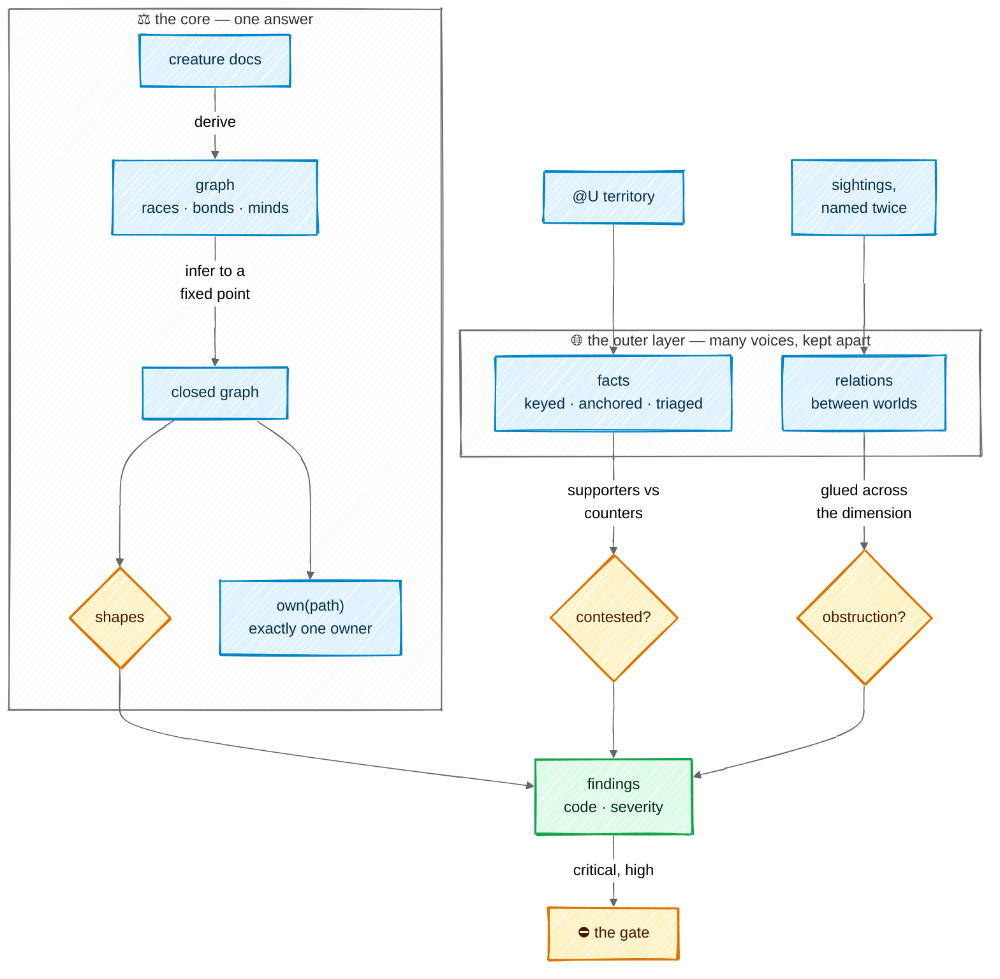

# The ontology

The ontology is the world's map of itself: which creatures exist, who answers to whom, who owns
each path, what creatures have learned about their territory, and how this world relates to its
neighbours. Its core is decisive — every path has exactly one owner, decided by code. Its outer
layer holds what is plural by nature, facts and relations, and keeps disagreement visible instead
of letting the last writer win. That outer layer takes its rules from Yucong Duan's
[DIKWP-MESH](https://github.com/YucongDuan/DIKWP-MESH-); the
[research page](research/dikwp-mesh.md) has the mathematics.

## In one picture



## In plain words

The core is read from the creature docs every time they change: the races, the chain of
command, the Minds each creature wears, and each creature's territory. From those, the ontology
works out everything that follows — a Slime under an Orc under an Elf is also *below* the Elf —
and checks the shapes the law demands: a Slime answers to exactly one Orc, no two creatures claim
the same ground, the chain of command never loops. Ownership is one function with a fixed order:
ask it about any path and it names one creature, or says nobody, and Rimuru must route a birth.

Around the core sit two things that are not one person's to decide. **Facts**: what creatures
learned about their territory, each remembered with who said it and on what evidence. When one
creature says the opposite of another, the ontology does not pick the newer one; it marks the
fact *contested*, shows both sides, and waits for a check, the Orc or the human. Disagreement is
caught even when nobody flags it: facts with a fixed key are compared by code, a fact whose
evidence changed is marked for a recheck, and a new fact that resembles an old one on the same
path is put in front of the Orc, who must say how the two relate. **Relations**:
how this world connects to others — it deploys one, reads secrets from another. A relation is
learned only when it is seen twice, proposed to the human, and dropped again if it stops being
seen.

Everything the ontology finds wrong is a finding with a code and a severity. The gate blocks a
landing only on the serious ones, in the territory it touches. There is no overall health score.

## Technical detail

### The graph

| Class | What | Read from |
|---|---|---|
| a race (`Slime`, `Orc`, `Elf`, `Kijin`, `DarkElf`, the throne and the ascended) | a creature | its doc under `.mnemorph/<race>/<name>/` |
| `Mind` | worn know-how | `.mnemorph/minds/`, and a doc's Minds field |
| `Doc` | a creature's document | the file itself |
| `Fact` (`Territory`) | something learned about a path | `@U territory` lines, as events |
| `World` | this world and its neighbours | `.mnemorph/dimension.toml` |

| Bond | From → to | Properties |
|---|---|---|
| `above` | creature → creature | transitive; `truth` (Slime → Orc), `verdict` (Orc → Elf) and `reports` (→ throne) are sub-bonds; `below` is its inverse |
| `owns` · `routes` · `posts` | creature → claim | a Slime's Territory, an Orc's Domain, a Kijin's Post — the doc's fields only |
| `wears` / `wornBy` | creature ↔ Mind | inverse pair |
| `heir` · `retired` | creature → creature · flag | relief and evolution |
| `about` · `by` · `counters` | fact → path · creature · fact | see *Facts* |
| `relates` | world → world | typed: `deploys`, `provisions`, `reads-secrets-from`, `depends-on`, or a learned type |

The derived graph is never written back; docs are the truth. Asserted facts and sightings are
append-only event files, folded in $(\text{time}, \text{event id})$ order like
[memory notes](08-memory.md#the-two-layers).

**Inference.** Subclass and sub-bond closure, inverses and the transitivity of `above` —
and, with the classes facts and worlds bring, domain and range typing — applied until nothing new appears: the least fixed point
$\mathcal{G}^{*} = \bigcup_n R^n(\mathcal{G}_0)$. The rules only add triples and the set of
possible triples is finite, so $\mathcal{G}^{*}$ is unique and reached in finitely many steps.
It is rebuilt when the docs' fingerprint moves, before a dispatch, never on a model call. A
direct report is typed by its two ends: a Slime to its Orc is `truth`, an Orc to its Elf is
`verdict`, anyone to the throne is `reports`; every one of them is `above`.

**Claims.** A creature's doc is `.mnemorph/<race>/<name>/README.md`: a `# name` heading, then
fields as list items, read before the first `##` heading of any depth and nowhere else. The
throne has a doc too, `.mnemorph/rimuru/<name>/README.md`: what reads the world reads it as it
reads every creature.

| Field | Who | Means |
|---|---|---|
| `Race` | every creature | its race, as the races name themselves (`slime`, `high-orc`) |
| `Reports to` | every creature but the throne | the creature above it: the chain of command |
| `Territory` | a Slime; an Elf | a Slime's zone, the paths it writes; an Elf's lane, the paths it plans across — owning nothing |
| `Domain` | an Orc | the paths it routes and judges, never writes |
| `Post` | a Kijin | the files and directories its outward acts own (CI, release, deploy) |
| `Verify` | a creature with a gate | one verify line per field |
| `Minds` | any | the Minds it wears |
| `Retired` | any | `yes`: it owns and commands nothing; its seat and claims are skipped |

A ground field is a list of paths inside the world: a directory written with its trailing `/`
(`src/`, `.github/workflows/`), covering what lies under it, or a file written with a `/` in it
(`./CHANGELOG.md`, `packages/cli/package.json`), covering that file alone. Anything else — a
sentence, a bare word, an absolute path, a `..` — makes the doc unreadable, and an unreadable doc
is reported, never guessed: the creature is not in the roster until it reads. So is a doc that
cannot be read at all, and a race's directory that cannot be listed. A
path mentioned in prose is never a claim; it raises a low `prose-claim` finding that the field
and the prose disagree. isekai read claims from prose too, and the rules
that kept prose mentions from becoming false claims grew into the largest and most fragile part
of its ontology; a field cannot be misread.

### Ownership: one function

$\mathrm{own} : \text{Path} \to \text{Creature} \cup \lbrace \bot\rbrace $ reads a path relative to the
world segment by segment — `.` dropped, `..` taking the segment before it, a directory ending in
`/` — so `crates/a/../../.mnemorph/law.md` is the law; a path that is absolute or climbs out of
the world is $\bot$. Then it takes the first rule that matches:

1. **Harness soil** — `.mnemorph/shared/`, `instruments/`, `memory/`, `ontology/`, `index/`,
   evolution's staging `tmp/evolution/` and the journal `log.md`: no body; only the harness writes
   them. The law, `.mnemorph/law.md`, and the world's configuration, `config.toml` and
   `config.local.toml`, are the human's: they change only as a diff the human applies.
2. **Scratch** — `.mnemorph/tmp/<body>/`: the body that owns the nest.
3. **A seat** — a living creature's directory under `.mnemorph/<race>/<name>/`: that creature,
   even inside a broader claim; the deepest seat wins.
4. **The compiled soils** of [the races](02-races.md#soil--who-may-write-what): the plan
   (`.mnemorph/plan.md`) and the dimension manifest, the throne's; the proving ground
   `.mnemorph/dark-elf/`, one ground with one keeper, the first living Dark Elf by name; the
   longest claim of a Kijin's post; the workspace — every root file, and `tools/`.
5. **The longest territory claim** among living authoring creatures (the Slimes' zones).
6. **The longest domain claim** among living gate-holders: an Orc's doc names its domain, and a
   path inside it that no Slime's zone covers is the Orc's to route.
7. Otherwise $\bot$: unowned soil, and Rimuru routes its birth.

Owning a path is not the right to write it. The gate's *right author* holds only when
$\mathrm{own}(\text{path})$ is the writer **and** the writer's race authors there
([soil](02-races.md#soil--who-may-write-what)): an Orc that owns a path by rule 6 routes it — a
Slime is born or extended for it — and writes it never, beyond its tests' verify lines.

$\mathrm{own}$ returns one creature per path. A Slime's doc is the Slime's; the gate's line-range
split, which gives the verify block to its Orc, is a refinement the *right author* check applies
to that one file ([the end gate](03-loop.md#the-end-gate)). Retired creatures own nothing: their
seats and claims are skipped. When two creatures tie on the same claim — itself a critical
finding — the tie breaks by creature name, so the answer stays deterministic while the finding
blocks.

The order is the rule: a creature that claims `.mnemorph` itself does not swallow every seat, the
queue and scratch, because rules 1–3 are asked first. The gate's *right author*, the dispatch card
and `mnemorph onto owner <path>` call this one function. The tool policy cannot: it sits below the
world in the crate graph and checks soil as prefixes. The loop hands each body the soil `own`
yields for it when it dispatches, as prefixes with exclusions (its territory minus the seats, queue and scratch the
earlier rules give away), so the policy and the gate never disagree: the longest claim that
covers a path decides, and on a tie the exclusion wins. A soil holds what `own` gives the body
by every rule but a domain — an Orc's soil is its seat and scratch. Its exclusions are found by
asking `own` of every claim inside the body's, never by restating the rules, and a test holds
the two to the same answer on every tracked file.

`mnemorph onto owner <path>...` prints, for each path, its owner, the rule that gave it and the
claim that matched — `crates/mnemorph-wire/src/lib.rs  slime-wire  zone crates/mnemorph-wire/`.
A path is the human's: relative to where they stand, or absolute; one outside the world is
nobody's. It reads the docs alone, so it needs no key and opens no session; a doc that does not
read is said on stderr.

**Overlap.** Two creatures whose write grounds — a Slime's zone, a Kijin's post — are equal, or
one inside the other, are a critical finding — except a seat doc inside a broader claim, which
rule 3 settles. An Orc's domain and an Elf's lane are not write grounds: they hold the zones
below them by design, so a domain over its Slimes' zones is the shape, not a breach. Two claims
of one creature never collide.

### Facts: who said what

A territory fact is

```math
f = (\text{about},\ \text{text},\ \text{by},\ \text{source},\ \text{status})
```

where `about` is the path it is about, `by` the creature whose body said it, and `source` the
evidence anchor (a `file:line`, a journal entry, a commit). A fact's id is the hash of its path
and its normalised text, so every assertion of the same fact is one more *support* event on the
same id, and a fact said in other words is a new fact until triage (below) links the two.
`<about>` is always a path — it contains a `/` or starts with `.`, so a file at the world's root
is written `./README.md` — and the first word of a fact's text is never mistaken for one. On the
wire:

    @U territory <about> <key>=<value>           # a keyed fact
    @U territory <about> <fact>                  # a free fact
    @U territory <about> !#<fact-id> <reason>    # counters one, naming it

A creature *supports* a fact by asserting it, and *counters* it with the third form, or by one of
the ways below that need no one to name anything. For a fact, count distinct creatures — $p$
supporters and $q$ counters — and read its status in order:

| Status | Rule |
|---|---|
| **settled** | a settle event with its proof (below) — final until a newer counter |
| **single** | $p = 1$, $q = 0$ — one voice |
| **agreed** | $p \ge 2$ and $\frac{q}{p+q} \le 0.35$ — named twice; one dissenter in three is tolerated |
| **countered** | $q \ge 2$ and $\frac{p}{p+q} \le 0.35$ — the counters carry it the same way |
| **contested** | any other case with $q > 0$ — a `contested-fact` finding |

The rows partition every case. A **countered** fact is shown as countered and recalled to no one
as true; the projection carries it only with its counters beside it. The 0.35 tolerance is
Mnemorph's own choice, untuned, measured on the losing side so more counters move a fact towards
*countered*, never back towards agreement. DIKWP-MESH uses the same number as a default for its
gluing check, without a derivation; it is not evidence. With the few voices a fact usually has,
the rule reads as counts: two to one is agreed, one to one contested, one to two countered.

### Catching what nobody flags

Agents do not volunteer disagreement: a body that believes the opposite of an old fact usually
just writes its own. DIKWP-MESH could count stances because its data had them filled in by hand.
Mnemorph derives counters three ways, cheapest first, and only the last costs a model any tokens.

**1. Keyed facts, compared by code.** A compiled vocabulary of keys, each with one value per path:

| Key | Value | Inherited by paths below |
|---|---|---|
| `entry` | a file inside the path | no |
| `build` | a command | no |
| `test` | a command | no |
| `generated` | `yes` or `no` | yes |
| `deprecated` | `yes`, `no` or `by <path>` | yes |

Each key is a functional property, a shape the core already checks:
$\lvert \lbrace v : (\text{about}, k, v) \rbrace \rvert \le 1$, after normalising $v$ (commands with
whitespace collapsed, paths normalised). Two creatures asserting different values for the same key
on the same path, or on a path below one where an inherited key is set, counter each other
automatically: each assertion is a support event on its own fact and a counter event on every
fact it collides with. The status table then applies unchanged, and no one had to name an id.

**2. Anchors that drift.** A fact's source records a digest of what it points at: the cited lines
of a `file:line`, the listing of a directory, a commit (which never drifts), a journal entry (never
either). When the digest no longer matches, the fact reads **stale** wherever it is shown, and
`onto check` raises a `stale-fact` finding. Staleness is computed, not stored, so it never adds a
counter; a creature that asserts the fact again re-anchors it. Most contradictions in a codebase
are a fact written before the code moved, and this catches them with a hash.

**3. Triage on collision.** A free fact lands through its body's parent (the Orc, for a Slime).
If the path, or a path above or below it, already holds active free facts, the landing shows the
parent the three that rank highest by BM25 against the new text, above a floor $\theta_t$, and the
parent's verdict labels the new fact against each:

    @V #<new-id> support #<id>      # the same fact: merged as a support event
    @V #<new-id> counter #<id>      # the opposite: a counter event
    @V #<new-id> refines #<id>      # narrower: both stand, linked
    @V #<new-id> distinct           # unrelated to all shown

A collision left unlabeled keeps the new fact **single** and raises an `untriaged-fact` finding.
Similarity only chooses what to compare; it never makes a fact contested by itself, because two
facts that share words agree as often as they clash. The cost is bounded: at most three candidate
lines per landed free fact, and none when nothing collides. Keyed facts skip triage — code already
decided.

A contradiction slips through only when it is free text, *and* recall misses the older fact or
the parent mislabels it:

```math
\Pr[\text{silent}] \le \Pr[\text{free}] \cdot \big(\Pr[\text{old fact not in the top 3}] + \Pr[\text{mislabel}]\big)
```

Each term is pushed down by a different lever: more keys shrink the first, the recall fixtures
measure the second, and the parent's own verdicts are what the value ledger scores.

**Recency never settles a fact.** A contested fact stays contested until a *settle* event with a
proof: a landing by the path's owner that passed its gate and cites the fact, the Orc's verdict
naming it, or the human. A creature's projection (`@ONTO`,
[communication](04-communication.md#the-wire-envelope)) shows a contested fact with both sides,
the way recall always seats one dissenting note.

`@U law` and `@U colony` are not ontology facts; they land as [memory notes](08-memory.md).

### Relations between worlds

**Gluing across a dimension.** Each world's ontology is a local section; the worlds of a
dimension overlap wherever two of them state relations about the same pair. Every type has an
inverse — `deploys` ↔ `deployed-by`, and `<type>-by` for a learned type unless one is declared —
and a pair may lawfully carry several types at once. For a pair $(A, B)$, let $R_A$ be the set A
states and $R_B$ the set B states, each read from A's side through inverses:

| Case | Result |
|---|---|
| $R_A \cap R_B \ne \emptyset$ | glued on what they share; the rest shown as one-sided |
| only one end states anything | partial: lawful, shown as one-sided |
| both ends state relations and $R_A \cap R_B = \emptyset$ | a `dimension-obstruction` finding, reported to Rimuru |

`mnemorph onto check --dimension` reads the neighbours' manifests (on this machine, inward) and
never edits them; a fix goes to the other world through its own throne, one hop at a time.

**Learning a relation.** A body that sees a cross-world reference — an image another world
deploys, a secret path another world provisions — records a sighting
$(\text{from}, \text{to}, \text{type}, \text{anchor}, \text{body})$. The ledger proposes a
relation to the human, as a manifest diff, only when:

1. **named twice** — two sightings, by different bodies, from different anchors;
2. **not a synonym** — once a new type $t$ names at least three pairs, and most of them already
   carry an existing type $t'$, by containment
   $\frac{|\text{pairs}(t) \cap \text{pairs}(t')|}{|\text{pairs}(t)|} \ge 0.8$, the proposal
   offers $t'$ first and the human chooses; on fewer pairs the proposal only notes the types the
   pair already carries, since a pair may lawfully carry several;
3. **it carries its way back** — every learned relation records the session it was last sighted
   in; unseen for 30 sessions of this world, its removal is proposed the same way.

Only the human's yes writes it, through Rimuru, whose soil the manifest is.

### Findings

Every check returns findings, each with a code and a severity. The end gate's *right author*
check blocks a landing on a critical or high finding that touches it: the finding's path lies
under a path the landing wrote, or the finding is about a creature that owns a written path (so
an `above-cycle` blocks landings by the creatures in the loop). Findings are computed on the tree
as the landing leaves it: a finding the landing removes — the Slime narrowing its own Territory
field to end an `overlap` — does not block it. Medium and low are reported, never
blocking. Findings are never summed into a score.

| Code | Severity | Read as |
|---|---|---|
| `overlap` | critical | two creatures' write grounds (zones, posts) equal or nested |
| `above-cycle` | critical | the chain of command loops |
| `slime-truth` | high | a Slime without exactly one `truth` edge |
| `dead-bond` | high | an `above` target with no doc, or retired |
| `heir-dead` | high | an heir that is retired or missing |
| `dimension-obstruction` | high | two worlds state relations that cannot both hold |
| `unowned-soil` | medium | a tracked path where `own` returns $\bot$ — no claim, or a compiled soil whose keeper does not live |
| `orphan-mind` | medium | a Mind nobody wears and not marked shared |
| `contested-fact` | medium | a territory fact with supporters and counters past the threshold |
| `stale-relation` | low | a learned relation unseen for 30 sessions |
| `prose-claim` | low | a doc's prose names a path its Territory field does not claim |
| `stale-fact` | low | a fact whose anchor's digest no longer matches |
| `untriaged-fact` | low | a free fact landed beside similar ones without the parent's label |

`mnemorph onto check` prints `@S PASS|FAIL <n> findings`, then one line per finding — severity,
code, `file:line` (the doc's field the finding stands on) and what it says — most severe first;
evolution's overlay must add none. It fails on a critical or high finding, and on a doc that
does not read, which is said on stderr. `unowned-soil` reads the tracked files from git and is
reported once per directory, with its count.

### Not taken from DIKWP-MESH

Plural ownership, the aggregate leakage score, DIKWP typing of every node, the 25 operators, the
path router and the hard-coded catalogue of new axes. The [research page](research/dikwp-mesh.md) says why.
