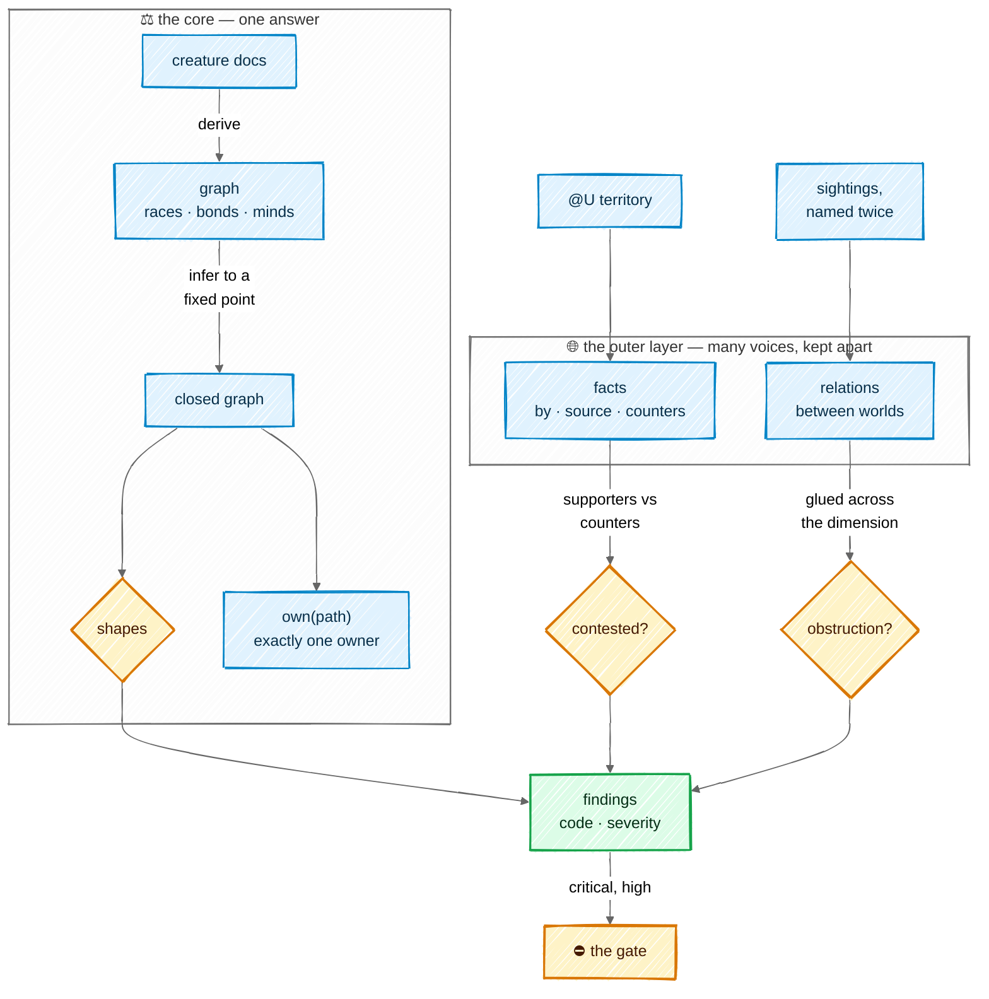

# The ontology

The ontology is the world's map of itself: which creatures exist, who answers to whom, who owns
each path, what creatures have learned about their territory, and how this world relates to its
neighbours. Its core is decisive — every path has exactly one owner, decided by code. Its outer
layer holds what is plural by nature, facts and relations, and keeps disagreement visible instead
of letting the last writer win. That outer layer takes its rules from Yucong Duan's
[DIKWP-MESH](https://github.com/YucongDuan/DIKWP-MESH-); the
[research page](research/dikwp-mesh.md) has the mathematics.

## In one picture

## In plain words

The core is read from the creature docs every time they change: the races, the chain of
command, the Minds each creature wears, and each creature's territory. From those, the ontology
works out everything that follows — a Slime under an Orc under an Elf is also *below* the Elf —
and checks the shapes the law demands: a Slime answers to exactly one Orc, no two creatures claim
the same ground, the chain of command never loops. Ownership is one function with a fixed order:
ask it about any path and it names one creature, or says nobody, and Rimuru must route a birth.

Around the core sit two things that are not one person's to decide. **Facts**: what creatures
learned about their territory, each remembered with who said it and on what evidence. When one
creature says the opposite of another, the ontology does not pick the newer one; it marks the
fact *contested*, shows both sides, and waits for a check, the Orc or the human. **Relations**:
how this world connects to others — it deploys one, reads secrets from another. A relation is
learned only when it is seen twice, proposed to the human, and dropped again if it stops being
seen.

Everything the ontology finds wrong is a finding with a code and a severity. The gate blocks a
landing only on the serious ones, in the territory it touches. There is no overall health score.

## Technical detail

### The graph

| Class | What | Read from |
|---|---|---|
| a race (`Slime`, `Orc`, `Elf`, `Kijin`, `DarkElf`, the throne and the ascended) | a creature | its doc under `.mnemorph/<race>/<name>/` |
| `Mind` | worn know-how | `.mnemorph/minds/`, and a doc's Minds field |
| `Doc` | a creature's document | the file itself |
| `Fact` (`Territory`) | something learned about a path | `@U territory` lines, as events |
| `World` | this world and its neighbours | `.mnemorph/dimension.toml` |

| Bond | From → to | Properties |
|---|---|---|
| `above` | creature → creature | transitive; `truth` (Slime → Orc), `verdict` (Orc → Elf) and `reports` (→ throne) are sub-bonds; `below` is its inverse |
| `owns` | creature → path prefix | from the doc's Territory field only |
| `wears` / `wornBy` | creature ↔ Mind | inverse pair |
| `heir` · `retired` | creature → creature · flag | relief and evolution |
| `about` · `by` · `counters` | fact → path · creature · fact | see *Facts* |
| `relates` | world → world | typed: `deploys`, `provisions`, `reads-secrets-from`, `depends-on`, or a learned type |

The derived graph is never written back; docs are the truth. Asserted facts and sightings are
append-only event files, folded in $(\text{time}, \text{event id})$ order like
[memory notes](08-memory.md#the-two-layers).

**Inference.** Subclass and sub-bond closure, domain and range typing, inverses and the
transitivity of `above`, applied until nothing new appears: the least fixed point
$\mathcal{G}^{*} = \bigcup_n R^n(\mathcal{G}_0)$. The rules only add triples and the set of
possible triples is finite, so $\mathcal{G}^{*}$ is unique and reached in finitely many steps.
It is rebuilt when the docs' fingerprint moves, before a dispatch, never on a model call.

**Claims.** A territory is read from the doc's structured Territory field only: directory
prefixes, normalised. A path mentioned in prose is never a claim; it can only prompt a `@?` that
the field and the prose disagree.

### Ownership: one function

$\mathrm{own} : \text{Path} \to \text{Creature} \cup \{\bot\}$ takes the first rule that matches:

1. **Harness soil** — the shared queue, instruments, memory and ontology event files: no body;
   only the harness writes them.
2. **Scratch** — `.mnemorph/tmp/<body>/`: the body that owns the nest.
3. **A creature's own doc** — that creature, even inside a broader claim; the deepest seat wins.
4. **The compiled soils** of [the races](02-races.md#soil-who-may-write-what): a Slime doc's
   verify block (its Orc, by line range), the workspace, a post, the proving ground, the plan and
   the dimension manifest.
5. **The longest territory prefix** of an authoring creature.
6. **The nearest zone above** the path.
7. Otherwise $\bot$: unowned soil, and Rimuru routes its birth.

The order is the rule: a creature that claims `.mnemorph` itself does not swallow every seat, the
queue and scratch, because rules 1–3 are asked first. The gate's *right author*, the policy, the
dispatch card and `mnemorph onto owner <path>` all call this one function.

**Overlap.** Two creatures whose prefixes are equal, or one inside the other, are a critical
finding — except a seat doc inside a broader claim, which rule 3 settles. Two prefixes of one
creature never collide.

### Facts: who said what

A territory fact is

$$
f = (\text{about},\ \text{text},\ \text{by},\ \text{source},\ \text{standing})
$$

where `about` is the path it is about, `by` the creature whose body said it, and `source` the
evidence anchor (a `file:line`, a journal entry, a commit). On the wire:

    @U territory <about> <fact>                  # asserts a fact
    @U territory <about> !#<fact-id> <reason>    # counters one, naming it

A creature *supports* a fact when it asserts it or asserts the same text about the same path; a
creature *counters* it with the second form. For a fact $f$, count distinct creatures: $p$
supporters and $q$ counters, and let

$$
c(f) = \frac{\min(p, q)}{\max(1,\ p + q)} \in \left[0, \tfrac{1}{2}\right]
$$

| Standing | Rule |
|---|---|
| **agreed** | $p \ge 2$ and $c \le 0.35$ — named twice, and one dissenter in three is tolerated |
| **single** | $p = 1$ and $q = 0$ — one voice |
| **contested** | $p > 0$, $q > 0$ and $c > 0.35$ — a `contested-fact` finding |
| **standing** | otherwise |

These are DIKWP-MESH's gluing thresholds, applied to creatures instead of tags.

**Recency never settles a fact.** A contested fact stays contested until a *settle* event with a
proof: a landing by the path's owner that passed its gate and cites the fact, the Orc's verdict
naming it, or the human. A creature's projection (`@ONTO`) shows a contested fact with both
sides, the way recall always seats one dissenting note.

`@U law` and `@U colony` are not ontology facts; they land as [memory notes](08-memory.md).

### Relations between worlds

**Gluing across a dimension.** Each world's ontology is a local section; the worlds of a
dimension overlap wherever two of them state a relation between each other. Relations have
inverses (`deploys` ↔ `deployed-by`). Where both ends state one:

| Both ends say | Result |
|---|---|
| the same relation, read through its inverse | glued |
| only one end says it | partial: lawful, shown as one-sided |
| relations that cannot both hold (different types for the same pair, or one end denying it) | a `dimension-obstruction` finding, reported to Rimuru |

`mnemorph onto check --dimension` reads the neighbours' manifests (on this machine, inward) and
never edits them; a fix goes to the other world through its own throne, one hop at a time.

**Learning a relation.** A body that sees a cross-world reference — an image another world
deploys, a secret path another world provisions — records a sighting
$(\text{from}, \text{to}, \text{type}, \text{anchor}, \text{body})$. The ledger proposes a
relation to the human, as a manifest diff, only when:

1. **named twice** — two sightings, by different bodies, from different anchors;
2. **not a synonym** — a new type $t$ whose world pairs overlap an existing type $t'$ with
   $J(\text{pairs}(t), \text{pairs}(t')) = \frac{|\text{pairs}(t) \cap \text{pairs}(t')|}{|\text{pairs}(t) \cup \text{pairs}(t')|} \ge 0.8$
   is proposed as $t'$;
3. **it carries its way back** — every learned relation records when it was last sighted;
   unseen for 30 runs, its removal is proposed the same way.

Only the human's yes writes it, through Rimuru, whose soil the manifest is.

### Findings

Every check returns findings, each with a code and a severity. The gate blocks a landing on a
critical or high finding inside the territory it touches; medium and low are reported, never
blocking. Findings are never summed into a score.

| Code | Severity | Read as |
|---|---|---|
| `overlap` | critical | two creatures' territories equal or nested |
| `above-cycle` | critical | the chain of command loops |
| `slime-truth` | high | a Slime without exactly one `truth` edge |
| `dead-bond` | high | an `above` target with no doc |
| `heir-dead` | high | an heir that is retired or missing |
| `dimension-obstruction` | high | two worlds state relations that cannot both hold |
| `unowned-soil` | medium | a tracked path where `own` returns $\bot$ |
| `orphan-mind` | medium | a Mind nobody wears and not marked shared |
| `contested-fact` | medium | a territory fact with supporters and counters past the threshold |
| `stale-relation` | low | a learned relation unseen for 30 runs |

`mnemorph onto check` prints `@S PASS|FAIL <n> findings` with each finding's code, severity and
`file:line`; evolution's overlay must add none.

### Not taken from DIKWP-MESH

Plural ownership, the aggregate leakage score, DIKWP typing of every node, the 25 operators, the
path router and the hard-coded catalogue of new axes. The [research page](research/dikwp-mesh.md) says why.
