# Race cards — the art brief

A brief for an image model: one card per race and ascended form, plus a card back. The cards are
shown on the board, in the docs and in the decks.

## In plain words

The image model paints **only the character art** — no frame, no plates, no text. Image models
cannot hold exact geometry across a dozen generations and fill blank plates with fake runes, so
everything that must be exact is drawn by the board as SVG: the frame in each race's materials,
the name banner, the duty plate, the gems, the sigil medallion and every word on the card, taken
from the compiled race law. When the law changes, the cards change with it, and the art never
needs redoing. "No text", the geometry and the colour-blind check become true by construction.

Generate in this order, so the set stays consistent:

1. **The Slime art first.** Iterate until style and lighting are right. It becomes the style
   reference for every other card.
2. The other base races, then the ascended forms — each ascended form with its base art as its
   character reference, so it reads as the same creature, evolved.

The designs are original: describe them as written here and never name an anime or its
characters in the prompt.

## The set

`tools/cards.py` draws every card (600 × 840) into `assets/cards/`: the race's hexagon portrait
from `assets/portraits/`, framed in the race's colour, with its name, tier gems, duty, tool
classes, soil, its rise or command line and its meter — the words of [the races](02-races.md).
When the law changes, edit the card's entry and run `python3 tools/cards.py`. A painted art set,
made with the brief below, would replace the portraits in the art window.

| 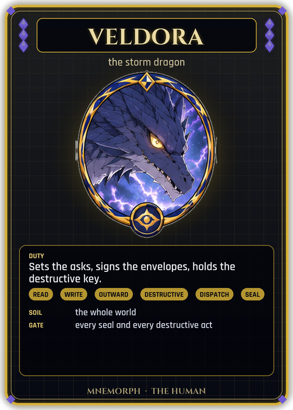 | 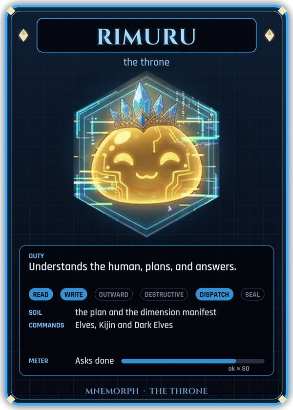 | 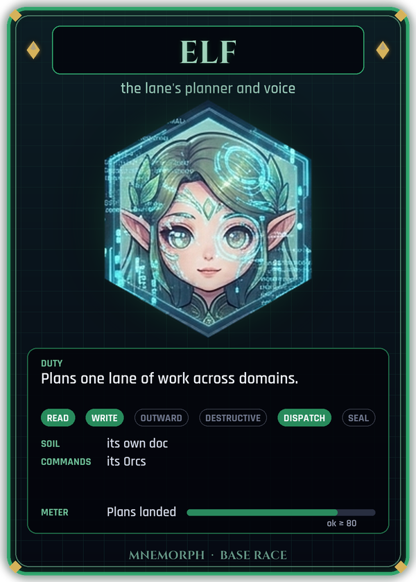 | 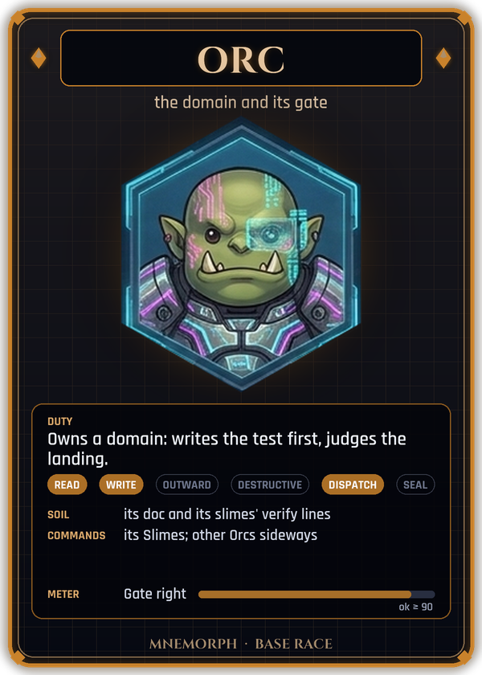 | 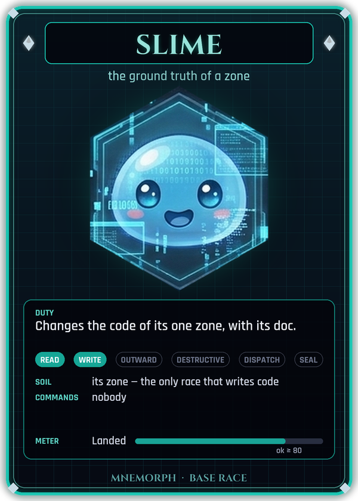 | 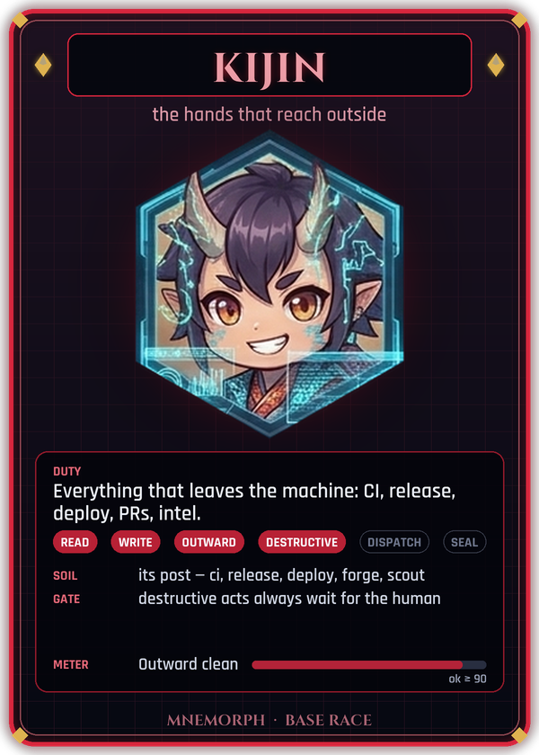 | 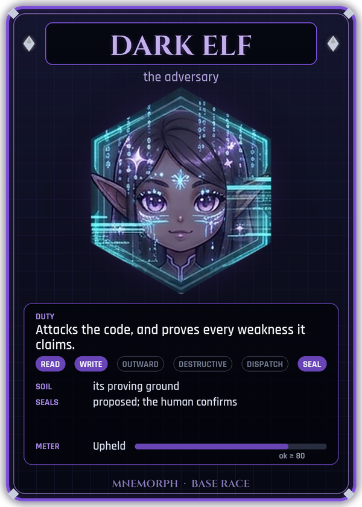 |
|:---:|:---:|:---:|:---:|:---:|:---:|:---:|
| Veldora | Rimuru | Elf | Orc | Slime | Kijin | Dark Elf |

| 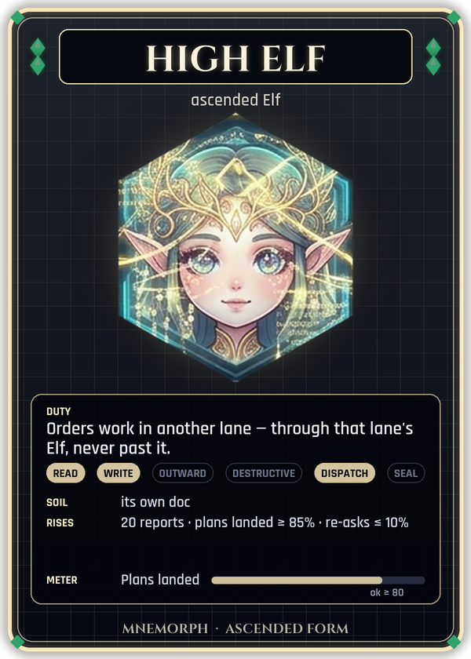 | 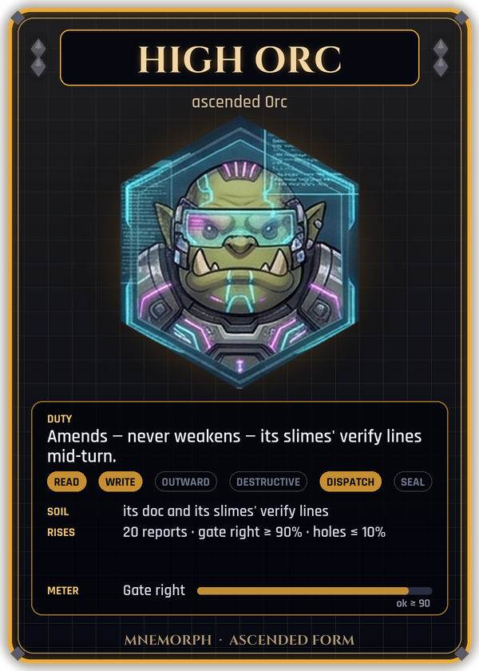 | 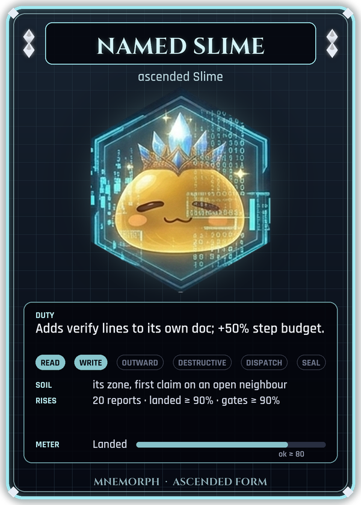 | 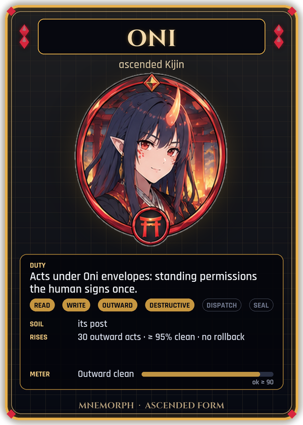 | 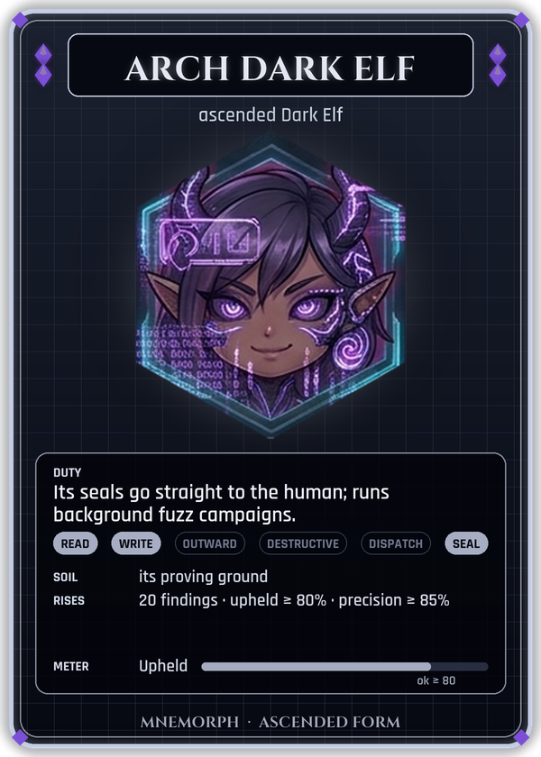 | 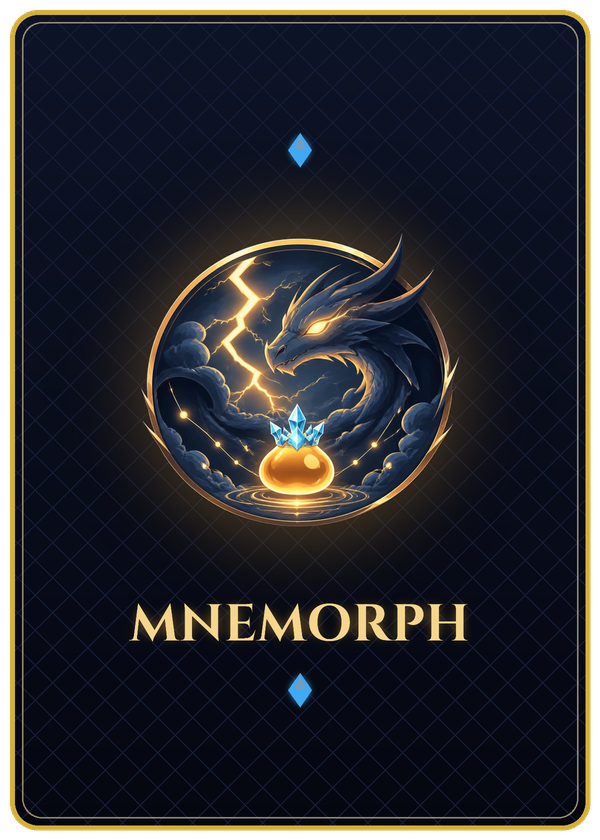 |
|:---:|:---:|:---:|:---:|:---:|:---:|
| High Elf | High Orc | Named Slime | Oni | Arch Dark Elf | Card back |

## The art spec

- **Portrait 4:5**, at least 1600 × 2000 px, PNG. (Leonardo, Midjourney and Flux all offer 4:5;
  the board crops it into the card's art window.)
- Head and shoulders in the **centred upper 60%**, so a 1:1 crop of that square is the icon-sized
  portrait; the lower part (waist, props, ground) may be cut by the frame.
- Background soft and painterly, inside the image to the edges — no border, no vignette frame.
- Lighting from the upper left on every image.

## The frame (drawn by the board, not the model)

```
┌──────────────────────────────┐  card 5:7 · SVG · themed for dark and light
│ ◆   ┌──────────────────┐   ◆ │  tier gems: 1 base · 2 ascended · 3 Veldora
│     │   name banner    │     │  text from the race law
│  ┌────────────────────────┐  │
│  │   the model's art      │  │  4:5 art, cropped to the window
│  └──────────( ✦ )─────────┘  │  sigil medallion (SVG)
│  ┌────────────────────────┐  │
│  │  duty · powers · bars  │  │  text from the race law
│  └────────────────────────┘  │
│        ▭  ▭  ▭  ▭            │  four meters from the value ledger
└──────────────────────────────┘
```

Each card section below gives the frame's material and colour for the SVG, separately from the
prompt.

## Master style block

Paste this at the start of every art prompt.

> Character illustration, portrait 4:5, original character design in polished anime key-visual
> style, crisp clean line art, cel shading with soft painterly gradients, rim light from the
> upper left, high detail on the character, calm readable background that fills the whole image.
> Head and shoulders centred in the upper part of the image, strong silhouette. No frame, no
> border, no card, no text, no letters, no numbers, no watermark, no signature.

**Negative prompt** (if the model takes one): text, letters, words, numbers, captions, logo,
watermark, signature, runes, card frame, border, vignette, extra fingers, deformed hands, cropped
head, off-centre character, photo, 3D render, lens flare.

## The cards

Each prompt is pasted after the master style block. The **SVG frame** line under it is for the
board, not the model; its colours are the race's theme tokens.

### Card back (SVG, drawn by the board — not a prompt)

> The back of the card set. Deep storm-indigo (#1E1B4B) field with a fine gold (#D4AF37) filigree
> border; in the centre a large circular emblem: a coiled storm dragon around a glowing
> droplet-shaped slime crown, surrounded by a ring of six small sigils (crown-drop, leaf, axe-gate,
> droplet, torii, crescent). Symmetric, no text.

### 🐉 Veldora — the human (special card, gold edge)

> A vast storm dragon, wise and amused, coiled through the clouds; only its head, one golden
> eye and crackling indigo storm clouds are visible, looking down at a small glowing slime on an
> open palm of cloud. Mood: the one whose word is law.

**SVG frame:** storm-gold (#D4AF37) and indigo lightning, a third tier gem in the top centre.
Sigil: a dragon's slit eye inside a storm ring.

### 👑 Rimuru — the throne

> A golden, softly glowing slime sovereign (#F2C94C), round and content, eyes closed in a gentle
> smile — same character as a small round golden slime with blush marks — floating above a throne
> of light, wearing a delicate azure crystal crown. Behind it, faint glowing threads fan downward
> to many tiny distant figures, suggesting it orders a whole realm. Mood: calm authority, the
> only voice that speaks to the human.

**SVG frame:** white gold and azure crystal (#3FA9F5). Sigil: a crown resting on a droplet.

### 🌿 Elf — the lane's planner and voice

> A young elf woman with long straight blonde hair, green eyes, a golden laurel circlet, pointed
> ears, green and cream robes. She holds a translucent map of glowing paths that branch into
> several lanes, one hand raised as if speaking. Background: a forest canopy with soft light.
> Mood: sees across domains, plans, speaks for the lane.

**SVG frame:** living wood and emerald (#2FA36B) with gold leaf. Sigil: a leaf crossed by a
compass needle.

### 🪓 Orc — the domain and its gate

> A broad green-skinned orc with big lower tusks, a small ring earring, a stern but fair
> expression, standing before a massive closed iron gate, one hand resting on a great axe planted
> in the ground, the other holding up a glowing amber seal stamp. Background: a fortified stone
> domain at dusk. Mood: nothing passes without its verdict.

**SVG frame:** hammered iron with amber (#C9822B) inlays and rivets. Sigil: an axe crossed with
a gate.

### 💧 Slime — the ground truth of a zone

> A round, glossy aqua-blue slime (#4FC3F7) with big red eyes, blush marks and a small happy
> mouth, sitting on a neat glowing grid tile in a small walled garden — its zone — carefully
> placing a tiny luminous cube into place. A tiny scroll (its zone document, blank) floats next
> to it. Mood: small, exact, the only one who touches the code.

**SVG frame:** polished teal glass (#19C3B0) and silver, with small bubble motifs. Sigil: a
droplet holding a small cube.

### 👹 Kijin — the hands that reach outside

> A young oni woman with a single ivory horn, long dark indigo hair with red streaks, red eyes,
> red marks on her cheeks, a small fang, wearing a dark kimono-style uniform with a crimson sash.
> She stands at an open torii gate at the edge of a village; through it, beyond, a wide outside
> world with distant ships, towers and signal fires. She carries a sealed scroll-case and a
> lantern. Mood: disciplined, loyal, the only one who leaves the village — and only with the
> lord's seal.

**SVG frame:** black lacquer and crimson (#D7263D) with gold torii motifs. Sigil: a torii gate
with an outward arrow.

Optional **post variants** (same character design and frame, different prop and background):

| Post | Prop and background |
|---|---|
| `kijin-ci` | a wooden training sword, a dojo with rows of practice targets lit green and red |
| `kijin-release` | a smith's hammer over an anvil, a freshly forged blade glowing, crates being sealed |
| `kijin-deploy` | a commander's war fan, a map table with banners planted on distant castles |
| `kijin-forge` | a brush and a stack of sealed letters, a shrine archive with hanging record scrolls |
| `kijin-scout` | a short blade and a hooded cloak, a rooftop at night overlooking distant lights |

### 🌑 Dark Elf — the adversary

> A dark elf woman with grey-violet skin, long silver hair, grey eyes, gold drop earrings, a
> knowing half-smile with a small fang, in a high-collared black and gold uniform. She holds a
> slim silver lens up to her eye, through which a hairline crack in a stone wall glows; her other
> hand pins a glowing violet seal onto the crack. Background: moonlit ramparts of a fortress,
> seen from outside. Mood: hostile to the work, honest about the proof.

**SVG frame:** obsidian and violet (#7B4FD6) with thin silver edges, slightly asymmetric thorn
ornaments. Sigil: a crescent moon pierced by a needle.

### ✨ High Elf — ascended Elf

> Same elf as the Elf card, evolved: hair now with teal-white luminous strands, an emerald and
> white-gold tiara with a central gem, green and white high-collared robes, a soft white-green
> aura and floating motes of light. The glowing map in her hands now connects to several other
> forests' maps at the edges.

**SVG frame:** the Elf frame in white gold (#F5E6B8) with emerald, two tier gems, faint halo
behind the art window. Sigil: the Elf sigil inside a radiant ring.

### ⚔️ High Orc — ascended Orc

> Same orc as the Orc card, evolved: long brown hair, a horned bone-and-iron helm, heavier tusks,
> scarred and proud, a fur-trimmed mantle over iron armour. The great gate behind him now stands
> open on a road he guards; his amber seal stamp glows molten gold (#E8A33D).

**SVG frame:** the Orc frame in blackened iron with molten-gold seams, two tier gems. Sigil: the
Orc sigil under a small crown.

### 💎 Named Slime — ascended Slime

> Same slime as the Slime card, evolved: its body now faceted like a clear aquamarine crystal
> (#5EEAD4) with light refracting inside, a tiny glowing name-mark on its forehead (a simple star
> shape, not a letter), the same red eyes. It tends a larger, more intricate garden of glowing
> tiles.

**SVG frame:** the Slime frame in crystal and platinum, two tier gems. Sigil: the Slime sigil
cut as a gemstone.

### 🔥 Oni — ascended Kijin

> Same oni woman as the Kijin card, evolved: the single horn now longer with a faint flame-gold
> glow, hair streaks burning crimson-orange (#FF6B35), embers drifting around her, a formal
> crimson and gold haori over the uniform, a ribbon of folded sealed charters (the human's
> standing permissions, blank) tied at her hip. The torii behind her is now lit and wreathed in
> calm flame; the road beyond is lit by lanterns she has placed.

**SVG frame:** lacquer and gold with flame filigree, two tier gems. Sigil: the torii sigil
inside a flame ring.

### 🌘 Arch Dark Elf — ascended Dark Elf

> Same dark elf as the Dark Elf card, evolved: silver hair now with violet-black tips, a circlet
> of dark silver with a crescent, an eclipse (#2E1065 with a silver corona) behind her head, a
> long coat with violet lining. Several violet seals hover around her, each pinned on a different
> faint crack in the fortress wall behind.

**SVG frame:** obsidian and silver with eclipse motifs, two tier gems. Sigil: the Dark Elf sigil
over an eclipse.

## What I check when the results come back

Send them in whatever form the model gives; I review each against:

1. **No text, frame or border** painted into the art.
2. **Composition** — head and shoulders in the centred upper 60%, the same scale on every card
   (I overlay them and measure).
3. **Edges** — the background runs to every edge, so the frame can crop it anywhere.
4. **1:1 crop** — the head-and-shoulders square works as a 64 px and 256 px portrait.
5. **Continuity** — each creature is recognisable from its isekai portrait, and each ascended
   form from its base card.
6. **Duty readable** — the prop and background say the race's job without a caption.
7. **Set harmony** — the race colours are distinct for colour-blind viewers (I run the CVD check).

Art that passes goes to `assets/art/<race>.png`; the board composes each card from it, the SVG
frame and the race law.
