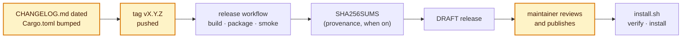

# Releasing

How a version of Mnemorph reaches a machine: a maintainer tags it, a workflow builds, tests and
drafts it, the maintainer reviews the draft and publishes it, and `install.sh` fetches and
verifies it.

## In one picture

Amber steps are a maintainer's; the rest is the workflow's and the installer's.

## In plain words

Nothing is published by a machine. Pushing a version tag starts the release workflow, which
builds the binaries for each supported machine, packages them, runs the release-candidate smoke
test on the built Linux archives, writes the checksums and opens a **draft** release. The draft is
invisible to users and to `install.sh` until a maintainer reads it and presses publish.

The smoke test exists because a test suite runs in clean fixtures and a user's machine is not
clean. Each candidate runs as the built artifact in a fresh HOME that looks lived in — a
`.gitconfig` with includes, aliases, a global hooks path and `core.fsmonitor`; other programs'
files in `~/.config` and `~/.local/state`; a `.bashrc` that edits PATH — against a world that is a
real repository with history ([lessons](lessons.md), M14).

## Technical detail

### What ships

One archive per target, `mnemorph-<target>.tar.gz`, holding `mnemorph-<version>-<target>/`:

| File | For |
|---|---|
| `mnemorph` | the terminal app and `mnemorph run` |
| `mnemorphd` | the server, the board (embedded) and the admin commands |
| `mnemorph-guard` | Linux only: the kernel guard every command runs through, found beside `mnemorph` |
| `LICENSE`, `THIRD-PARTY-NOTICES.md`, `README.md`, `CHANGELOG.md` | the licence, the notices, the book's front page, the notes |

| Target | Built on |
|---|---|
| `x86_64-unknown-linux-gnu` | `ubuntu-22.04` (its glibc is the floor) |
| `aarch64-unknown-linux-gnu` | `ubuntu-22.04-arm` |
| `aarch64-apple-darwin` | `macos-14` |
| `x86_64-apple-darwin` | `macos-14`, cross-built |

`SHA256SUMS` lists every archive as `<sha256>  <name>`. Asset names carry no version, so
`releases/latest/download/<asset>` always names the newest published release.

### Cutting a release

1. On `main`, green: set `[workspace.package] version` in `Cargo.toml` to `X.Y.Z` (and let
   `cargo check` refresh `Cargo.lock`), rename `## [Unreleased]` in `CHANGELOG.md` to
   `## [X.Y.Z] - YYYY-MM-DD`, open a new empty `## [Unreleased]` above it, point the
   `[Unreleased]` link at the bottom to `…/compare/vX.Y.Z...main`, and add
   `[X.Y.Z]: https://github.com/Kaginari/mnemorph/releases/tag/vX.Y.Z` beside it. Land that as a
   pull request.
2. Run `just rc-smoke` locally: the same smoke test, on a release build.
3. Tag the merged commit and push the tag: `git tag -a vX.Y.Z -m "Mnemorph X.Y.Z"` then
   `git push origin vX.Y.Z`.
4. The `release` workflow runs:
   - `prepare` refuses a tag that is not `vX.Y.Z`, that differs from `Cargo.toml`'s version, or
     whose changelog section is missing or undated; the section becomes the draft's notes;
   - `board` builds the board once, embedded by every `mnemorphd`;
   - `build` compiles each target with `--locked`, packages it (`tools/package-release.sh`), and
     on Linux runs `tools/rc-smoke.sh` on the archive and `tools/test-install.sh` with it;
   - `checksums` writes `SHA256SUMS` over the four archives;
   - `attest` (off unless turned on, below) records build provenance;
   - `draft` opens the draft release with the archives and `SHA256SUMS`, and refuses if a release
     for the tag already exists.
5. Review the draft: the notes, the four archives and `SHA256SUMS`. Download an archive and the
   sums and check them (`sha256sum -c --ignore-missing SHA256SUMS`).
6. Publish the draft. `install.sh` sees it from then on: run it once on a clean machine.

A failed run publishes nothing. Fix on `main`, delete the tag (`git push origin :vX.Y.Z`, then
`git tag -d vX.Y.Z`), and tag again; a tag that already reached users is never moved: cut the next
patch version instead. The workflow can also be started by hand (`workflow_dispatch`) for an
existing tag, to redraft after a draft was deleted.

A pre-release tag (`vX.Y.Z-rc.1`) drafts a pre-release; its changelog section is
`## [X.Y.Z-rc.1] - YYYY-MM-DD`.

### Provenance (signing)

The `attest` job signs build provenance for the archives and `SHA256SUMS` with
`actions/attest-build-provenance`: keyless, through GitHub's OIDC token and Sigstore, so no key
and no secret exist. It needs `id-token: write` and `attestations: write`, which only that job is
granted. It is off until the repository variable `MNEMORPH_ATTEST` is `true`. Once on, anyone
can check an archive with `gh attestation verify mnemorph-<target>.tar.gz --repo Kaginari/mnemorph`.

### The checks around it

| Check | Runs | What it proves |
|---|---|---|
| `just rc-smoke [artifact]` (`tools/rc-smoke.sh`) | by hand; the `rc-smoke` workflow; the release workflow | the built binaries answer `--version` (the expected version), `status`, a headless `run` that lands through the end gate, and `mnemorphd board --help`, in a fresh lived-in HOME, against a scripted provider on loopback — and leave the real HOME, other programs' files, the user's git hooks and the world's history untouched |
| `just install-test` (`tools/test-install.sh`) | `just check`, on Linux and macOS | `install.sh` installs each supported machine's archive from a fake release served on loopback, under two minutes, without touching a profile; it refuses a tampered archive, a missing `SHA256SUMS`, a missing line, a missing release, an unsupported OS or architecture |
| the `rc-smoke` workflow | pull requests touching the release's files, weekly, by hand | shellcheck and `dash -n` on the scripts; a release build packaged, smoke-tested and installed |

### The installer

`install.sh` is POSIX `sh`, all of it inside one function called on its last line with stdin
from `/dev/null`, so a download cut short runs nothing. It maps `uname` to a target (an Apple
Silicon shell under Rosetta gets the native build), checks the version is `x.y.z`, `vx.y.z` or
`latest` before it goes into a URL, downloads `SHA256SUMS` and the archive over HTTPS with TLS 1.2
or later (curl, else wget), and refuses to unpack unless the archive's line is present and
matches, and unless every member stays beneath the unpack directory: no absolute name, no `..`,
no symbolic or hard link. It copies the binaries into
`~/.local/bin` (or `--dir`, or `MNEMORPH_INSTALL_DIR`), each beside and renamed over the old one,
runs `mnemorph --version`, and prints the `export PATH=…` line when the directory is not on PATH:
it needs no sudo and edits no profile. `--version` (or `MNEMORPH_VERSION`) picks a release;
`MNEMORPH_RELEASE_BASE` points it at a mirror or a test's local server: it must be `https://`,
plain `http://` only to `127.0.0.1`, `localhost` or `[::1]`, or `file:///` (with curl); anything
else is refused.

### Not tested yet

The macOS archives are built and packaged but not smoke-tested: only the Linux archives run
`tools/rc-smoke.sh` and `tools/test-install.sh` before the draft. The installer's macOS paths are
covered by `just install-test`, which `just check` runs on macOS, with stand-in binaries. Try a
macOS archive by hand on a Mac before publishing.

### Not shipped

npm packages of the TypeScript SDK and protocol are not published. Code signing of the macOS
binaries (an Apple Developer ID and notarisation) is not done: the archives are downloaded with
`curl`, which sets no quarantine flag, so Gatekeeper does not stop them.
