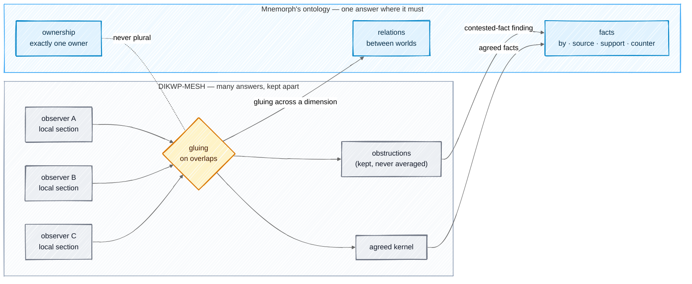
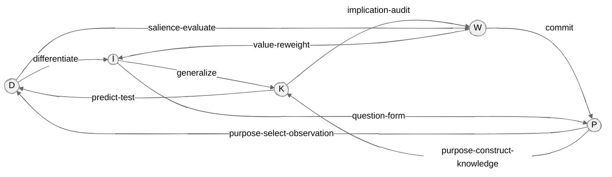
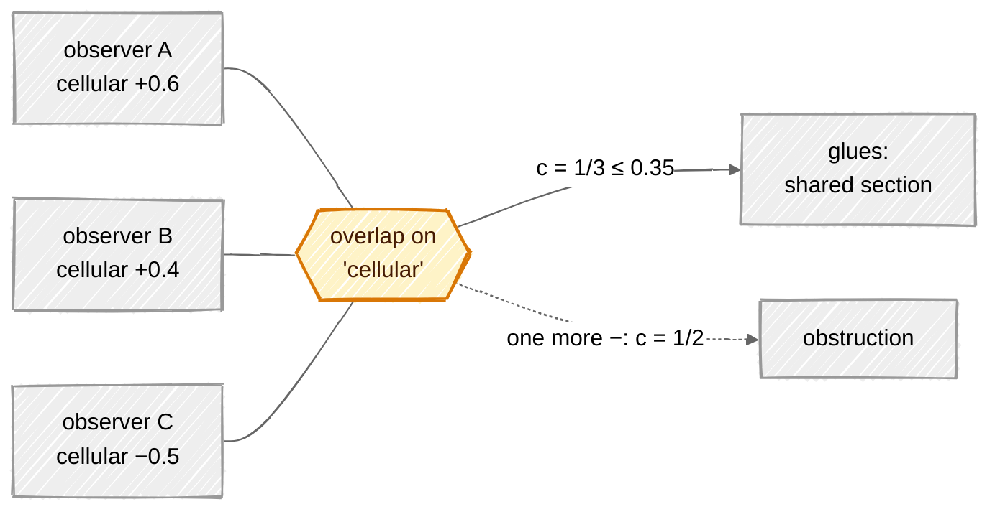

# Research: DIKWP-MESH and the ontology

[DIKWP-MESH²](https://github.com/YucongDuan/DIKWP-MESH-) (Yucong Duan, Apache-2.0) is a Python
prototype that treats meaning as a network seen by many observers at once, rather than as one
definition. This page explains its mathematics, says what its code really computes, and works out
which of its ideas fit Mnemorph's [ontology](../09-ontology.md) and which do not. Formulas marked
**[code]** are read out of `src/dikwp_mesh2/`; **[model]** marks a formula written for this page.

## In one picture



## In plain words

MESH starts from a complaint about the DIKWP model (Data, Information, Knowledge, Wisdom,
Purpose): it is usually drawn as a pyramid, each layer feeding the next. MESH says the five are
peers that turn into each other in every direction, and that a concept is not one definition but
what several observers, each in a context and with a purpose, agree and disagree about.

So MESH collects every observer's view, finds where they agree (a *kernel*), where they split
(*branches*), and where they flatly contradict each other (*obstructions*). It never averages a
contradiction away. It can also notice when the existing vocabulary keeps failing and propose a
new dimension, but only behind tests and a way back.

Mnemorph's ontology has the opposite core job: every path has **exactly one** owner, decided by
code, and the gate enforces it. Plural answers there would be a bug. But the ontology also holds
things that *are* plural by nature: facts creatures assert about their territory, and relations
between neighbouring worlds. Those have no conflict model today. That is where MESH fits.

## Technical detail

### 1. The semantic hypergraph [code]

Each observer $a$ contributes a local section

```math
G_a = (V_a,\ E_a,\ H_a,\ \mu_a,\ \kappa_a)
```

- $V_a$ — semantic atoms (claims, observations, values), each with tags and a **stance**
  $\sigma_a(t) \in [-1, 1]$ per tag $t$;
- $E_a$ — directed transformation events between atoms;
- $H_a$ — n-ary relations, stored as relation nodes joined to every member;
- $\mu_a(v) \in \Delta^4$ — the atom's **type membership**, a point on the 4-simplex:

```math
\mu(v) = (\mu_D, \mu_I, \mu_K, \mu_W, \mu_P), \qquad \mu_x \ge 0, \quad \textstyle\sum_x \mu_x = 1
```

  An atom can be 60% Knowledge and 40% Purpose; nothing forces one type.
- $\kappa_a$ — observer, context, time, modality, scale, source and confidence.

The whole mesh is a multigraph over the union $\bigcup_a V_a$, with relation nodes for $H$.

### 2. The operator alphabet and path algebra [code]

The 25 ordered pairs $T_{xy} : S_x \to S_y$, $x, y \in \lbrace D, I, K, W, P\rbrace $, are the primitive
operators; five are self-loops (re-observe, re-segment, model-revise, value-negotiate,
purpose-transform).



*Ten of the 25 edges; every pair, both directions and every self-loop exists.*

Each operator carries a base loss $\ell$, an evidence need $e$, a reversibility $r$ and a
generativity $g$, all in $[0,1]$. A path composes them as independent events:

```math
\ell_{\text{path}} = 1 - \prod_i (1 - \ell_i), \qquad
r_{\text{path}} = \prod_i r_i, \qquad
g_{\text{path}} = 1 - \prod_i (1 - g_i)
```

and is ranked by an additive cost, with an optional purpose preference $\rho \in [0,1]$:

```math
\mathrm{cost} = \sum_i \max\!\big(0.01,\ 0.52\,\ell_i + 0.28\,e_i + 0.20\,(1 - r_i) - 0.25\,\rho_i\big)
```

*Worked example*, Data to Wisdom:

| Path | cost | loss | reversibility | generativity |
|---|---:|---:|---:|---:|
| $D \to W$ (salience-evaluate) | 0.511 | 0.420 | 0.350 | 0.550 |
| $D \to I \to W$ (differentiate, consequence-map) | 0.644 | 0.454 | 0.328 | 0.769 |

The longer path loses slightly more and is less reversible, but generates far more, and here the
short path wins on cost. A detour wins only when the direct operator is itself costly: Data to
Purpose costs 0.638 directly (purpose-infer) and 0.580 through Information (differentiate,
question-form). The cost never rewards generativity, which is worth knowing before reusing it.

### 3. Alignment between observers [code]

For atoms $u$ (observer $a$) and $v$ (observer $b \ne a$):

```math
\mathrm{sim}(u,v) = 0.48\,J(\text{tags}) + 0.25\,\cos(\mu_u, \mu_v) + 0.12\,\gamma + 0.15\,\bar{s}
```

- $J(X,Y) = |X \cap Y| / |X \cup Y|$, the Jaccard index of the tag sets;
- $\gamma = 1$ in the same context, $0.55$ otherwise;
- $\bar{s}$ = mean over shared stance keys of $1 - |\sigma_u - \sigma_v|/2$ (0.65 if none).

A **conflict** on tag $t$ is a sign clash: $\sigma_u(t)\ \sigma_v(t) < -0.12$. Compatibility
discounts similarity by up to 20% for conflicts:

```math
\mathrm{comp}(u,v) = \mathrm{sim}(u,v)\,\big(1 - 0.2\,\min(1, |\text{conflicts}|/2)\big)
```

### 4. Gluing: the idea, and what the code does

**The idea [model].** In sheaf theory, a cover of a space by open sets $\lbrace U_a\rbrace $ carries local
data $s_a$ on each $U_a$. If every pair agrees on its overlap,
$s_a|_{U_a \cap U_b} = s_b|_{U_a \cap U_b}$, the pieces **glue** into one global section. If some
pair disagrees, no global section exists, and the disagreement is an **obstruction**: real
information about the space, not noise. MESH takes observers as the cover and their views as
local sections. Its rule: glue what agrees, keep obstructions, never average.



**The code [code]** is a counting rule per tag, not a cohomology computation. With $n$ observers,
a tag $t$ has support $\mathrm{supp}(t) = |\lbrace a : t \in \text{tags}_a\rbrace | / n$, positive count
$p(t) = |\lbrace \sigma > 0.15\rbrace |$, negative count $q(t) = |\lbrace \sigma < -0.15\rbrace |$, and contradiction

```math
c(t) = \frac{\min(p, q)}{\max(1,\ p + q)} \in [0, \tfrac12]
```

| Section | Rule |
|---|---|
| shared | $\mathrm{supp}(t) \ge 0.45 \ \wedge\ c(t) \le 0.35$ |
| obstruction | $p > 0 \ \wedge\ q > 0 \ \wedge\ c(t) > 0.35$ |
| partial | otherwise |

Over all alignment edges $\mathcal{E}$ (similarity $\ge 0.10$):

```math
\mathrm{obs} = \min\!\Big(1,\ \frac{\sum_{e \in \mathcal{E}} \big[(1 - \mathrm{comp}(e)) + 0.25\,|\text{conflicts}(e)|\big]}{1.25\,|\mathcal{E}|}\Big), \qquad \mathrm{obs} = 1 \text{ if } \mathcal{E} = \emptyset
```

and a partial global section exists iff some tag is shared and $\mathrm{obs} < 0.72$. The 0.10
floor filters nothing: two atoms of different observers with no shared tag still score at least
$0.12 \cdot 0.55 + 0.15 \cdot 0.65 = 0.164$, and any pair sharing a tag is admitted regardless, so
$\mathcal{E}$ is every cross-observer pair.

Note the threshold's meaning: $c \le 0.35$ means one dissenter among three still glues
($c = 1/3$); two against two never does ($c = 1/2$). That is a majority rule with a tolerance,
not unanimity.

### 5. Invariants, branches, conflicts, residuals [code]

Per tag, with the stance mean $\bar\sigma$:

```math
\mathrm{dis}(t) = \frac{1}{|\sigma|}\sum (\sigma_i - \bar\sigma)^2, \qquad
H(t) = -\sum_{x} \pi_x(t) \log_2 \pi_x(t)
```

where $\pi(t)$ is the tag's type mass over D/I/K/W/P, so $H \in [0, \log_2 5 \approx 2.32]$
measures how many kinds of meaning the tag spans.

| Class | Rule |
|---|---|
| invariant kernel | $\mathrm{supp} \ge 0.40 \ \wedge\ \neg(p > 0 \wedge q > 0 \wedge \mathrm{dis} > 0.28)$ |
| conflict | $p > 0 \wedge q > 0$, otherwise |
| branch | $\mathrm{supp} \ge 0.20$, otherwise |
| residual | the rest — rare, untranslated meaning |

### 6. Concept escape [code]

When residuals keep piling up, MESH proposes a new dimension. Each catalogued candidate scores

```math
\mathrm{need} = \min\!\big(1,\ 0.45\,\mathrm{supp} + 0.35\,\tfrac{|\text{types spanned}|}{5} + 0.20\,\min(1, \overline{\mathrm{dis}})\big)
```

The catalogue is six hard-coded axes about the definition of life, so in code this is a lookup,
not discovery. The valuable part is the **install protocol** in its formal model: a proposed axis
is never installed automatically; it needs a trigger ledger, discriminating observations,
cross-observer transfer tests, evidence that it is not a synonym of an existing axis, and a
rollback condition.

### 7. The hierarchy-leakage audit [code]

The audit reads a graph over the five types and emits coded findings with severities
(critical 1.0, high 0.7, medium 0.4, low 0.2): `LINEAR_PIPELINE`, `NO_FEEDBACK_CYCLES`,
`POOR_TRANSFORMATION_COVERAGE` (15 or more of 25 pairs missing), `PRIVILEGED_TYPE` (PageRank share
$> 0.55$), `PURPOSE_MONARCHY`, `SINGLE_OBSERVER_DEFINITION`, `PURPOSE_CANNOT_GENERATE_OTHER_TYPES`,
`PURPOSE_CANNOT_BE_REVISED` and `PURPOSE_REVISION_BOTTLENECK`. It then
sums them into one score, $\min(1, \sum w / 4)$, with bands at 0.30 and 0.65.

### 8. The ontology's own mathematics

Mnemorph's ontology inherits isekai's: a set of triples, rules and shapes.

- **Inference** is forward chaining over Horn rules — subclass and subproperty closure, domain
  and range typing, inverses, transitivity of `above` — to the least fixed point
  $\mathcal{G}^{*} = \bigcup_n R^n(\mathcal{G}_0)$. The rules are monotone over a finite set of
  possible triples, so the fixed point exists, is unique and is reached in finitely many steps.
- **Shapes** are constraints checked on $\mathcal{G}^{*}$: a Slime has exactly one `truth` edge;
  territories are disjoint; every `above` target has a doc.
- **Ownership** is a total function $\mathrm{own} : \text{Path} \to \text{Creature} \cup
  \{\bot\}$, a lexicographic rule over soil kinds and prefix length, ties broken by creature name (see
  [the ontology](../09-ontology.md#ownership-one-function)). It must be deterministic: two
  answers would let two bodies write one file, or none judge it.
- **`above` must be acyclic** — a tree from Slime to the throne. MESH's audit treats a missing
  cycle as a defect; for the chain of command, a cycle *is* the defect.

### 9. What Mnemorph takes

| MESH idea | Where in MESH | In Mnemorph |
|---|---|---|
| Claims indexed by observer, with stance and source | `SemanticAtom`, $\kappa_a$ | territory facts carry `by` and `source`, and creatures support or counter them ([ontology](../09-ontology.md#facts-who-said-what)) |
| Contradictions kept as obstructions, decided by the counting rule | `gluing.py` | the `contested-fact` finding, with the 0.35 tolerance measured on the losing side; the projection shows both sides |
| Stances as input | `SemanticAtom.stance`, filled in by hand in the demo bundle | agents do not volunteer stances, so counters are derived: keyed facts compared by code, anchors that drift, and the parent's triage when a new fact resembles an old one ([ontology](../09-ontology.md#catching-what-nobody-flags)) |
| Local sections glued on overlaps | §4 | worlds of a dimension as local sections: a relation two worlds state differently is an obstruction reported to Rimuru |
| The install protocol for a new axis | formal model §6 | learning a relation: a sightings ledger, named twice, a no-synonym check, the human's yes, a rollback by expiry |
| Coded findings with severities | `audit.py` | every `onto check` finding has a code and a severity; the gate blocks on critical and high in the landing's territory |

### 10. What Mnemorph does not take

- **Plural ownership.** Gluing never touches `own`.
- **The aggregate leakage score.** Findings stand alone, as in [memory](../08-memory.md): a clean
  count elsewhere cannot excuse one critical finding.
- **DIKWP typing of every node** and the 25 operators. The ontology's classes are races, Minds,
  docs and facts; a simplex membership adds nothing the gate can check.
- **The router's additive cost.** No ontology question is a cheapest-path question.
- **The hard-coded escape catalogue.** Mnemorph keeps only the protocol.
