# Roadmap

## In one picture

```mermaid
---
config:
  look: handDrawn
  theme: neutral
  flowchart:
    wrappingWidth: 360
---
flowchart LR
    D["📖 D<br/>the book"] --> M0["M0<br/>foundations"]
    M0 --> M1["M1<br/>wire + races"]
    M1 --> M2["M2<br/>ledger + meters"]
    M2 --> M3["M3<br/>providers"]
    M3 --> M4["M4<br/>tools + sandbox + gate"]
    M4 --> M4a["M4a<br/>config"]
    M4a --> M5["M5<br/>one body loops"]
    M5 --> M6["M6<br/>protocol + CLI<br/>🐕 solo dogfood"]
    M6 --> M7["M7<br/>the world"]
    M7 --> M8["M8<br/>memory + toolbox"]
    M8 --> M9["M9<br/>👹 Kijin"]
    M8 --> M10["M10<br/>🌑 Dark Elf"]
    M9 --> M11["M11<br/>value · evolution<br/>ascension"]
    M10 --> M11
    M11 --> M12["M12<br/>board"]
    M12 --> M13["M13<br/>integrations"]
    M13 --> M14["M14<br/>1.0"]
    classDef good fill:#dcfce7,stroke:#16a34a,stroke-width:2px,color:#052e16
    class D,M0,M1,M2,M3 good
    classDef step fill:#e0f2fe,stroke:#0284c7,stroke-width:1.5px,color:#082f49
    class M4,M4a,M5,M6,M7,M8,M11,M12,M13,M14 step
    classDef kijin fill:#fbdde1,stroke:#D7263D,stroke-width:2px,color:#3d0710
    class M9 kijin
    classDef dark fill:#ebe2fb,stroke:#7B4FD6,stroke-width:2px,color:#22114a
    class M10 dark
```

## In plain words

We write first, then we build one rung at a time, from the pieces with no dependencies upward.
A rung is finished only when its own tests pass against fakes of the rung below; the next rung
starts by testing the two together for real. So when something breaks, it is always in the newest
piece.

Consumption comes early on purpose (M2): before Mnemorph makes a single model call, it can already
count and stop. From M6 Mnemorph is usable in a terminal and, in solo mode, starts working
on itself; from M7 it runs the full chain, and from M9 it opens its own pull requests.

Every milestone ends the same way:

1. all tests green in CI;
2. the book updated in the same change (Vitality);
3. a fresh Fable review of the milestone, its findings fixed or recorded;
4. the milestone's tokens per model and share of the plan's usage windows, read with
   `npx ccusage`, written to `log.md`.

## Technical detail

Size: **S** ≈ one focused session, **M** ≈ two or three, **L** ≈ four or more.

### D — The book · M

Pages 01–06, races, lessons, card prompt (this book). Then:

- the canvases: install [tldraw offline](https://offline.tldraw.com), connect Claude Code through
  its agent setup, and draw one canvas per page from its Mermaid sketches — overview, races and
  ascensions, the loop, one order down and back, the client protocol, architecture, sandbox,
  consumption; each exported to SVG and embedded in its page;

- your review of [Races](02-races.md): bars, privileges, falls, Kijin posts, Dark Elf duties;
- the race cards generated from [the prompt](race-cards-prompt.md) and reviewed;
- the name decided — `mnemorph` is taken on npm and crates.io, so the published crate and npm
  names (and an npm scope) are settled here; then the GitHub repository is created
  (`gh repo create`, your call: public or private);
- whether Mnemorph has distributions (isekai's agent-one lineage: one engine, a lexicon file plus
  defaults) — it shapes the CLI's wording and the card text;
- one diagram checked in a GitHub preview: if GitHub ignores the hand-drawn look, the look is set
  in the docs site's config instead and the pages keep plain Mermaid;
- canvases reviewed like code: a `.tldraw` file can carry document scripts that run when opened.

**Exit:** you say the book is right. No code before this.

### M0 — Foundations · S

- Install the toolchain: rustup (stable, pinned in `rust-toolchain.toml`), pnpm via corepack.
- Cargo workspace with empty crates; pnpm workspace with empty packages; `justfile`
  (`just check` = fmt, clippy `-D warnings`, nextest, Biome, typecheck, vitest).
- CI on GitHub Actions: Linux and macOS; `cargo-deny` (licences, advisories) from day one.
- `.mnemorph/` seeded by hand: law, the first creatures for Mnemorph's own crates, `log.md`.
- Docs site: VitePress over `docs/` as it stands, Mermaid hand-drawn, a dead link fails the
  build; built by CI as the `book` artifact until the repository can publish Pages.

**Exit:** `just check` green locally and in CI; the docs site builds.

### M1 — Wire and races · M

Pure crates, no I/O.

- `mnemorph-wire`: every tag of [Communication](04-communication.md), parser + encoder, trimming
  order, envelope. Fixtures transcribed from isekai's `wire/` tests. Property test round-trip.
- `mnemorph-races`: the enum and its methods, shelves, soil, gates, dispatch decision table, score
  formulas, ascension and fall predicates, budget shares. Table-driven tests: every cell of the
  dispatch flowchart; every bar at, just under and just over its threshold.

**Exit:** `races` covered whole (it is the law): 100% region coverage, the gate stable Rust can
measure, with every operand of every rule driven both ways by table tests; `cargo doc` renders the
race codex.

### M2 — Ledger and meters · S

- Usage rows and the append-only JSONL journal (one write per row, synced; a tolerant reader).
- Prices in TOML and weighted tokens, unpriced handling; occupancy and spend, one function each.
- Envelopes carved by plan weight with maximum shares and the challenge reserve, pre-flight,
  recorded spend, the return of unspent slices; caps across sessions.
- Folds per body, race, model and day, with cache-hit and prefix shares. (The value fold —
  signals for the score formulas — needs the world's verdicts and lands with M11.)

**Exit:** a random tree of up to 50 commissions, sequential and parallel, never exceeds any
envelope, and every weighted item gets a slice while its parent has budget (proptest); the folds
match hand-computed fixtures with both providers' cache shapes.

### M3 — Providers · M

- Anthropic Messages streaming with cache breakpoints; OpenAI-compatible (vLLM, OpenRouter,
  Ollama).
- Retry ladder for 429/529/5xx with jitter and `retry-after`; a stall timer that starts at the
  first byte; zero-argument tool calls; `message_stop` required.
- A scripted provider that **serialises every request**, so schema bugs fail tests; recorded
  cassettes for real responses.
- Usage rows emitted for every call (M2 junction test first).

**Exit:** cassette suite green; a live smoke test behind a flag.

### M4 — Tools, sandbox, human gate · L

- Tools: read (with unchanged-window withholding), write, edit, glob, grep, bash, git.
- Classifier: `read | write | outward | destructive` from a parsed shell AST (wrappers like
  `env`, `sh -c`, `xargs`, `sudo` unwrapped; brace expansion; redirects to `/dev/tcp`); deletes
  and renames inside the writer's soil are `write`, kept in the attic first; tag pushes and registry
  publishes are `destructive`.
- Sandbox: landlock + seccomp (sockets denied without network) on Linux; Seatbelt on macOS; secrets by name
  with output redaction.
- The gate request as an interface (a TTY answer or a test double), with deny on timeout.

**Exit:** an escape suite (writes outside the soil, network from a non-Kijin body, symlink and
`..` tricks, `/proc` reads of secrets, credential paths) is fully refused on macOS and on Linux
at both landlock ABI v1 (5.15) and the CI runner's ABI; `status` prints the sandbox in force.

### M4a — Config · S

- TOML layers (global, project tracked, project local), every value carrying its origin,
  `config explain`, unknown keys reported as holes, writes through `toml_edit`.
- The tracked layer may only tighten the human gate; loosening comes only from the local or
  global file, never from env, flags or text a body wrote.
- Models per creature, (race, office) and tier; budgets; providers; Oni envelopes with their
  compiled exclusions.

**Exit:** the config lessons' tests green; `config explain` correct for scalars, lists and maps.

### M5 — One body loops · M

- The six beats, budgets as readings, checkpoint and resume from the journal, the salvage resume,
  guts and doom checkpoint, escalation after failed acts, the stall guards (`repin`,
  `actBudget`) and a clock autopsy when a deadline kills a run.
- Cache-prefix stability test for Rimuru, tool JSON included.
- Solo mode (Rimuru's voice plus one Slime over the whole repository, end gate, no dispatch),
  with the stress reading that will trigger its escalation.
- The session's queue lane and interrupt (Esc pivots to the next queued line), the message-sequence
  validator over random interrupt / queue sequences.

**Exit:** Rimuru alone completes scripted tasks end to end against the scripted provider, and one
real task against a live model, its spend matching the ledger.

### M5b — Long runs · S

- Replay compaction: a pure function over a copy of the transcript — old tool outputs fold to
  captions, thinking stays bound to its call — so a long run stops re-sending its history.
- Stress as an absolute, configurable token threshold with its three acts: write down what is
  not durable, push heavy work to a fresh body, tell the human to break.
- The per-bench tally (visits, red, green, muted) behind the stall guard.
- Tools off the runtime thread: Esc and the clock reach a long command, a gate's verify lines
  and the salvage turn.

**Exit:** a 40-step scripted run sends at most a bounded multiple of its live context per turn;
Esc stops a running command within a second.

### M6 — Protocol, SDK, CLI · L · 🐕 dogfood

- `mnemorph-server`: JSON-RPC over stdio and WebSocket, events with `seq`, reconnect, gate request.
- `@mnemorph/protocol` generated, `@mnemorph/sdk`, `@mnemorph/cli` with Ink: streaming text, tool
  call cards, the gate prompt, slash commands, status line with spend / left / cache / held,
  themes; Enter queues while a turn runs, `/send`, `/handoff` and `/handoff read`, `mnemorph q`.
- The UX bar is Claude Code and OpenCode: input history, multi-line editing, paste, selection and
  copy, resize, interrupt with Esc, no flicker.

**Exit:** you use `mnemorph` for a real session and it feels finished. From here Mnemorph helps
build Mnemorph in solo mode.

### M7 — The world · L

- Creatures as data, territory and ontology (who owns a path), dispatch with every rule of the
  flowchart, Courts with fresh contexts, the return path, the end gate (all its checks), the
  append-only `log.md` writer, the council (its keys, forced escalation after three warrants) and
  relief (split by prefixes or by tree, retire, `relief` rows); self-heal: the roster rebuilt from
  the docs' fingerprint, the clock-death memo, one live court per seat, `housekeep --heal`; the
  workspace soil; solo's escalation into a
  lane on stress, a boundary or an act it does not hold, measured against the hierarchy on the
  same 30 tasks.
- The send and wake lanes per body (a report wakes its own parent), the shared work queue —
  revisioned snapshots, the rank law, relay-hold, the `queue` tool, `merge=union`.
- The ontology, following [its page](09-ontology.md), rungs lowest first:
  1. the graph derived from the docs' Territory, Domain, chain and Minds fields, and inference to
     its fixed point, rebuilt on the docs' fingerprint;
  2. ownership as one function, called by the gate, the policy, the dispatch card and
     `onto owner`;
  3. the shapes as findings with codes and severities; *right author* failing on critical and
     high ones that touch the landing;
  4. territory facts as events — `by`, source, support, counter, settle — with their status and
     the `contested-fact` finding; `@ONTO` showing both sides;
  5. relation sightings, the named-twice proposal with its synonym check and expiry, and
     `onto check --dimension`.

**Exit:** the full "one order, down and back" sequence runs with scripted bodies and passes its
gate; every refusal names its lawful route; a creature claiming `.mnemorph` owns none of the seats,
the queue or scratch; an ontology fixture with an overlap, a loop in the chain, a contested fact
and one dimension obstruction reports each with its code and severity, and the gate blocks only
the critical and high ones; one relation sighted twice by two bodies produces exactly one manifest
diff proposal and writes nothing.

### M8 — Memory and toolbox · L

Memory follows [its page](08-memory.md): the archive is never rewritten, notes are traces that
point at it, and only a promotion route grounds a note into shared memory. Rungs, lowest first:

1. **Notes as events.** The trace schema (polarity, salience, confidence, status, source), the
   append-only event log with its fold, a tolerant reader, `merge=union`. Short, personal and
   shared tiers on top; personal notes follow their creature through split and retirement.
2. **Recall.** tantivy BM25 ranked by relation, the priors, the dissent seat and the declared
   omissions; silent on queries with no content words; never rebuilt inline, healed once at boot.
3. **The write rule.** `Note<Proposed>` and `Note<Grounded>` as types; `@U` landing personal and
   proposed; promotion to shared by the four routes (checked, accepted, corroborated, confirmed),
   each carrying its proof; the turn's journal row carries the anchors it recalled.
4. **Reconsolidation.** A run-ending failure writes one revise event per failed act, 0.9 to the
   anchors it cited and 0.4 to those only recalled, never to a dissenting note; a first failure
   writes nothing; a human's correction lands grounded; confidence gained on repeated passes.
5. **Consolidation and forgetting.** The desk's distillation, dissent exempt; `dormant`,
   `abstract`, and `tombstone` on machine-local tiers only.
6. **Pathologies.** `mnemorph memory status`: the replay loop, lock-in and the unproven write
   (the fold checks every event's `by` and proof), each with its act.
7. **Session start, handoff, toolbox, drain.** Session start injects the law and the recent log
   through the harness itself; the handoff's gathered facts and its offer at the stress zone and
   at checkpoints; the toolbox's two levels with priced manifests; the compaction drain, whose
   `@U` lines land as proposed notes.

**Exit:**

- recall fixtures, among them one where the only correcting note ranks below $k$ and is still
  recalled, and one where the best hit is a poor match and stays under $\theta$;
- a 50-turn run whose scripted model makes one wrong claim in five and whose scripted gate misses
  one wrong claim in ten: no note reaches shared memory without a route's proof, and the share of
  wrong grounded notes stays within fixture noise of $0.2 \cdot 0.1 / (0.8 + 0.02) \approx 2.4\%$;
- a findings-only commission's accepted claims reach shared memory with no test run, and its
  rejected ones stay personal;
- a fresh session after a clear carries the last journal entries in its first prompt;
- the toolbox meters each entry in tokens of exactly what is injected, and every command a prompt
  or hint names exists in the build;
- a stress-zone run drains instead of dying.

### M9 — Kijin · M

- The outward pipeline (plan → gate → intent → act → result), post journals, secret injection.
- Posts in order: `forge` (git push, PRs via `gh`), `ci` (CI as an instrument), `scout` (OSV
  mirror), `release`, `deploy`.

**Exit:** a branch pushed and a PR opened through `kijin-forge` with one gate prompt; a cut run
mid-act is gated again, not replayed.

### M10 — Dark Elf · M

- Diff challenge on risk surfaces, offline CVE audit over the scout's mirror, secret scanning,
  rule-pack static analysis, threat models, the law audit.
- The witness rule (finding ids, coverage of the cited line), seals as gated acts, frozen
  witnesses, the contest path, expiry, and the automatic challenge on risk surfaces.

**Exit:** on a seeded vulnerable fixture repo, the Dark Elf finds the planted flaws with
witnesses, seals, and the seal lifts only when the fix includes the witness.

### M11 — Value, evolution, ascension · M

- The value ledger and its fold into each race's signals, score folds per race, meters, minimum
  record, evolution — its trigger (stress and a full desk), split / rebirth / mutate staged and
  proven over an overlay, the 10-run cooldown, propose mode with `evolve apply | reject` —
  ascension proposals, your confirmation, probation and falls, Oni envelopes — with a
  table-driven test of every compiled exclusion (destructive acts, workflow-touching pushes,
  protected deploys, unredacted or oversized text).

**Exit:** replaying a recorded ledger reproduces every ascension and fall exactly.

### M12 — Board · L

- The cockpit, the colony net (2D and 3D), the timeline, ledger and consumption dashboards, race
  cards rendered from the compiled law with the generated art, live over the WebSocket.

**Exit:** Playwright suite green in both themes; Fable design review.

### M13 — Integrations · M

- `mnemorph mcp serve` (memory and law as MCP tools), a Claude Code hooks adapter (the law inside
  Claude Code: session start, pre-tool gate, stop gate, pre-compact drain), and
  `mnemorph import <dir>/.isekai` to bring an isekai world over.
- The MCP client (#48): race-scoped servers by class, the spec cache with lazy start, the cursor
  followed, slimmed and priced schemas, local argument checks, ranked offers, the ledger's
  learning.
- The first MCP benchmark, simple and repeatable: the same servers (a large one, such as GitHub,
  and two small ones) and the same scripted tasks, run through Mnemorph and through maki. Measured:
  tokens of tool specs shown to the model, tokens loaded on demand, session start time, time to
  the first tool call, calls that picked the wrong tool or failed on arguments, and total
  weighted tokens per task.

**Exit:** this very repository's isekai world imports cleanly; the MCP benchmark's table is in the
book, and Mnemorph matches or beats maki on spec tokens shown and on start time — or the page says
plainly where it does not.

### M14 — 1.0 · S

- Signed release binaries, npm distribution, installer, changelog, the decks.

**Exit:** a fresh machine installs and runs Mnemorph in under two minutes.

## The rules of the road

- One milestone open at a time; rungs within it in order.
- Nothing is ported without its test: read the isekai source, transcribe its tests as fixtures,
  then write the Rust.
- Every lesson in [lessons](lessons.md) is enforced in the milestone it names.
- isekai keeps living; Mnemorph never edits it. Lessons flow from it as reading, never as code
  copied blind.
