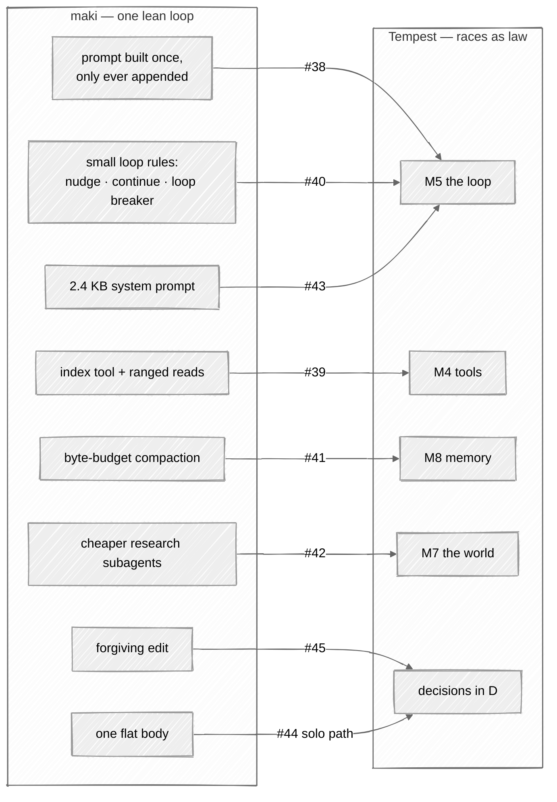

# Study: maki

[maki](https://github.com/tontinton/maki) is a terminal coding agent that ranks first among the
published harnesses on a small benchmark. This page says what it does well, where Tempest is
stronger, and which of its ideas Tempest takes. It describes maki as of v0.5.5.

## In one picture

## In plain words

maki is built around one idea: spend as few context tokens as possible. Its whole system prompt
is about 2.4 KB, it reads files through a skeleton first, and it never rebuilds the start of its
prompt, so the provider's cache serves almost all of every request. That discipline is why it
does well.

Tempest is built around a different idea: an agent's powers are law, compiled in. Who may write
code, who may reach outside, who judges a landing, how much each body may spend — these are rules
the binary enforces, not settings or habits. maki has almost none of that: no OS sandbox, a single
body that may do anything it is permitted to do, and behaviour that plugins can rewrite.

So the two are strong in different places. Tempest takes maki's token discipline where it fits —
six ideas, each now an issue on the milestone that builds it — and keeps its own law. Two ideas
touch the law itself and wait for a decision.

## Technical detail

### What maki is

- A Rust workspace (the same stack as Tempest's core), with a ratatui terminal UI, a loop on the
  smol runtime, Lua plugins in the manner of neovim (every built-in tool is a plugin), twelve-plus
  providers, MCP, skills, an ACP server and a headless JSON mode.
- **Its benchmark.** The report attached to its v0.5.5 release: FrontierHarness Eval v1.0, 30
  tasks (21 from Terminal-Bench, 9 from DeepSWE), Kimi K3 through Fireworks — 21 of 30 passed
  (70%) at $2.06 per pass, first of 13 published harnesses; on the same tasks Codex scored 19 of
  30. A mean of 36.4 turns per task; a cache hit rate of 85% (median) and 97.7% (weighted by
  tokens).
- **How to read it.** Self-run, one trial per task, its environment equivalence stated as
  unverified, and a margin of two tasks over the next harness — a direction worth following, not a
  proof.

### Where Tempest is stronger

| Concern | maki | Tempest |
|---|---|---|
| Containment | no OS sandbox: permission prompts over a parsed command, and a `--yolo` switch | landlock, seccomp and a network namespace per body, Seatbelt on macOS, an escape suite in CI ([architecture](05-architecture.md#sandbox)) |
| Who may do what | one body, configurable by plugins that can replace prompt sections and register tools and permission rules | six races and five ascended forms compiled in: shelves, soil, gates and dispatch are code ([races](02-races.md)) |
| Reaching outside | any permitted tool | only a Kijin carries `outward`; every outward act is planned, gated, journaled before and after, and never replayed |
| Judging a change | the model's own word | the end gate: right author, verify lines that stood before the turn, duties, doc truthful, tests intact, no seal ([the loop](03-loop.md#the-end-gate)) |
| Adversarial review | none | the Dark Elf: findings only with a witness, seals that freeze the witness, the attack becomes the regression test |
| Spend | per-call accounting | budgets in weighted tokens carved down the chain under race ceilings, pre-flight before every call, caps per day, month and session ([consumption](06-consumption.md)) |
| Memory of the run | a session log | an append-only journal, a usage ledger, creature docs that move with the code (Vitality) |
| Messages between bodies | not applicable — one body | a typed wire with an exact `@E`, a fixed cut order that never drops holes, the unsaid or orders ([communication](04-communication.md)) |

### Where maki is stronger

- **Tokens per turn.** A smaller prompt, skeleton-first reading, and a request prefix that never
  moves — so most of every request is a cache read.
- **Turns that do not stall.** Small coded rules keep the loop going: an empty reply is nudged, a
  reply cut at `max_tokens` is continued, an overflow compacts once, a third identical tool call
  is refused.
- **Short tasks.** One body with no hand-offs. A deep hierarchy pays a prefix at every hop and a
  verify-first turn before code; on 30 short tasks that costs.
- **Breadth.** More providers, MCP and ACP today. Tempest reaches these at M3 and M13.

### What Tempest takes

| Idea from maki | Where in maki | In Tempest | Issue |
|---|---|---|---|
| The request only ever grows: mid-session changes (date, model, directory, mode) are appended, never rebuilt into the prefix; thinking blocks are dropped once if the prefix ever moved | `maki-agent/src/agent/frame.rs`, `run.rs` (`assert_append_only`) | the cache-prefix test runs N turns with such changes (M5) | [#38](https://github.com/Kaginari/tempest/issues/38) |
| An `index` tool returning a file's skeleton with line ranges, and `read` that requires a range | `plugins/index`, `plugins/read/init.lua` | `tempest-tools` (M4), sharing the parser the shell classifier needs | [#39](https://github.com/Kaginari/tempest/issues/39) |
| Loop resilience rules: nudge, continue, one overflow compaction, an identical-call loop breaker, partial output on cancel | `run.rs`, `tool_dispatch.rs` | beside guts and the doom checkpoint (M5), with nudges capped low | [#40](https://github.com/Kaginari/tempest/issues/40) |
| Compaction by a byte budget with a fixed summary template | `compaction.rs`, `prompts/compaction_user.md` | the compaction drain (M8): discoveries become `@U` lines, files `@F` lines | [#41](https://github.com/Kaginari/tempest/issues/41) |
| Research subagents on a cheaper model, never a stronger one than their parent | `plugins/task/init.lua` | a findings commission may ride a lower tier (M7) | [#42](https://github.com/Kaginari/tempest/issues/42) |
| A small, measured prompt | `maki-agent/src/prompts/` | a CI ceiling on each race's prefix tokens (M5), beside the prefix-share meter | [#43](https://github.com/Kaginari/tempest/issues/43) |

### Waiting for a decision

- **A permanent solo path** ([#44](https://github.com/Kaginari/tempest/issues/44)). Keep the
  lone-body mode instead of removing it at M7: one body with Rimuru's voice and a Slime's hands,
  still under shelves, soil, the sandbox and the end gate, escalating into the hierarchy only on
  context stress, a territory boundary, or an outward or adversarial act. The races stay as law;
  the hierarchy becomes something a run pays for only when the task needs it. Measured on the same
  30 tasks before M7.
- **A forgiving edit** ([#45](https://github.com/Kaginari/tempest/issues/45)). maki's edit tries
  exact, trimmed, anchored, whitespace-normalised and indentation-flexible matches and re-indents
  the replacement. Tempest's lesson is a strict edit that names the closest line. The middle
  ground: accept a forgiving match only when exactly one candidate exists, and say in the result
  what was forgiven.

### What Tempest does not take

- **Permission prompts as the only containment.** The sandbox is not optional.
- **Plugins that rewrite prompts, tools and permissions.** Races are code, not configuration.
- **A `batch` meta-tool.** Native parallel tool calls already do it.
- **Hooks that keep a run going** (`agent.stop` continue, twenty nudges). Envelopes are the limit.
- **The headline score as proof.** It is a direction; Tempest measures its own runs.
